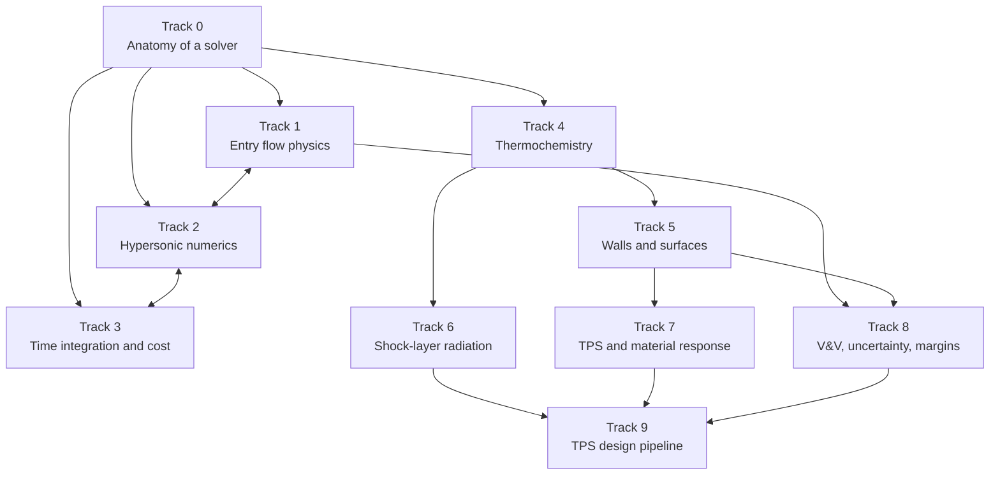

# The course

Ten tracks, taught in order, building a working understanding of everything behind atmospheric entry and TPS analysis: the flow physics, the numerical methods, the thermochemistry, the wall and material physics, and the codes and design pipeline that tie them together.

## How lessons work

Every concept is first anchored to a **solver slot** ([Track 0](track-0/index.md)) or a **pipeline stage** ([Track 9](track-9.md)), then explained. [deep] topics go: what it is → the problem it solves → cost → failure modes → the [implications lens](../how-to-use.md#the-implications-lens) → how it shows up in a run. [feel] topics get a short, accurate picture and a pointer to where it connects. MFC appears as the familiar contrast, because it makes nearly the opposite choice from production reentry codes in almost every slot.

Lessons end in **checkpoint questions**. Model answers are collapsed under each question; try first, then expand. The [session log](session-log.md) records how each checkpoint went and what is still shaky.

Lessons summarize and link; the full, durable explanation of each method lives in the [reference](../reference/index.md).

## The tracks

| Track | Topic | Depth | Status |
|---|---|---|---|
| [0](track-0/index.md) | Anatomy of a solver | [deep] | In progress: 0.1 taught |
| [1](track-1.md) | Hypersonic and entry flow physics | mostly [deep] | Outline |
| [2](track-2.md) | Numerics for hypersonic flows | [deep] | Outline |
| [3](track-3.md) | Time integration, convergence and cost | [deep] | Outline |
| [4](track-4.md) | Thermochemistry and nonequilibrium | mostly [deep] | Outline |
| [5](track-5.md) | Walls and gas–surface interaction | mostly [deep] | Outline |
| [6](track-6.md) | Shock-layer radiation | mostly [feel] | Outline |
| [7](track-7.md) | TPS materials, ablation and material response | mixed | Outline |
| [8](track-8.md) | Accuracy, V&V, uncertainty and margins | mixed | Outline |
| [9](track-9.md) | The TPS design pipeline end to end | [feel] | Outline |

## Suggested order and time budget

At roughly 10–15 hours a week: Track 0 first (2–3 weeks); then the [deep] items of Tracks 1–3, interleaving physics with the numerics that capture it (4–6 weeks; for example SWBLI alongside low-dissipation fluxes and unsteady time integration); then Tracks 4–5 (2–3 weeks); then Tracks 6–9 and the [code case studies](../codes/index.md) as shorter sessions, with Track 9 as the capstone. Expect the timeline to stretch: checkpoints don't move on until the reasoning is solid.

## Core references

See the [bibliography](../references.md). Textbooks are reference: pull the relevant chapter rather than reading cover to cover.
