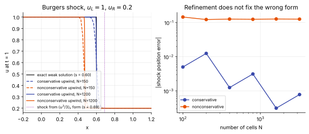

# Lesson 0.1: Governing equations

**Slot:** governing equations, the slot every other slot serves · **Depth:** [deep] · **Reference pages:** [governing equations](../../reference/foundations/governing-equations.md), [conservation form and weak solutions](../../reference/foundations/conservation-and-weak-solutions.md), [mathematical character](../../reference/foundations/mathematical-character.md), [closing the system](../../reference/foundations/closing-the-system.md)

Reconstruction, fluxes, time integration and boundary conditions all exist to solve one PDE system, and most of their properties follow from its structure. This lesson is about that structure.

## 1. The system a reentry code solves

Every code in this manual solves a balance law

$$
\frac{\partial \mathbf{U}}{\partial t} + \nabla\cdot\big(\mathbf{F}_{\text{inv}}(\mathbf{U}) - \mathbf{F}_{\text{visc}}(\mathbf{U},\nabla\mathbf{U})\big) = \mathbf{S}(\mathbf{U}).
$$

For a perfect gas $\mathbf U = [\rho, \rho\mathbf u, \rho E]^T$: five unknowns in 3D. A two-temperature reacting code like DPLR or LAURA swaps global continuity for one continuity equation per species and adds a vibrational–electronic energy equation, so 11-species air carries **16 unknowns per cell instead of 5**. The source vector, zero for a perfect gas, now holds the chemistry $\dot\omega_s$ and the translational–vibrational exchange $Q_{T\text{-}v}$: the two biggest sources of stiffness (Lesson 0.6), living on the right-hand side, not in the fluxes.

The full equations, written out term by term, are on the [governing equations](../../reference/foundations/governing-equations.md) page. One detail worth holding on to: total energy includes the formation enthalpies, so **the total-energy equation has no chemistry source**; dissociation just converts thermal energy into chemical energy inside the same conserved $E$.

## 2. Conservative vs primitive, and what "weak" means

Primitive variables $(\rho_s, \mathbf u, p, T, T_v)$ are what you think in and what boundary conditions are written in, and for smooth flow the primitive-variable PDE is perfectly valid. But a shock is a discontinuity, where derivatives don't exist. There the equations hold only in **integral** (weak) form, and the jump across the shock is fixed by the **Rankine–Hugoniot** conditions, which come from the conserved quantities.

The cleanest illustration is Burgers' equation. Its conservative form and a form multiplied through by $u$ have identical smooth solutions, but give different shock speeds, because the chain rule fails at a discontinuity. Nature picks the form whose $\mathbf U$ is actually conserved across the shock: for a gas, mass, momentum and total energy.

<figure markdown>

<figcaption>A nonconservative scheme for Burgers' equation converges to the wrong shock, and refinement doesn't fix it.</figcaption>
</figure>

The **Lax–Wendroff theorem** says a scheme in conservation form, if it converges, converges to a weak solution, so its shocks have the right speed and jump. A nonconservative scheme can converge to a shock in the wrong place, and the error doesn't shrink with refinement. For a capsule: wrong standoff and post-shock temperature, then wrong chemistry and stagnation heating. A separate **entropy condition** picks the physical weak solution among those the correct form admits (it rules out expansion shocks); it doesn't decide which form is correct.

The distinction to keep: the **equations solved and the update** are conservative; the **variables reconstructed** can be anything. MFC reconstructs primitive variables with WENO and builds conservative fluxes; DPLR-style codes do the same with MUSCL. Full treatment: [conservation form and weak solutions](../../reference/foundations/conservation-and-weak-solutions.md).

## 3. Mathematical character, and why it rules the time step

The inviscid part is **hyperbolic**: real wave speeds $u_n - a$, $u_n$, $u_n + a$, with species and $e_v$ adding more copies of $u_n$ (they're passively convected, so the wave structure doesn't change). The $a$ is the **frozen** sound speed. This is why [flux functions](../../reference/spatial/riemann-solvers.md) are built entirely around the inviscid part, while [viscous fluxes](../../reference/spatial/viscous-fluxes.md) are central-differenced.

The viscous part is **parabolic** in time (diffusion; elliptic in steady state), and the two characters give two explicit time-step limits:

$$
\Delta t_{\text{conv}} \lesssim \frac{\Delta x}{|u| + a},\qquad \Delta t_{\text{visc}} \lesssim \frac{\Delta x^2}{2\nu}.
$$

Their ratio is set by the **cell Reynolds number** $Re_\Delta = (|u|+a)\Delta x/\nu$: the viscous limit binds when $Re_\Delta \lesssim 2$. Wall-resolved heating grids are built to have $Re_\Delta \lesssim 1$ at the wall for heat-flux accuracy, so for an explicit scheme the viscous limit, scaling as $\Delta x^2$, governs there. Derivation and a figure: [time-step limits](../../reference/time/time-step-limits.md).

The steady problem around a blunt body has **mixed character**: a subsonic, elliptic pocket behind the bow shock and a supersonic, hyperbolic shock layer beyond the sonic line. That's why you can [space-march](../../reference/special/space-marching.md) down a slender afterbody but not through a capsule nose, and why every code marches the unsteady equations (hyperbolic in time everywhere) to steady state. See [mathematical character](../../reference/foundations/mathematical-character.md).

## 4. Closing the system

The PDEs give one equation per conserved variable, but the fluxes and sources need $p$, $T$, $T_v$, transport coefficients and rates. **Closing the system** supplies them: the thermal equation of state, caloric relations (inverted for temperatures every evaluation), transport properties and kinetics. The PDEs are just conservation; almost all the physical uncertainty of an aeroheating prediction lives in the closures. Details and per-cell costs: [closing the system](../../reference/foundations/closing-the-system.md).

## 5. Through the implications lens

Going from 5 to 16 equations costs an explicit code roughly linearly. An implicit code carries $n\times n$ block Jacobians: memory goes as $n^2$ and block factorizations as $n^3$, so $(16/5)^3 \approx 33\times$ per block operation, before the source Jacobians. This is one reason GPU porting of reentry codes is hard and why codes offer perfect-gas and equilibrium modes for quick runs. Steady vs unsteady capability isn't set by the equations, but the viscous stiffness makes time-accurate explicit runs on wall-resolved grids very expensive. Robustness: the extra variables bring new failure modes (negative species densities, temperature-inversion failures, $T_v$ overshoot).

In a run, the knobs here are the gas model, the species set and the number of temperatures; the symptoms are cost jumping when chemistry switches on, temperature-inversion aborts early in a run, and heat flux that keeps changing with wall spacing because $Re_\Delta$ is still too large.

## 6. Follow-up questions from this session

These came up while working through the lesson. Each has a full answer on its reference page.

**What exactly happens in one residual evaluation?** Decode conserved to primitive (closures applied), reconstruct face states with limited slopes, evaluate the inviscid numerical flux, compute viscous fluxes from face gradients, evaluate sources, and update. Worked minmod numbers included: [the finite-volume pipeline](../../reference/spatial/finite-volume-pipeline.md).

**Why reconstruct primitives instead of conservatives, and when are characteristic variables better?** Positivity at high Mach (pressure is a small difference of two large energies) and clean contacts favour primitives; characteristic variables pay off where waves overlap, mainly at shocks. At an isolated contact, primitives are already good. See [which variables to reconstruct](../../reference/spatial/reconstruction.md#which-variables-to-reconstruct).

**Is the Riemann solver always used?** There is always a numerical flux function; Riemann solvers are one family. See [Riemann solvers](../../reference/spatial/riemann-solvers.md), [flux-vector splitting](../../reference/spatial/flux-vector-splitting.md), [central schemes](../../reference/spatial/central-schemes.md).

**Two Jacobians?** The flux Jacobian is for analysis (wave speeds); the residual Jacobian is for implicit updates (Newton as $\Delta t\to\infty$). See [implicit methods](../../reference/time/implicit-methods.md#two-different-jacobians).

**Why is the dissociating shock layer denser, and why is standoff smaller?** Pressure and enthalpy behind the shock are fixed by the freestream; dissociation lowers the temperature at that pressure, so density rises; denser gas carries the same mass flux out through a thinner layer. See [post-shock density and standoff](../../reference/physics/entry-flow-anatomy.md#post-shock-density-and-standoff).

**What are tabulated electronic levels, and what is the potential well?** See [energy modes](../../reference/thermo/energy-modes.md).

**Why do the gas-model bullets and table disagree?** Because there are two independent axes (thermal state, chemical state). See [gas models](../../reference/thermo/gas-models.md#two-independent-axes). Dense gases are there too.

**1T, 2T, 3T, multi-vibrational, rotational, state-to-state?** Upgraded to a [deep] section of Track 4. Preview: [thermal nonequilibrium models](../../reference/thermo/thermal-nonequilibrium.md).

**How does chemistry "know" when to react?** It doesn't decide; the Arrhenius exponential switches rates on by over 100 orders of magnitude behind the shock. See [finite-rate chemistry](../../reference/thermo/finite-rate-chemistry.md#how-it-knows-when-to-react).

**What does Stefan–Maxwell diffusion give that simpler models don't?** Cross-diffusion; it matters for very different molecular masses. See [transport and diffusion](../../reference/thermo/transport-and-diffusion.md).

**Can stiff chemistry be stepped locally?** Cell by cell, yes: point-implicit sources, or operator splitting with stiff sub-stepped integrators. Not reaction by reaction. See [stiff source terms](../../reference/sources/stiff-sources.md).

**Local time stepping: steady, unsteady, and the multiphase case?** Steady LTS is standard but doesn't cure aspect-ratio stiffness; time-accurate LTS and subcycling exist (AMR, multirate, sub-stepped local ODEs). See [local time stepping](../../reference/time/local-time-stepping.md). Two corrections were made during the session: a handful of thin cells set the *global* step only in time-accurate runs, and naive LTS (not all LTS) is what breaks time accuracy.

**Which wins, explicit or implicit, and is IGR a loophole?** A cost model makes it intuitive: implicit wins when the wanted step exceeds the allowed step by more than the implicit overhead. IGR changes the flux slot, not the time-step constraint. See [explicit vs implicit](../../reference/time/explicit-vs-implicit.md).

**Line and point relaxation?** Preview: [relaxation methods](../../reference/time/relaxation-methods.md); full treatment in Track 3.3–3.4.

**PNS, mathematically?** See [space marching](../../reference/special/space-marching.md).

## Checkpoint

Answer in your own words first, then expand the model answer.

**1.** A code reconstructs primitive variables at cell faces but updates conserved variables with flux differences. Is it conservative? And what specifically goes wrong for a capsule if you instead discretize the primitive-variable PDE directly?

??? success "Model answer"
    Yes: conservation is a property of the update, which is a conservative flux difference. Reconstruction only builds face states for the flux evaluation (the closures are applied in the decode step, a different job). Discretizing the primitive-variable PDE gives wrong **jump conditions**: the shock converges to the wrong speed and position with the wrong post-shock state, so standoff, post-shock temperature, chemistry and stagnation heating are wrong, and the error does not vanish under refinement.

**2.** At a wall-resolved aeroheating grid, which explicit time-step limit binds, convective or viscous? What single parameter tells you, and what does that imply for explicit vs implicit in a steady heating calculation?

??? success "Model answer"
    The viscous limit, because the parameter that decides is the **cell Reynolds number** $Re_\Delta = (|u|+a)\Delta x/\nu$, and the viscous limit binds when $Re_\Delta \lesssim 2$. Heating grids are built with $Re_\Delta \lesssim 1$ at the wall. (The Damköhler number is the chemistry analog, flow time over chemical time, not this.) For a steady calculation the wanted time step is unbounded, so implicit methods win by large factors even though each implicit step costs many explicit ones.

**3.** Why does going from 5 to 16 equations hurt an implicit block-line solver much more than an explicit WENO code like MFC?

??? success "Model answer"
    Explicit cost per step grows roughly linearly with the number of equations (more flux components and source evaluations). Implicit methods carry $n\times n$ Jacobian blocks: memory scales as $n^2$ and factorization or inversion as $n^3$, about $33\times$ per block from 5 to 16. Stiff chemistry also adds source Jacobians and usually more iterations.

**4.** Why can you space-march down a slender cone's afterbody but not through a capsule's stagnation region? Which property of the equations is involved?

??? success "Model answer"
    Where the flow is supersonic, the steady equations are hyperbolic in the flow direction, so information only travels downstream and you can march plane by plane. The capsule's stagnation region is subsonic, so the steady equations there are **elliptic**: disturbances travel upstream and the solution at a point depends on what is downstream of it, so it can't be marched. (The thin boundary layer is what justifies dropping streamwise viscous terms; it is not what makes marching allowed.)

**5.** In the Burgers example, both forms are exact for smooth solutions but give different shock speeds. In your own words, why does that happen, and how do you decide which form is "right" for a gas?

??? success "Model answer"
    At a discontinuity the chain rule fails, so forms that are equivalent for smooth flow encode different jump conditions. The right form is the integral balance of the quantities that are actually conserved across a shock: for a gas, mass, momentum and total energy. The entropy condition is a separate step: it picks the physical weak solution among those the correct form admits.

**Status:** Questions 1 and 3 answered solidly; 2, 4 and 5 half right, rework pending. See the [session log](../session-log.md).
