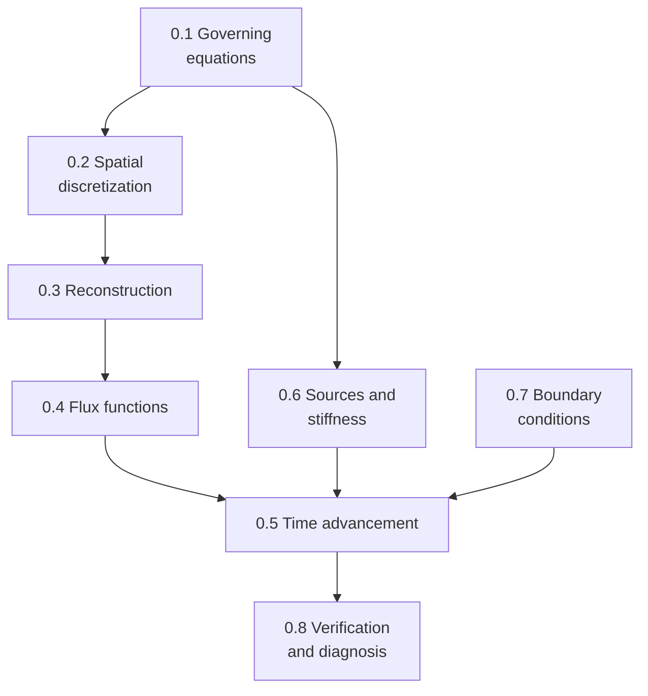

# Track 0: Anatomy of a solver

**Depth:** [deep] throughout · **Budget:** 2–3 weeks

The shared skeleton of every CFD code, explained with reentry codes in mind. Every later topic, and every term you'll meet in a code's documentation, lives in one of these slots.

| Lesson | Topic | Status |
|---|---|---|
| [0.1](0-1-governing-equations.md) | Governing equations: conservation form, weak solutions, mathematical character, closures | Taught; checkpoint partly open |
| [0.2](0-2-spatial-discretization.md) | Spatial discretization: FD, FV, FE/DG, DSMC; structured vs unstructured | Outline |
| [0.3](0-3-reconstruction.md) | Reconstruction: first order, MUSCL and limiters, WENO, Godunov's theorem | Outline (basics previewed in 0.1) |
| [0.4](0-4-flux-functions.md) | Flux functions: Riemann solvers, flux-vector splitting, central schemes | Outline |
| [0.5](0-5-time-advancement.md) | Time advancement: explicit vs implicit, Jacobians, relaxation, dual time | Outline (much previewed in 0.1) |
| [0.6](0-6-sources-and-stiffness.md) | Source terms and stiffness | Outline (previewed in 0.1) |
| [0.7](0-7-boundary-conditions.md) | Boundary conditions | Outline |
| [0.8](0-8-verification.md) | Verification and diagnosis | Outline |

## Exit test

Given a DPLR or US3D methods paragraph and an MFC input file, place every choice in its slot and explain, through the implications lens, why each code chose differently.
