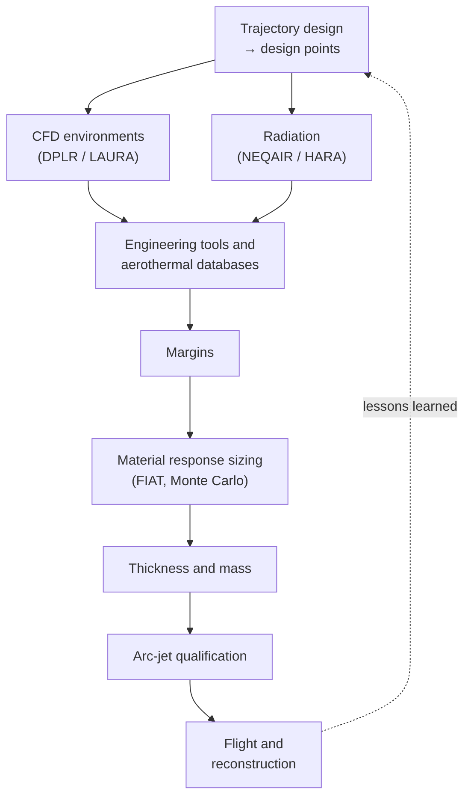

# Track 9: The TPS design pipeline end to end

**Depth:** [feel]. The capstone that ties every other track together.

| # | Topic |
|---|---|
| 9.1 | Trajectory design to design trajectories and body points. |
| 9.2 | CFD environments (DPLR, LAURA) plus radiation (NEQAIR, HARA) at selected trajectory points. |
| 9.3 | Engineering tools and databases anchored to CFD (CBAERO, aerothermal databases, response surfaces). |
| 9.4 | Margins, then material response sizing (FIAT/TPSSizer, Monte Carlo), then thickness and mass. |
| 9.5 | Arc-jet qualification and test-condition selection. |
| 9.6 | Flight reconstruction: comparing as-flown environments with design (InSight, MSL, Mars 2020). |
| 9.7 | Coupling levels: uncoupled design practice, loose blowing-BC iteration (DPLR–PATO), tightly coupled in-code (LAURA/HARA ablating walls), configurable frameworks (Ares: US3D + Icarus + NERO). |
