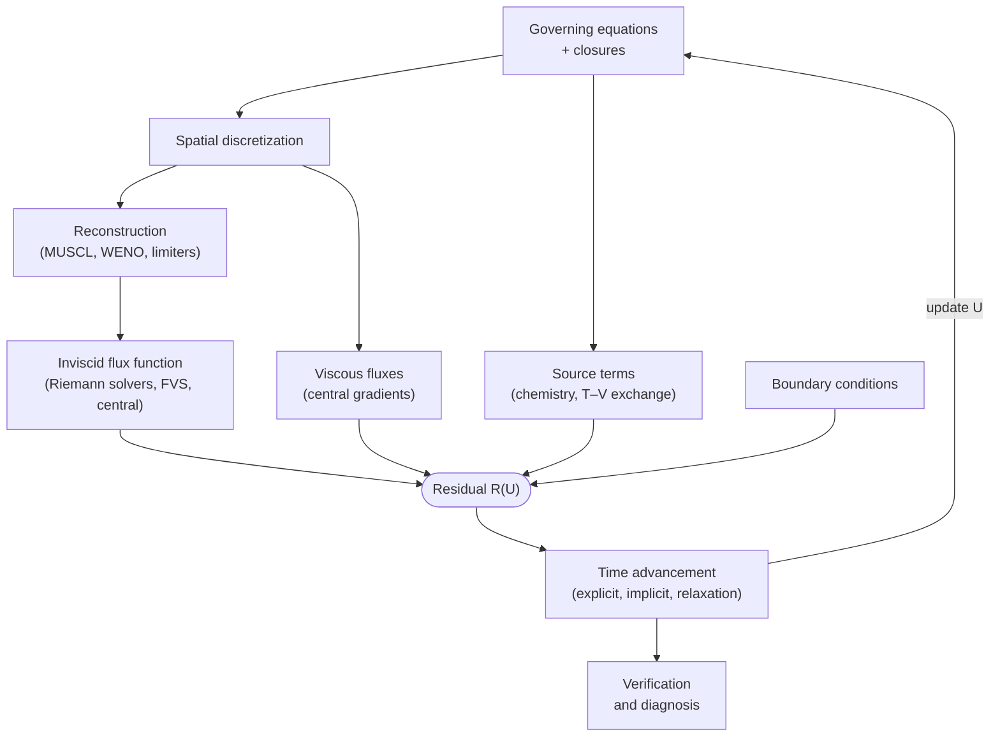

# Hypersonic CFD Manual

This is a theory manual for atmospheric entry: the flow physics around capsules and probes, the numerical methods inside production aeroheating codes, high-temperature thermochemistry, gas–surface interaction, shock-layer radiation and the analysis of thermal protection systems.

The goal isn't to know what a method is called. It's to know **what it implies for a run**: its time step and cost, whether it can do steady or unsteady problems, how accurate it is (above all for wall heat flux), how robust it is, which physics it captures or silently smears, and how it maps to hardware. Every page is written through that lens.

## Where to start

-   :material-book-open-variant: **[Theory manual](reference/index.md)**

    ---

    Thirteen numbered chapters in the order a solver is built: equations, entry-flow physics, physical models, boundary conditions, spatial discretization, flux functions, sources, time integration, reduced and rarefied methods, verification, radiation. One page per method family, each with the same structure, so any choice a code makes can be looked up and its effect on a run understood.

-   :material-alphabetical: **[Glossary](glossary.md)**

    ---

    Key terms in a fixed format: what it is, the problem it solves, its implications, how it shows up in a run.

-   :material-table: **[Codes at a glance](codes/index.md)**

    ---

    Which choice DPLR, LAURA, US3D and the other production codes make in each slot, with their primary sources.

## The map

Every method in this manual lives in a **slot** of the solver, and every slot serves the same governing equations. When a new term comes up, the first question is always which slot it belongs to.

The [theory manual](reference/index.md) is organized around these slots: the equations and the physical models that close them first, then discretization, fluxes, sources and time integration.

## Status of the manual

The manual is growing. In the sidebar, a hollow circle marks an **outline** page (planned headings and pointers only) and a half-filled circle marks a **draft** (key formulas and facts in place, some sections still to be written). Pages without an icon are written. See [how to use this manual](how-to-use.md) for the conventions.
