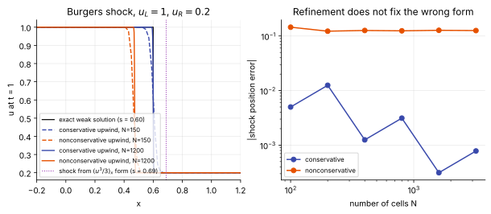

# Conservation form and weak solutions

**Slot:** Track 0.1 governing equations · **Depth:** [deep]

## What it is

A shock is a discontinuity, so the differential form of the equations, which assumes derivatives exist, is meaningless at it. The equations still hold in **integral** (or, equivalently, **weak**) form, and that form fixes the jump across the shock. A numerical scheme written in **conservation form** inherits this, so its shocks have the right speed and the right jump. A scheme built on a nonconservative rewrite of the same equations doesn't, and the error doesn't vanish under grid refinement.

## The problem it solves

Without it, a shock-capturing code can converge to a solution with the shock in the wrong place and the wrong post-shock state. For a capsule that means the wrong standoff distance and the wrong post-shock temperature, which then feed wrong chemistry and wrong stagnation heating, all while the solution looks smooth and converged.

## How it works

### The integral form

For any fixed interval $[a,b]$, conservation says

$$
\frac{d}{dt}\int_a^b U\,dx = F\big(U(a,t)\big) - F\big(U(b,t)\big).
$$

The amount in the box changes only by what crosses its faces. No derivative of $U$ appears, so this holds whether $U$ is smooth or not. It is the actual physical statement; the differential form $\partial_t U + \partial_x F(U) = 0$ is a consequence of it when $U$ is smooth.

### The weak form

Multiply the differential form by any smooth test function $\phi(x,t)$ that vanishes outside a bounded region, integrate over space and time, and integrate by parts so all derivatives land on $\phi$:

$$
\int_0^\infty\!\!\int_{-\infty}^{\infty}\big(U\,\phi_t + F(U)\,\phi_x\big)\,dx\,dt + \int_{-\infty}^{\infty} U(x,0)\,\phi(x,0)\,dx = 0.
$$

A **weak solution** is any $U$ that satisfies this for every admissible $\phi$. $U$ is never differentiated, so it may jump. Every smooth (classical) solution is a weak solution; the converse is false, and that is the point.

### Rankine–Hugoniot conditions {#rankine-hugoniot-conditions}

Apply the integral form to a thin box straddling a discontinuity moving at speed $s$ and shrink the box. The result is the **Rankine–Hugoniot condition**

$$
s\,[U] = [F(U)], \qquad [\,\cdot\,] = (\cdot)_R - (\cdot)_L .
$$

The shock speed and the state behind it are fixed entirely by *which* quantities appear in $U$ and $F$. For a gas, $U$ holds mass, momentum and total energy, the quantities actually conserved across a shock, and these jump conditions are the familiar normal-shock relations.

### Why the conserved variables are a physics choice: Burgers' equation

For smooth flow you can rewrite a conservation law in many equivalent ways using the chain rule. At a discontinuity the chain rule fails (a product like $u\,\partial_x u$ with discontinuous $u$ is a step function times a delta function, which has no unique meaning), and the rewrites disagree.

Burgers' equation $u_t + (u^2/2)_x = 0$ gives a shock speed $s = (u_L + u_R)/2$. Multiply the smooth equation by $u$ and you get $(u^2/2)_t + (u^3/3)_x = 0$: identical smooth solutions, but Rankine–Hugoniot now gives $s = \tfrac23(u_L^2 + u_Lu_R + u_R^2)/(u_L + u_R)$. Both forms are "exact" for smooth flow; they disagree at the shock. Nature picks the form whose $U$ is actually conserved across the discontinuity.

<figure markdown>

<figcaption>Left: a conservative upwind scheme converges to the correct shock (s = 0.60); a nonconservative upwind scheme for the same equation puts the shock in the wrong place, and the $(u^3/3)_x$ form would put it somewhere else again (s ≈ 0.69). Right: refining the grid shrinks the conservative scheme's shock-position error but leaves the nonconservative error at about 0.12 at every resolution.</figcaption>
</figure>

### Nonuniqueness and the entropy condition

The weak form admits too many solutions. For example, it allows an expansion shock in which the gas compresses on the way out, violating the second law. An extra **entropy condition** picks the physical weak solution (for gas dynamics: entropy must not decrease across a shock; equivalently, characteristics must run *into* the shock). This is a separate job from choosing the conservation form: the conservation form fixes which jump conditions apply, and the entropy condition picks the physical solution among those the correct form admits. Numerically, it is why [Roe's solver](../spatial/riemann-solvers.md#roe) needs an entropy fix.

### The Lax–Wendroff theorem {#the-lax-wendroff-theorem}

A numerical scheme is in **conservation form** if its update is a flux difference,

$$
U_i^{n+1} = U_i^n - \frac{\Delta t}{\Delta x}\big(\hat F_{i+1/2} - \hat F_{i-1/2}\big),
$$

with a numerical flux $\hat F$ consistent with the physical one ($\hat F(U,U) = F(U)$). The **Lax–Wendroff theorem** (1960) states: if such a scheme converges (boundedly, almost everywhere) as $\Delta x,\Delta t\to 0$, the limit is a weak solution. It does *not* guarantee convergence, and it does *not* guarantee the entropy-satisfying solution. It guarantees correct jump conditions if you converge at all.

Nonconservative schemes carry no such guarantee. Hou and LeFloch (1994) showed that they generally converge to solutions with wrong shocks, with an error controlled by the scheme's numerical viscosity; it does not vanish with refinement, exactly as in the figure above.

### Store and update conservative, compute with primitives

Conservation form constrains the **update**, not every intermediate quantity. A finite-volume code stores cell averages of $U$ and updates them with flux differences, but in between it routinely converts to primitive variables $(\rho_s, \mathbf u, p, T, T_v)$, because the flux functions, viscous terms and sources are all written in them. Reconstructing primitive (or characteristic) variables at faces is legitimate and often better behaved; see [reconstruction: which variables](../spatial/reconstruction.md#which-variables-to-reconstruct). What is *not* legitimate is updating with a discretization of the primitive-variable PDE.

## Variants

### Nonconservative systems

Some physically important systems have no conservation form at all. The multiphase five-equation model used in MFC, for example, advects volume fractions with $\partial_t\alpha + \mathbf u\cdot\nabla\alpha = K\nabla\cdot\mathbf u$, a nonconservative product. Jump conditions are then not uniquely defined by the PDE, and path-conservative theory (Dal Maso–LeFloch–Murat) is needed; the shock jumps become partly a modeling choice. Single-phase gas dynamics, including reacting multi-temperature air, does not have this problem: it can and must be solved in conservation form.

## Implications

| Lens | Effect |
|---|---|
| Time step and cost | None directly; conservation form costs nothing extra. |
| Steady vs unsteady | Applies to both; steady shocks also need correct jump conditions. |
| Accuracy | Decisive for shock position, standoff and post-shock state; errors from a nonconservative update don't converge away. |
| Robustness | Conservation form alone doesn't guarantee positivity or entropy satisfaction; those need [limiters](../spatial/reconstruction.md), positivity-preserving fluxes and entropy fixes. |
| Physics captured or lost | Wrong jumps propagate into wrong temperature, chemistry, radiation and heating behind the shock. |
| Hardware / parallel fit | Neutral. Flux-difference updates are also what make finite-volume codes conserve exactly in parallel, since each face flux is computed once and shared. |

## In a run

You rarely choose this explicitly; production codes are conservative by construction. It shows up when you write or modify a code (adding an equation in nonconservative form "because it's easier"), when using a primitive-variable formulation for convenience, and as a diagnostic: global conservation checks (mass in minus mass out) catch nonconservative bugs.

## Which codes

All finite-volume reentry codes (DPLR, LAURA, US3D, FUN3D, SU2-NEMO, Eilmer) update conserved variables with flux differences. Multiphase codes such as MFC carry conservative equations for mass, momentum and energy alongside a nonconservative volume-fraction equation.

## See also

[Governing equations](governing-equations.md) · [Mathematical character](mathematical-character.md) · [Riemann solvers](../spatial/riemann-solvers.md) · [The finite-volume pipeline](../spatial/finite-volume-pipeline.md)

## References

LeVeque, *Finite Volume Methods for Hyperbolic Problems* (chapters on weak solutions and the Lax–Wendroff theorem); Toro, *Riemann Solvers and Numerical Methods for Fluid Dynamics*; Lax & Wendroff (1960); Hou & LeFloch (1994). See the [bibliography](../../references.md).
