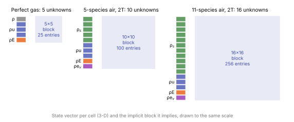

# Governing equations

**Chapter:** 1 Fundamental equations · **Depth:** [deep]

## What it is

Every continuum code in this manual solves a system of balance laws: mass, momentum and energy (plus, for reacting gases, one mass balance per species and extra energy equations for internal modes). Written in conservation form,

$$
\frac{\partial \mathbf{U}}{\partial t} + \nabla\cdot\big(\mathbf{F}_{\text{inv}}(\mathbf{U}) - \mathbf{F}_{\text{visc}}(\mathbf{U},\nabla\mathbf{U})\big) = \mathbf{S}(\mathbf{U}).
$$

$\mathbf U$ is the vector of conserved variables, $\mathbf F_{\text{inv}}$ the inviscid (convective plus pressure) flux, $\mathbf F_{\text{visc}}$ the viscous flux (momentum, heat and mass diffusion), and $\mathbf S$ the sources (chemistry and energy exchange between internal modes).

Every other slot of a solver exists to discretize and drive this one system: [reconstruction](../spatial/reconstruction.md) and [flux functions](../spatial/riemann-solvers.md) handle $\mathbf F_{\text{inv}}$, [viscous discretization](../spatial/viscous-fluxes.md) handles $\mathbf F_{\text{visc}}$, [source treatment](../sources/stiff-sources.md) handles $\mathbf S$, and [time integration](../time/implicit-methods.md) advances $\mathbf U$.

## The problem it solves

The equations are just conservation. On their own they aren't closed: the fluxes need pressure, temperature, transport coefficients and reaction rates that aren't in $\mathbf U$. Supplying those is [closing the system](closing-the-system.md), and that is where almost all of the physical modeling (and uncertainty) of an aeroheating prediction lives.

The choice of which quantities go in $\mathbf U$ is itself physics. Quantities assumed to be in equilibrium leave the PDE system and move into the closure; quantities allowed to lag get their own transport equation. See [gas models](../thermo/gas-models.md).

## How it works

### Perfect gas

For a calorically perfect gas in 3D, $\mathbf U = [\rho,\ \rho\mathbf u,\ \rho E]^T$: five unknowns, with $E = e + \tfrac12|\mathbf u|^2$ and $e = c_v T$.

Written out in 1D with every diffusion term visible, the Navier–Stokes equations are

$$
\begin{aligned}
&\partial_t \rho + \partial_x(\rho u) = 0,\\
&\partial_t(\rho u) + \partial_x(\rho u^2 + p - \tau) = 0, &&\tau = \tfrac43 \mu\,\partial_x u,\\
&\partial_t(\rho E) + \partial_x\big((\rho E + p)u - u\tau + q\big) = 0, &&q = -\kappa\,\partial_x T.
\end{aligned}
$$

The inviscid flux is everything without $\mu$ or $\kappa$: $\mathbf F_{\text{inv}} = [\rho u,\ \rho u^2 + p,\ (\rho E + p)u]^T$. The viscous flux collects the stress $\tau$ (momentum diffusion) and the heat flux $q$ (heat conduction). Dropping $\mathbf F_{\text{visc}}$ gives the **Euler equations**.

### Reacting, two-temperature mixture

A code like DPLR, LAURA or US3D in its standard reentry configuration replaces global continuity with one continuity equation per species and adds a vibrational–electronic energy equation:

$$
\begin{aligned}
&\partial_t \rho_s + \nabla\cdot(\rho_s\mathbf u + \mathbf J_s) = \dot\omega_s, \qquad s = 1,\dots,n_s,\\
&\partial_t(\rho\mathbf u) + \nabla\cdot(\rho\mathbf u\mathbf u + p\mathbf I - \boldsymbol\tau) = 0,\\
&\partial_t(\rho E) + \nabla\cdot\big((\rho E + p)\mathbf u - \boldsymbol\tau\cdot\mathbf u + \mathbf q + \mathbf q_v + \textstyle\sum_s h_s \mathbf J_s\big) = 0,\\
&\partial_t(\rho e_v) + \nabla\cdot\big(\rho e_v\mathbf u + \mathbf q_v + \textstyle\sum_s e_{v,s}\mathbf J_s\big) = Q_{T\text{-}v} + \textstyle\sum_s \dot\omega_s e_{v,s}.
\end{aligned}
$$

Here $\rho = \sum_s\rho_s$, $\mathbf J_s$ is the diffusive mass flux of species $s$ (with $\sum_s \mathbf J_s = 0$), $\mathbf q = -\kappa\nabla T$ and $\mathbf q_v = -\kappa_v\nabla T_v$ are the heat fluxes of the two temperatures, $\dot\omega_s$ is the chemical production rate ([finite-rate chemistry](../thermo/finite-rate-chemistry.md)) and $Q_{T\text{-}v}$ the translational–vibrational energy exchange ([thermal nonequilibrium](../thermo/thermal-nonequilibrium.md)).

Total energy includes the formation enthalpies:

$$
\rho E = \sum_s \rho_s e_s(T, T_v) + \sum_s \rho_s h_s^0 + \tfrac12\rho|\mathbf u|^2.
$$

Two consequences are worth holding on to. First, **the total-energy equation has no chemistry source**: dissociation simply converts thermal energy into chemical energy inside the same conserved $E$. Second, codes carry total energy plus vibrational energy (rather than separate translational and vibrational energies) because total energy is the quantity that is exactly conserved, and the conservation form needs it (see [conservation form](conservation-and-weak-solutions.md)).

### Counting unknowns

| Configuration (3D) | Unknowns per cell |
|---|---|
| Perfect gas | 5 |
| 5-species air, 2T | 5 + 3 + 1 + 1 = 10 |
| 11-species air, 2T | 11 + 3 + 1 + 1 = 16 |

<figure markdown>

<figcaption markdown="span">What each cell stores for three gas models, and the dense block an implicit solver builds for every cell and every cell–neighbour pair. Going from a perfect gas to 11-species two-temperature air triples the state vector and multiplies the block's entries by ten.</figcaption>
</figure>

The jump from 5 to 16 costs an [explicit](../time/explicit-methods.md) code roughly linearly, but an [implicit](../time/implicit-methods.md) code pays $n^2$ in memory and $n^3$ in block factorizations. See [explicit vs implicit](../time/explicit-vs-implicit.md).

## Variants

### Euler

Inviscid: $\mathbf F_{\text{visc}} = 0$. Purely [hyperbolic](mathematical-character.md#hyperbolic). Good for shock shapes, standoff and pressure; useless for heat flux, which is a viscous quantity.

### Navier–Stokes {#navier-stokes}

Full viscous fluxes. Required for wall heat flux, skin friction, separation and anything involving boundary layers. Technically *incompletely parabolic*, since continuity has no diffusion term.

### Thin-layer and parabolized Navier–Stokes {#thin-layer-and-parabolized-navier-stokes}

Drop the viscous derivatives along the wall (thin-layer) and, additionally, the time derivative with marching in the flow direction (PNS). See [space marching](../special/space-marching.md).

### Reacting variants

Equilibrium (5 equations, chemistry hidden in the closure), finite-rate one-temperature, two-temperature and multi-temperature. See the [gas-model ladder](../thermo/gas-models.md).

## Typical values

- Unknowns per cell in 3-D: 5 (perfect gas), 10 (5-species 2T air), 16 (11-species 2T air); one more for each extra temperature, two or more for turbulence-model equations.
- Implicit block entries per cell–neighbour pair: 25, 100 and 256 for those three cases.
- Species sets for air: 5 (N₂, O₂, NO, N, O) below about 8–9 km/s; 11 (adding the ions and electrons) above ([choosing physical models](../model-selection.md)).
- Total enthalpy at entry speeds: $V^2/2$, so 28 MJ/kg at 7.5 km/s and 60 MJ/kg at 11 km/s. For comparison, dissociating all the O₂ and N₂ in a kilogram of air takes about 30 MJ.

## Trade-offs

- **More equations vs more closure.** Every quantity given its own transport equation can lag behind equilibrium, which is more physics, and costs an unknown per cell and a rate model with its own uncertainty.
- **Species densities vs mixture density plus mass fractions.** Carrying each $\rho_s$ keeps every species conservative; the total density is then a sum, and round-off or clipping of negative $\rho_s$ must not break $\rho = \sum\rho_s$.
- **Total plus vibrational energy vs two separate energies.** Total energy is exactly conserved and has no chemistry source, so it belongs in conservation form; the vibrational equation carries the source terms.
- **Euler vs Navier–Stokes.** Euler gives shock shape and pressure at a fraction of the grid cost; heat flux and skin friction need the viscous terms and a wall-resolved grid.

## Effects on stability and robustness

- New unknowns bring new ways to be unphysical: a negative species density, a vibrational energy below its minimum, a temperature inversion that fails.
- The source terms $\dot\omega_s$ and $Q_{T\text{-}v}$ are [stiff](../sources/stiff-sources.md); the fluxes are not.
- The wave speeds of the inviscid part don't change when species are added ([mathematical character](mathematical-character.md#adding-species-and-vibrational-energy)), so shock capturing and the CFL condition carry over unchanged.

## Implications

| Lens | Effect |
|---|---|
| Time step and cost | Viscous terms add a $\Delta x^2$ [time-step limit](../time/time-step-limits.md); each extra equation adds explicit cost linearly and implicit cost cubically per block. |
| Steady vs unsteady | The equations are always unsteady; steady solutions are reached by marching in (pseudo-)time. |
| Accuracy | Must be solved in [conservation form](conservation-and-weak-solutions.md) for correct shock jumps; heat flux needs Navier–Stokes, resolved wall gradients and correct closures. |
| Robustness | More unknowns bring more failure modes: negative species densities, temperature-inversion failures, $T_v$ overshoot. |
| Physics captured or lost | Set by which quantities are in $\mathbf U$ and by the closures, not by the PDE form. |
| Hardware / parallel fit | More unknowns per cell raise memory per cell; this hurts implicit methods and GPUs most. |

## In a run

The knobs are the equation set (Euler vs Navier–Stokes, thin-layer options), the gas model, the species set (5- vs 11-species air, a CO₂ set for Mars) and the number of temperatures. Symptoms that trace back here: cost per iteration jumping when chemistry is switched on, early temperature-inversion aborts, and heat flux that never settles because the wall gradient isn't resolved.

## Which codes

All the production reentry codes (DPLR, LAURA, US3D, FUN3D in its reacting mode, SU2-NEMO, Eilmer) solve the reacting multi-temperature system above in conservation form, differing mainly in closures and in the numerics of the other slots. MFC solves a different system (multiphase five- or six-equation models) whose volume-fraction equation is genuinely nonconservative; see [the contrast](conservation-and-weak-solutions.md#nonconservative-systems).

## See also

[Conservation form and weak solutions](conservation-and-weak-solutions.md) · [Mathematical character](mathematical-character.md) · [Closing the system](closing-the-system.md) · [Gas models](../thermo/gas-models.md)

## References

Anderson, *Hypersonic and High-Temperature Gas Dynamics*; Gnoffo (1999); Candler (2019). See the [bibliography](../../references.md).
