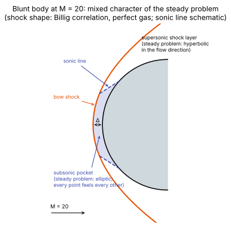

# Mathematical character: hyperbolic, parabolic, elliptic

**Slot:** Track 0.1 governing equations · **Depth:** [deep]

## What it is

The compressible Navier–Stokes equations combine two kinds of mathematics. The inviscid part is **hyperbolic**: information travels as waves at finite speeds, and discontinuities can form and persist. The viscous part is **parabolic** in time (diffusion), and its steady version is **elliptic**. Which character dominates where decides how a solver must be built: which terms get upwinded, which time-step limits apply, and whether a steady problem can be marched in space.

## The problem it solves

Knowing the character tells you what a discretization must respect. Upwind [flux functions](../spatial/riemann-solvers.md) exist because the inviscid part has directional wave propagation; [viscous fluxes](../spatial/viscous-fluxes.md) are central because diffusion has no preferred direction; [time-step limits](../time/time-step-limits.md) come in two kinds because the two characters impose different stability conditions; and [space marching](../special/space-marching.md) works only where the steady problem is hyperbolic in the marching direction.

## How it works

### Hyperbolic

A first-order system $\partial_t U + A(U)\,\partial_x U = 0$ is hyperbolic when the **flux Jacobian** $A = \partial F/\partial U$ has real eigenvalues and a complete set of eigenvectors. The eigenvalues are the wave speeds; the eigenvectors say what each wave carries. For the 1D Euler equations,

$$
\lambda = u - a,\quad u,\quad u + a :
$$

two acoustic waves and one entropy (contact) wave. Information at a point comes only from inside the region bounded by the fastest characteristics (the domain of dependence).

### Adding species and vibrational energy {#adding-species-and-vibrational-energy}

For a reacting multi-temperature mixture, each species equation and the vibrational-energy equation add another eigenvalue $\lambda = u$, and the acoustic speeds don't change. The cleanest way to see it is to write the 1D inviscid equations in **primitive variables**, $\mathbf W = (\rho, u, p, Y_s, e_v)^T$ (one species shown; each extra species adds an identical row). Away from the source terms, each of these quantities obeys a simple transport law:

$$
\frac{D\rho}{Dt} = -\rho\,\frac{\partial u}{\partial x},\qquad
\frac{Du}{Dt} = -\frac1\rho\frac{\partial p}{\partial x},\qquad
\frac{Dp}{Dt} = -\rho a_f^2\,\frac{\partial u}{\partial x},\qquad
\frac{DY_s}{Dt} = 0,\qquad
\frac{De_v}{Dt} = 0,
$$

with $D/Dt = \partial_t + u\,\partial_x$. Written as $\partial_t\mathbf W + \mathbf A_W\,\partial_x\mathbf W = 0$,

$$
\mathbf A_W =
\begin{bmatrix}
u & \rho & 0 & 0 & 0\\
0 & u & 1/\rho & 0 & 0\\
0 & \rho a_f^2 & u & 0 & 0\\
0 & 0 & 0 & u & 0\\
0 & 0 & 0 & 0 & u
\end{bmatrix}.
$$

The matrix is block diagonal. The upper $3\times3$ block is the ordinary Euler block, with eigenvalues $u - a_f$, $u$, $u + a_f$. The lower block is already diagonal: each species and $e_v$ contributes one more $\lambda = u$, with an eigenvector that is a unit vector (a jump in $Y_s$ or $e_v$ alone, with $\rho$, $u$, $p$ unchanged). The conservative Jacobian $\partial\mathbf F/\partial\mathbf U$ is the same operator in different variables ($\mathbf A_U = \mathbf M\mathbf A_W\mathbf M^{-1}$ with $\mathbf M = \partial\mathbf U/\partial\mathbf W$), so it has the same eigenvalues.

Why the pressure row has no $Y_s$ or $e_v$ entries: pressure does depend on composition and on $e_v$ through the equation of state, but in inviscid flow without sources a fluid parcel keeps its $Y_s$ and $e_v$, so the only way its pressure can change is through compression. Following a parcel,

$$
\frac{Dp}{Dt} = \underbrace{\left[\left(\frac{\partial p}{\partial\rho}\right)_{e,Y,e_v} + \frac{p}{\rho^2}\left(\frac{\partial p}{\partial e}\right)_{\rho,Y,e_v}\right]}_{a_f^2}\frac{D\rho}{Dt}
+ \sum_s\left(\frac{\partial p}{\partial Y_s}\right)\underbrace{\frac{DY_s}{Dt}}_{0}
+ \left(\frac{\partial p}{\partial e_v}\right)\underbrace{\frac{De_v}{Dt}}_{0},
$$

using $De/Dt = (p/\rho^2)\,D\rho/Dt$ for adiabatic compression. The bracket *defines* the frozen sound speed. Composition and $e_v$ still change the value of $a_f$, but they don't open new acoustic paths.

**What "passively advected" means here.** $Y_s$ and $e_v$ move with the fluid at speed $u$ and generate no pressure waves of their own. A jump in composition (pure N₂ on one side, partly dissociated air on the other) at equal $p$ and $u$ is just another contact discontinuity: it sits still in the fluid frame, like a temperature jump. That is the sense in which species "ride the contact". They are not passive in the stronger sense of having no effect: they change $R_{mix}$, $a_f$ and the energy, and the source terms couple them to everything.

**Source terms don't change this.** Chemistry and vibrational relaxation enter as a source vector $\mathbf S(\mathbf U)$, not through the flux, so they don't appear in $\mathbf A$. They don't change wave speeds or the CFL limit; they bring their own (stiff) time scales, treated on the [stiff sources](../sources/stiff-sources.md) page.

Consequences: the system stays hyperbolic; the convective CFL limit uses $|u| + a_f$ as before; and every upwind flux extends by carrying the extra variables through the contact. For HLLC this is written out in [HLLC with species and vibrational energy](../spatial/riemann-solvers.md#hllc-with-species-and-vibrational-energy).

### Frozen and equilibrium sound speed {#frozen-and-equilibrium-sound-speed}

A sound wave is a rapid compression followed by expansion. Compressing a gas does work on it, and that energy has to go into some internal mode. How much the **pressure** rises for a given compression, which is what sets the sound speed, depends on *where the energy goes*:

- If the energy can only go into translation and rotation, the translational temperature rises a lot and so does the pressure. The gas is stiff, and the sound speed is high. This is the **frozen** limit: the wave passes before vibration and chemistry can respond.
- If vibration (and dissociation) can soak up part of that energy during the wave, less goes into translation, the temperature and pressure rise less, and the gas is softer. This is the **equilibrium** limit, and its sound speed $a_e$ is lower. Thermodynamic stability guarantees $a_e \le a_f$.

Which limit applies depends on the ratio of relaxation time to wave period. For a passing acoustic wave in a shock layer, vibration and chemistry are usually too slow to follow, so the frozen speed is the physically relevant one, and for numerics it is the only one: in a finite-rate model, $Y_s$ and $e_v$ change only through source terms, and source terms are absent from the flux Jacobian. The eigenvalues are therefore always $u \pm a_f$. (An **equilibrium-gas** model, in which composition is a function of the local $(\rho, e)$ through the equation of state, has $a_e$ in its eigenvalues instead.)

For a two-temperature thermally perfect mixture, $p = \rho R_{mix} T$ and, at fixed $Y_s$ and $e_v$, $de = c_{v,tr}\,dT$. Evaluating the bracket above gives

$$
a_f^2 = \gamma_f\,\frac{p}{\rho},\qquad \gamma_f = 1 + \frac{R_{mix}}{c_{v,tr}},\qquad c_{v,tr} = \sum_s Y_s\,c_{v,tr,s},
$$

where $c_{v,tr,s} = \tfrac32 R_s$ for atoms and $\tfrac52 R_s$ for diatomic molecules (translation plus two rotational degrees of freedom). For pure N₂ this gives $\gamma_f = 1 + 2/5 = 1.4$, at any temperature. In a one-temperature model, vibration is assumed equilibrated with $T$, so $c_v$ includes the vibrational heat capacity: with vibration fully excited, $c_v = \tfrac72 R$ and $\gamma = 9/7 \approx 1.29$, so the sound speed is about 4% lower ($\sqrt{1.4/1.286} \approx 1.04$). Letting dissociation respond too lowers the equilibrium value further; equilibrium air at entry conditions has effective $\gamma$ values well below 1.3 (see the equilibrium property charts in Anderson). Because the dispersion relation of a relaxing gas runs between these two limits, high-frequency disturbances travel at $a_f$ and slow ones at $a_e$.

### Parabolic

Diffusion, $\partial_t u = \nu\,\partial_x^2 u$, has no finite propagation speed: a disturbance is felt everywhere instantly, with exponentially small amplitude far away. It smooths everything, so no discontinuity survives. The viscous stresses, heat conduction and species diffusion in [the governing equations](governing-equations.md) are all of this type.

Compressible Navier–Stokes is technically **incompletely parabolic**, since the continuity equation has no diffusion term. With viscosity a real shock isn't a discontinuity: it is a few mean free paths thick. That is far thinner than any continuum CFD cell, so on the grid it still looks like a discontinuity, which is why Navier–Stokes codes still need shock capturing.

### Elliptic

Steady diffusion is Laplace's or Poisson's equation: every point influences every other point, and there's no direction in which a solution can be marched. In steady compressible flow, ellipticity also appears without viscosity: wherever the flow is **subsonic**, pressure disturbances propagate upstream as well as downstream.

### Mixed character around a blunt body

The steady problem around a capsule is mixed. Behind the bow shock, the stagnation region is subsonic, so the steady equations there are elliptic. Beyond the sonic line the shock layer is supersonic, and the steady inviscid equations are hyperbolic in the flow direction: information only travels downstream.

<figure markdown>

<figcaption>The subsonic pocket between the bow shock and the nose is elliptic in the steady sense; past the sonic line, the shock layer is supersonic. Shock shape from Billig's perfect-gas correlation; the sonic line is schematic.</figcaption>
</figure>

Historically this made the steady **blunt-body problem** notoriously hard: no single steady method suited both regions. The breakthrough was to solve the *unsteady* equations instead, which are hyperbolic in time everywhere regardless of local Mach number, and march them to steady state (Moretti and Abbett, 1966). Every modern code still does this, in physical or pseudo-time.

The solver "knows" each region locally, at every face, through the signs of the eigenvalues. In supersonic regions all eigenvalues across a face have the same sign, and an upwind flux such as [Steger–Warming](../spatial/flux-vector-splitting.md#steger-warming) automatically takes only the upstream contribution. In subsonic regions it mixes both sides. Relaxation solvers exploit the same fact: Gauss–Seidel sweeps aligned with a supersonic flow converge almost in one pass (see [relaxation methods](../time/relaxation-methods.md)).

## Implications

| Lens | Effect |
|---|---|
| Time step and cost | Two explicit stability limits: convective ($\Delta x/(\lvert u\rvert +a)$) and viscous ($\Delta x^2/2\nu$). See [time-step limits](../time/time-step-limits.md). |
| Steady vs unsteady | Steady problems with subsonic regions must be solved globally (time marching or iteration); purely supersonic regions can be [space-marched](../special/space-marching.md). |
| Accuracy | Upwinding the hyperbolic part and centring the parabolic part is what each term's character demands. |
| Robustness | Wrong upwinding (taking information from downstream in a supersonic region) is unstable. |
| Physics captured or lost | Hyperbolic structure permits shocks and contacts; diffusion sets boundary layers and the wall heat flux. |
| Hardware / parallel fit | Elliptic coupling is global and needs many iterations or global solves; hyperbolic coupling is local. |

## In a run

You see the character in convergence behaviour: the subsonic stagnation region usually converges last in a steady blunt-body run, while supersonic regions settle quickly. Space-marching codes refuse to march, or produce "departure solutions," when the marching plane contains too much subsonic or reversed flow.

## Which codes

Universal; this is mathematics, not a code choice. What differs between codes is how they exploit it (upwind flux type, sweep directions, line-solve directions).

## See also

[Governing equations](governing-equations.md) · [Riemann solvers](../spatial/riemann-solvers.md) · [Time-step limits](../time/time-step-limits.md) · [Space marching](../special/space-marching.md) · [Entry flow anatomy](../physics/entry-flow-anatomy.md)

## References

Hirsch, *Numerical Computation of Internal and External Flows*; Vincenti & Kruger, *Introduction to Physical Gas Dynamics* (frozen and equilibrium sound speeds in relaxing gases); LeVeque, *Finite Volume Methods for Hyperbolic Problems*; Anderson, *Hypersonic and High-Temperature Gas Dynamics*; Moretti & Abbett (1966); Billig (1967). See the [bibliography](../../references.md).
