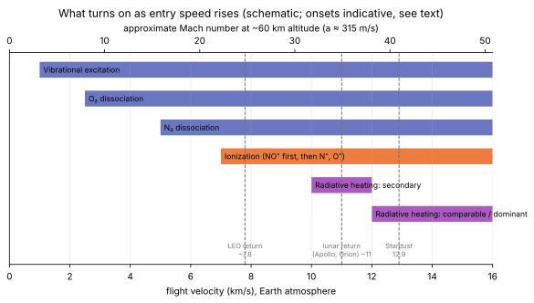

# Choosing physical models: when you need what

**Slot:** cross-cutting (gas models, nonequilibrium, ionization, radiation, rarefaction) · **Depth:** [feel], rules of thumb

## What it is

A decision guide: for a given flight condition and a given output you care about, which thermochemical, ionization, radiation and rarefaction models are needed, and which are overkill. It collects the thresholds scattered across chapters 2, 3, 5 and 11 into tables. Every number here is a rule of thumb: an onset, not a sharp boundary. Check the specific case with the criteria on the linked pages.

## The problem it solves

Each extra model adds equations, stiffness, uncertain rate data and run time. Too little physics gives wrong temperatures, standoff, heating or electron densities. Too much costs time and can make a run harder to converge without making it more accurate (Park 1990, §5.5, on extra temperatures whose exchange rates are uncertain).

## How it works

### First: Mach number is the wrong axis

What switches on high-temperature physics is **energy per unit mass**, which grows as $V^2/2$, together with **density**, which sets collision rates and so decides equilibrium versus nonequilibrium and continuum versus rarefied. **Body size** matters too, because it sets how much time the gas spends in each region. Mach number only enters through $V$, and it hides the temperature: a Mach 10 wind tunnel expands gas to a few tens of kelvin, so its total enthalpy is low and the flow is a perfect gas. A vehicle at Mach 10 in flight at 3 km/s already dissociates oxygen behind its shock. So the tables below use **velocity** first, with an approximate Mach number at about 60 km altitude (speed of sound about 315 m/s) for orientation.

<figure markdown>

<figcaption markdown="span">Which physics turns on as Earth entry speed rises, in the stagnation region of a metre-scale blunt body. Schematic: onsets are indicative and shift with altitude and body size.</figcaption>
</figure>

### Table 1: by entry speed (Earth air, stagnation region of a blunt body)

| Velocity | ≈ Mach (60 km) | What turns on | Minimum gas model that captures it | Example |
|---|---|---|---|---|
| < 1 km/s | < 3 | nothing significant | calorically perfect gas | — |
| 1–2.5 km/s | 3–8 | vibrational excitation | thermally perfect gas | sounding rockets, launch-vehicle ascent |
| 2.5–5 km/s | 8–16 | O₂ dissociation, NO formation | 5-species air, equilibrium or finite-rate | low-speed Mars entry (in CO₂: CO₂ dissociation) |
| 5–7 km/s | 16–22 | N₂ dissociation; strong chemical and thermal nonequilibrium at altitude | 5-species finite-rate, 2T | — |
| 7–9 km/s | 22–29 | onset of ionization (NO⁺ via associative ionization) | 7-species (adds NO⁺, e⁻) if electrons matter; 2T | LEO return (~7.8 km/s), RAM-C (~7.6 km/s), OREX |
| 9–12 km/s | 29–38 | significant ionization (N⁺, O⁺); radiative heating becomes a secondary contribution | 11-species, 2T; radiation estimated (uncoupled) | lunar return: Apollo, Orion (~11 km/s) |
| > 12 km/s | > 38 | radiation comparable to or dominating convection; strong ionization; ablation–radiation coupling | 11-species, 2T or 3T, coupled radiation | Stardust (12.9 km/s), planetary return |

Sources and calibration: the dissociation and ionization onsets follow Anderson's velocity–altitude discussion (*Hypersonic and High-Temperature Gas Dynamics*, ch. 1 and 9). The temperatures behind them are O₂ dissociating at about 2500–4000 K, N₂ at about 4000–9000 K and ionization above about 9000 K, at around 1 atm and lower at lower pressure. A NASA study of Apollo found radiative heating negligible at orbital entry speeds and only of secondary importance at lunar return, but expected it to dominate at planetary-return speeds (NASA Manned Spacecraft Center report on Apollo radiative heating, 1972, NTRS 19720017314). The 7-species model is generally adequate to about 8 km/s, and above that it underpredicts the heat-flux reduction from ionization (DSMC comparison, *AIAA J.* 58(3), 2020). A 7-species model was found adequate along the whole OREX trajectory (Gupta et al. 1997).

### Table 2: by altitude (density), at a given speed

Higher altitude means fewer collisions: the gas has less time to equilibrate (nonequilibrium grows) and eventually stops behaving as a continuum.

| Regime | Indicator | What you need | What you can drop |
|---|---|---|---|
| Dense: chemistry fast compared with the flow time | Damköhler number $Da \gg 1$ (low altitude, large body) | equilibrium gas model | finite-rate chemistry, extra temperatures |
| Rates comparable to flow time | $Da \sim 1$ (most of an entry's peak-heating segment) | finite-rate chemistry | — |
| Strong shock at altitude | vibrational relaxation length comparable to shock layer; post-shock $T \gg T_v$ | two-temperature model (Park 2T) | — |
| Very low density, wakes, upstream of shock | electron–vibration coupling too slow to keep $T_e = T_v$ | three-temperature model | — (but only where it matters, see Table 3) |
| Slip | $10^{-3} \lesssim Kn \lesssim 10^{-1}$, or local $Kn_{GL} > 0.05$ near the wall | slip / temperature-jump walls | — |
| Transitional | $Kn \gtrsim 0.1$ | DSMC | continuum CFD |

Example: for OREX (1.35 m nose radius, orbital speed), a 7-species model was adequate from 105 km down to 48 km, but above about 84 km thermal nonequilibrium and slip had to be included to match flight heating (Gupta et al. 1997). Criteria: [stiff sources and Damköhler number](sources/stiff-sources.md), [thermal nonequilibrium](thermo/thermal-nonequilibrium.md), [continuum breakdown](rarefied/continuum-breakdown.md).

### Table 3: by what you want to predict

The same flow can need different models depending on the output.

| Output | Usually sufficient | Needed when | Usually not needed |
|---|---|---|---|
| Forebody pressure, forces, trim | equilibrium or 5-species finite-rate; 1T often adequate for trends | — | ionization, radiation, 3T |
| Shock standoff | finite-rate chemistry (standoff lies between perfect-gas and equilibrium values) | always at entry speeds | radiation (unless strongly coupled) |
| Convective stagnation heat flux | finite-rate 2T, 5–7 species, catalytic wall model, resolved boundary layer | 11 species above ~9 km/s | 3T |
| Radiative heat flux | 11-species 2T plus a radiation solver (NEQAIR/HARA); non-Boltzmann excited states | above ~10 km/s (Earth), ~7 km/s (Mars, CO₂) | — |
| Coupled radiation | radiation fed back into the flow energy equation | when radiative heating is large: coupling alone lowered radiative heating by 30–60% for Apollo 4 (10.24 km/s) and a 15.24 km/s Mars-return case (Johnston, Gnoffo & Sutton 2009) | at LEO speeds |
| Electron density, blackout | 7-species minimum; 11-species above ~9 km/s; ambipolar diffusion | whenever communications matter, from ~6–7 km/s | radiation |
| Wake and afterbody (electrons, chemistry) | finite-rate with recombination; 3T for electron energy in wakes (Clarey & Greendyke 2019b) | blackout at afterbody antennas, wake radiation | — |
| High-altitude heating (> ~80 km for metre-scale bodies) | 2T plus slip walls; DSMC if $Kn \gtrsim 0.1$ | — | turbulence |
| Ablating heat shield | ablation species (C, H, CO, CN…) in the flow; blowing boundary condition | when blowing is a sizeable fraction of the free-stream mass flux (20% blowing lowered radiative flux by about 40% in Johnston et al. 2009) | — |

### Rules of thumb in one place

- **Perfect gas** is acceptable only when the stagnation temperature stays below roughly 800 K: cold hypersonic tunnels and method testing. In flight above about 1 km/s it is wrong for temperature, standoff and heating ([gas models](thermo/gas-models.md)).
- **Equilibrium** works at low altitude and for large bodies. It fails in relaxation zones behind strong shocks and in expansions and wakes, where recombination freezes ([gas models](thermo/gas-models.md)).
- **Finite-rate 1T** is enough for quick pressure and heating trends; a 2023 comparison of 5-, 7- and 11-species models with 1T and 2T recommended 1T with 5 species for rapid estimates and 2T with 11 species for accuracy at extreme altitude and Mach number (Zhao et al. 2023).
- **2T (Park)** is the default for entry design from roughly 6 km/s up. Behind a strong shock it is also *less stiff* numerically than 1T (Park 1990, §5.5).
- **3T** pays off in wakes, upstream of the shock and for radiation and blackout predictions. On a forebody shock layer the electron temperature tracks $T_v$, and 3T costs about 1.8× in 0-D tests (Farbar et al. 2013; Clarey & Greendyke 2019a). Separate vibrational temperatures per molecule rarely add trustworthy information (Park 1990, §5.5).
- **Species sets:** 5 species up to the onset of ionization; 7 species (add NO⁺, e⁻) to about 8 km/s, or whenever electrons matter; 11 species above about 9 km/s.
- **Radiation:** ignore at LEO speeds; estimate (uncoupled) at lunar return; couple above about 12 km/s or when radiative heating is a large share. Radiative heating grows with nose radius, the opposite of convective heating ([stagnation heating](physics/stagnation-point-heating.md#radiative-heating)).
- **Catalysis** matters whenever atoms reach the wall, from oxygen dissociation (above ~4–5 km/s) upwards, and most when the boundary layer is frozen ([stagnation heating](physics/stagnation-point-heating.md#fayriddell)).
- **Rarefaction:** slip walls above about $Kn \sim 10^{-3}$; DSMC above about 0.1, or wherever $Kn_{GL} > 0.05$ ([continuum breakdown](rarefied/continuum-breakdown.md)).
- **Other atmospheres shift the numbers.** In Mars CO₂, radiation becomes significant at entry speeds of 7 km/s and above (Park, Howe, Jaffe & Candler 1991), and CO₂ infrared radiation can heat the afterbody at lower speeds.

!!! warning "Calibration"
    The onsets above depend on altitude, body size and which output you need, and different sources draw the boundaries differently. Use them to choose a starting model, then check the case: Damköhler number for chemistry, relaxation length for thermal nonequilibrium, $Kn_{GL}$ for rarefaction, and a sensitivity run (one model level up) for anything the design depends on.

## Implications

| Lens | Effect |
|---|---|
| Time step and cost | Each step up the ladder adds equations (species, temperatures) and stiffness; radiation coupling and DSMC are the large jumps. |
| Steady vs unsteady | Unchanged by the model choice, except that wakes needing 3T are usually unsteady. |
| Accuracy (heat flux, pressure) | Pressure is forgiving (equilibrium often enough); heat flux needs finite-rate 2T and wall chemistry; radiation and blackout need ionization. |
| Robustness | More physics, more failure modes (avalanche ionization, stiff exchange terms); 2T is more robust than 1T behind strong shocks. |
| Physics captured or lost | See the tables. |
| Hardware / parallel fit | More equations per cell; radiation solvers add separate cost (line-by-line especially). |

## In a run

Start one level below what you expect to need, add physics one step at a time, and keep the change only if the output you care about moves by more than its uncertainty.

## Which codes

Production entry codes (DPLR, LAURA, US3D) support 5- to 11-species air and 2T as standard, with radiation through NEQAIR (post-processed) or HARA (coupled in LAURA), and slip walls. 3T and DSMC are available in some codes and research tools ([ionization](thermo/ionization-and-electrons.md#which-codes), [DSMC](rarefied/dsmc.md#which-codes)).

## See also

[Gas models](thermo/gas-models.md) · [Thermal nonequilibrium](thermo/thermal-nonequilibrium.md) · [Ionization, electrons and plasma](thermo/ionization-and-electrons.md) · [Stagnation-point heating](physics/stagnation-point-heating.md) · [Continuum breakdown](rarefied/continuum-breakdown.md) · [Implications matrix](implications-matrix.md)

## References

Anderson, *Hypersonic and High-Temperature Gas Dynamics*; Park, *Nonequilibrium Hypersonic Aerothermodynamics* (1990); Gupta, Yos, Thompson & Lee (1990); Gupta et al. (1997); Johnston, Gnoffo & Sutton (2009); Farbar, Boyd & Martin (2013); Clarey & Greendyke (2019a, 2019b); Zhao et al. (2023); Park, Howe, Jaffe & Candler (1991).
