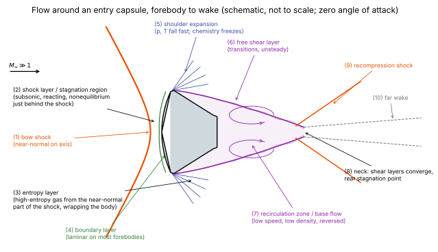
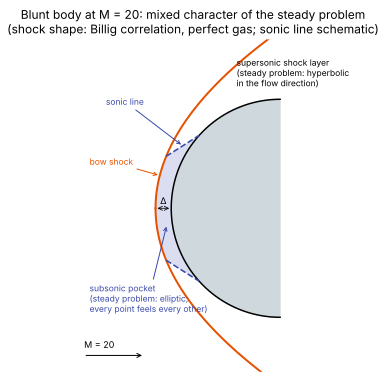

# Entry flow anatomy

**Chapter:** 2 Entry flow physics · **Depth:** [deep]

## What it is

The structure of the flow around a blunt entry vehicle, and the vocabulary for it: bow shock, shock layer, stagnation region and sonic line, entropy layer, boundary layer, viscous interaction, shoulder expansion, separation, free shear layer, recirculation zone, neck, recompression shock and wake, plus the interactions between them.

## The problem it solves

Every aerothermal quantity is tied to one of these regions, and each region stresses different parts of the solver: the stagnation region is subsonic and [elliptic](../foundations/mathematical-character.md#mixed-character-around-a-blunt-body), the shock layer is reacting and in nonequilibrium, the boundary layer sets heat flux, and the wake is separated and unsteady.

## How it works

<figure markdown>

<figcaption markdown="span">The regions of the flow around an entry capsule at zero angle of attack, forebody to wake. Schematic, not to scale: in a real flight case the shock layer is thin compared with the body, and the wake is several body diameters long.</figcaption>
</figure>

<figure markdown>

<figcaption markdown="span">The forebody close up: bow shock, standoff, subsonic stagnation pocket and supersonic shock layer around a sphere at M = 20 (Billig's perfect-gas shock-shape correlation; sonic line schematic).</figcaption>
</figure>

The flow is easiest to describe as a set of regions, each with its own physics and its own demands on the solver. The numbers follow the capsule figure.

### Forebody

**(1) Bow shock.** A detached, curved shock standing ahead of the blunt body ([hypersonic shock relations](hypersonic-shock-relations.md)). On the axis it is locally a normal shock, the strongest part; away from the axis it weakens and becomes oblique, tending to a Mach wave far away. Across it the flow is decelerated and compressed in a few mean free paths, so on any continuum grid it is a [captured discontinuity](../foundations/conservation-and-weak-solutions.md). Numerically it is where the [flux function](../spatial/riemann-solvers.md) and [shock instabilities](../spatial/shock-instabilities.md) matter most, and where grid alignment pays off.

**(2) Shock layer and stagnation region.** The gas between the shock and the body. Near the axis it is **subsonic** (the stagnation region, bounded by the **sonic line**), so the steady problem there is [elliptic](../foundations/mathematical-character.md#mixed-character-around-a-blunt-body); farther out it is supersonic. Immediately behind the shock the gas is hot and out of equilibrium: translation has jumped, but vibration and chemistry lag, and a **relaxation zone** follows in which the gas dissociates (and at high speed ionizes and radiates) on its way towards equilibrium. Whether the gas reaches equilibrium before the body depends on the [Damköhler number](../../glossary.md#damkohler-number). This region decides standoff, post-shock temperature and radiative heating, and sets the edge conditions for [stagnation-point heating](stagnation-point-heating.md).

**(3) Entropy layer.** Because the shock is curved, streamlines cross it at different strengths. Gas that crossed the near-normal part near the axis gained more entropy and ends up hotter and less dense than gas that crossed the weaker oblique part. This high-entropy gas wraps around the body as a layer next to the wall. It matters most for slender, blunt-nosed bodies (blunted cones, lifting bodies), where the [boundary layer](#boundary-layer) grows into it over a long distance and the edge conditions for heating change as it is "swallowed". On a capsule it is essentially the whole shock layer.

**(4) Boundary layer.** The thin viscous layer at the wall, where velocity drops to zero (or to a slip value in rarefied flow) and temperature drops to the wall temperature. Convective **heat flux** is decided entirely here, by the temperature gradient and by species diffusion with catalytic recombination at the wall ([wall boundary conditions](../walls/wall-boundary-conditions.md)). It is thin compared with the shock layer at high Reynolds number, so it needs fine wall-normal cells ([cell Reynolds number](../time/time-step-limits.md)) and a low-dissipation flux. On most capsule forebodies it is **laminar**; large, high-Reynolds-number vehicles, rough or ablating heat shields, and steps and gaps can make it transition to **turbulent**, which can raise heating by a factor of several.

**Viscous interaction.** When the Mach number is high and the Reynolds number low, the boundary layer becomes thick enough (it scales roughly with $M^2/\sqrt{Re}$) to displace the outer inviscid flow appreciably. The changed outer flow then changes the pressure the boundary layer sees. This two-way coupling is **viscous interaction**, measured by $\bar\chi = M^3\sqrt{C/Re_x}$ ($C$ the Chapman–Rubesin parameter): weak for small $\bar\chi$, strong when $\bar\chi$ is large, typically near sharp leading edges and at high altitude. At still lower density the shock and boundary layer merge into one viscous layer (**viscous shock layer**, then **merged layer**), and continuum assumptions start to fail; the Knudsen number $Kn = \lambda/L$ measures this ([continuum breakdown](../rarefied/continuum-breakdown.md)) (indicative ranges: continuum below about 0.001, slip to about 0.1, transitional to about 10, free-molecular above).

### Shoulder and afterbody

**(5) Shoulder expansion.** At the edge of the heat shield the flow turns sharply around the shoulder and expands, with pressure and temperature dropping by large factors over a short distance. Two things happen at once. The boundary layer thins, so the shoulder can be a local heating peak on some shapes. And the chemistry **freezes**: recombination is too slow to keep up with the fast expansion, so the gas leaves the shoulder with much of its dissociation still in place. Numerically, strong expansions are where [positivity](../spatial/riemann-solvers.md#positivity-safeguards) is tested and where a Roe-type flux needs its [entropy fix](../spatial/riemann-solvers.md#entropy-fixes-why-roe-needs-one).

**(6) Separation and the free shear layer.** The boundary layer cannot follow the sharp turn onto the backshell and **separates** at or near the shoulder. It leaves as a **free shear layer**: a thin layer of strong velocity shear between the fast outer flow and the nearly stagnant gas behind the body. Shear layers are unstable, so this one typically becomes unsteady and transitions to turbulence within a short distance even when the forebody boundary layer is laminar.

**(7) Recirculation zone (base flow).** Behind the backshell, enclosed by the shear layer, is a region of slow, reversed, low-density, low-pressure gas: the **recirculation zone** or **base region**. It is subsonic and elliptic, its flow is driven by entrainment into the shear layer, and its size and heating depend sensitively on where and how the shear layer develops. Backshell heating is usually a small fraction of forebody stagnation heating, but the backshell's thermal protection is correspondingly thin, so the fraction matters. Steady RANS solutions here are often only time averages of a flow that is really unsteady.

**(8) Neck.** Downstream, the shear layers from opposite sides converge towards the axis. Where they meet is the **neck**, with a **rear stagnation point** on the axis where the reversed flow of the recirculation zone and the downstream flow divide.

**(9) Recompression shock.** The outer flow, turned towards the axis by the converging shear layers, must turn back to run parallel to it, which requires a **recompression shock** (also called the wake or lip shock) starting near the neck.

**(10) Far wake.** The viscous trail downstream: slowly mixing, turbulent, and still carrying the frozen chemistry from the shoulder. In high-speed entries it can contribute to afterbody radiative heating.

### Interactions

Some of the most severe local heating comes from waves and layers meeting each other rather than from any one region:

- **[Shock–shock interaction](shock-shock-interactions.md).** When an external shock (from another body, a flap, a strut or an attachment) hits the bow shock, the result depends on where it hits. Edney (1968) classified the patterns into six types; the worst (type IV) sends a supersonic jet into the body surface and can multiply local heating many times.
- **[Shock–boundary-layer interaction](shock-boundary-layer-interaction.md) (SWBLI).** A shock impinging on a boundary layer, or a compression corner such as a flap or the cone–cone junction of the [double cone](../spatial/reconstruction.md#double-cone-ranking), raises the pressure the boundary layer must climb. It separates, forming a **separation bubble** bounded by a separation shock and a reattachment shock, with a heating peak at reattachment. The bubble size is a sensitive test of a scheme's dissipation, which is why the double cone is a standard validation case.
- **Jet interactions.** Reaction-control jets firing into the cross-flow create their own bow shock and separation region ahead of the jet.

### Laminar, turbulent, steady, unsteady: a map

| Region | Usually | Steady? | What stresses the solver |
|---|---|---|---|
| Bow shock | thin discontinuity | steady (forebody) | flux function, carbuncle, grid alignment |
| Shock layer / stagnation region | inviscid, reacting, nonequilibrium | steady | stiff chemistry, thermal nonequilibrium, slow subsonic convergence |
| Forebody boundary layer | laminar; turbulent on large or rough vehicles | steady | wall-normal resolution, flux dissipation, catalysis, transition modelling |
| Shoulder expansion | inviscid, chemistry freezing | steady | positivity, entropy fix, frozen chemistry |
| Free shear layer | transitional to turbulent | unsteady | turbulence modelling, dissipation of the scheme |
| Recirculation zone | low speed, low density, reversed | unsteady (low frequency) | slow convergence, low-Mach behaviour of the flux, rarefaction at altitude |
| Neck and far wake | turbulent | unsteady | time accuracy, long domains |

!!! warning "Calibration"
    The table is the typical picture for a blunt capsule at moderate angle of attack. Transition location, the degree of wake unsteadiness, and whether a steady RANS solution is adequate depend on the vehicle, trajectory point and heat-shield surface; check against the vehicle's own flight or ground-test data.

### Post-shock density and standoff

For a strong normal shock, the conservation laws ([Rankine–Hugoniot](../foundations/conservation-and-weak-solutions.md#rankine-hugoniot-conditions)) give

$$
\rho_1 u_1 = \rho_2 u_2,\qquad p_2 \approx \rho_1 u_1^2,\qquad h_2 \approx \tfrac12 u_1^2,
$$

where the approximations hold because $u_2 \ll u_1$. Post-shock **pressure and enthalpy are fixed by the freestream momentum and kinetic energy**, almost independently of the gas model. What the gas model decides is how that enthalpy is held. In a perfect gas it is all random thermal motion, so $T_2$ is huge. In dissociating air a large fraction goes into breaking bonds (chemical energy), so $T_2$ is several times lower.

The equation of state then gives $\rho_2 = p_2/(R_{mix}T_2)$. At essentially the same pressure but a much lower temperature, the density is higher. Dissociation also raises $R_{mix}$ (more particles per unit mass), which partly offsets this, but the temperature drop wins. "Denser" means denser at the same pressure; the shock-layer volume is not fixed in advance, it is the outcome.

The density ratio $\varepsilon^{-1} = \rho_2/\rho_1$ rises from the perfect-gas strong-shock limit $(\gamma+1)/(\gamma-1) = 6$ to roughly 10–15 or more in high-speed equilibrium air (indicative values; see the equilibrium normal-shock charts in Anderson). Continuity then says the post-shock gas also moves more slowly, $u_2 = \varepsilon u_1$.

**Standoff follows from mass balance.** The mass flux entering through the shock must leave sideways around the shoulder. Denser gas carries the same mass flux through a thinner layer, so the shock sits closer. Standoff is approximately proportional to the density ratio across the shock; a widely used approximation for a sphere is

$$
\frac{\Delta}{R_n} \approx 0.78\,\frac{\rho_1}{\rho_2}.
$$

In **nonequilibrium**, the composition right behind the shock is still frozen, so $T$ is high and the density ratio is close to the perfect-gas value; moving towards the body the gas relaxes, $T$ drops and the density climbs. Finite-rate standoff therefore falls between the perfect-gas and equilibrium values. This is one of the quickest sanity checks on a reacting solution.

## Variants

Not variants of a method but of the flow: **angle of attack** (moves the stagnation point towards the shoulder and makes the wake asymmetric), **slender versus blunt bodies** (slender bodies have weaker shocks, long entropy layers and boundary layers that dominate the heating), and **altitude** (from continuum through slip and transitional to free-molecular flow, where [DSMC](../rarefied/dsmc.md) replaces CFD).

## Typical values

- Density ratio across the bow shock: 6 (perfect gas, $\gamma = 1.4$); roughly 10–15 or more (high-speed equilibrium air).
- Standoff on a sphere from $\Delta/R_n \approx 0.78\,\rho_1/\rho_2$: 13% of the nose radius for a density ratio of 6, 5% for a ratio of 15. For $R_n = 1$ m that is 13 cm against 5 cm (computed from the formula).
- Post-shock pressure: close to $\rho_1 u_1^2$ whatever the gas model. At 7.5 km/s and $\rho_1 = 10^{-4}$ kg/m³ that is about 5.6 kPa.
- Post-shock enthalpy: close to $u_1^2/2$, so 28 MJ/kg at 7.5 km/s.
- Post-shock velocity: $u_1$ divided by the density ratio, so of order 0.5–1 km/s at orbital entry speed.

## Trade-offs

A page about a flow has no method trade-off of its own. What the anatomy imposes on a computation is a set of competing resolution demands: the bow shock wants grid lines aligned with it, the boundary layer wants cells thin in the wall-normal direction, the shoulder wants streamwise resolution through a rapid expansion, and the wake wants a time-accurate method. Forebody heating needs only the first two, which is why forebody-only grids and steady solvers are the design workhorse.

## Effects on stability and robustness

Where each region causes numerical trouble:

- **Stagnation region and bow shock:** [carbuncle](../spatial/shock-instabilities.md) and axis artefacts.
- **Boundary layer:** stiffness from high-aspect-ratio cells ([relaxation methods](../time/relaxation-methods.md)).
- **Shoulder expansion:** density and pressure fall by orders of magnitude over a short distance, which is where negative pressures appear.
- **Wake:** unsteady, partly rarefied, and often the reason a steady residual stalls ([convergence diagnostics](../time/convergence-diagnostics.md#stalls-and-limit-cycles)).

## Implications

| Lens | Effect |
|---|---|
| Time step and cost | The boundary layer sets the smallest cells (viscous limit); the stagnation region and wake set the convergence time of steady runs. |
| Steady vs unsteady | The forebody is steady and is usually solved as such; the wake is unsteady, so steady wake solutions are approximations. |
| Accuracy (heat flux, pressure) | Forebody pressure is set by the shock layer and is forgiving; heat flux is set by the boundary layer and is sensitive to grid, flux dissipation and wall chemistry. Interaction regions are the hardest. |
| Robustness | Strong shock (carbuncle), strong expansion (positivity), and near-vacuum base region are the three failure sites. |
| Physics captured or lost | Each region needs different physics: nonequilibrium chemistry behind the shock, transport and catalysis at the wall, turbulence in the wake, possibly rarefaction in the base region. |
| Hardware / parallel fit | Neutral; but unsteady wake simulations multiply cost by the number of time steps. |

## In a run

- Standoff is the first thing to check against expectations: perfect gas > nonequilibrium > equilibrium. A standoff outside that range points at the gas model, the shock capturing, or the grid at the shock.
- Check that the wall-normal grid resolves the boundary layer (cell Reynolds number at the wall) before trusting heat flux.
- Watch the residual history region by region: a steady run whose forebody has converged but whose wake keeps changing is showing wake unsteadiness, not a forebody problem.
- Look for negative pressure or temperature clipping at the shoulder and in the base region.

## Which codes

Not code-specific.

## See also

[Mathematical character](../foundations/mathematical-character.md) · [Gas models](../thermo/gas-models.md) · [Energy modes](../thermo/energy-modes.md) · [Turbulence modeling](turbulence-modeling.md) · [Wall boundary conditions](../walls/wall-boundary-conditions.md) · [Shock instabilities](../spatial/shock-instabilities.md)

## References

Anderson, *Hypersonic and High-Temperature Gas Dynamics* (shock layers, entropy layers, viscous interaction); Babinsky & Harvey (eds.), *Shock Wave–Boundary-Layer Interactions*; Bird, *Molecular Gas Dynamics* (rarefaction regimes); Billig (1967); Edney (1968); Gnoffo (1999). See the [bibliography](../../references.md).
