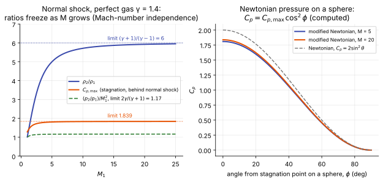

# Hypersonic shock relations and Newtonian theory

**Slot:** Track 1 (inviscid hypersonic theory) · **Depth:** [feel], with the formulas

## What it is

The limiting forms of the shock relations as the Mach number becomes large, the Mach-number independence principle that follows from them, and Newtonian and modified Newtonian theory: the simplest model of surface pressure on a blunt body. Together they are the closed-form inviscid theory of hypersonic flow (Anderson, chapters 2 and 3).

## The problem it solves

A CFD solution of an entry flow has thousands of numbers and no obvious reference. These relations give a few of those numbers in closed form: the post-shock state, the stagnation pressure, and the pressure distribution over a blunt forebody. They are what a solution is checked against first ([engineering checks](../verification/engineering-checks.md)), what engineering aerodynamic tools are built on ([engineering methods](../special/engineering-methods.md)), and the reason capsule forebody pressure is so forgiving compared with heat flux.

## How it works

### Strong-shock limits

For a perfect gas, the normal-shock ratios with upstream Mach number $M_1$ are

$$
\frac{\rho_2}{\rho_1} = \frac{(\gamma+1)M_1^2}{(\gamma-1)M_1^2 + 2},\qquad
\frac{p_2}{p_1} = 1 + \frac{2\gamma}{\gamma+1}\left(M_1^2 - 1\right).
$$

As $M_1 \to \infty$ these become

$$
\frac{\rho_2}{\rho_1} \to \frac{\gamma+1}{\gamma-1},\qquad \frac{p_2}{\rho_1 u_1^2} \to \frac{2}{\gamma+1},\qquad \frac{h_2}{u_1^2/2} \to 1 .
$$

The density ratio stops growing (6 for $\gamma = 1.4$); the pressure and enthalpy behind the shock become fixed fractions of the free-stream momentum and kinetic energy. For an oblique shock of angle $\beta$ the same limits hold with $M_1\sin\beta$ in place of $M_1$, and for a thin body the shock lies close to the surface: with $\rho_2/\rho_1 = 6$, the shock-layer thickness is a small fraction of the body length.

High-temperature effects change the density limit, not the momentum argument: dissociation and vibration act like a lower effective $\gamma$, so the real-gas density ratio across a strong shock in air rises to roughly 10–15 or more ([standoff and post-shock density](entry-flow-anatomy.md#post-shock-density-and-standoff)), while $p_2 \approx \rho_1 u_1^2$ is almost unchanged.

<figure markdown>

<figcaption markdown="span">Left: perfect-gas normal-shock ratios approach constants as $M_1$ grows. Right: Newtonian and modified Newtonian pressure on a sphere. Both computed from the formulas on this page.</figcaption>
</figure>

### Mach-number independence

Because the post-shock ratios freeze, the whole inviscid flow pattern around a blunt body (shock shape, sonic line, pressure coefficient distribution) stops changing once the Mach number is high enough (Oswatitsch). For blunt bodies the plateau is reached by roughly Mach 5–10. It is the reason wind-tunnel data at Mach 6–10 are useful for flight at Mach 25, as long as the *gas* behaves the same, which at entry speeds it does not: real-gas effects break the independence through the density ratio.

### Newtonian theory

Newton's model of fluid resistance treats the oncoming flow as a stream of particles that hit the surface, give up their normal momentum, and slide along it. For a surface element inclined at angle $\theta$ to the free stream,

$$
C_p = 2\sin^2\theta .
$$

Physically, the hypersonic shock layer is so thin and dense that the flow does almost what this model says: it is turned at the shock, essentially at the wall. The model ignores the pressure needed to curve the flow along a convex surface (the **Busemann** centrifugal correction) and is exact only in the double limit $M \to \infty$, $\gamma \to 1$.

### Modified Newtonian theory

Lees (1955) replaced the factor 2 by the actual stagnation-point value:

$$
C_p = C_{p,\max}\sin^2\theta,\qquad
C_{p,\max} = \frac{p_{0,2} - p_\infty}{\tfrac12\rho_\infty u_\infty^2},
$$

where $p_{0,2}$ is the total pressure behind a normal shock (Rayleigh pitot formula). For $\gamma = 1.4$, $C_{p,\max} \to 1.839$ as $M \to \infty$; in equilibrium air at entry conditions it approaches 2. On a sphere, $\sin\theta = \cos\phi$ with $\phi$ the angle from the stagnation point, so $C_p = C_{p,\max}\cos^2\phi$.

Modified Newtonian is surprisingly accurate on blunt forebodies, typically within a few percent of CFD over the heat shield, and poor where the flow expands strongly (shoulders) and wherever the surface is shadowed from the flow (backshells, where it predicts $C_p = 0$).

### Equilibrium and nonequilibrium normal shocks

With a high-temperature gas the normal-shock jump conditions (mass, momentum, energy) still hold, but closing them needs the equilibrium equation of state, so they are solved iteratively for $(\rho_2, h_2)$ (Anderson, chapter 14). Behind a real shock the gas first jumps to the *frozen* state, with translation heated but vibration and chemistry unchanged, then relaxes towards equilibrium over a **relaxation zone** (Anderson, chapter 15). The frozen state just behind the shock and the equilibrium state far behind it bracket the solution, and the relaxation profile between them is a standard check for thermal-nonequilibrium and finite-rate chemistry models ([thermal nonequilibrium](../thermo/thermal-nonequilibrium.md)).

## Variants

- **Newtonian** ($C_p = 2\sin^2\theta$), **modified Newtonian** (Lees), **Newtonian–Busemann** (centrifugal correction; can give negative pressure on convex bodies and is usually worse than modified Newtonian in practice).
- **Tangent wedge / tangent cone** and **shock-expansion** methods for slender bodies: see [engineering methods](../special/engineering-methods.md).

## Typical values

- Perfect-gas strong-shock density ratio: 6 ($\gamma = 1.4$); 4 ($\gamma = 5/3$).
- $C_{p,\max}$ (γ = 1.4): 1.81 at M = 5, 1.84 in the limit (computed, figure above).
- Equilibrium air at entry speeds: density ratio of order 10–15 or more, $C_{p,\max}$ close to 2 (Anderson, chapter 14).

## Trade-offs

- Gain: closed-form pressure and post-shock states in microseconds; a check on any CFD solution.
- Pay: no heating, no viscous effects, no wake, poor on expansions and shadowed surfaces.

## Effects on stability and robustness

Not a numerical method; it affects runs only as an initial condition (a Newtonian or strong-shock estimate is a reasonable starting guess for the shock-layer state) and as a check.

## Implications

| Lens | Effect |
|---|---|
| Time step and cost | Negligible; used before and after CFD, not in it. |
| Steady vs unsteady | Steady only. |
| Accuracy (heat flux, pressure) | Forebody pressure within a few percent on blunt bodies; no heat flux. |
| Robustness | n/a |
| Physics captured or lost | Captures the momentum balance; loses viscosity, chemistry (except through $C_{p,\max}$), expansions, wakes. |
| Hardware / parallel fit | n/a |

## In a run

- Compare the CFD stagnation pressure with $p_\infty + C_{p,\max}\tfrac12\rho_\infty u_\infty^2$; disagreement of more than a few percent points at the shock capturing, the free-stream setup or the gas model.
- Compare the forebody $C_p$ distribution with modified Newtonian.
- Check the density ratio across the shock on the stagnation line against the perfect-gas limit and the equilibrium value.

## Which codes

Not implemented in the CFD codes covered here; modified Newtonian is the pressure model inside engineering aerodynamic tools ([engineering methods](../special/engineering-methods.md)).

## See also

[Entry flow anatomy](entry-flow-anatomy.md) · [Stagnation-point heating](stagnation-point-heating.md) · [Engineering methods](../special/engineering-methods.md) · [Engineering checks](../verification/engineering-checks.md) · [Gas models](../thermo/gas-models.md)

## References

Anderson, *Hypersonic and High-Temperature Gas Dynamics* (chapters 2, 3, 14, 15); Lees (1955); Vincenti & Kruger, *Introduction to Physical Gas Dynamics* (relaxation behind shocks).
