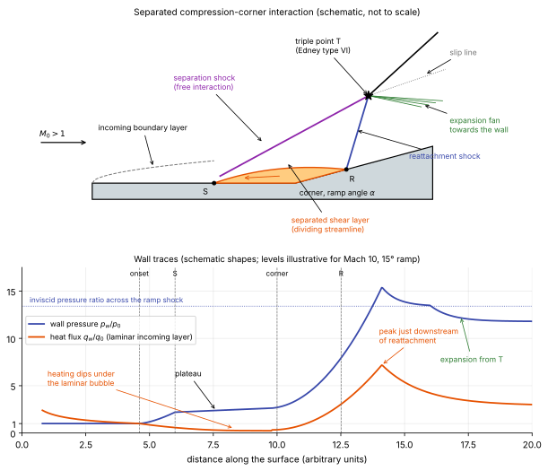
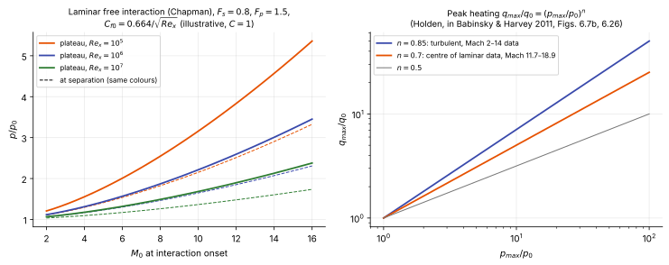
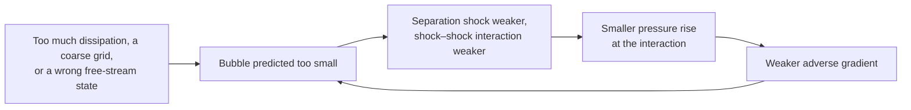

# Shock/boundary-layer interaction

**Chapter:** 2 Entry flow physics · **Depth:** [deep]

## What it is

A shock/boundary-layer interaction (SWBLI) is what happens when a shock wave meets a boundary layer. The shock imposes a sudden pressure rise. The slow gas near the wall carries too little momentum to climb it, so the boundary layer thickens and, if the rise is strong enough, **separates**. A bubble of recirculating flow forms, with a separation shock ahead of it, a free shear layer over it and a reattachment shock behind it. The shock can come from outside (an **impinging shock** from another body or a fitting) or be generated by the surface itself (a **compression corner**: a flap, a flare, the junction of the [double cone](../spatial/reconstruction.md#double-cone-ranking), a forward-facing step).

## The problem it solves

This page describes a flow feature, not a method. It matters for entry vehicles for three reasons.

- **Local heating.** Away from the stagnation point, the highest convective heating often sits just downstream of where a separated shear layer **reattaches**: on body flaps and flares, at steps and gaps in the heatshield, and ahead of reaction-control jets on the backshell. A reattaching layer has been compressed through two or more oblique shocks instead of one normal shock, so its stagnation pressure is high, and it strikes the surface at a steep angle.
- **Control effectiveness.** The separation bubble changes the pressure on a flap, so it changes trim and pitching moment. On the first Space Shuttle entry (STS-1) the vehicle's aerodynamic behaviour in pitch differed significantly from the prediction; the difference was traced mainly to Mach-number and real-gas effects, including a smaller separation on the body flap than predicted (Maus et al.; Weilmuenster et al.; summarized by Candler 2011, §7.4).
- **A test of the solver.** The bubble size depends on numerical dissipation, grid, time-integration method and turbulence model, and a wrong bubble size feeds back on itself (below). The double cone is the standard laminar validation case for exactly this reason.

**When do I need to think about it?** Any compression on the surface downstream of a boundary layer: a flap or flare, a cone–cone or cone–cylinder junction, a step, or a shock from another part of the vehicle. Rough thresholds:

- **Laminar layers separate easily.** In Holden's Mach 11.7 tests at $Re_L = 2.5\times10^5$ (Reynolds number based on the distance $L$ from the leading edge to the corner), a wedge just over 10° was enough to start separation (Holden 2011, Fig. 6.6).
- **Turbulent layers at hypersonic Mach numbers are much harder to separate.** Holden reports attached flow on ramps up to about 30° and with shock generators up to about 15° (Holden 2011, §6.3).
- **What goes wrong if you ignore it:** an attached-flow prediction misses the plateau, puts the pressure rise at the wrong place, and misses the reattachment heating peak, which can be several times the undisturbed heating (worked example below).

## How it works

### Anatomy of a separated interaction

<figure markdown>

<figcaption markdown="span">Top: the wave and layer structure of a separated compression corner (schematic, not to scale). Bottom: the shapes of the wall pressure and heat flux it produces, normalized by the values $p_0$, $q_0$ at the interaction onset; shapes are schematic, levels are illustrative for Mach 10 and a 15° ramp. Look at how little of the pressure rise happens at separation and how much at reattachment, and at where the heating peak sits relative to R.</figcaption>
</figure>

Reading the figure from left to right:

1. **Interaction onset.** The wall pressure starts rising upstream of everything else. The distance from the onset to where the inviscid shock would hit the wall is the **upstream influence length** $L_0$.
2. **Separation point S.** The wall shear stress falls to zero and reverses. Compression waves from the thickening layer coalesce into the **separation shock**.
3. **Plateau.** Under a well-developed bubble the pressure is nearly constant: the bubble is a slow, almost isobaric "dead-air" region and the outer flow sees it as a wedge-shaped obstacle. The pressure level is the **plateau pressure** $p_p$.
4. **Separated shear layer.** It leaves at S and grows by entraining fluid. Its **dividing streamline** separates the fluid that goes downstream from the fluid trapped in the bubble.
5. **Reattachment point R.** The shear layer turns back onto the surface. The rest of the pressure rise happens here, through the **reattachment shock**. The heat flux peaks just downstream of R, where the shear layer has been turned and its thermal layer is thinnest.
6. **Triple point T.** At high Mach numbers the separation and reattachment shocks are both shallow and cross close to the wall. The crossing is an Edney type VI interference ([shock–shock interactions](shock-shock-interactions.md)): a single transmitted shock goes on, and an expansion fan from T reflects off the ramp, so the wall pressure falls again after its peak (Délery 2011, §2.6.2, §2.9.1).

The **impinging-shock** case has the same viscous structure; only the outer shock pattern differs (an incident shock, a separation shock that crosses it, and a reflected shock). Délery shows that a ramp and an impinging shock give nearly the same wall-pressure distribution if they impose the same overall pressure rise: what the boundary layer responds to is the pressure rise, not where it comes from (Délery 2011, §2.6.2, Fig. 2.47).

### Why the boundary layer gives way: momentum against pressure

Write the streamwise momentum equation of a steady boundary layer ($x$ along the wall, $y$ normal to it, $u$ and $v$ the velocity components, $\tau$ the total shear stress including the turbulent part):

$$
\rho u\,\frac{\partial u}{\partial x} + \rho v\,\frac{\partial u}{\partial y} = -\frac{dp}{dx} + \frac{\partial \tau}{\partial y}.
$$

The left side is the change of momentum along a streamline. An adverse pressure gradient ($dp/dx > 0$) decelerates every streamline, and the low-momentum streamlines near the wall are decelerated most, because the same $dp/dx$ acts on less momentum. Shear stress fights back: near the wall $\partial\tau/\partial y > 0$, so the faster outer fluid drags the slow inner fluid forward. Separation happens when the pressure gradient wins at the wall.

This one balance explains the main parametric trends:

- **Fullness of the profile.** A turbulent layer carries much more momentum close to the wall. The incompressible shape factor $H_i = \delta^*_i/\theta_i$ (displacement thickness over momentum thickness, a measure of how "empty" the profile is) is about 2.5 for a laminar flat-plate layer and 1.3–1.4 for a turbulent one (Délery 2011, §2.4.2). The turbulent layer resists more.
- **Thickness of the subsonic layer.** Pressure signals travel upstream only through the subsonic part of the layer next to the wall. A laminar layer has a proportionally thicker subsonic part, so the interaction spreads further upstream.
- **Reynolds number.** In a laminar layer, higher $Re$ means relatively weaker viscous forces and therefore *less* resistance, so laminar interactions grow with $Re$. In a turbulent layer two effects compete (weaker viscous forces versus a fuller profile); the interaction length grows with $Re_\delta$ up to about $10^5$ and shrinks above it (Délery 2011, §2.5.4, §2.7.1).
- **Wall temperature.** Cooling the wall lowers the sound speed near it, so the near-wall Mach number rises and the subsonic layer thins. The density near the wall rises too. Both make the layer more resistant: wall cooling **contracts** the interaction, wall heating lengthens it (Délery 2011, §2.4.2, §2.9.2).

This is also why [space marching](../special/space-marching.md#where-it-fails) can't pass through a separated interaction: information travels upstream through the subsonic layer and the reversed flow, so the problem is locally [elliptic](../foundations/mathematical-character.md#elliptic).

### Free interaction: the separation and plateau pressures

Chapman's **free-interaction** argument (1950s; formalized later as triple-deck theory by Stewartson & Williams) explains why the first part of a separated interaction doesn't depend on what caused it. It combines two equations, one for the boundary layer and one for the outer flow (Délery 2011, §2.7.1).

**Boundary-layer side.** At the wall $u = v = 0$, so the momentum equation above reduces exactly to $dp/dx = (\partial\tau/\partial y)_w$. Integrating from the onset $x_0$ and scaling the shear stress with its value $\tau_{w0}$ at the onset, $y$ with the displacement thickness $\delta^*_0$ there, and $x - x_0$ with an interaction length $L$:

$$
\frac{p - p_0}{q_0} = C_{f0}\,\frac{L}{\delta^*_0}\,f_1(\bar x),
$$

where $q_0 = \tfrac12\rho_0u_0^2$ is the dynamic pressure at the onset, $C_{f0} = \tau_{w0}/q_0$ is the skin-friction coefficient there, $\bar x = (x-x_0)/L$, and $f_1$ is a dimensionless function (the integral of the scaled wall-normal shear gradient). This says the pressure the layer can absorb is set by how hard friction can push the inner fluid.

**Outer-flow side.** The outer flow follows the displacement surface, so its deflection angle is $\phi \approx d\delta^*/dx$. Linearized supersonic theory gives the pressure change for a small deflection:

$$
\frac{p - p_0}{q_0} = \frac{2}{\sqrt{M_0^2-1}}\,\frac{\delta^*_0}{L}\,f_2(\bar x),\qquad f_2 = \frac{d(\delta^*/\delta^*_0)}{d\bar x}.
$$

This says the outer flow pushes back harder the faster the layer thickens.

**Combined.** Multiplying the two eliminates the unknown $L$:

$$
\frac{p - p_0}{q_0} = F(\bar x)\,\frac{\sqrt{2C_{f0}}}{(M_0^2-1)^{1/4}},\qquad F = \sqrt{f_1f_2},
$$

and dividing them at the separation point gives the length scale

$$
L \;\propto\; \delta^*_0\,C_{f0}^{-1/2}\,(M_0^2-1)^{-1/4}.
$$

Every quantity on the right is a property of the incoming layer at the onset. The ramp angle or the incident-shock strength does not appear. That is the meaning of "free": the separation pressure and the first part of the interaction are set by the layer, not by the obstacle. Experiments confirm it, with one universal $F$ for laminar and one for turbulent flow:

| | $F$ at separation | $F$ at the plateau |
|---|---|---|
| Laminar | 0.8 | 1.5 |
| Turbulent | 4.2 | 6 |

(Délery 2011, §2.7.1.) The turbulent values are about five times the laminar ones, which is the quantitative form of "laminar layers separate easily".

In the hypersonic limit $(M_0^2-1)^{-1/4}\approx M_0^{-1/2}$ and $q_0/p_0 = \tfrac12\gamma M_0^2$, so the pressure rise scales as $(p-p_0)/p_0 \propto C_{f0}^{1/2}M_0^{3/2}$.

**The consequence for heating.** The obstacle still imposes its full pressure rise $\Delta p_T$. Since separation only takes $\Delta p_S$ (fixed by the layer), reattachment must supply the rest: $\Delta p_S + \Delta p_R = \Delta p_T$. A stronger obstacle doesn't raise the separation pressure; it pushes S upstream and lengthens the bubble, so the shear layer has a longer run to gain the momentum it needs to reattach against a larger $\Delta p_R$ (Délery 2011, §2.7.1). At hypersonic speed $\Delta p_R$ is most of $\Delta p_T$, which is why the heating peak is at reattachment.

<figure markdown>

<figcaption markdown="span">Left: laminar separation (dashed) and plateau (solid) pressure ratios from the free-interaction formula with $F = 0.8$ and $1.5$, $\gamma = 1.4$ and a Blasius skin friction $C_{f0}=0.664/\sqrt{Re_x}$ (Chapman–Rubesin factor set to 1; illustrative, computed). The plateau rises with Mach number and falls as the Reynolds number grows. Right: the peak-heating power law, computed for three exponents; Holden's turbulent data (Mach 2–14) follow $n = 0.85$, his laminar data (Mach 11.7–18.9) fall between $n = 0.5$ and $0.85$, around $0.7$.</figcaption>
</figure>

### Peak heating at reattachment

Holden's measurements give the most useful single result for TPS work: the peak heat flux in an interaction, divided by the undisturbed value $q_0$ just upstream, follows the peak pressure ratio,

$$
\frac{q_{max}}{q_0} = \left(\frac{p_{max}}{p_0}\right)^{n},
$$

with $n \approx 0.85$ for turbulent interactions over Mach 2 to 14, for both wedge-induced and shock-induced cases (Holden 2011, Fig. 6.26). Laminar data at Mach 11.7–18.9 fall below that line, between $n = 0.5$ and $0.85$ (Holden 2011, Fig. 6.7b). The same power law holds for swept, three-dimensional turbulent interactions (Holden 2011, §6.3.5).

Why pressure predicts heating: the heat flux into a boundary layer scales roughly with the square root of the edge density times a velocity gradient, and the reattaching layer is compressed by the pressure rise, which thins the thermal layer. Candler's laminar computations show the same thing directly: the boundary layer under an impinging shock is compressed so much that its thickness nearly vanishes at the plot scale (Candler 2011, §7.2.1).

**What it means for TPS sizing:** if a vehicle design can bound the peak pressure ratio across a flap or flare, it has a first estimate of the heating amplification there, without resolving the bubble. The correlation gives the *peak*, not its location or width.

### Laminar, transitional and turbulent interactions

- **Laminar** interactions are long (the interaction extent is of order ten boundary-layer thicknesses and can be much more), the heat flux **falls** under the bubble (the layer lifts off the wall), and the peak at reattachment is moderate (Délery 2011, §2.3.3, Fig. 2.61a).
- **Turbulent** interactions are short and the heat flux **rises** already at separation, because turbulence is amplified there and large eddies carry hot outer gas towards the wall (Délery 2011, Fig. 2.61b).
- **Transitional** interactions are the common case at hypersonic speed and the most dangerous. The separated shear layer is far less stable than the attached layer, so it [transitions](../turbulence/transition.md) inside the interaction even when the incoming layer is laminar. Separation then behaves as laminar (long bubble, falling heat flux) while reattachment behaves as turbulent (high pressure and heating peaks). The peak heating at reattachment during transition **can exceed the fully turbulent value**, because the transitional structures are large and organized before they break down (Délery 2011, §2.8). Most "laminar" hypersonic interactions in ground tests are in fact transitional (Délery 2011, §2.8; Candler 2011, §7.5).

!!! note "A misconception to drop"
    "Laminar flow is the benign case, so a laminar CFD run is conservative for heating." Not for interactions. A laminar run predicts a bubble that is too large (the real shear layer transitions and reattaches sooner) and a reattachment peak that is too low (transitional reattachment heats more than laminar, and sometimes more than turbulent). Candler notes that his laminar Mach 6 and compression-corner computations over-predict the separation length for this reason (Candler 2011, §7.2.1–7.2.2).

### Specific features at hypersonic speed

- **Thin shocks embedded in the layer.** The subsonic part of the layer is very thin, so compression waves coalesce into shocks deep inside the layer, and with shallow shock angles much of the shock pattern can sit inside the boundary layer (Délery 2011, §2.9.1).
- **Feedback between separation and shock strength.** The separation shock strengthens the incoming shock, which raises the adverse gradient, which enlarges the separation (Candler 2011, §7.2.1).
- **Viscous interaction controls laminar separation.** Holden correlates incipient laminar separation for wedge- and shock-induced cases against the viscous-interaction parameter $\bar\chi = M^3\sqrt{C/Re_L}$ ($C$ the Chapman–Rubesin parameter, see [entry flow anatomy](entry-flow-anatomy.md#forebody)); his data from roughly Mach 9 to 19 collapse when $M_\infty\theta_{i}$ ($\theta_i$ the incipient-separation angle) is plotted against $\bar\chi_L$ (Holden 2011, Fig. 6.7a).
- **Entropy layers.** A blunt leading edge ahead of the interaction puts the boundary layer inside the [entropy layer](entry-flow-anatomy.md#forebody) (item 3 there) of lower-Mach, lower-stagnation-pressure gas. At Mach 10 on a 15° ramp, rounding the plate's leading edge to 2.5 or 5 mm reduced the peak heating at reattachment by about a factor of 10 and shrank the separation, partly because the lower local Reynolds number kept the interaction laminar (Coët et al., in Délery 2011, §2.9.4).
- **Real-gas effects shrink the bubble.** Dissociation in the slow, hot bubble absorbs energy, so at nearly the same pressure the gas is colder and denser, just as it is behind a [bow shock](entry-flow-anatomy.md#post-shock-density-and-standoff). Denser gas in the bubble means a smaller bubble, more oblique shocks, and a weaker shock–shock interaction at reattachment. This is the mechanism behind the STS-1 body-flap problem and it reproduces in computations of high-enthalpy air on the double cone (Candler 2011, §7.4). A **catalytic** wall could do the opposite: recombination in the bubble releases energy, which is expected to enlarge the bubble and raise heating (Délery 2011, §2.9.5, stated as anticipated, not measured).

### Low-frequency unsteadiness

A turbulent interaction with separation is never steady. Its separation shock moves back and forth at frequencies far below those of the incoming turbulence.

**The frequency.** Normalize the dominant frequency $f$ of the shock motion with the interaction length $L$ (from the mean separation shock to the corner, to reattachment, or to the extrapolated incident shock, depending on geometry) and the free-stream speed $U_\infty$:

$$
S_L = \frac{fL}{U_\infty}.
$$

Compiled data from shock reflections, compression ramps, blunt fins and overexpanded nozzles collapse to $S_L \approx 0.03$–$0.04$ with about 20% scatter and no clear Mach-number trend; separated compression ramps above Mach 2 give 0.02–0.05 (Dussauge, Dupont & Debiève 2006; Dupont et al. 2011, Fig. 9.4). Since $L$ is many boundary-layer thicknesses $\delta$, this is several orders of magnitude below the energetic-eddy frequency $U_\infty/\delta$.

**The amplitude.** The shock travels over a distance $L_{ex}$ of about 0.3 of the interaction length (Dupont et al. 2011, Fig. 9.5).

**The other frequencies in the bubble.** The shear layer sheds large eddies at much higher frequencies, with spacing of about $L/2$. Subsonic separated bubbles "breathe" at $S_L \approx 0.12$; supersonic shock motions above Mach 2 are at least four times slower (Dupont et al. 2011, §9.3.3).

**The cause (still debated).** Two families of explanation:

- **Upstream:** very long structures in the incoming layer ("superstructures", about $30\delta$ long, convected at $0.75U_\infty$) give $S_L \approx 0.025\,L/\delta$. That matches only interactions with $L/\delta \sim 1$, i.e. weak or incipient ones.
- **Downstream:** the bubble's mass budget. The shear layer entrains fluid out of the bubble and sheds it downstream; the bubble periodically drains and refills, and the shock follows the bubble. Piponniau et al. built a frequency scaling on this and found it consistent with strongly separated cases; wall pressure at the shock foot and in the bubble are highly coherent (about 0.8) at these low frequencies (Dupont et al. 2011, §9.3.3).

The current reading is that upstream turbulence drives weak interactions and the bubble dynamics drive strongly separated ones (Dupont et al. 2011, §9.4; Clemens & Narayanaswamy 2014).

**Why it matters for the solver.** A steady [RANS](../turbulence/rans-models.md) solver has nothing to converge to; it may stall or wander ([convergence diagnostics](../time/convergence-diagnostics.md#stalls-and-limit-cycles)). A time-accurate run must cover many cycles of the slowest frequency while resolving the fastest, so the number of time steps is large (worked example below).

### Canonical cases

| Case | What it tests | Where to find it |
|---|---|---|
| **Double cone** (25°/55°, laminar N₂, CUBRC LENS) | Dissipation of the numerics; shock–shock interaction feeding the bubble; free-stream characterization | Holden & Wadhams (2001); Candler (2011, §7.4); [reconstruction](../spatial/reconstruction.md#double-cone-ranking) |
| **Hollow cylinder–flare** | Axisymmetric laminar separation without a leading-edge entropy layer; rarefied and slip effects at low density | Holden et al. (2003); Harvey (2011, ch. 8) |
| **Compression ramp** (2D) | Free interaction, plateau, reattachment heating; Mach and angle trends | Délery (2011, §2.6.2); Candler (2011, §7.2.2) |
| **Impinging shock on a flat plate** | Shock reflection with separation; unsteadiness in turbulent cases | Délery (2011, §2.6.1); Dupont et al. (2011) |
| **Cone–cylinder–flare** (turbulent) | RANS turbulence-model behaviour at shocks | MacLean et al. (2008): ground tests for the HIFIRE-1 transition experiment, Mach 7.16, 33° flare |

The double cone deserves a closer look because it is where most production codes have been tested. The attached first-cone shock, the separation shock and the detached bow shock from the second cone meet at a triple point; the transmitted shock hits the second cone near reattachment, and a supersonic jet runs along the second-cone surface (Candler 2011, Fig. 7.15). Three lessons from the validation campaign:

1. **Free-stream state matters as much as numerics.** All codes over-predicted the heating on the first cone by up to 20%, although the pressure was right. The cause was vibrational energy frozen in the shock-tunnel nozzle: nitrogen's vibration froze near the throat temperature ($T_v \approx 2560$ K), which lowered the kinetic-energy flux by about 10%, and that energy did not reach the metal model (nitrogen vibration accommodates poorly on metals). Including both effects lowered the computed heating by about 20% and matched the data (Nompelis, Candler & Holden 2003; Candler 2011, §7.4). See [thermal nonequilibrium](../thermo/thermal-nonequilibrium.md).
2. **High enthalpy is not solved.** For air at 4.5, 10.4 and 15.2 MJ/kg, computations predict a bubble that shrinks with enthalpy (the real-gas mechanism above). The measured bubble at 15.2 MJ/kg was about twice the computed one, and the smallest measured bubble was at the middle enthalpy. The leading suspicion is the facility free-stream state, not the CFD (Nompelis et al. 2007; Candler 2011, §7.4).
3. **Numerics change the answer on any practical grid** ([reconstruction](../spatial/reconstruction.md#double-cone-ranking)).

### Why errors amplify: the feedback loop

Any error that shrinks the bubble weakens the interaction, which weakens the adverse pressure gradient, which shrinks the bubble further (Candler 2011, §7.5). The same loop works in the other direction for errors that enlarge it. This is why an interaction is a sharper test than an attached boundary layer: errors don't just add, they are amplified.

## Variants

### Two-dimensional and axisymmetric

Compression corner, impinging shock, normal shock (transonic), imposed pressure jump (overexpanded nozzle exit), forward-facing step. The boundary layer responds the same way to the same pressure rise in all of them (Délery 2011, §2.4.1). Axisymmetric cases (cylinder–flare, cone–flare, double cone) behave like 2D ones but are slightly three-dimensional in detail.

### Three-dimensional

Swept wedges, sharp and blunt fins, and protuberances. In 3D a separation bubble is not closed: fluid spirals into **foci** and escapes sideways. Separation is identified from the **skin-friction-line** pattern (the lines tangent to the wall shear stress vector): a flow is separated when that pattern contains a **saddle point** with a separation line through it (critical-point theory; Délery 2011, §2.10). Holden's peak-heating power law still holds for swept turbulent interactions (Holden 2011, §6.3.5), and their gross features are less sensitive to the turbulence model than 2D separation (Holden 2011, §6.3.5).

### Laminar, transitional, turbulent

See [above](#laminar-transitional-and-turbulent-interactions). For turbulent interactions, the turbulence-modelling problem is set out on [turbulence modeling](turbulence-modeling.md).

### Rarefied

At low density the interaction is affected by velocity slip and temperature jump at the wall, which reduce the effective resistance of the layer; Harvey (2011, ch. 8) compares DSMC and Navier–Stokes computations for hollow-cylinder–flare and biconic cases. See [continuum breakdown](../rarefied/continuum-breakdown.md) and [DSMC](../rarefied/dsmc.md).

## Typical values

- **Shape factor** $H_i$ of the incoming layer: about 2.5 laminar, 1.3–1.4 turbulent (flat plate; Délery 2011, §2.4.2).
- **Free-interaction constants** $F$: laminar 0.8 at separation, 1.5 at the plateau; turbulent 4.2 and 6 (Délery 2011, §2.7.1).
- **Laminar incipient separation:** a wedge of just over 10° at Mach 11.7, $Re_L = 2.5\times10^5$ (Holden 2011, Fig. 6.6).
- **Turbulent separation at hypersonic speed:** attached up to ramp angles of about 30° and shock-generator angles of about 15° (Holden 2011, §6.3).
- **Interaction length:** about 10 boundary-layer thicknesses for laminar interactions, less for turbulent (Délery 2011, §2.3.3); weak hypersonic shock-induced interactions take only 4–5 thicknesses (Holden 2011, §6.2).
- **Reynolds-number reversal** for turbulent interaction length: around $Re_\delta \approx 10^5$ (Délery 2011, §2.5.4).
- **Peak heating:** $q_{max}/q_0 = (p_{max}/p_0)^{0.85}$, turbulent, Mach 2–14; laminar data around exponent 0.7, Mach 11.7–18.9 (Holden 2011, Figs. 6.26, 6.7b).
- **Pressure above inviscid:** on laminar compression corners at Mach 6–12 (10°, 15°, 20°, unit Reynolds number $10^6$/m), the computed pressure on the ramp is significantly higher than the inviscid value near the corner, relaxing towards it downstream (Candler 2011, §7.2.2).
- **Impinging shock, laminar, Mach 6:** a 10° shock generator with impingement at $Re_x = 1.5\times10^6$ gives an inviscid pressure ratio of 10.43; the computed peak is higher because of the extra turning from the layer (Candler 2011, §7.2.1).
- **Entropy-layer effect:** about a factor of 10 lower reattachment heating with a 2.5–5 mm leading-edge radius, Mach 10, 15° ramp (Coët et al., in Délery 2011, §2.9.4).
- **Unsteadiness:** $S_L = fL/U_\infty \approx 0.03$–$0.04$ (0.02–0.05 for separated ramps above Mach 2); shock excursion about $0.3L$; subsonic bubble breathing $S_L\approx 0.12$ for comparison (Dupont et al. 2011).
- **Grid and time:** about $10^6$ cells for 2D laminar interactions (Candler 2011, §7.3); $1536\times768$ cells and at least 150 flow times for the double cone (Candler, Subbareddy & Nompelis 2015).

### Worked example: a laminar flap at Mach 10

A laminar boundary layer at $M_0 = 10$ with $Re_x = 10^6$ at the interaction onset meets a 15° flap. Take $\gamma = 1.4$ and, for illustration, a Blasius skin friction with the Chapman–Rubesin factor set to 1: $C_{f0} = 0.664/\sqrt{10^6} = 6.64\times10^{-4}$.

1. **Free-interaction factor.** $\sqrt{2C_{f0}} = 0.0364$ and $(M_0^2-1)^{1/4} = 99^{1/4} = 3.154$, so $\sqrt{2C_{f0}}/(M_0^2-1)^{1/4} = 0.01155$.
2. **Convert to $p/p_0$.** $q_0/p_0 = \tfrac12\gamma M_0^2 = 70$.
3. **Separation pressure** ($F = 0.8$): $(p_S - p_0)/p_0 = 0.8\times0.01155\times70 = 0.65$, so $p_S/p_0 \approx 1.65$.
4. **Plateau** ($F = 1.5$): $(p_p - p_0)/p_0 = 1.5\times0.01155\times70 = 1.21$, so $p_p/p_0 \approx 2.2$.
5. **Total pressure rise.** The inviscid oblique shock for a 15° deflection at Mach 10 gives a shock angle of 19.9° and $p_T/p_0 = 13.4$.
6. **Split.** Separation takes the flow to 2.2; reattachment must supply the remaining factor of about 6 ($13.4/2.2$). Most of the compression, and therefore the heating, is at reattachment.
7. **Peak heating.** If the peak pressure reaches the inviscid value, Holden's laminar exponent gives $q_{max}/q_0 \approx 13.4^{0.7} \approx 6$; the turbulent exponent would give $13.4^{0.85}\approx 9$. Since computed peaks typically overshoot the inviscid pressure (Candler 2011, §7.2.2), treat these as lower bounds.

The same flap seen by a turbulent layer would need a plateau with $F = 6$ instead of 1.5, four times the pressure rise before separating. And a 10× higher Reynolds number would lower the laminar plateau to about 1.7 (figure above): the laminar layer separates *more* easily at higher Reynolds number.

### Worked example: the cost of resolving unsteadiness (illustrative)

Take a turbulent interaction with $L = 5$ cm, $U_\infty = 1000$ m/s and $\delta = 5$ mm.

- Shock-motion frequency: $f = 0.03\times1000/0.05 = 600$ Hz, period 1.7 ms.
- Energetic-eddy frequency: $U_\infty/\delta = 2\times10^5$ Hz, about 330 times higher.
- Statistics over 30 low-frequency periods need 50 ms of physical time. With a [wall-resolved LES](../turbulence/scale-resolving.md#wall-resolved-les) time step of order $10^{-8}$ s (illustrative), that is $5\times10^6$ time steps.

This is why interaction unsteadiness is studied with LES and DNS at modest Reynolds numbers and short records, and why steady RANS remains the design tool despite its known faults.

## Trade-offs

- **Steady laminar Navier–Stokes.** Accurate when the flow really is laminar, the free stream is known and there is little chemistry; needs a large grid and low-dissipation numerics (Candler 2011, §7.5). Wrong (bubble too large, peak too low) as soon as the shear layer transitions.
- **Steady RANS.** The only practical tool at flight Reynolds numbers. But eddy-viscosity models produce turbulent kinetic energy from the mean strain rate, which at a shock becomes huge and unphysical, while real shock–turbulence interaction actually suppresses production (Sinha, Mahesh & Candler 2003, 2005). On a 33° flare at Mach 7.16, baseline Spalart–Allmaras predicted no separation; a strain-adaptive formulation (Rung et al. 2003) that limits production at high strain gave a separation close to the experiment and a better pressure distribution, **but did not significantly improve the heat flux** (MacLean et al. 2008; Candler 2011, §7.3). Knight & Zheltovodov (2011, §4.3) summarize RANS as the engineering standard whose accuracy for multiple shock interactions over wide ranges of conditions is still not established.
- **LES and DNS.** Little or no calibration, and they capture the unsteadiness; but resolving the viscous sublayer limits them to low Reynolds numbers (Knight & Zheltovodov 2011, §4.3), and the low-frequency motion makes the records long (worked example above).
- **Hybrid RANS/LES (DES family).** RANS near the wall, LES away from it; an active research area for interactions (Knight & Zheltovodov 2011, §4.3). See [scale-resolving methods](../turbulence/scale-resolving.md#detached-eddy-simulation).
- **Correlations** (free interaction, Holden's power law). Instant, and good for peak values and sanity checks; they give no distributions and no location.

## Effects on stability and robustness

- **Separation size is sensitive to numerical dissipation.** Flux function and limiter change it on any practical grid; dissipative methods may need enormous grids to reach the converged answer ([the double-cone ranking](../spatial/reconstruction.md#double-cone-ranking); Candler 2011, Fig. 7.13).
- **Local time stepping and approximate implicit methods can create spurious unsteadiness.** Gnoffo showed that local time stepping can produce artificial periodic vortex shedding in separated flows (a concave body and the double cone), and a time-accurate integration removed it and recovered the steady solution seen in experiment (Gnoffo 2002; Candler 2011, §7.3). See [local time stepping](../time/local-time-stepping.md#effects-on-stability-and-robustness).
- **The bubble converges slowly.** Its size changes slowly near the end of the iteration; residuals can look converged while the separation point is still moving ([convergence diagnostics](../time/convergence-diagnostics.md#monitor-the-quantities-you-want)).
- **A steady solver applied to an unsteady interaction may stall** ([convergence diagnostics](../time/convergence-diagnostics.md#stalls-and-limit-cycles)).
- **RANS can flip between attached and separated** with a small change in the model (the flare example above), and in a sequence of interactions (a shock train) the error compounds at each one (Candler 2011, §7.3).

## Implications

| Lens | Effect |
|---|---|
| Time step and cost | Large grids (about $10^6$ cells in 2D laminar), long settling (at least 150 flow times on the double cone); scale-resolving runs need millions of steps to sample the low-frequency motion ([dual time stepping](../time/dual-time-stepping.md#how-large-a-physical-step)). |
| Steady vs unsteady | Laminar interactions can be steady; transitional and turbulent separated ones are unsteady at $S_L\approx0.03$. Local time stepping can fake unsteadiness in a steady laminar case. |
| Accuracy (heat flux, pressure) | Reattachment heating depends on bubble size, which depends on dissipation, grid, transition and turbulence model; errors amplify through the feedback loop. Holden's correlation bounds the peak. |
| Robustness | Slow convergence of the separation point; stalls; RANS flips between attached and separated. |
| Physics captured or lost | Laminar runs miss shear-layer transition; RANS misses unsteadiness and over-produces turbulence at shocks; dissipative schemes shrink the bubble. |
| Hardware / parallel fit | Steady laminar and RANS runs suit implicit line-relaxation codes; scale-resolving runs favour low-dissipation explicit or time-accurate implicit methods ([central schemes](../spatial/central-schemes.md)) and GPUs. |

## In a run

- **Monitor the separation and reattachment points** (or the bubble length) as a convergence metric, not only residuals and integrated heating (Candler 2011, §7.3).
- **Run a dissipation sensitivity:** two limiters or two flux functions on the same grid. If the bubble changes, the result is dissipation-limited.
- **Refine in both directions:** streamwise around S and R (controls the bubble) and wall-normal (controls heating). Wall-normal refinement is the cheaper of the two (Candler, Subbareddy & Nompelis 2015).
- **Finish steady laminar runs time-accurately** if local time stepping or approximate implicit methods produce shedding or a wandering bubble (Gnoffo 2002).
- **Keep experimental data at arm's length:** don't stop the run when the bubble matches the measurement; the solution is still converging and some unmodeled physics (transition, free-stream nonequilibrium) can legitimately make the CFD bubble differ (Candler 2011, §7.3).
- **For turbulent interactions, run more than one turbulence model** with realizability constraints and report the spread (Candler 2011, §7.3).
- **Sanity check the peak** against $q_{max}/q_0 = (p_{max}/p_0)^{0.85}$ (turbulent) or exponent around 0.7 (laminar).
- **Symptoms:** a bubble that shrinks with every coarsening or every more dissipative option (dissipation-limited); a heating peak that keeps rising with refinement (unresolved reattachment); periodic shedding in a laminar case run with local time stepping (numerical artifact); attached RANS flow on a geometry that separates in tests (turbulence production at the shock).

## Which codes

The double cone was computed by many groups in a NATO RTO working-group comparison (Candler 2011, §7.4); the flux/limiter ranking on it comes from Druguet, Candler & Nompelis (2005), reproduced in Candler (2011, Fig. 7.13) and Candler, Subbareddy & Nompelis (2015). [DPLR](../../codes/index.md#dplr), [LAURA](../../codes/index.md#laura) and [US3D](../../codes/index.md#us3d) all have double-cone and cylinder–flare comparisons in the validation literature; for turbulent interactions, the RANS options in each code (Spalart–Allmaras, SST and their compressibility variants) carry the limitations above. US3D adds low-dissipation kinetic-energy-consistent fluxes and hybrid RANS/LES for scale-resolving interaction studies ([central schemes](../spatial/central-schemes.md)).

!!! warning "Calibration"
    Which code produced each published double-cone and cylinder–flare result, and which turbulence-model variants (for example strain-adaptive or shock-limited Spalart–Allmaras) are available in which code version, should be checked in the individual validation papers and user manuals. The code-level statements here are at the general level of the codes' methods papers.

## See also

[Entry flow anatomy](entry-flow-anatomy.md#interactions) · [Shock–shock interactions](shock-shock-interactions.md) · [Turbulence modeling](turbulence-modeling.md) · [Reconstruction and limiters](../spatial/reconstruction.md#double-cone-ranking) · [Central schemes](../spatial/central-schemes.md) · [Local time stepping](../time/local-time-stepping.md) · [Convergence diagnostics](../time/convergence-diagnostics.md) · [Space marching](../special/space-marching.md#where-it-fails)

## References

Babinsky & Harvey (eds.), *Shock Wave–Boundary-Layer Interactions* (2011), by chapter: Délery, ch. 2 (physical introduction: free interaction, laminar/turbulent/transitional, hypersonic features, 3D topology); Holden, ch. 6 (hypersonic experiments and correlations); Candler, ch. 7 (numerical simulation, double cone); Harvey, ch. 8 (rarefied interactions, DSMC); Dupont, Debiève & Dussauge, ch. 9 (unsteadiness); Knight & Zheltovodov, chs. 4–5 (turbulent interactions and their modelling); Inger, ch. 10 (triple-deck theory). Also Délery & Marvin (1986); Dolling (2001); Dussauge, Dupont & Debiève (2006); Clemens & Narayanaswamy (2014); Gaitonde (2015); Holden & Wadhams (2001); Nompelis, Candler & Holden (2003); Nompelis et al. (2007); Druguet, Candler & Nompelis (2005); Gnoffo (2002); MacLean et al. (2008); Rung et al. (2003); Sinha, Mahesh & Candler (2003, 2005). See the [bibliography](../../references.md).
