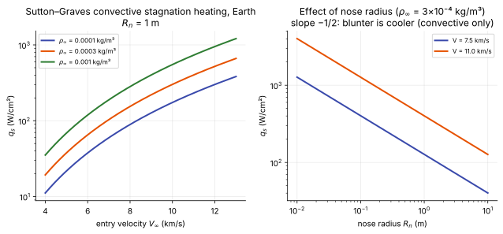

# Stagnation-point heating

**Slot:** Track 1.2 · **Depth:** [deep]

## What it is

Closed-form and correlation estimates of the convective heat flux at the stagnation point of a blunt body: Fay–Riddell (the boundary-layer solution with dissociation and wall catalysis), Sutton–Graves (the engineering correlation from it), and the reference-temperature method for heating away from the stagnation point. Their common message is the scaling $q_s \propto \sqrt{\rho_\infty/R_n}\,V_\infty^3$.

## The problem it solves

Stagnation heating sizes the heat shield at the nose and is the single most quoted aerothermal number for an entry vehicle. It is also the hardest thing for CFD to get right ([heat-flux accuracy](entry-flow-anatomy.md#boundary-layer)), so an independent estimate is essential: correlations are used for trajectory design long before CFD, and as a check on every CFD solution afterwards.

## How it works

### Why heating scales with $\sqrt{\rho/R_n}\,V^3$

Near the stagnation point the boundary layer is a thin layer between the wall and an inviscid stagnation-point flow whose tangential velocity grows linearly with distance, $u_e \approx (du_e/dx)\,x$. The boundary-layer thickness is set by viscosity and this velocity gradient, $\delta \sim \sqrt{\nu_e/(du_e/dx)}$, and the heat flux by the enthalpy difference across it, $q \sim k\,\Delta T/\delta$. From Newtonian theory the velocity gradient is

$$
\left(\frac{du_e}{dx}\right)_s = \frac{1}{R_n}\sqrt{\frac{2(p_e - p_\infty)}{\rho_e}},
$$

which scales as $V_\infty/R_n$. Putting these together, with the edge enthalpy $\approx V_\infty^2/2$, gives $q_s \propto \sqrt{\rho_\infty/R_n}\,V_\infty^3$:

- **$V^3$:** the energy to be carried away grows as $V^2$ and the rate at which gas is processed as $V$.
- **$1/\sqrt{R_n}$:** a blunter nose has a smaller velocity gradient, a thicker boundary layer and lower heating. This is why entry capsules are blunt (Allen & Eggers).
- **$\sqrt{\rho}$:** heating grows more slowly than density, so peak heating occurs higher on the trajectory than peak deceleration.

### Fay–Riddell

Fay & Riddell (1958) solved the stagnation-point boundary layer for dissociated air in chemical equilibrium and for a frozen boundary layer with a catalytic wall, and correlated the results as

$$
q_w = 0.763\,Pr^{-0.6}\,(\rho_w\mu_w)^{0.1}(\rho_e\mu_e)^{0.4}\sqrt{\left(\frac{du_e}{dx}\right)_s}\,(h_{0,e} - h_w)\left[1 + \left(Le^{\,n} - 1\right)\frac{h_D}{h_{0,e}}\right],
$$

with $n = 0.52$ for an equilibrium boundary layer and $n = 0.63$ for a frozen boundary layer at a fully catalytic wall. Symbols: subscript $e$ is the boundary-layer edge (post-shock stagnation conditions), $w$ the wall; $h_{0,e}$ the total enthalpy; $h_D$ the dissociation (chemical) enthalpy at the edge; $Le$ the Lewis number. The driving enthalpy $h_{0,e} - h_w$ already includes the chemical enthalpy $h_D$ carried by atoms, which is released at the wall only if they recombine there. The bracket corrects for atoms diffusing at a different rate than heat ($Le \ne 1$); with $Le \approx 1.4$ it is roughly a 10% effect. For a **non-catalytic** wall with a frozen boundary layer, atoms reach the wall but don't recombine, so their chemical energy is not delivered: the bracket becomes $[1 - h_D/h_{0,e}]$, and at high enthalpy, where $h_D$ is a large part of $h_{0,e}$, heating drops substantially. This is the physics behind the catalytic wall options in [wall boundary conditions](../walls/wall-boundary-conditions.md).

### Sutton–Graves

Sutton & Graves (1971) fitted the general form to boundary-layer solutions for many gas mixtures:

$$
q_s = k\,\sqrt{\frac{\rho_\infty}{R_n}}\;V_\infty^3 \qquad (\text{SI: W/m}^2),
$$

with $k$ depending only on the atmosphere's composition. It assumes a fully catalytic, cold wall and gives the **convective** heating only (no radiation).

<figure markdown>

<figcaption markdown="span">Sutton–Graves convective stagnation heating for Earth ($k = 1.7415\times10^{-4}$ SI), computed from the correlation: against velocity for three free-stream densities, and against nose radius.</figcaption>
</figure>

### Away from the stagnation point: reference temperature

Along the forebody, laminar heating is often estimated by evaluating incompressible flat-plate or similarity results at a **reference temperature** that accounts for compressibility and the cold wall (Eckert's reference enthalpy method); one common form is

$$
\frac{T^*}{T_e} = 1 + 0.032\,M_e^2 + 0.58\left(\frac{T_w}{T_e} - 1\right).
$$

Lees' method gives the laminar heating distribution over a blunt body as a ratio to the stagnation value, which (like modified Newtonian pressure) is accurate on the forebody and poor around the shoulder.

### Radiative heating

At high entry speeds the hot shock layer also radiates to the wall. Radiative heating grows much faster with velocity than convective heating (correlations scale with a high power of $V$) and *increases* with nose radius, the opposite trend. Above roughly 10–11 km/s at Earth (lunar return and faster) it becomes a significant or dominant part of stagnation heating. It is covered with the radiation chapter (Track 6); correlations such as Tauber–Sutton are the radiative counterpart of Sutton–Graves.

## Variants

- **Fay–Riddell**: equilibrium or frozen boundary layer, catalytic or not; needs edge and wall transport properties.
- **Sutton–Graves**: one constant per atmosphere; quick, design-level.
- **Detra–Kemp–Riddell, Zoby** and others: further correlations of the same family, including turbulent and laminar distributions.
- **Reference temperature / reference enthalpy (Eckert)** and **Lees' distribution** away from the stagnation point.

## Typical values

- Sutton–Graves $k$: $1.7415\times10^{-4}$ (Earth), $1.9027\times10^{-4}$ (Mars), SI units (Sutton & Graves 1971; as tabulated in later NASA entry literature).
- Fay–Riddell Lewis-number exponent: 0.52 (equilibrium BL), 0.63 (frozen BL, fully catalytic wall) (Fay & Riddell 1958).
- Example (computed from the correlation): $R_n = 1$ m, $\rho_\infty = 3\times10^{-4}$ kg/m³, $V_\infty = 11$ km/s gives $q_s \approx 400$ W/cm².

!!! warning "Calibration"
    Correlations of this family typically agree with each other and with laminar, fully catalytic CFD to within roughly 10–20%. They don't cover partially catalytic walls, ablating surfaces, turbulent forebodies or radiation unless explicitly extended.

## Trade-offs

- Gain: instant, independent estimates along a whole trajectory; the scaling laws that drive vehicle shape.
- Pay: stagnation point (and simple distributions) only; idealized wall chemistry; no radiation, no turbulence, no ablation.

## Effects on stability and robustness

Not a numerical method. Used to judge whether a CFD heat flux is credible.

## Implications

| Lens | Effect |
|---|---|
| Time step and cost | Negligible; trajectory-wide estimates before CFD. |
| Steady vs unsteady | Quasi-steady along a trajectory. |
| Accuracy (heat flux, pressure) | Typically 10–20% for laminar convective stagnation heating; the reference against which CFD heating is checked. |
| Robustness | n/a |
| Physics captured or lost | Captures BL scaling and catalytic recombination (Fay–Riddell); loses radiation, turbulence, ablation, partially catalytic walls. |
| Hardware / parallel fit | n/a |

## In a run

- Compare CFD stagnation heat flux with Fay–Riddell or Sutton–Graves for the same wall assumption (fully catalytic, cold wall). A large mismatch usually means insufficient wall-normal resolution, too much flux dissipation in the boundary layer, or a grid not aligned with the shock ([engineering checks](../verification/engineering-checks.md)).
- When switching the wall from fully catalytic to non-catalytic, expect a drop in heating of the size Fay–Riddell's bracket predicts.

## Which codes

Correlations are built into trajectory and engineering tools; CFD codes compute the heating directly and are compared against them.

## See also

[Hypersonic shock relations and Newtonian theory](hypersonic-shock-relations.md) · [Entry flow anatomy](entry-flow-anatomy.md) · [Wall boundary conditions](../walls/wall-boundary-conditions.md) · [Surface energy balance](../walls/surface-energy-balance.md) · [Transport and diffusion](../thermo/transport-and-diffusion.md)

## References

Anderson, *Hypersonic and High-Temperature Gas Dynamics* (chapters 6, 17); Fay & Riddell (1958); Sutton & Graves (1971); Eckert (1955); Allen & Eggers (1958).
