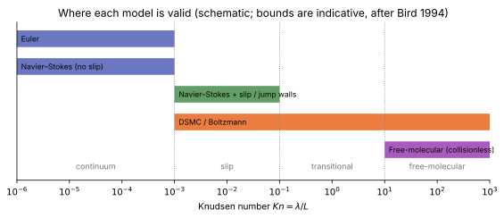

# Rarefaction and continuum breakdown

**Chapter:** 11 Rarefied flow and particle methods · **Depth:** [feel], with the criteria

## What it is

The Knudsen number and the flow regimes it defines, the reason the Navier–Stokes equations fail when molecules collide too rarely (the Chapman–Enskog expansion), and the local **breakdown parameter** that tells you where in a CFD solution the continuum model stops being trustworthy.

## The problem it solves

Entry starts in free-molecular flow and ends in continuum flow, and some regions stay rarefied long after the forebody is continuum: the wake and base region, small features, and the shock interior. A CFD solution there can look smooth and converged while being physically wrong. The breakdown criteria say where to switch to [DSMC](dsmc.md), or at least to [slip walls](../walls/wall-boundary-conditions.md#slip-and-temperature-jump-walls-rarefied-flow).

## How it works

### Knudsen number and regimes

The Knudsen number compares the mean free path $\lambda$ with a length scale $L$ of the flow:

$$
Kn = \frac{\lambda}{L},\qquad \lambda = \frac{1}{\sqrt2\,\pi d^2 n}\ \text{(hard spheres)},\qquad Kn \approx \sqrt{\frac{\pi\gamma}{2}}\,\frac{M}{Re}.
$$

The last form ties rarefaction to the hypersonic parameters: high Mach number and low Reynolds number both push $Kn$ up.

<figure markdown>

<figcaption markdown="span">Flow regimes and the models valid in each. Schematic; the bounds are indicative and depend on which length scale is used.</figcaption>
</figure>

- **Continuum** ($Kn \lesssim 10^{-3}$): Navier–Stokes with no-slip walls.
- **Slip** ($10^{-3} \lesssim Kn \lesssim 10^{-1}$): Navier–Stokes still holds in the interior, but the gas next to the wall no longer takes the wall's velocity and temperature; slip and temperature-jump conditions fix this.
- **Transitional** ($10^{-1} \lesssim Kn \lesssim 10$): neither continuum nor collisionless; needs the Boltzmann equation, in practice [DSMC](dsmc.md).
- **Free-molecular** ($Kn \gtrsim 10$): collisions in the gas are negligible; surface forces and heating follow from [free-molecular theory](free-molecular-flow.md).

### Why Navier–Stokes fails: Chapman–Enskog {#why-navier-stokes-fails-chapman-enskog}

The Boltzmann equation describes the velocity distribution function $f(\mathbf x, \mathbf c, t)$ of the molecules. Chapman and Enskog expanded $f$ about the local equilibrium (Maxwellian) distribution $f_0$ in powers of the Knudsen number:

$$
f = f_0\left(1 + Kn\,\phi_1 + Kn^2\,\phi_2 + \dots\right).
$$

Taking moments gives the fluid equations at each order: $f_0$ alone gives the **Euler** equations; adding $\phi_1$ gives **Navier–Stokes**, with viscosity, conductivity and diffusion coefficients expressed through collision integrals ([transport](../thermo/transport-and-diffusion.md#viscosity-and-conductivity)); the next order gives the Burnett equations. So Navier–Stokes is a first-order correction to equilibrium, valid only while the distribution stays close to Maxwellian, which requires many collisions over the length on which the flow changes. Inside a shock (a few mean free paths thick), in a rarefied wake, or near a wall in thin gas, that fails.

### The gradient-length breakdown parameter

A global $Kn$ based on the body size can hide local breakdown. Boyd, Chen & Candler (1995) proposed a local Knudsen number based on the gradient length of a flow quantity $Q$:

$$
Kn_{GL} = \frac{\lambda}{Q}\,\left|\nabla Q\right|,
$$

evaluated for density, temperature and velocity magnitude, taking the maximum. They found that continuum predictions differ from DSMC by more than a few percent where $Kn_{GL}$ exceeds about 0.05. It is cheap to post-process from a CFD solution and is the usual criterion for where a hybrid CFD–DSMC method should switch.

## Variants

- Global $Kn$ (body length or nose radius) vs local breakdown parameters ($Kn_{GL}$; Bird's $P$ parameter based on the rate of change of density along streamlines).
- Remedies in order of cost: slip/jump walls → hybrid CFD–DSMC → full DSMC. Extended continuum models (Burnett, moment methods) exist but are not standard for entry.

## Typical values

- Regime bounds as listed above (indicative; Bird 1994).
- Breakdown threshold $Kn_{GL} \approx 0.05$ (Boyd, Chen & Candler 1995, hypersonic sphere and cylinder flows compared with DSMC).
- Capsule entries are typically in continuum flow (for the body scale) from somewhere around 80–90 km altitude downwards on Earth, with the wake staying rarefied longer.

!!! warning "Calibration"
    Altitude bounds depend on vehicle size and the gas; treat the last bullet as an order of magnitude and compute $Kn$ for the actual case.

## Trade-offs

- Gain: knowing where CFD is valid, cheaply, from the CFD solution itself.
- Pay: the criteria are thresholds on fuzzy transitions; the answer is "probably wrong beyond here", not an error estimate.

## Effects on stability and robustness

Continuum codes in rarefied regions often still converge, which is the danger. Very low densities in the base region also stress positivity ([Riemann solvers](../spatial/riemann-solvers.md#positivity-safeguards)).

## Implications

| Lens | Effect |
|---|---|
| Time step and cost | The criterion is free; switching to DSMC multiplies cost. |
| Steady vs unsteady | n/a |
| Accuracy (heat flux, pressure) | Continuum heat flux and shock thickness become wrong as $Kn$ rises; slip walls recover some of it. |
| Robustness | Low-density regions stress positivity. |
| Physics captured or lost | Non-Maxwellian distributions, shock structure, thermal nonequilibrium at the kinetic level are lost in CFD. |
| Hardware / parallel fit | n/a |

## In a run

- Post-process $Kn_{GL}$ from every high-altitude solution; map where it exceeds 0.05.
- If breakdown is confined to the shock interior, the forebody solution is usually still fine; if it reaches the wall or covers the wake, use slip walls or DSMC.

## Which codes

Continuum codes (DPLR, LAURA, US3D) with slip-wall options; [SPARTA](../../codes/index.md#sparta) for DSMC; hybrid CFD–DSMC methods have been developed in research (e.g. the Michigan group's MPC framework) but are not routine.

## See also

[DSMC](dsmc.md) · [Free-molecular flow](free-molecular-flow.md) · [Wall boundary conditions](../walls/wall-boundary-conditions.md) · [Transport and diffusion](../thermo/transport-and-diffusion.md) · [Entry flow anatomy](../physics/entry-flow-anatomy.md)

## References

Bird, *Molecular Gas Dynamics and the Direct Simulation of Gas Flows*; Shen, *Rarefied Gas Dynamics*; Chapman & Cowling, *The Mathematical Theory of Non-Uniform Gases*; Boyd, Chen & Candler (1995).
