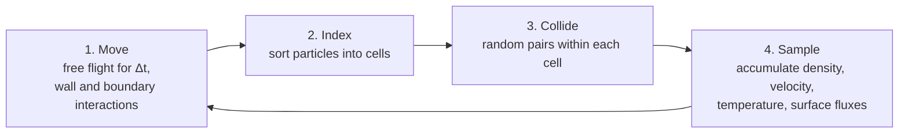

# Direct simulation Monte Carlo (DSMC)

**Chapter:** 11 Rarefied flow and particle methods · **Depth:** [feel], toward [deep] for the numerical parameters

## What it is

A particle method for the Boltzmann equation (Bird). A modest number of simulator particles, each standing for a large number $F_N$ of real molecules, move and collide in a grid of cells. Moving and colliding are done in separate steps within each time step. Macroscopic quantities (density, velocity, temperatures, heat flux) are sampled as averages over many particles and time steps.

## The problem it solves

In transitional flow ($0.1 \lesssim Kn \lesssim 10$) the Navier–Stokes equations are invalid ([continuum breakdown](continuum-breakdown.md)) and the Boltzmann equation, a 7-dimensional integro-differential equation, is impractical to discretize directly. DSMC solves it statistically, and handles internal energy and chemistry through collision rules rather than continuum rate equations.

## How it works

Each time step $\Delta t$:

1. **Move.** Every particle moves ballistically, $\mathbf x \leftarrow \mathbf x + \mathbf c\,\Delta t$, interacting with walls (diffuse/specular reflection, accommodation) and boundaries.
2. **Index.** Particles are sorted into cells.
3. **Collide.** Within each cell, pairs are selected at random and collided with a probability proportional to their relative speed times the collision cross-section. Bird's **no-time-counter (NTC)** scheme selects

    $$
    N_{\text{pairs}} = \tfrac12\,N\,\bar N\,F_N\,(\sigma_T c_r)_{\max}\,\frac{\Delta t}{V_c}
    $$

    candidate pairs in a cell of volume $V_c$ holding $N$ simulated particles (time-averaged number $\bar N$), each standing for $F_N$ real molecules. $\sigma_T$ is the total collision cross-section, $c_r$ the relative speed of a pair, and $(\sigma_T c_r)_{\max}$ the largest value of their product seen in the cell. Each candidate pair is accepted with probability $\sigma_T c_r/(\sigma_T c_r)_{\max}$. The cost is linear in $N$.
4. **Sample.** Accumulate moments for output.

Moving and colliding separately is exact in the limit of small $\Delta t$ and small cells, which sets the numerical parameters below.

**Collision models.** The **variable hard sphere (VHS)** model (Bird 1981) uses hard-sphere scattering with a cross-section that falls with relative speed, chosen so the model reproduces the real gas's viscosity–temperature exponent $\omega$ ($\mu \propto T^\omega$). The **variable soft sphere (VSS)** model also matches diffusion. **Internal energy:** the **Larsen–Borgnakke** model exchanges energy between translation and rotation/vibration in a fraction of collisions, set to reproduce relaxation rates (the particle counterpart of [Landau–Teller relaxation](../thermo/thermal-nonequilibrium.md)). **Chemistry:** reaction probabilities per collision chosen to reproduce Arrhenius rates (total collision energy model), or Bird's quantum-kinetic model.

## Variants

- NTC (Bird) vs Majorant Frequency and other collision-selection schemes.
- VHS, VSS, generalized hard sphere collision models.
- Larsen–Borgnakke with discrete vibrational levels.
- Time-averaged steady sampling vs ensemble-averaged unsteady sampling.
- Hybrid CFD–DSMC (DSMC only where $Kn_{GL}$ is large).

## Typical values

Rules of thumb for the numerical parameters (Bird 1994; widely used):

- **Cell size:** smaller than the local mean free path, typically $\Delta x \lesssim \lambda/3$ (subcells or transient adaptive subcells relax this for collision partner selection).
- **Time step:** smaller than the local mean collision time, and small enough that particles cross a fraction of a cell per step.
- **Particles per cell:** of order 10–20 or more for collision statistics.
- **Worked sizing (illustrative):** at 90 km altitude the ambient mean free path is about 2 cm, so cells of $\lambda/3$ are about 7 mm. A 3-D domain of 5 m on a side would need of order $4\times10^8$ such cells and several billion particles at 10–20 per cell, before allowing for the denser gas behind the shock, where $\lambda$ is an order of magnitude smaller. At 110 km, $\lambda$ is of order 1 m and the same domain needs a few thousand cells. This steep growth with density is why DSMC stops being practical as the flow becomes continuum.
- **Statistical noise** in a sampled mean falls only as $1/\sqrt{\text{number of samples}}$: halving the noise costs four times the sampling.

## Trade-offs

- Gain: valid from transitional to free-molecular flow; shock structure, non-Maxwellian distributions and kinetic-level nonequilibrium come out naturally; boundary conditions are simple particle reflections.
- Pay: cost grows steeply with density (cells scale with $1/\lambda$, collisions with density), so DSMC becomes impractical as the flow becomes continuum; statistical noise, especially in heat flux and in low-speed regions; unsteady flows need ensemble averaging.

## Effects on stability and robustness

No CFL instability in the usual sense; errors are statistical and from violating the cell-size and time-step rules (which mainly inflate transport coefficients, for example over-predicting heat flux). Positivity is automatic.

## Implications

| Lens | Effect |
|---|---|
| Time step and cost | Set by mean collision time and mean free path; cost grows steeply with density. |
| Steady vs unsteady | Naturally unsteady; steady results by time-averaging after transients. |
| Accuracy (heat flux, pressure) | Correct physics in rarefied flow; heat flux is the noisiest output. |
| Robustness | Robust; errors are statistical. |
| Physics captured or lost | Captures what continuum loses at high $Kn$; collision models are the physics knobs. |
| Hardware / parallel fit | Particle-parallel; GPU-friendly (SPARTA uses Kokkos). |

## In a run

- Check the ratio of cell size to local mean free path and of time step to mean collision time over the whole domain, after the solution is established (the density field sets them).
- Check particle counts per cell, especially in the dense stagnation region and the near-vacuum wake.
- Converge the sampling: watch heat flux noise fall as more samples are taken.

## Which codes

[SPARTA](../../codes/index.md#sparta) (Sandia, open source): hierarchical Cartesian grid with cut cells, adaptive grids, Kokkos GPU support. Other DSMC codes used for entry include DAC (NASA) and MONACO (University of Michigan).

!!! warning "Calibration"
    Code capabilities change between releases; take model availability from each code's documentation.

## See also

[Continuum breakdown](continuum-breakdown.md) · [Free-molecular flow](free-molecular-flow.md) · [Discretization families](../spatial/discretization-families.md) · [Thermal nonequilibrium](../thermo/thermal-nonequilibrium.md)

## References

Bird, *Molecular Gas Dynamics and the Direct Simulation of Gas Flows* (1994); Bird (1981) (VHS); Borgnakke & Larsen (1975); Boyd & Schwartzentruber, *Nonequilibrium Gas Dynamics and Molecular Simulation*; Shen, *Rarefied Gas Dynamics*.
