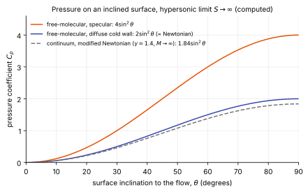

# Free-molecular flow

**Chapter:** 11 Rarefied flow and particle methods · **Depth:** [feel]

## What it is

The collisionless limit ($Kn \gtrsim 10$): molecules from the free stream hit the surface without colliding with each other or with molecules leaving the surface. Surface pressure, shear and heating then follow in closed form from the free-stream velocity distribution and a gas–surface interaction model.

## The problem it solves

The first part of every entry, aerobraking passes, and very small features are free-molecular. Forces and heating there set the vehicle's attitude and the start of the heating pulse, and the closed-form results are the limit that DSMC must reproduce.

## How it works

Each surface element sees an incoming flux of molecules with the free-stream Maxwellian distribution, shifted by the vehicle velocity. The governing parameter is the **speed ratio** $S = V_\infty/\sqrt{2RT_\infty}$, the bulk speed in units of the most probable thermal speed; at entry speeds $S$ is large (order 10–30).

What happens at the wall is set by the gas–surface interaction model. The simplest is **Maxwell's**: a fraction $\sigma$ of molecules is re-emitted **diffusely** (in random directions, with a Maxwellian at a temperature set by the energy accommodation coefficient $\alpha$), and $1 - \sigma$ is reflected **specularly**.

In the hypersonic limit $S \to \infty$ the results take a simple form for a surface inclined at angle $\theta$ to the flow:

- **Specular reflection:** each molecule reverses its normal momentum, so the normal momentum delivered is twice the incoming: $C_p = 4\sin^2\theta$.
- **Diffuse reflection, cold wall:** incoming normal momentum is fully absorbed and re-emitted molecules carry little momentum back: $C_p \to 2\sin^2\theta$ plus a small re-emission term of order $\sqrt{T_w/T_\infty}/S$. This is Newton's model ([Newtonian theory](../physics/hypersonic-shock-relations.md#newtonian-theory)), which is why Newton's corpuscular picture is exact for free-molecular flow and only approximate in a continuum.
- **Heating:** the energy flux is the incoming kinetic energy flux times the energy accommodation coefficient, $q \approx \alpha\,\tfrac12\rho_\infty V_\infty^3\sin\theta$ for large $S$; the **heat-transfer coefficient** $C_H = q/(\tfrac12\rho_\infty V_\infty^3)$ is at most about 1.

<figure markdown>

<figcaption markdown="span">Pressure coefficient on a surface inclined at $\theta$ to the flow, in the hypersonic limit. Specular reflection gives twice the diffuse cold-wall value, which is Newton's $2\sin^2\theta$. The continuum modified-Newtonian curve is shown for comparison: pressure hardly changes between the free-molecular and continuum limits. Heating and shear are what change by orders of magnitude. Computed from the limiting formulas.</figcaption>
</figure>

A worked number for heating: with full accommodation, a surface normal to the flow at 7.5 km/s and 120 km altitude ($\rho_\infty \approx 2\times10^{-8}$ kg/m³) receives $q \approx \tfrac12\rho_\infty V_\infty^3 \approx 0.4$ W/cm². The whole kinetic energy flux arrives because there is no shock layer or boundary layer to turn it away, but the density is so low that the flux is small. Lower down the density rises by orders of magnitude while $C_H$ falls by orders of magnitude, and their product peaks in the continuum regime.

Finite-$S$ formulas (Schaaf & Chambré) add error-function and exponential terms in $S\sin\theta$.

## Variants

- Maxwell (specular/diffuse fraction), Cercignani–Lampis–Lord, and other gas–surface interaction kernels.
- Panel methods applying the formulas element by element; shadowing must be handled for concave bodies.
- **Bridging functions** blend free-molecular and continuum coefficients across the transitional regime for engineering databases.

## Typical values

- Speed ratio at Earth entry: order 10–30.
- Energy accommodation on engineering surfaces is often assumed near 1 (diffuse, fully accommodating) in the absence of data.
- Free-molecular stagnation $C_H \approx 1$ (for full accommodation), compared with continuum values orders of magnitude smaller: the boundary layer and shock layer are what protect a vehicle at lower altitude.

## Trade-offs

- Gain: exact closed-form results in the limit; trivially cheap.
- Pay: valid only at $Kn \gtrsim 10$; results depend on accommodation coefficients that are often poorly known.

## Effects on stability and robustness

- Nothing iterates, so nothing can diverge.
- The practical risk is geometric: on concave or multi-body shapes, panels shadowed from the free stream, or struck by molecules reflected from other panels, are not covered by the single-panel formulas.
- Results scale directly with accommodation coefficients, so an assumed value of 1 is a modelling choice to state, not a default to forget.

## Implications

| Lens | Effect |
|---|---|
| Time step and cost | Negligible. |
| Steady vs unsteady | Steady per condition. |
| Accuracy (heat flux, pressure) | Exact in the limit, up to accommodation uncertainty. |
| Robustness | n/a |
| Physics captured or lost | No collisions in the gas by assumption. |
| Hardware / parallel fit | n/a |

## In a run

Use as the high-altitude end of an aerothermal database and as a check on DSMC at very low density.

## Which codes

Free-molecular panel methods in engineering tools; DSMC codes recover the limit. Plume-impingement tools for proximity operations use the same physics.

## See also

[Continuum breakdown](continuum-breakdown.md) · [DSMC](dsmc.md) · [Hypersonic shock relations and Newtonian theory](../physics/hypersonic-shock-relations.md) · [Wall boundary conditions](../walls/wall-boundary-conditions.md)

## References

Schaaf & Chambré, *Flow of Rarefied Gases* (1958); Bird, *Molecular Gas Dynamics and the Direct Simulation of Gas Flows*; Shen, *Rarefied Gas Dynamics*.
