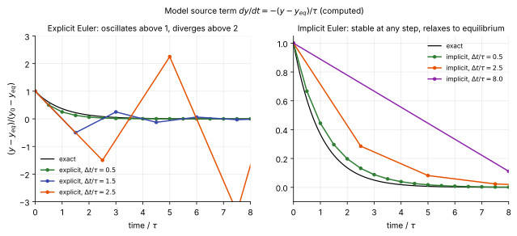

# Stiff source terms

**Chapter:** 8 Source terms · **Depth:** [deep]

## What it is

How a solver integrates the chemistry production rates $\dot\omega_s$ and the vibrational energy exchange $Q_{T\text{-}v}$ when their time scales are many orders of magnitude shorter than the flow's. A source is **stiff** when its fastest time scale is much shorter than the time step you'd like to take.

## The problem it solves

Reaction rates switch on exponentially with temperature ([finite-rate chemistry](../thermo/finite-rate-chemistry.md#how-it-knows-when-to-react)): behind a strong shock some reactions equilibrate in nanoseconds while the flow evolves over milliseconds. Integrating such sources explicitly would force $\Delta t$ below the fastest chemical time scale everywhere, a limit often far more severe than the [flow limits](../time/time-step-limits.md#source-term-limit).

The ratio of flow time to chemical time is the **Damköhler number**, $Da = \tau_{\text{flow}}/\tau_{\text{chem}}$. $Da \ll 1$: chemistry effectively frozen. $Da \gg 1$: chemistry effectively in equilibrium. $Da \sim 1$: genuine nonequilibrium. A reentry flow contains all three regimes at once, which is exactly what makes it stiff.

## How it works

### Why explicit integration fails

The essence of a stiff source is a fast relaxation towards a local equilibrium. The simplest model is one variable $y$ relaxing to $y_{eq}$ with time constant $\tau$:

$$
\frac{dy}{dt} = -\frac{y - y_{eq}}{\tau} .
$$

One explicit (forward Euler) step multiplies the distance from equilibrium by $1 - \Delta t/\tau$. For $\Delta t < \tau$ that is a decay. For $\tau < \Delta t < 2\tau$ the solution overshoots equilibrium and oscillates. For $\Delta t > 2\tau$ the factor is below $-1$ and the error grows without bound. One implicit (backward Euler) step multiplies the distance by $1/(1 + \Delta t/\tau)$, which is between 0 and 1 for every step size: with a huge step the cell simply lands on equilibrium.

<figure markdown>

<figcaption markdown="span">The model relaxation equation integrated with three step sizes, computed from the amplification factors $1 - \Delta t/\tau$ (explicit, left) and $1/(1 + \Delta t/\tau)$ (implicit, right). The explicit scheme is useless once the step exceeds twice the relaxation time; the implicit one loses accuracy in the transient but always goes to the right equilibrium.</figcaption>
</figure>

For a real mixture $\tau$ is replaced by the eigenvalues of the source Jacobian $\partial\mathbf S/\partial\mathbf U$: each eigenvalue is one over a chemical or relaxation time scale, and the explicit limit is set by the largest. A worked estimate for vibrational relaxation behind a bow shock: the Millikan–White correlation gives $p\,\tau_v \approx 4.7\times10^{-7}$ atm s for N₂–N₂ collisions at 10,000 K, so at a post-shock pressure of 0.1 atm $\tau_v \approx 5\times10^{-6}$ s. With a 10 cm shock layer and a post-shock speed of 500 m/s the flow time is $2\times10^{-4}$ s, so $Da \approx 40$ (illustrative conditions): relaxation is fast but not instantaneous, the classic nonequilibrium case. Dissociation and ionization reactions at the same conditions span many more orders of magnitude.

### One cell at a time

Reactions can't be stepped one at a time: they share species, so they are tightly coupled through the concentrations. All practical approaches work **cell by cell**, treating the full source vector of each cell together.

### Point-implicit {#point-implicit}

Treat the source implicitly in each cell. For an otherwise explicit update,

$$
\left(\frac{V}{\Delta t}\,\mathbf I - V\,\frac{\partial\mathbf S}{\partial\mathbf U}\right)\Delta\mathbf U = -\mathbf R(\mathbf U^n),
$$

one dense $n\times n$ solve per cell. This removes the chemical stability limit entirely. In a fully implicit code, $\partial\mathbf S/\partial\mathbf U$ simply joins the diagonal blocks of the [residual Jacobian](../time/implicit-methods.md#two-different-jacobians). This is the norm in reentry codes.

### Operator splitting with sub-stepped chemistry {#operator-splitting-with-sub-stepped-chemistry}

Advance the flow (fluxes only) by $\Delta t$, then integrate each cell's chemistry ODE system $d\mathbf U/dt = \mathbf S(\mathbf U)$ over the same $\Delta t$ with a stiff adaptive integrator (BDF-type, CVODE-style), taking as many internal substeps as that cell needs. Strang splitting (half-step chemistry, full-step flow, half-step chemistry) gives second-order accuracy in time.

A caveat matters for steady aeroheating: with simple (Lie) splitting, the converged steady state can depend on $\Delta t$, because the split operators don't balance exactly at steady state. That makes splitting awkward for steady problems and is part of why point-implicit treatment won there. Splitting is common in unsteady combustion codes.

### IMEX

Implicit–explicit Runge–Kutta schemes: explicit stages for the fluxes, implicit stages for the sources, combined in one consistent time-accurate scheme without splitting error at steady state.

### Reduction methods

Eliminate the fastest modes analytically so they never need resolving: quasi-steady-state approximation (QSSA) for fast intermediate species, partial equilibrium for fast reactions, and computational singular perturbation (CSP) or intrinsic low-dimensional manifolds for systematic reduction. More common in combustion than in reentry.

## Variants

The four approaches above, side by side:

| Approach | Stability limit from chemistry | Steady state exact? | Time-accurate? | Typical home |
|---|---|---|---|---|
| Explicit sources | $\Delta t < 2\tau_{\min}$ | yes | yes | non-reacting or slow chemistry only |
| Point-implicit | none | yes | first order unless iterated | steady reentry codes |
| Split with stiff ODE solver | none | no for Lie splitting (depends on $\Delta t$) | yes (second order with Strang) | unsteady combustion, explicit codes |
| IMEX | none | yes | yes | research, unsteady reacting flow |

## Typical values

- Amplification of a relaxation mode per step: $1 - \Delta t/\tau$ explicit, $1/(1 + \Delta t/\tau)$ implicit.
- Vibrational relaxation of N₂ by N₂ from Millikan–White: $p\,\tau_v \approx 7\times10^{-6}$ atm s at 5000 K, $5\times10^{-7}$ at 10,000 K, $1\times10^{-7}$ at 15,000 K (computed from the correlation, without Park's high-temperature correction).
- Range of the Arrhenius factor for N₂ dissociation: from about $10^{-164}$ at 300 K to about $10^{-5}$ at 10,000 K ([finite-rate chemistry](../thermo/finite-rate-chemistry.md#how-it-knows-when-to-react)).
- Cost of a point-implicit source: one dense $n\times n$ solve per cell, $n = 16$ for 11-species 2T air.

## Trade-offs

- **Point-implicit vs splitting.** Point-implicit has no splitting error and converges to the exact steady state; splitting lets each cell take as many substeps as it needs and keeps the flow solver explicit.
- **Fully coupled vs point-implicit only.** Putting the source Jacobian into a fully implicit system costs nothing extra; treating only the sources implicitly leaves the convective and viscous limits in place.
- **Detailed kinetics vs reduction.** Reduction removes the stiffest modes and some species, at the cost of generality.

## Effects on stability and robustness

- Explicit sources overshoot and diverge once the step exceeds twice the fastest time scale (figure).
- Implicit sources are stable but not positivity-preserving: a large step can still drive a trace species negative, so codes clip or limit the update.
- Impulsive starts with full chemistry behind a freshly captured shock are the classic failure; ramp the sources.
- The source Jacobian improves diagonal dominance of the implicit system when sources are relaxing (negative eigenvalues), and harms it when they are explosive (ionization avalanche).

## Implications

| Lens | Effect |
|---|---|
| Time step and cost | Point-implicit: a dense $n\times n$ solve per cell, removes the chemical limit. Splitting: cost scales with local stiffness (many substeps only where chemistry is fast). |
| Steady vs unsteady | Point-implicit works for both; Lie splitting has a $\Delta t$-dependent steady state; Strang and IMEX are time-accurate. |
| Accuracy | Large implicit steps are fine for steady state; for unsteady chemistry, time accuracy needs care (splitting order, subiterations). |
| Robustness | Implicit sources prevent the explosive overshoot of explicit chemistry; negative species densities still need clipping or positivity-preserving updates. |
| Physics captured or lost | Reduction methods discard fast transients by design; fine if those are not of interest. |
| Hardware / parallel fit | Cell-local and parallel, but adaptive substepping gives uneven work per cell, which hurts GPU load balance. |

## In a run

- Knobs: source treatment (point-implicit, split), chemistry start-up (frozen chemistry first, then switched on), sometimes a cap on reaction rates during start-up.
- Start-up: ramp the chemical sources from zero to full strength over the early iterations, and prefer a two-temperature model behind strong shocks, where it is less stiff than a one-temperature model because $T_v$ starts low (Park 1990, §5.5). Electron-impact ionization is the stiffest reaction class; see [avalanche ionization](../thermo/ionization-and-electrons.md#effects-on-stability-and-robustness).
- Symptoms: blow-up the moment chemistry is switched on; negative species densities near shocks; convergence slowing when going from 5 to 11 species.
- If the minimum time step of an explicit run sits just behind the shock, the sources are setting it.

## Which codes

Production reentry codes ([DPLR](../../codes/index.md#dplr), [LAURA](../../codes/index.md#laura), [US3D](../../codes/index.md#us3d)) treat sources implicitly, with the source Jacobian in the diagonal block of their implicit systems. Operator splitting with stiff ODE integrators is the norm in unsteady combustion codes and in explicit research codes with chemistry.

!!! warning "Calibration"
    The statement about the production codes follows from their published implicit formulations (Wright, Candler & Bose 1998; Gnoffo 1990; Candler et al. 2015). How each code limits or ramps sources during start-up is in the user manuals, not in those papers.

## See also

[Finite-rate chemistry](../thermo/finite-rate-chemistry.md) · [Thermal nonequilibrium](../thermo/thermal-nonequilibrium.md) · [Implicit methods](../time/implicit-methods.md) · [Local time stepping](../time/local-time-stepping.md)

## References

Bussing & Murman (1988) on point-implicit sources; Strang (1968); Hindmarsh et al. (2005) on CVODE/SUNDIALS; Lam & Goussis (1994) on CSP. See the [bibliography](../../references.md).
