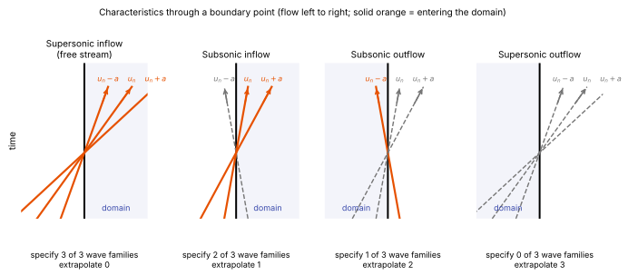

# Boundary conditions

**Chapter:** 5 Boundary conditions and walls · **Depth:** [deep]

## What it is

How a solver supplies the information that is missing at the edges of the domain. The interior scheme needs a state on both sides of every face, and at a boundary face one side doesn't exist. A boundary condition provides it, either as a **ghost-cell state** (a fictitious cell outside the domain) or directly as a **boundary-face flux**.

Walls are boundaries too, but their thermal and chemical conditions are a subject of their own: see [wall boundary conditions](../walls/wall-boundary-conditions.md).

## The problem it solves

Two things can go wrong at a boundary. If you impose more than the physics allows, the boundary fights the interior solution and reflects waves back into the domain. If you impose less, the problem has no unique solution and the run drifts. The inviscid part of the equations says exactly how much to impose: **one condition for each characteristic that enters the domain**, no more and no fewer.

## How it works

### Counting what enters

Look at the flow along the direction normal to the boundary. The inviscid equations carry information along [characteristics](../foundations/mathematical-character.md#hyperbolic) with three distinct speeds,

$$
\lambda_1 = u_n - a,\qquad \lambda_2 = u_n \ \ (\text{repeated}),\qquad \lambda_3 = u_n + a,
$$

where $u_n$ is the velocity component normal to the boundary and $a$ is the (frozen) sound speed. $\lambda_1$ and $\lambda_3$ are the two acoustic waves. $\lambda_2$ is repeated once for every remaining equation: entropy, the two tangential velocity components, and each species density and vibrational energy that the gas model [adds](../foundations/mathematical-character.md#adding-species-and-vibrational-energy). With $n_e$ equations per cell there are $n_e - 2$ waves travelling at $u_n$.

A wave whose speed points into the domain brings information from outside, so the boundary condition must supply it. A wave whose speed points out carries information the interior already has, so it must be taken from the interior.

<figure markdown>

<figcaption markdown="span">The three wave families through a boundary point, in the $x$–$t$ plane, for flow from left to right. Solid orange lines enter the domain and need a boundary condition. Dashed grey lines leave it and are extrapolated from the interior. Schematic.</figcaption>
</figure>

| Boundary | Sign of the speeds (flow into domain positive) | Specify | Take from interior |
|---|---|---|---|
| Supersonic inflow | all positive | all $n_e$ | none |
| Subsonic inflow | $u_n - a < 0$, others positive | $n_e - 1$ | 1 |
| Subsonic outflow | only $u_n - a$ points in | 1 | $n_e - 1$ |
| Supersonic outflow | all point out | none | all $n_e$ |

For 11-species two-temperature air in 3-D, $n_e = 16$: a subsonic inflow specifies 15 quantities and a subsonic outflow one (almost always the pressure).

"Specify" means a physical boundary condition. "Take from interior" means a **numerical** boundary condition: the scheme still needs a number there, and gets it by extrapolating.

### Why entry flows are the easy case

A capsule in flight sits in a hypersonic free stream. The outer boundary ahead of the bow shock is a supersonic inflow, so every variable is simply set to its free-stream value. The exit plane behind the body is almost entirely supersonic, so everything is extrapolated. Neither boundary can reflect a wave, because no wave can travel from the interior to the inflow boundary, and none can come back in through a supersonic outflow.

This is why the far field of an entry computation can sit just outside the bow shock, while a subsonic airfoil computation needs its far field tens of chords away. The price is that the outer boundary must actually be outside the shock everywhere, and for accuracy should follow it closely ([shock alignment](discretization-families.md#shock-alignment)).

The care goes into the exceptions: the subsonic part of the boundary layer and wake where they cross the exit plane, symmetry planes and the axis, and facility simulations (nozzles, arc jets) where subsonic boundaries are real.

### Riemann invariants for subsonic boundaries

When a boundary is subsonic, the cleanest way to combine "specified" and "extrapolated" information is through the quantities each wave carries. For a perfect gas in one dimension these are the **Riemann invariants**,

$$
R^\pm = u_n \pm \frac{2a}{\gamma - 1},
$$

which stay constant along the $u_n \pm a$ characteristics, plus entropy and tangential velocity, which travel at $u_n$. At a far-field face with outward normal, take $R^+$ from the interior cell (it travels outward) and $R^-$ from the free stream (it travels inward). Adding and subtracting gives the boundary state:

$$
u_{n,b} = \tfrac12\,(R^+ + R^-),\qquad a_b = \tfrac{\gamma-1}{4}\,(R^+ - R^-).
$$

Entropy and tangential velocity come from the free stream if $u_{n,b}$ points in, and from the interior if it points out. The invariants assume isentropic flow of a perfect gas. Reacting-gas codes use the same idea in linearized form: decompose the difference between interior and exterior states into characteristic variables with the local eigenvectors, and keep only the incoming ones from outside.

### Ghost cells or boundary fluxes

There are two ways to apply any of these conditions.

- **Ghost cells.** Fill one or two layers of fictitious cells outside the boundary with a state chosen so that the ordinary interior flux function, applied to the interior and ghost states, produces the wanted boundary behaviour. For a symmetry plane, the ghost state is the mirror image: same density, pressure and tangential velocity, normal velocity reversed. The flux function then returns zero mass flux through the face on its own. Ghost cells keep the interior code unchanged and give higher-order stencils something to read.
- **Boundary fluxes.** Compute the flux at the boundary face directly from the boundary state. At an inviscid wall the only nonzero inviscid flux is the pressure force in the momentum equations, $\mathbf F\cdot\mathbf n = (0,\ p\,\mathbf n,\ 0)^T$. This avoids inventing a state inside a wall, which matters for cold walls ([wall boundary conditions](../walls/wall-boundary-conditions.md#numerical-implementation)).

### Boundary conditions inside an implicit solver

In an [implicit method](../time/implicit-methods.md) the left-hand side contains the Jacobian of the residual. A ghost state depends on the interior state next to it, $\mathbf U_g = \mathbf f(\mathbf U_i)$, so its contribution to the Jacobian is $\partial\mathbf F/\partial\mathbf U_g \cdot \partial\mathbf U_g/\partial\mathbf U_i$, and it belongs in the diagonal block of the boundary cell. If instead the ghost state is frozen during the linear solve (an **explicit**, or lagged, boundary condition), the boundary cells are effectively advanced explicitly while the interior is implicit. The converged answer is the same, but the usable CFL number and the convergence rate drop, and the wall is exactly where an aeroheating run needs to converge best.

## Variants

### Supersonic inflow (free stream)

All variables are set: density or pressure, velocity, temperature, and also the species mass fractions and the vibrational temperature. In flight the free stream is in equilibrium, so $T_v = T_\infty$ and the composition is ambient. In a ground facility it usually is not: the nozzle expansion [freezes](../thermo/thermal-nonequilibrium.md) the vibrational energy and leaves some dissociated gas, so the test-section free stream has $T_v > T$ and atoms present. Using flight-style free-stream conditions for a tunnel case is a common source of disagreement with measured heating.

### Supersonic outflow

Extrapolate everything from the interior (copy the last cell, or extrapolate linearly). The boundary layer crossing the exit has a thin subsonic part next to the wall, which by the counting rule would need one condition. In practice it is extrapolated like the rest. That works for the same reason [space marching](../special/space-marching.md) works: the subsonic layer is thin and the pressure across it is set by the supersonic flow outside. It fails if a recirculation region crosses the exit plane, because then flow enters through an "outflow" boundary with nothing specified. Put the exit plane downstream of where the wake closes, or stop the domain at the shoulder if only forebody heating is wanted.

### Subsonic outflow

One quantity is specified, normally the static pressure. A hard pressure condition reflects outgoing acoustic waves back into the domain, which is harmless for a steady solution but contaminates an unsteady one. **Non-reflecting characteristic conditions** (Thompson; the NSCBC formulation of Poinsot and Lele) instead set the amplitude of the incoming acoustic wave so that the pressure relaxes towards its target,

$$
\mathcal L_{\text{in}} = \sigma\,(1 - M^2)\,\frac{a}{L}\,(p - p_\infty),
$$

where $\mathcal L_{\text{in}}$ is the incoming wave amplitude, $M$ the largest Mach number in the domain, $L$ a domain length and $\sigma$ a relaxation coefficient. With $\sigma = 0$ nothing is reflected but the mean pressure can drift; a large $\sigma$ pins the pressure and reflects.

### Symmetry plane

Zero normal velocity and zero normal gradient of every scalar and of the tangential velocity. With ghost cells this is the mirror state described above. It is exact only if the flow really is symmetric: a steady symmetric solution of an unsteady wake is an artefact of the boundary condition.

### Axis of an axisymmetric flow

In axisymmetric form each cell is a wedge of revolution, the face lying on the axis has zero area, and so no flux passes through it. The radial momentum equation picks up a pressure source term from the wedge's side faces. Nothing needs to be imposed, but the axis is where trouble shows up: cells next to it have vanishing volume, and for a capsule at zero angle of attack the axis is the stagnation streamline, exactly where peak heating is read off. Stagnation-point heat-flux spikes or dips on the axis, and [carbuncles](shock-instabilities.md) that start there, are classic artefacts. In 3-D the same issue appears as a grid pole where hexahedra collapse; nose-patch block topologies avoid it.

### Block interfaces and periodic boundaries

Not physical conditions: the ghost cells are filled with the neighbouring block's (or the periodic image's) interior cells. In a line-relaxation solver the coupling across a block interface is lagged, so a block boundary placed across the boundary layer slows convergence ([relaxation methods](../time/relaxation-methods.md)).

### Walls

No-slip, thermal, catalytic and slip conditions: [wall boundary conditions](../walls/wall-boundary-conditions.md). Ablating and blowing walls: [surface energy balance](../walls/surface-energy-balance.md).

## Typical values

- Conditions to specify with $n_e$ equations: $n_e$ (supersonic inflow), $n_e - 1$ (subsonic inflow), 1 (subsonic outflow), 0 (supersonic outflow). For 11-species 2T air in 3-D, $n_e = 16$.
- NSCBC relaxation coefficient $\sigma$: 0.25 is the value recommended by Poinsot & Lele (1992); 0.58 is the optimum derived by Rudy & Strikwerda (1980) for their model problem.
- Ghost layers needed: one for a first-order or compact second-order scheme, two for MUSCL on a structured grid, three for fifth-order WENO.

## Trade-offs

- **Ghost cells vs boundary fluxes.** Ghost cells reuse the interior scheme and extend naturally to high order; boundary fluxes are exact about what crosses the face and avoid unphysical ghost states.
- **Implicit vs lagged boundary conditions.** Implicit treatment costs a Jacobian of the boundary condition for each boundary type; lagging it is simpler to code but limits the CFL number.
- **Hard vs relaxed outflow pressure.** A fixed pressure holds the operating point but reflects; a non-reflecting condition lets waves out but lets the mean pressure wander.
- **Tight vs generous outer boundary.** A boundary close to the shock wastes no cells on free stream, but it must be re-fitted whenever the shock moves (angle of attack, gas model, trajectory point).

## Effects on stability and robustness

- Over-specifying a subsonic boundary (for example fixing density, velocity and pressure at a subsonic outflow) gives a problem with no solution; the run oscillates or diverges near the boundary.
- A bow shock touching the inflow boundary is a hard failure: the free-stream condition is then imposed inside the shock layer.
- Reverse flow through an extrapolation outflow is unstable or produces a solution that depends on the initial condition.
- Lagged wall conditions are a frequent reason an implicit run stalls at a CFL number far below what the interior scheme supports.

## Implications

| Lens | Effect |
|---|---|
| Time step and cost | Negligible cost per iteration. Lagged (explicit) boundary conditions cap the CFL number of an implicit solver. |
| Steady vs unsteady | Reflections don't matter for a steady answer but corrupt unsteady ones; non-reflecting conditions are an unsteady-flow tool. |
| Accuracy (heat flux, pressure) | Hypersonic far-field boundaries are exact. Axis and symmetry treatment directly affects stagnation-point heat flux. |
| Robustness | Shock on the outer boundary, reverse flow at the exit and the axis singularity are the usual failures. |
| Physics captured or lost | A symmetry plane suppresses asymmetric and unsteady wake modes. Free-stream $T_v$ and composition matter for facility cases. |
| Hardware / parallel fit | Ghost cells double as the halo exchanged between processors or GPUs. |

## In a run

- Check that the outer boundary clears the bow shock at every trajectory point, with a few cells of free stream to spare.
- For facility cases, set the free-stream $T_v$ and mass fractions from a nozzle computation, not from ambient values.
- If heat flux shows a spike or dip exactly on the axis, suspect the axis treatment or a carbuncle before suspecting the physics.
- If residuals stall with the largest values in cells next to a boundary, check whether that boundary condition is treated implicitly.
- If the exit plane shows inflow, move it downstream or cut the domain upstream of the separation.

## Which codes

All the production entry codes ([DPLR](../../codes/index.md#dplr), [LAURA](../../codes/index.md#laura), [US3D](../../codes/index.md#us3d)) use free-stream inflow, extrapolation outflow, symmetry and axis conditions, and treat wall conditions implicitly. The structured codes also adapt the outer boundary to the bow shock during the run. [MFC](../../codes/index.md#mfc) offers characteristic (Thompson-type) non-reflecting conditions because its problems are unsteady and wave-dominated.

!!! warning "Calibration"
    The statements above are about what these codes offer in general, from their user manuals and methods papers. Option names, numbering and defaults differ between codes and versions; check the user manual before relying on a specific setting.

## See also

[Wall boundary conditions](../walls/wall-boundary-conditions.md) · [Surface energy balance](../walls/surface-energy-balance.md) · [Mathematical character](../foundations/mathematical-character.md) · [Space marching](../special/space-marching.md) · [Shock instabilities](shock-instabilities.md)

## References

Blazek, ch. 8; Hirsch, vol. 2; Thompson (1987); Poinsot & Lele (1992); Rudy & Strikwerda (1980). See the [bibliography](../../references.md).
