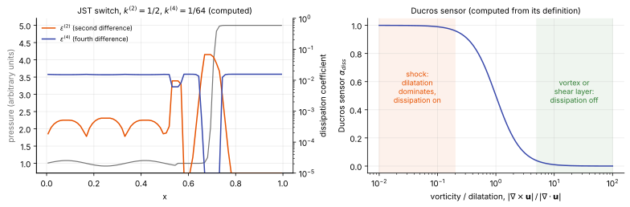

# Central schemes and dissipation

**Chapter:** 7 Inviscid flux functions · **Depth:** [deep]

## What it is

Central schemes compute the face flux from a symmetric average of the two sides and add dissipation explicitly, rather than getting it implicitly from upwinding. Any upwind flux can be written this way ("central minus dissipation", see [Riemann solvers](riemann-solvers.md#how-it-works)); central schemes make the split explicit so the dissipation can be switched off where it isn't needed.

## The problem it solves

Upwind fluxes dissipate everywhere, including in smooth regions where they damp turbulence, instability waves and acoustics. For LES and DNS of transition, SWBLI unsteadiness or turbulent heating, that numerical dissipation can swamp the physics (Subbareddy & Candler showed fully upwind fluxes visibly over-damp decaying turbulence). Central schemes can be nearly dissipation-free in smooth flow and add dissipation only at shocks.

## How it works

The flux at face $f$ is

$$
\hat{\mathbf F}_f = \mathbf F_{f,\text{sym}} + \alpha_{\text{diss}}\,\mathbf D_f ,
$$

a symmetric (non-dissipative) part, plus a dissipative part $\mathbf D_f$ (typically borrowed from an upwind scheme) multiplied by a **shock sensor** $0 \le \alpha_{\text{diss}} \le 1$ that is near zero in smooth or vortical regions and near one at shocks. Design choices: how the symmetric part is built (plain average, skew-symmetric, kinetic-energy consistent), where the dissipation comes from, and the sensor.

A naive central average is unstable for compressible turbulence even without shocks. The convective terms are products of the variables, and on a grid a product of two resolved waves can create a wave too short for the grid to represent, which then reappears as a longer one (**aliasing**). With a plain central average that mechanism creates kinetic energy from nothing, and with no dissipation to remove it the energy piles up until the run fails. Kinetic-energy-consistent and skew-symmetric forms are built so that the discrete convective terms can't do that.

<figure markdown>

<figcaption markdown="span">Two ways to decide where dissipation acts. Left: the JST coefficients computed for a pressure profile with smooth waves and a captured shock (grey, left axis). The second-difference coefficient $\varepsilon^{(2)}$ rises by orders of magnitude at the shock, and the background fourth-difference coefficient $\varepsilon^{(4)}$ switches off there. Right: the Ducros sensor, which compares compression with rotation; it is near one where dilatation dominates and near zero in vortical flow.</figcaption>
</figure>

## Variants

### JST

Jameson–Schmidt–Turkel (1981): a central flux plus two kinds of added dissipation. In one dimension the face flux is the central average minus a dissipative flux, $\hat{\mathbf F}_{i+1/2} = \tfrac12(\mathbf F_i + \mathbf F_{i+1}) - \mathbf d_{i+1/2}$, with

$$
\mathbf d_{i+1/2} = \lambda_{i+1/2}\Big[\varepsilon^{(2)}\,(\mathbf U_{i+1} - \mathbf U_i) \;-\; \varepsilon^{(4)}\,(\mathbf U_{i+2} - 3\mathbf U_{i+1} + 3\mathbf U_i - \mathbf U_{i-1})\Big],
$$

with $\lambda = |u| + a$ the largest wave speed at the face. The first term is a second difference: it acts like a viscosity and is what captures shocks. The second is a fourth difference: it is tiny in smooth flow, but damps the odd–even (sawtooth) mode that a central scheme can't see. The coefficients come from a pressure sensor,

$$
\nu_i = \frac{|p_{i+1} - 2p_i + p_{i-1}|}{p_{i+1} + 2p_i + p_{i-1}},\qquad
\varepsilon^{(2)} = k^{(2)}\max(\nu_i,\nu_{i+1}),\qquad
\varepsilon^{(4)} = \max\big(0,\ k^{(4)} - \varepsilon^{(2)}\big).
$$

$\nu_i$ is a normalized second difference of pressure: of order $\Delta x^2$ in smooth flow and of order one across a shock. So $\varepsilon^{(2)}$ is negligible except at shocks, and $\varepsilon^{(4)}$ is turned off exactly there, because a fourth difference across a discontinuity would produce overshoots. $k^{(2)}$ and $k^{(4)}$ are user constants.

This is the classic aerospace central scheme, typically paired with [explicit Runge–Kutta](../time/explicit-methods.md#explicit-steady-state-solvers), local time stepping and multigrid. Its second-difference term is a scalar dissipation (the same coefficient for every wave), which is what makes it too diffusive for boundary layers at high Mach number unless the coefficients are reduced near walls.

### Kinetic-energy-consistent fluxes

Subbareddy & Candler (2009), the basis of US3D's low-dissipation capability. The aim: the discrete convective fluxes should not create or destroy kinetic energy $\rho k = \tfrac12\rho|\mathbf u|^2$, which is transferred only through pressure work and viscous dissipation.

Deriving the kinetic-energy balance from the discrete mass and momentum fluxes shows this holds if the momentum flux is the mass flux times the **face-averaged velocity**:

$$
\mathbf F_f = (\rho u')_f \begin{bmatrix} 1 \\ \bar u \\ \bar v \\ \bar w \end{bmatrix}_f,\qquad \bar a_f = \tfrac12(a_i + a_{nbr}),
$$

with any symmetric choice of the face mass flux $(\rho u')_f$, and with the kinetic-energy flux in the total-energy equation chosen consistently (it involves $\tfrac12(u_iu_{nbr} + v_iv_{nbr} + w_iw_{nbr})$ times the mass flux). This is the compressible analog of the kinetic-energy-conserving fluxes used in incompressible LES codes, and similar to skew-symmetric forms. They also show the time discretization matters: a "fully discrete" form is needed to keep the property through the time step.

**The fully discrete form.** Kinetic-energy consistency in space is lost if the time integrator is careless. Subbareddy & Candler make the scheme consistent in time as well by writing the kinetic energy as a quadratic product of the parameter vector $\mathbf Z = \sqrt\rho\,(1,\mathbf u)$, which leads to a Roe-type average **between time levels** for the velocity in the convective fluxes:

$$
\tilde{\mathbf u} = \frac{\sqrt{\rho^{n+1}}\,\mathbf u^{n+1} + \sqrt{\rho^{n}}\,\mathbf u^{n}}{\sqrt{\rho^{n+1}} + \sqrt{\rho^{n}}},
\qquad
\mathbf F_f = (\rho u')_f \begin{bmatrix} 1 \\ \tilde{\mathbf u}_f \end{bmatrix}.
$$

Because the flux depends on $\mathbf U^{n+1}$ the scheme is implicit. The simplest solver is the fixed-point iteration

$$
\mathbf U^{n+1,k+1} = \mathbf U^n - \frac{\Delta t}{V}\sum_f \mathbf F_f\big(\mathbf U^n,\mathbf U^{n+1,k}\big)\,S_f,\qquad \mathbf U^{n+1,0} = \mathbf U^n,
$$

stopped when the residual falls below a threshold (Candler, Subbareddy & Nompelis 2015):

- **Iterations:** 3–4 are typically enough, so the cost is similar to a multistage Runge–Kutta step (but second order).
- **Time step:** this explicit iteration is CFL-limited, CFL ≤ 1.
- **Implicit alternative:** linearize about time level $n$; exact linearization is onerous because of the density weighting, but approximate linearizations work well in practice.

**Why it is more stable than it looks.** An unbiased flux would normally be expected to oscillate badly near steep gradients. The kinetic-energy constraint limits how much kinetic energy each face can move, which suppresses overshoots and undershoots in non-smooth regions. It is not enough at real shocks: strong shocks still need the added upwind dissipation below.

**Shock capturing** adds the dissipative part of the [modified Steger–Warming](flux-vector-splitting.md#modified-steger-warming) flux, $\mathbf D_f = -\tfrac12(\mathbf R|\boldsymbol\Lambda|\mathbf R^{-1})_f(\mathbf U_R - \mathbf U_L)$, with MUSCL face states, multiplied by the Ducros sensor (below), taking the larger of the two cell values at the face.

**Time integration** is implicit: BDF2 with subiterations solved by full-matrix point relaxation, with CFL up to $10^5$ for steady runs. A subtlety: if the implicit Jacobians include full dissipation while the residual uses switched dissipation, unconverged subiterations leave a small extra dissipation that accumulates over many steps; converging the subiterations removes it.

**Validation** in the paper includes the 25°–55° double cone at Mach 11.3 (Holden's CUBRC case), where the separation size is sensitive to numerical dissipation; with the low-dissipation fluxes (TVD-MUSCL with minmod plus the Ducros switch) the computed heat transfer matched experiment and reference simulations, once vibrational relaxation and chemistry were included in the forebody.

**Higher than second order on hexahedral grids.** US3D extends the KEC flux to fourth and sixth order without widening the connectivity, by reusing the cell-centred gradients it already computes for the viscous terms. In 1-D the idea is

$$
\mathbf U_{i+\frac12} = a\,(\mathbf U_i + \mathbf U_{i+1}) + b\,\Delta x\left(\frac{\partial\mathbf U}{\partial x}\bigg|_i - \frac{\partial\mathbf U}{\partial x}\bigg|_{i+1}\right),
$$

where $a$ and $b$ set the modified wavenumber. A Taylor expansion shows $a = \tfrac12$, $b = \tfrac18$ cancels the $\Delta x^2$ error and gives a fourth-order face value; using neighbours' gradients again gives sixth order. This assumes smooth variation on a smoothly varying hexahedral grid; on irregular grids the order is lost.

**Sensor limits.** The Ducros sensor (below) misses some discontinuities. Candler et al. give the example of a cold, light gas injected into a hot, heavy stream: the large density jump carries little dilatation and is not flagged. A Mach-number switch or other detector may be needed, and sensor design is still open research for all low-dissipation schemes.

### Shock sensors

**Ducros:**

$$
\alpha_{\text{diss}} = \min\!\left(\frac{(\nabla\cdot\mathbf u)^2}{(\nabla\cdot\mathbf u)^2 + |\nabla\times\mathbf u|^2 + \epsilon},\ 1\right).
$$

Near one where dilatation dominates (shocks), near zero where vorticity dominates (turbulence), so shear layers and boundary-layer turbulence are left undamped. Undefined in 1D (no vorticity), where pressure- or density-gradient sensors are used instead. Other sensors use pressure or density second differences (as in JST) or the Mach-number jump across a face. No sensor is perfect: compressions and expansions in turbulence also trigger it, and a strong vortex near a shock can switch it off.

### Shock regularization (IGR)

A different route, used in MFC: rather than capturing shocks with limiters and Riemann solvers, modify the equations with an "entropic pressure" obtained from an elliptic solve each step, so shocks are spread over a controlled width and simple central fluxes can be used. This replaces the whole reconstruction-plus-Riemann-solver slot and needs very little memory, which is what enabled very large GPU runs in [MFC](../../codes/index.md#mfc). It is still explicit and CFL-limited, so it does not change the [time-step constraint](../time/explicit-vs-implicit.md#shock-regularization-is-not-a-time-step-loophole).

!!! warning "Calibration"
    Summary of the published idea (Cao & Schäfer) and its use in MFC (Wilfong et al.); check those papers for the exact formulation.

## Typical values

- JST constants: $k^{(2)}$ between 1/4 and 1, $k^{(4)}$ between 1/256 and 1/32; 1/2 and 1/64 are common starting values (Jameson, Schmidt & Turkel 1981; Blazek).
- Fully discrete KEC, explicit iteration: 3–4 iterations per step, CFL ≤ 1, cost comparable to multistage Runge–Kutta (Candler, Subbareddy & Nompelis 2015).
- Implicit KEC (BDF2 + full-matrix point relaxation): CFL up to $10^5$ for steady runs (Subbareddy & Candler 2009); about 100 for second-order implicit point relaxation in hybrid RANS/LES (Candler et al. 2015).
- Order: second by default; fourth and sixth on smooth hexahedral grids using gradient information ($a = \tfrac12$, $b = \tfrac18$ for fourth order).
- Large-scale use: a 216.6-million-element DNS of the HIFiRE-5 elliptic cone in US3D used fourth-order KEC fluxes with third-order explicit Runge–Kutta (Candler et al. 2015).

## Trade-offs

- **Central with switched dissipation vs upwind.** Far less dissipation in smooth and vortical flow, which transition, LES and DNS need. The price is dependence on a shock sensor.
- **Sensor too weak vs too strong.** A sensor that misses a discontinuity leaves it unprotected and the solution oscillates; one that fires too widely makes the scheme as dissipative as the upwind flux it borrowed from.
- **Scalar (JST) vs matrix dissipation.** Scalar dissipation is cheap and robust but damps every wave at the fastest wave's rate; matrix dissipation (the upwind term used with KEC) damps each wave at its own speed and preserves boundary layers.
- **For steady aeroheating.** With the sensor on everywhere the scheme reduces to its upwind parent, so nothing is gained; the method earns its cost only when there is unsteady small-scale motion to preserve.

## Effects on stability and robustness

- With dissipation switched off, stability rests entirely on the symmetric flux not producing kinetic energy. A plain average fails this; KEC and skew-symmetric forms pass it.
- Sensor misfires are the main risk: a density jump with little dilatation (cold light gas into a hot heavy stream) isn't flagged by the Ducros sensor.
- Forward Euler and two-stage Runge–Kutta are unstable with dissipation-free central fluxes at any time step ([explicit methods](../time/explicit-methods.md#why-there-is-a-step-limit-at-all)); three or more stages, or an implicit scheme, are needed.
- In an implicit solver, building the Jacobian with full dissipation while the residual uses switched dissipation helps convergence but leaves extra damping unless subiterations are converged.

## Implications

| Lens | Effect |
|---|---|
| Time step and cost | Cheap fluxes; the sensor adds a gradient evaluation. Implicit treatment needs care with switched dissipation in the Jacobians. |
| Steady vs unsteady | Designed for unsteady LES/DNS; works for steady runs with the dissipation switched fully on or by sensor. |
| Accuracy | Minimal dissipation in smooth and vortical regions; quality at shocks depends on the sensor and the borrowed dissipation. |
| Robustness | Without dissipation, central schemes rely on kinetic-energy consistency for stability; sensor misfires at strong shocks are the main risk. |
| Physics captured or lost | Keeps turbulence, instability waves and separation-bubble dynamics (double-cone separation size is dissipation-sensitive). |
| Hardware / parallel fit | Compact and local; GPU-friendly. |

## In a run

Knobs: dissipation on/off/sensor, sensor type and threshold, reconstruction used in the dissipation term. Symptoms: oscillations near shocks (sensor too weak), over-damped turbulence or wrong separation size (sensor too strong or dissipation always on).

## Which codes

US3D (KEC plus Ducros-switched modified Steger–Warming dissipation); many aerospace codes (JST); MFC (IGR).

## See also

[Riemann solvers](riemann-solvers.md) · [Flux-vector splitting](flux-vector-splitting.md) · [Shock instabilities](shock-instabilities.md) · [US3D](../../codes/index.md#us3d)

## References

Jameson, Schmidt & Turkel (1981); Ducros et al. (1999); Subbareddy & Candler (2009); Candler, Subbareddy & Nompelis (2015, chapter); Candler et al. (2015, US3D); Pirozzoli (2011). See the [bibliography](../../references.md).
