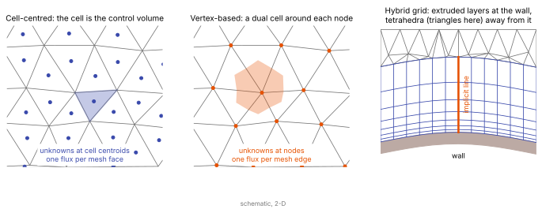

# Discretization families

<div class="page-meta" markdown>
**Chapter:** 6 Spatial discretization · **Depth:** [deep]
</div>

## What it is

The ways of turning the continuous PDE into a finite set of unknowns: finite differences, finite volumes, finite elements and discontinuous Galerkin, and particle methods (DSMC); on structured multiblock or unstructured grids; cell-centred or vertex-based.

## The problem it solves

Each family makes different trade-offs between conservation, geometric flexibility, order of accuracy and cost. The choice constrains everything downstream: how reconstruction works, which relaxation directions exist, and how heat flux behaves near walls.

## How it works

Every family answers three questions, and the answers are what distinguish them.

1. **Where do the unknowns live, and what do they mean?** A point value at a grid node, an average over a cell, or the coefficients of a polynomial inside an element.
2. **Is conservation built in?** A scheme is conservative when whatever leaves one control volume enters its neighbour, so that the update is a [flux difference](../foundations/conservation-and-weak-solutions.md). Without that, captured shocks sit in the wrong place.
3. **How is the order of accuracy raised?** By widening the stencil (more neighbours), or by adding unknowns inside each element.

<figure markdown>

<figcaption markdown="span">Left: a cell-centred scheme stores one state per mesh cell, and the cell is the control volume. Middle: a vertex-based scheme stores one state per node, and its control volume is the **dual cell** built around the node from the centroids and edge midpoints of the surrounding cells. Right: a hybrid grid, with layers extruded from the wall that give clean wall-normal stencils and lines for an implicit solver, and unstructured cells outside. Schematic, 2-D.</figcaption>
</figure>

| Family | Unknowns | Conservative? | Order raised by | Grids | Use in entry CFD |
|---|---|---|---|---|---|
| Finite difference | point values at nodes | yes, if written as flux differences | wider 1-D stencils | smooth structured only | DNS of transition on simple shapes |
| Finite volume, cell-centred | cell averages | yes, by construction | wider reconstruction stencil | any | the production standard (DPLR, LAURA, US3D) |
| Finite volume, vertex-based | averages over dual cells | yes, by construction | wider reconstruction stencil | any, usually unstructured | FUN3D, SU2 |
| Discontinuous Galerkin | polynomial coefficients per element | yes | more coefficients per element | any | research |
| Particles (DSMC) | simulated molecules | yes (particles carry mass, momentum, energy) | more particles, smaller cells | Cartesian or unstructured | rarefied flow |

## Variants

### Finite difference

The unknowns are point values on a grid whose lines can be followed in each index direction. Derivatives are approximated by differencing along those lines, one direction at a time. On a curved body the grid is mapped to a uniform computational box and the equations are differenced there, which requires the mapping, and so the grid, to be smooth.

High order is cheap, because each derivative needs only a one-dimensional stencil. Conservation holds if the scheme differences numerical fluxes defined at half-points (the Shu–Osher form) instead of differencing the variables. The limitations are geometric: grid singularities, abrupt changes in spacing and complex shapes all degrade it.

### Finite volume, cell-centred

Integrate the conservation law over each mesh cell. The time rate of change of the cell average equals the net flux through its faces, exactly; the only approximation is how the face fluxes are computed. Each interior face is shared by two cells and its flux is computed once, so conservation is automatic on cells of any shape. This is the method described step by step in the [finite-volume pipeline](finite-volume-pipeline.md).

Second order is standard: a linear reconstruction in each cell and one flux evaluation at each face centre. Going higher on general grids needs multidimensional reconstruction and several quadrature points per face, which is why production codes stop at second order.

### Finite volume, vertex-based (dual mesh)

The unknowns sit at the mesh nodes. The control volume of a node is its dual cell, and each piece of the dual cell's boundary is associated with one mesh **edge**, so the solver loops over edges, computing one flux per edge between the two nodes it joins.

The difference from cell-centred shows up in the counts. A tetrahedral mesh has about 5.5 cells and 7 edges per node. On the same mesh a vertex-based code therefore has about one-fifth as many unknowns as a cell-centred one, but each unknown exchanges fluxes with about 14 neighbours instead of 4. Per unknown it does more work and gets a better-supported gradient. With one million nodes: one million unknowns and 7 million edge fluxes vertex-based, against 5.5 million unknowns and 11 million face fluxes cell-centred.

At a wall the node lies on the surface. An isothermal wall temperature can be set directly on the unknown, whereas a cell-centred code holds its nearest unknown half a cell away and imposes the wall value through the face ([wall boundary conditions](../walls/wall-boundary-conditions.md#numerical-implementation)).

### Finite element and discontinuous Galerkin

Represent the solution inside each element by a polynomial of degree $p$. In **discontinuous Galerkin** (DG) the polynomials of neighbouring elements are not required to match at the shared face. The jump there is resolved with a numerical flux, exactly as in finite volumes, and a finite-volume scheme is DG with $p = 0$.

The order is raised by adding coefficients inside the element rather than reaching for more neighbours, so the stencil stays compact (face neighbours only) on any mesh. The costs: a tetrahedron at $p = 2$ carries 10 coefficients per equation, so 160 unknowns per element for 16 equations, and an implicit block of $160\times160$; the explicit time-step limit shrinks roughly as $1/(2p+1)$; and a shock inside an element makes the polynomial oscillate, so shock capturing (limiting, or added artificial viscosity) is needed inside elements and is the method's weak point in hypersonic flow.

### Structured multiblock vs unstructured grids {#structured-vs-unstructured}

For decades aeroheating codes (DPLR, LAURA) used structured multiblock grids, and the reasons are numerical rather than historical. Three things favour ordered hexahedral cells near the vehicle:

- **Heat flux needs a clean wall-normal stencil.** Second-order reconstruction and viscous gradients are most accurate when the cell pair across a face lines up with the face normal. Extruded hexahedra or prisms give that; stretched tetrahedra do not, and their gradients degrade.
- **Line relaxation needs lines.** [DPLR](../time/relaxation-methods.md#dplr) solves exactly along wall-normal lines; those exist naturally in an $(i,j,k)$ grid and in extruded layers, but not in a tetrahedral mesh.
- **Shocks need alignment** (next section).

The cost is grid generation. For complex geometry a structured grid can take longer to build than the solution takes to run, and may force poor cells or wasted points. The modern answer, introduced by Nompelis, Drayna & Candler (2004) and carried into US3D, is a **hybrid unstructured** grid built to look structured where it matters:

1. pave the surface with quadrilaterals and/or triangles;
2. extrude the surface mesh normal to the wall, giving layers of hexahedra or prisms through the boundary layer, which also provide solution lines;
3. fill the remaining volume with tetrahedra where geometry demands it, keeping hexahedra around the bow shock;
4. solve along the extruded lines with line relaxation and use point relaxation elsewhere.

US3D treats even a pure multiblock hexahedral grid as unstructured: it partitions blocks like any other cells, so there is no limit on the number of blocks. That makes it practical to use **three- and five-point singularities** in the grid topology (points where three or five blocks meet instead of four) and many small embedded-refinement blocks, which Candler, Subbareddy & Nompelis (2015) found relieve many of the compromises of conventional multiblock design.

Implementation follows from this: an unstructured cell-centred solver loops over **faces** to compute fluxes and scatter them to the two adjacent cells, then over **cells** to update. A pre-processor supplies the face-to-cell connectivity (with a consistent normal direction), the extra neighbours needed for second-order reconstruction, and the line structure for the implicit solver.

```text
for each face f with left cell L and right cell R:
    F = flux(face states of L and R, normal of f)
    dU[L] -= F * area(f);  dU[R] += F * area(f)
for each cell c:
    U[c] += dt / vol(c) * dU[c]
```

### Element types at strong shocks {#element-types-at-strong-shocks}

Tetrahedra at a strong shock are the single largest source of avoidable error in hypersonic unstructured simulations.

**Mechanism.** When a strong shock crosses a tetrahedron obliquely, the momentum fluxes through its faces don't balance the way they do on a cell aligned with the shock. The imbalance produces spurious vorticity and entropy at the shock, even with a first-order flux (Candler, Subbareddy & Nompelis 2015). Once created, that vorticity convects downstream and cannot be removed by any added dissipation. It ends up in the subsonic stagnation region and the entropy layer, which is exactly where the wall heat flux is set. Rotated flux evaluation has reduced the error on some grids but is not a general fix.

**Evidence.** Nompelis et al. (2004) computed a perfect-gas cylinder at 5 km/s ($\rho_\infty = 10^{-3}$ kg/m³, $T_\infty = 200$ K) on four grids:

| Grid | Near wall | Near the bow shock | Result |
|---|---|---|---|
| S | hexahedra | hexahedra | smooth shock and entropy layer; line relaxation converged to machine zero in about 800 iterations |
| H1 | hexahedra | hexahedra (shock region), tetrahedra elsewhere | indistinguishable from S |
| H2 | hexahedra | tetrahedra clustered at the shock | rougher shock, errors in the entropy layer |
| H3 | hexahedra | isotropic tetrahedra | visible errors in temperature, pressure and entropy; poor heat flux; residual never reached machine zero |

Their conclusion: even with a high-quality surface grid, tetrahedra near the bow shock spoil the heat-flux prediction, and an approximately shock-aligned region of hexahedra fixes it. Good grid design remains essential on unstructured grids.

### Shock alignment ("tailoring") {#shock-alignment}

Even on hexahedral grids, a strong shock that crosses the grid obliquely generates spurious post-shock vorticity and entropy. DPLR, LAURA and US3D therefore all provide grid-adaptation utilities that move the outer grid to follow the bow shock. The procedure in US3D (Candler et al. 2015):

1. converge on an initial grid whose lines run from the wall to the free-stream boundary;
2. detect the bow shock along each line;
3. rescale the points on each line so the shock sits a fixed number of cells from the wall (and the outer boundary just outside it);
4. reconverge; repeat once more if needed.

A more general approach under development in 2015 deforms the grid gradually until it is shock-aligned.

### Particle methods (DSMC)

Not a discretization of the Navier–Stokes equations at all. Simulated molecules are moved and collided, and the flow fields are averages over them. The grid only serves to find collision partners and to sample. Used where the gas is too rarefied for the continuum equations to hold: see [continuum breakdown](../rarefied/continuum-breakdown.md) and [DSMC](../rarefied/dsmc.md).

## Typical values

- Tetrahedral mesh counts: about 5.5 cells, 7 edges and 11 faces per node (standard mesh statistics; see Blazek).
- DG unknowns per element and equation on tetrahedra: 4 ($p = 1$), 10 ($p = 2$), 20 ($p = 3$).
- Hybrid line/point convergence: about 2× slower than pure line relaxation on a fully hexahedral grid, much faster than pure point relaxation (Nompelis et al. 2004).
- Shock tailoring: typically one or two rounds of align-and-reconverge (Candler et al. 2015).
- Machine-zero convergence on the all-hexahedral cylinder grid: about 800 iterations with line relaxation (Nompelis et al. 2004, table above).

## Trade-offs

- **Structured vs unstructured.** Structured grids give the best stencils, natural implicit lines and the lowest memory traffic, but can take longer to generate for a complex shape than the solution takes to run. Hybrid unstructured grids cut gridding time at a modest convergence cost.
- **Hexahedra vs tetrahedra at the shock.** Shock-aligned hexahedra give a smooth entropy layer and correct heat flux; tetrahedra generate vorticity that no dissipation removes.
- **Cell-centred vs vertex-based.** Cell-centred has more unknowns on the same mesh and simple face-based fluxes; vertex-based has fewer unknowns with richer stencils and unknowns on the wall.
- **Second-order FV vs high-order FD or DG.** High order pays off for smooth, wave-dominated problems (transition, turbulence). For steady heating with strong shocks, a well-aligned second-order grid is cheaper and more robust.

## Effects on stability and robustness

- A shock crossing tetrahedra keeps the residual oscillating; aligned hexahedra let it converge to machine zero (Nompelis et al. 2004).
- Finite differences on a non-smooth grid lose both accuracy and stability at the kinks.
- DG without shock capturing fails at strong shocks; with it, the result depends on the capturing parameters.
- Cells collapsing at a grid pole or axis give vanishing volumes and time steps ([boundary conditions](boundary-conditions.md#axis-of-an-axisymmetric-flow)).

## Implications

| Lens | Effect |
|---|---|
| Time step and cost | Unstructured face loops cost more memory traffic per cell than structured sweeps; hybrid grids converge about 2× slower than pure line relaxation. |
| Steady vs unsteady | Shock tailoring is a steady-state tool; moving shocks need adaptation or deformation. |
| Accuracy (heat flux, pressure) | Element type and alignment at the bow shock control entropy-layer error and so stagnation heat flux; wall-normal extruded layers control the heat-flux gradient. |
| Robustness | A shock sitting in tetrahedra keeps the residual oscillating; aligned hexahedra converge to machine zero. |
| Physics captured or lost | Spurious vorticity from tetrahedra contaminates the entropy layer and any downstream boundary layer. |
| Hardware / parallel fit | Unstructured connectivity partitions freely (thousands of blocks); line-aware partitioning keeps implicit lines on one processor. |

## In a run

- Look at the shock in the converged solution: if it zigzags across cells or the entropy contours ripple downstream, check element type and alignment there before blaming the flux function.
- On unstructured grids, check that the extruded layers reach beyond the boundary layer and that implicit lines actually formed.
- Run shock tailoring once the shock position has settled, then reconverge.

## Which codes

Structured cell-centred FV: DPLR, LAURA, Eilmer, MFC. Unstructured cell-centred FV: US3D. Vertex-based FV: FUN3D, SU2. DSMC: SPARTA. See [codes](../../codes/index.md).

## See also

[The finite-volume pipeline](finite-volume-pipeline.md) · [Point and line relaxation](../time/relaxation-methods.md) · [Reconstruction](reconstruction.md#multidimensional-and-unstructured-reconstruction) · [Shock instabilities](shock-instabilities.md)

## References

Hirsch; Blazek; Bird; Nompelis, Drayna & Candler (2004); Candler, Subbareddy & Nompelis (2015, chapter); Candler et al. (2015, US3D). See the [bibliography](../../references.md).
