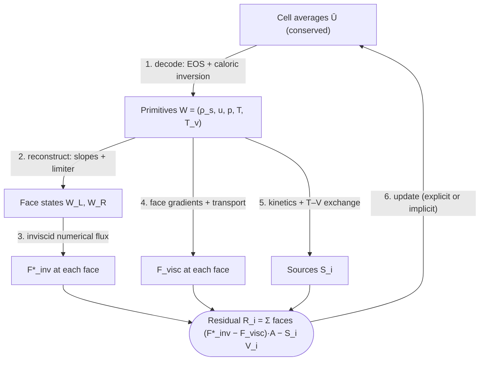

# The finite-volume pipeline

**Slot:** Track 0.2–0.5, the whole residual evaluation · **Depth:** [deep] · **Taught in:** [Lesson 0.1](../../course/track-0/0-1-governing-equations.md), expanded in Lessons 0.2–0.5

## What it is

The sequence of operations a cell-centred finite-volume code performs to turn the stored cell averages $\bar{\mathbf U}_i$ into a residual $\mathbf R_i$ and then an update. This page is the hub: each step links to the page that covers it in depth.

## The problem it solves

It connects every slot of the solver. Knowing the order of operations tells you where a given method acts, what it receives as input, and which other choices it interacts with.

## How it works

Each cell stores $\bar{\mathbf U}_i$, the average of the conserved variables over its volume. Primitives are never the state; they are a derived view recomputed every evaluation, because the fluxes and sources are written in them. The update itself is always a conservative flux difference ([why that matters](../foundations/conservation-and-weak-solutions.md)).

### 1. Decode

Convert $\bar{\mathbf U}_i \to \mathbf W_i$. This is where the [closures](../foundations/closing-the-system.md) are applied.

For a calorically perfect gas it is closed-form: $u = (\rho u)/\rho$, $p = (\gamma-1)(\rho E - \tfrac12\rho u^2)$. For a two-temperature mixture, species densities come straight from $\mathbf U$, $T_v$ needs a Newton solve, and $T$ then follows directly ([details](../foundations/closing-the-system.md#2-caloric-relations-and-the-temperature-inversion)).

### 2. Reconstruct

Build face states $\mathbf W_L$, $\mathbf W_R$ on each side of every face. First order uses the cell values themselves; second order builds a limited slope in each cell from its neighbours and evaluates it at the faces; WENO blends several candidate polynomials. See [reconstruction and limiters](reconstruction.md) and [WENO](weno.md).

A worked example with the minmod limiter, for any primitive $q$ in 1D:

$$
\Delta^- = q_i - q_{i-1},\quad \Delta^+ = q_{i+1} - q_i,\quad \sigma_i = \operatorname{minmod}(\Delta^-,\Delta^+),\quad q^L_{i+1/2} = q_i + \tfrac12\sigma_i,\quad q^R_{i-1/2} = q_i - \tfrac12\sigma_i .
$$

With $q = 1, 2, 4$ in cells $i-1, i, i+1$: $\Delta^- = 1$, $\Delta^+ = 2$, so $\sigma_i = 1$ and $q^L_{i+1/2} = 2.5$ (an unlimited central slope would give 2.75). At an extremum, $q = 1, 3, 2$, the slopes have opposite signs, $\sigma_i = 0$, and the cell goes flat (locally first order).

### 3. Inviscid flux

Evaluate a numerical flux function $\hat{\mathbf F}(\mathbf W_L, \mathbf W_R)$ at each face. There is always a flux function; a Riemann solver is one family of them:

- [Riemann solvers](riemann-solvers.md): exact (Godunov), Roe, HLL, HLLC, Rusanov.
- [Flux-vector splitting](flux-vector-splitting.md): Steger–Warming, van Leer, AUSM family. These split the flux by the signs of the eigenvalues instead of solving a Riemann problem.
- [Central schemes](central-schemes.md): central differencing plus artificial dissipation (JST), kinetic-energy-consistent fluxes with shock-switched dissipation; and shock regularization (IGR) as a different route.

All of them need $p$, $a$ and $u_n$ on each side, which are primitive quantities.

### 4. Viscous flux

Face gradients of $\mathbf u$, $T$, $T_v$ and mass fractions from neighbouring cells, face-averaged transport coefficients, then stresses, heat fluxes and diffusion fluxes. Always central-type. See [viscous fluxes](viscous-fluxes.md).

### 5. Sources

Evaluate $\dot\omega_s$ and $Q_{T\text{-}v}$ at the cell centre from $\mathbf W_i$. An explicit code adds them to the residual; a point-implicit or fully implicit code also puts $\partial\mathbf S/\partial\mathbf U$ into its left-hand matrix, which removes the chemistry stability limit. See [stiff source terms](../sources/stiff-sources.md).

### 6. Update

Inviscid and viscous fluxes are computed separately but **summed into one residual**; they are not solved separately:

$$
\mathbf R_i = \sum_{\text{faces}}\big(\hat{\mathbf F}_{\text{inv}} - \mathbf F_{\text{visc}}\big)\cdot\mathbf A_f - \mathbf S_i V_i .
$$

Explicit: $\bar{\mathbf U}_i \leftarrow \bar{\mathbf U}_i - \frac{\Delta t}{V_i}\mathbf R_i$, with a Runge–Kutta scheme repeating steps 1–5 once per stage ([explicit methods](../time/explicit-methods.md)). Implicit: assemble $(\mathbf I\,V/\Delta t + \partial\mathbf R/\partial\mathbf U)\,\Delta\mathbf U = -\mathbf R$ and solve it approximately ([implicit methods](../time/implicit-methods.md), [relaxation](../time/relaxation-methods.md)). Boundary conditions enter as fluxes or ghost-cell states at boundary faces ([boundary conditions](boundary-conditions.md)).

## Implications

| Lens | Effect |
|---|---|
| Time step and cost | Explicit cost is one pipeline pass per RK stage; implicit adds Jacobian assembly and a linear solve per iteration. |
| Steady vs unsteady | The same residual serves both; only step 6 changes. |
| Accuracy | Set by reconstruction order, flux dissipation and gradient quality; heat flux is especially sensitive to steps 3 and 4 near the wall. |
| Robustness | Steps 1 and 2 are where positivity is won or lost. |
| Physics captured or lost | Each step can smear physics: limiters clip peaks, dissipative fluxes smear contacts and boundary layers. |
| Hardware / parallel fit | Steps 1–5 are local and map well to GPUs; step 6 is where implicit methods introduce global data dependencies. |

## In a run

Every input deck selects something in each step: reconstruction order and limiter (step 2), flux scheme and entropy fix (step 3), gradient method (step 4), source treatment (step 5), time integrator and CFL (step 6).

## Which codes

All cell-centred finite-volume codes follow this structure (DPLR, LAURA, US3D, Eilmer, MFC). Vertex-based codes (FUN3D, SU2) do the same on a dual mesh around each node. See [discretization families](discretization-families.md).

## See also

[Reconstruction](reconstruction.md) · [Riemann solvers](riemann-solvers.md) · [Viscous fluxes](viscous-fluxes.md) · [Stiff sources](../sources/stiff-sources.md) · [Implicit methods](../time/implicit-methods.md)

## References

Blazek, *Computational Fluid Dynamics: Principles and Applications*; Hirsch, *Numerical Computation of Internal and External Flows*; LeVeque, *Finite Volume Methods for Hyperbolic Problems*. See the [bibliography](../../references.md).
