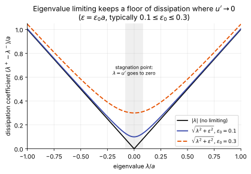
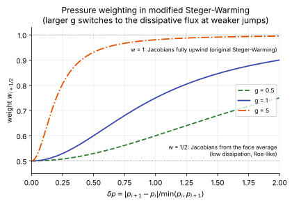

# Flux-vector splitting

**Slot:** Track 0.4 flux functions · **Depth:** [deep] · **Taught in:** [Lesson 0.4](../../course/track-0/0-4-flux-functions.md) (pending); reentry use in [Track 2.3](../../course/track-2.md)

## What it is

Instead of solving a [Riemann problem](riemann-solvers.md) at the face, **flux-vector splitting** (FVS) splits the flux of each state into a part carried by right-running waves and a part carried by left-running waves, and upwinds each part separately:

$$
\hat{\mathbf F}(\mathbf U_L, \mathbf U_R) = \mathbf F^+(\mathbf U_L) + \mathbf F^-(\mathbf U_R).
$$

## The problem it solves

It gives upwinding with very little logic and, importantly for implicit codes, simple and robust flux Jacobians $\partial\mathbf F^\pm/\partial\mathbf U$. Classic FVS is also naturally resistant to the [carbuncle](shock-instabilities.md), which is part of why it became the backbone of DPLR and US3D.

## How it works

### Steger–Warming {#steger-warming}

The Euler flux is homogeneous of degree one, $\mathbf F = \mathbf A\mathbf U$ with $\mathbf A = \partial\mathbf F/\partial\mathbf U$. Split the eigenvalues by sign, $\lambda^\pm = \tfrac12(\lambda \pm |\lambda|)$, and rebuild:

$$
\mathbf A^\pm = \mathbf R\,\boldsymbol\Lambda^\pm\,\mathbf L,\qquad \mathbf F^\pm = \mathbf A^\pm\mathbf U .
$$

In supersonic flow all eigenvalues share a sign and the flux is fully upwinded. Weaknesses: $|\lambda|$ is not differentiable where an eigenvalue changes sign (sonic points, stagnation regions), producing small glitches; and the scheme is **very dissipative across contacts and shear layers**, so boundary layers are badly smeared unless the grid is very fine. That would ruin heat flux on its own.

### Modified Steger–Warming {#modified-steger-warming}

The fix used in DPLR and US3D evaluates the split Jacobians not at each side's own state but at a state averaged between the two sides. In the first-order form (Subbareddy & Candler 2009; Candler, Subbareddy & Nompelis 2015),

$$
\hat{\mathbf F}_{i+\frac12} = \big(\mathbf R\boldsymbol\Lambda^+\mathbf R^{-1}\big)_{i+\frac12}\,\mathbf U_i + \big(\mathbf R\boldsymbol\Lambda^-\mathbf R^{-1}\big)_{i+\frac12}\,\mathbf U_{i+1}
= \big(\mathbf R\boldsymbol\Lambda\mathbf R^{-1}\big)_{i+\frac12}\,\frac{\mathbf U_i + \mathbf U_{i+1}}{2} - \frac12\big(\mathbf R\lvert\boldsymbol\Lambda\rvert\mathbf R^{-1}\big)_{i+\frac12}\,(\mathbf U_{i+1} - \mathbf U_i),
$$

with all matrices evaluated at face-averaged values. That expansion is the key insight: a symmetric (central) part plus a dissipation term $\tfrac12\mathbf R\lvert\boldsymbol\Lambda\rvert\mathbf R^{-1}\Delta\mathbf U$. **If the face average is the Roe average, this is exactly the Roe flux.** The signature flux of DPLR and US3D is, in disguise, a Roe-type upwind flux with a different averaging, and it gives results close to Roe's for hypersonic flows. Unlike the original Steger–Warming, it keeps the dissipation in shear layers low, because the averaged Jacobian doesn't see the jump in $\mathbf U$ across a boundary-layer cell as upwind information.

On its own the averaged form is not dissipative enough at strong shocks. Three additions make it a production flux.

#### Eigenvalue limiting {#eigenvalue-limiting}

When the shock-normal Mach number exceeds roughly 6, numerical error can overwhelm the physics. In the stagnation region of a blunt body the convective eigenvalue $\lambda = u'$ (face-normal velocity) goes to zero, the dissipation it carries vanishes, and error accumulates into a [carbuncle](shock-instabilities.md). The usual cure is to align the grid with the bow shock and to keep the eigenvalues in the dissipation away from zero:

$$
\lambda'^{\pm} = \tfrac12\Big(\lambda \pm \sqrt{\lambda^2 + \varepsilon^2}\Big),\qquad \varepsilon = \varepsilon_0\,a,\qquad 0.1 \le \varepsilon_0 \le 0.3 ,
$$

so that $\lambda'^+ - \lambda'^- = \sqrt{\lambda^2+\varepsilon^2}$ never drops below $\varepsilon$. This is the same idea as the entropy fix and the sonic-glitch correction for upwind schemes at sonic points.

The limiting **must not be applied in boundary layers**: there $u'$ is legitimately small across the layer, and the floor would drive an artificial flux across the boundary layer and corrupt heat flux. Codes switch it off near walls.

#### Pressure weighting {#pressure-weighting}

For very strong shocks on poorly aligned grids even the first-order flux can go aphysical. The remedy is to slide smoothly back to the original, more dissipative Steger–Warming flux where the pressure jumps. The Jacobians are evaluated from biased data,

$$
\mathbf U^+ = w\,\mathbf U_i + (1-w)\,\mathbf U_{i+1},\qquad
\mathbf U^- = (1-w)\,\mathbf U_i + w\,\mathbf U_{i+1},
$$

with a pressure-dependent weight

$$
w_{i+\frac12} = 1 - \frac12\,\frac{1}{(g\,\delta p)^2 + 1},\qquad
\delta p = \frac{p_{i+1} - p_i}{\min(p_i,\,p_{i+1})}.
$$

Smooth flow gives $\delta p\to0$, $w = \tfrac12$: averaged Jacobians, low dissipation. A strong jump gives $w\to1$: each Jacobian from its own upwind side, which is the original Steger–Warming flux.

The sensitivity $g$ is problem-dependent: $0.5 \le g \le 5$ depending on flow conditions, geometry and how well the grid is aligned with the bow shock (Candler et al. 2015 chapter); Nompelis et al. (2004) used $g = 5$ in their hybrid unstructured solver. Larger $g$ adds dissipation.

#### Which variables to average and reconstruct {#msw-averaging-variables}

Averaging conserved variables to get the face state behaves poorly in boundary layers with strong temperature gradients (a cold wall under a hot shock layer). Candler's group forms the face state from **primitive variables** instead. The same applies to the MUSCL face states: for reacting flow US3D extrapolates and limits species densities, velocity, pressure and specific internal energy, then rebuilds $\mathbf U$, which reduces spurious pressure variations in boundary layers ([consistent primitive reconstruction](reconstruction.md)).

One open problem, flagged in the US3D paper: with very fast reactions, limiting the species densities one equation at a time can break elemental conservation and produce species overshoots and undershoots.

#### Why DPLR likes it

The split Jacobians $\mathbf A^\pm$ are exact linearizations of the flux, so the implicit operator of [line relaxation](../time/relaxation-methods.md#dplr) can be built from the very matrices the flux uses. Candler et al. (2015) name this as part of DPLR's convergence success.

US3D's low-dissipation option keeps this dissipation term, multiplies it by a shock sensor, and replaces the central part with a [kinetic-energy-consistent flux](central-schemes.md#kinetic-energy-consistent-fluxes).

!!! warning "Calibration"
    The averaged form, the Roe equivalence, eigenvalue limiting with $0.1\le\varepsilon_0\le0.3$, the pressure weight with $0.5\le g\le5$ and primitive-variable averaging are from the Candler, Subbareddy & Nompelis (2015) chapter and Subbareddy & Candler (2009). Default values in current DPLR and US3D releases, and how each code decides where "the boundary layer" is for switching off eigenvalue limiting, are not in these sources; check the DPLR user manual and US3D documentation.

### van Leer

Splits the flux with polynomials in the local Mach number, chosen so $\mathbf F^\pm$ are continuously differentiable through sonic points (removing Steger–Warming's glitches). Still dissipative across contacts and shear layers.

### AUSM family

Liou's Advection Upstream Splitting Method splits the flux into a convective part (a mass flux upwinded with an interface Mach number) and a pressure part (split separately). Variants (AUSM+, AUSM+-up, AUSMPW+, ...) add low-dissipation behaviour in boundary layers, all-speed preconditioning and shock-stability fixes. Contacts are resolved well. Widely used in SU2 and commercial codes. *(Details to be written in Lesson 0.4.)*

### Flux splitting for finite-difference WENO

High-order finite-difference codes (the Shu–Osher approach, as in ALPACA's and JAX-Fluids' "flux splitting" solver type) reconstruct *fluxes* rather than states. The flux at each point is split, $f^\pm = \tfrac12(f \pm \alpha u)$, usually in characteristic variables, and $f^+$ and $f^-$ are reconstructed with left- and right-biased WENO stencils. The choice of $\alpha$ names the scheme:

- **Global Lax–Friedrichs (GLF):** $\alpha$ = the maximum wave speed over the whole domain (per characteristic field). Most dissipative, most robust, and smooth in the data (good for formal accuracy).
- **Local Lax–Friedrichs (LLF):** $\alpha$ = the maximum over the local stencil. Less dissipative.
- **Roe-type splitting:** $\alpha = |\lambda|$ of each characteristic field, upwinding each field by its own speed, with a fallback to LLF where the eigenvalue changes sign (entropy fix).
- **Low-Mach variants (Roe-M, LLF-M):** limit the acoustic $\alpha$ to $\phi\,|u|$ at low face-normal Mach number, which cures grid-aligned shock instabilities; see [low-Mach corrections](low-mach-corrections.md#roe-m).

Codes using this approach often add a positivity-preserving fallback flux (an HLLC or HLL flux computed from first-order states) where the high-order split flux would produce negative density or pressure; see [positivity safeguards](riemann-solvers.md#positivity-safeguards).

## Typical values

- Eigenvalue limiter $\varepsilon_0$: 0.1–0.3 (larger for stronger stagnation-region problems); off in boundary layers.
- Pressure-weight sensitivity $g$: 0.5–5; 5 in Nompelis et al. (2004).
- Shock-normal Mach number above which unlimited upwind error becomes dangerous on blunt bodies: about 6.
- Where the switch happens: the weight reaches 0.9 when $g\,\delta p = 2$, i.e. at a 40% pressure jump for $g = 5$ or a 400% jump for $g = 0.5$.

## Trade-offs

- **Averaged vs upwind Jacobians.** Averaged (modified) Jacobians: Roe-like dissipation, sharp boundary layers, good heat flux. Upwind (original) Jacobians: robust at strong shocks, but smear contacts and shear layers. Pressure weighting picks one or the other locally.
- **Larger $\varepsilon_0$ or $g$.** More robust stagnation regions and shocks; more dissipation, so separation zones shrink and shear layers thicken. In the double-cone test the separation length is the sensitive measure ([reconstruction](reconstruction.md#double-cone-ranking)).
- **FVS vs Riemann solvers.** Exact, smooth Jacobians that suit implicit line relaxation, versus solvers like HLLC that are designed around the wave structure but have Jacobians that are harder to linearize exactly.

## Effects on stability and robustness

- Without eigenvalue limiting, the stagnation region of a blunt body at high Mach number can grow a carbuncle; with it, the shock stays put.
- Eigenvalue limiting inside the boundary layer is itself a source of error (artificial cross-layer flux), not a stability aid.
- Pressure weighting lets the first-order flux survive misaligned strong shocks; it does not remove the spurious vorticity that tetrahedra generate at a shock ([discretization families](discretization-families.md#element-types-at-strong-shocks)).
- Exact Jacobians make the implicit operator consistent with the residual, which allows large CFL numbers in DPLR.

## Implications

| Lens | Effect |
|---|---|
| Time step and cost | Cheap; Jacobians of split fluxes are well suited to [implicit relaxation](../time/relaxation-methods.md), a big reason DPLR uses them. |
| Steady vs unsteady | Usable for both; robust steady convergence is the traditional strength. |
| Accuracy | Raw Steger–Warming and van Leer smear boundary layers and heat flux; modified SW and AUSM variants fix much of this. |
| Robustness | Carbuncle-resistant (classic FVS); robust at very strong shocks. |
| Physics captured or lost | Dissipative variants damp contacts, shear layers and instability waves; not a choice for transition DNS without a low-dissipation alternative (see [central schemes](central-schemes.md)). |
| Hardware / parallel fit | Face-local; fine on GPUs. |

## In a run

Knobs:

- Scheme selection.
- Modified Steger–Warming: eigenvalue limiter $\varepsilon_0$, pressure-weight sensitivity $g$, choice of averaging variables.

Symptoms:

- Heat flux that keeps changing with wall-normal refinement: too much dissipation (check that eigenvalue limiting is off near the wall).
- Bulge or recirculation ahead of the stagnation point: carbuncle; raise $\varepsilon_0$, improve shock alignment.
- Separation zones that shrink as $g$ or $\varepsilon_0$ grow: the result is dissipation-limited; refine or reduce dissipation.
- Small glitches at sonic lines: unsmoothed eigenvalues.

## Which codes

DPLR and US3D use modified Steger–Warming as their base upwind flux (US3D adds low-dissipation KEC options, see [central schemes](central-schemes.md#kinetic-energy-consistent-fluxes)); SU2 and STAR-CCM+ offer AUSM-family schemes.

## See also

[Riemann solvers](riemann-solvers.md) · [Central schemes](central-schemes.md) · [Shock instabilities](shock-instabilities.md) · [DPLR](../../codes/index.md#dplr) · [US3D](../../codes/index.md#us3d)

## References

Steger & Warming (1981); van Leer (1982); MacCormack & Candler (1989); Subbareddy & Candler (2009); Candler, Subbareddy & Nompelis (2015, chapter); Nompelis, Drayna & Candler (2004); Candler et al. (2015, US3D); Shu & Osher (1988); Liou & Steffen (1993); Liou (1996, 2006). See the [bibliography](../../references.md).
