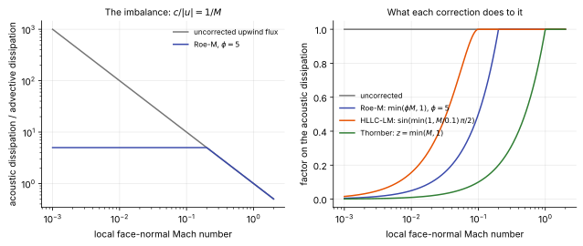

# Low-Mach corrections

**Chapter:** 7 Inviscid flux functions · **Depth:** [deep]

## What it is

Modifications to upwind flux functions (or to the face states fed to them) that rescale numerical dissipation where the **local** Mach number is small. They were developed for nearly incompressible flow, but in hypersonics they matter for a different reason: even in a Mach 20 flow, there are faces where the velocity component normal to the face is tiny.

## The problem it solves

Write any upwind flux as "central minus dissipation" ([Riemann solvers](riemann-solvers.md#how-it-works)). The dissipation has an **advective** part, scaling with $|u|$, and an **acoustic** part, scaling with $|u \pm c|$. When $M = |u|/c \to 0$ the acoustic part stays of order $c$ while the advective part vanishes, so the dissipation is badly unbalanced. Guillard and Viozat (1999) showed that for Godunov-type schemes this produces pressure fluctuations of order $M$ instead of the physical $M^2$, ruining low-Mach accuracy.

That would be a footnote for entry flows, except for three places where low local Mach numbers appear in a hypersonic calculation.

**Transverse faces at a grid-aligned shock.** When a strong shock moves (or sits) along $x$, the fluxes computed in $y$ and $z$ see an almost zero normal velocity. Hu and Adams, and then Fleischmann et al., argued that this mismatch between acoustic and advective dissipation, rather than a simple lack of dissipation, is what drives the [carbuncle](shock-instabilities.md). Reducing the acoustic dissipation in that limit stabilizes the shock, the opposite of the classical cure (adding dissipation).

**Boundary layers and the stagnation region.** Near a wall the flow is locally subsonic and, in the viscous sublayer, very slow. Excess acoustic dissipation there smears the profile that sets the heat flux. Xie et al. built "all-speed" HLL-type schemes for hypersonic heating partly on this basis.

**Wakes and base regions**, which are subsonic and recirculating.

## How it works

<figure markdown>

<figcaption markdown="span">Left: the ratio of acoustic to advective dissipation in an upwind flux is $c/|u| = 1/M$, so at a face-normal Mach number of 0.01 the acoustic part is a hundred times too large; Roe-M caps the ratio at $\phi$. Right: the factor each correction on this page applies to the acoustic dissipation, as a function of local Mach number. All return to one, and so to the unmodified scheme, by Mach 1 or earlier. Computed from the formulas below.</figcaption>
</figure>

There are two families: scale the acoustic eigenvalues (or wave speeds) in the dissipation term, or scale the velocity jump that the dissipation acts on. In each case a Mach-dependent factor $z$ or $\phi$ goes to 1 at moderate Mach numbers, so the original scheme, and its shock-capturing behaviour, is recovered.

### Roe-M (Hu and Adams; Fleischmann et al.) {#roe-m}

Replace the acoustic eigenvalues in Roe's dissipation matrix, $\lambda = u \pm c$, by $u \pm \min(\phi |u|,\ c)$, with $\phi$ an order-one constant ($\phi = 5$ in their tests). At low Mach the Roe flux then tends to the central flux $\tfrac12(\mathbf F_L + \mathbf F_R)$: acoustic dissipation is reduced to the level of the advective one. The same idea applies to local Lax–Friedrichs flux splitting ("LLF-M"). The authors also describe a variant that *raises* the advective eigenvalue instead (more dissipation), which they found less attractive.

### HLLC-LM (Fleischmann, Adami and Adams, 2020) {#hllc-lm}

Simply shrinking $S_L$ and $S_R$ in the standard HLLC formula doesn't work: at low Mach it collapses to pure upwinding ($\mathbf F_L$ or $\mathbf F_R$), which adds dissipation. The fix is to rewrite HLLC in a **central form**. Applying the Rankine–Hugoniot condition across the waves from both sides and averaging gives, in the star region,

$$
\mathbf F^* = \tfrac12(\mathbf F_L + \mathbf F_R) + \tfrac12\Big[S_L(\mathbf U_{*L} - \mathbf U_L) + |S_*|\,(\mathbf U_{*L} - \mathbf U_{*R}) + S_R(\mathbf U_{*R} - \mathbf U_R)\Big],
$$

which is identical to classical HLLC (to round-off). The first and third bracket terms are the acoustic dissipation, the middle term the advective (contact) dissipation. HLLC-LM scales only the acoustic speeds **in this final flux evaluation**,

$$
S_{L,R}^{\text{LM}} = \phi\,S_{L,R},\qquad \phi = \sin\!\Big(\min\big(1,\ \tfrac{M_{\text{loc}}}{M_{\text{lim}}}\big)\,\tfrac{\pi}{2}\Big),\qquad M_{\text{loc}} = \max\!\Big(\tfrac{|u_L|}{c_L}, \tfrac{|u_R|}{c_R}\Big),
$$

with $M_{\text{lim}} = 0.1$; $S_*$ and the star states are computed with the original speeds. Above $M_{\text{loc}} = 0.1$ it is exactly HLLC. The result is shock-stable (including in 3D, where plain HLLC developed severe carbuncles in their high-order tests) while being *less* dissipative than HLLC, which is unusual: most shock-stable HLLC variants add dissipation.

### Thornber reconstruction correction (Thornber et al., 2008)

Act on the reconstructed face velocities instead of the flux:

$$
\begin{gathered}
u_L' = \frac{u_L + u_R}{2} + z\,\frac{u_L - u_R}{2},\qquad u_R' = \frac{u_L + u_R}{2} - z\,\frac{u_L - u_R}{2},\\[1ex]
z = \min\!\Big(\max\big(\tfrac{|u_L|}{c_L}, \tfrac{|u_R|}{c_R}\big),\ 1\Big).
\end{gathered}
$$

The velocity jump the Riemann solver sees is reduced by $z$ at low Mach and untouched at $M \ge 1$. Developed for implicit LES of low-Mach mixing (Richtmyer–Meshkov); Xie et al. report it can introduce small disturbances near strong shocks and switch it off there with a pressure-based shock sensor.

### Anti-dissipation pressure correction (Chen et al., 2022)

In HLLC the star pressure contains a dissipative part driven by the velocity jump,

$$
p_d = \frac{\rho_L\rho_R\,(S_R - u_R)(S_L - u_L)}{\rho_R(S_R - u_R) - \rho_L(S_L - u_L)}\,(u_R - u_L).
$$

The correction adds $(z - 1)\,p_d$ back to the star-region momentum flux (along the face normal) and $(z - 1)\,p_d\,S_*$ to the energy flux, so that this pressure dissipation is scaled by a Mach-dependent factor $z$ (equal to 1 at high Mach). It is the same idea as the Thornber correction, applied to the pressure term rather than the reconstructed velocities.

!!! warning "Calibration"
    Written from the MFC documentation (Wilfong et al., 2026, Sec. 4.2.4), which offers this as `low_Mach = 1` and the Thornber correction as `low_Mach = 2`. The velocity-jump factor $(u_R - u_L)$ in $p_d$ is reconstructed from the standard HLLC star pressure; check Chen et al. (2022) for the exact definition of $z$ before implementing.

### Not relevant here: artificial Mach number

MFC's `pi_fac` modifies the stiffened-gas $\pi_\infty$ of liquid phases to raise the local Mach number artificially. It is a multiphase device with no counterpart for ideal-gas or reacting-air flows.

### Preconditioning

The corrections above change only the flux. **Preconditioning** (Turkel; Weiss & Smith) changes the time derivative as well. The system is written as $\boldsymbol\Gamma\,\partial\mathbf Q/\partial t + \nabla\cdot\mathbf F = 0$ with a matrix $\boldsymbol\Gamma$ chosen so that the acoustic wave speeds $u \pm c$ are replaced by speeds of the same order as $u$ when the Mach number is low. Two things follow:

- **Convergence.** At low Mach number the unmodified system is stiff because acoustic waves are far faster than convection (condition number about $1/M$). With all wave speeds of order $u$ the condition number is of order one and a time-marching solver converges at a rate independent of Mach number.
- **Accuracy.** The flux dissipation is rebuilt from the preconditioned eigenvalues, which gives the same rebalancing of acoustic and advective dissipation as the corrections above.

The cost is that $\boldsymbol\Gamma$ distorts time, so the transient is no longer physical. For unsteady flow it is applied only to the pseudo-time derivative of [dual time stepping](../time/dual-time-stepping.md). It is the standard all-speed approach in commercial density-based solvers; the [STAR-CCM+](../../codes/index.md#star-ccm) coupled solver uses a Weiss–Smith preconditioned Roe flux. The preconditioning switches itself off above Mach 1, so in an entry flow it acts only in the boundary layer, stagnation region and wake.

## Typical values

- HLLC-LM limit Mach number: $M_{\text{lim}} = 0.1$ (Fleischmann, Adami & Adams 2020).
- Roe-M and LLF-M constant: $\phi = 5$ (Fleischmann et al. 2020).
- Size of the imbalance: acoustic over advective dissipation is $1/M$, so 10 at a face-normal Mach number of 0.1 and 1000 at 0.001.
- Pressure-fluctuation scaling of an uncorrected Godunov-type scheme: order $M$ instead of the physical $M^2$ (Guillard & Viozat 1999).
- Cost: one Mach number and one scaling factor per face.

## Trade-offs

- **Scaling wave speeds (Roe-M, HLLC-LM) vs scaling the velocity jump (Thornber, Chen).** The first acts inside the flux and is active only below a small Mach number; the second acts over the whole subsonic range and may need a shock sensor to stay off near strong shocks.
- **Flux correction vs preconditioning.** A flux correction fixes accuracy only and keeps time accuracy; preconditioning also fixes convergence but distorts time.
- **Against the classical carbuncle cures.** These remove dissipation instead of adding it, so boundary layers and contacts are not smeared; they are newer and less tested on production entry cases than eigenvalue limiting.

## Effects on stability and robustness

- HLLC-LM and Roe-M stabilize grid-aligned strong shocks that plain HLLC and Roe can't hold, including in 3-D and at high order (Fleischmann et al. 2020).
- A hard switch in the Mach-dependent factor can cause steady-state convergence to chatter; HLLC-LM's sine ramp is smooth for that reason.
- Reducing dissipation in the subsonic stagnation region removes a safety margin there; on poor grids the result can be noisier wall quantities.
- Preconditioning with too small a reference velocity near stagnation points is unstable, which is why codes impose a floor on it.

## Implications

| Lens | Effect |
|---|---|
| Time step and cost | Negligible: a Mach number and a scaling factor per face. |
| Steady vs unsteady | Both; a smooth activation (the sine in HLLC-LM) avoids switching noise in steady convergence. |
| Accuracy | Less acoustic dissipation in boundary layers, stagnation regions and wakes; potentially better heat flux on a given grid. |
| Robustness | HLLC-LM and Roe-M cure grid-aligned shock instabilities; velocity-jump corrections may need shock-sensor switching near strong shocks. |
| Physics captured or lost | Low-Mach features (vortices, acoustics in subsonic regions) survive instead of being damped. |
| Hardware / parallel fit | Face-local; trivial on GPUs. |

## In a run

Knobs: the correction type and its limit Mach number ($M_{\text{lim}} = 0.1$ in HLLC-LM; $\phi = 5$ for Roe-M), and whether a shock sensor switches it off near shocks. Symptoms it addresses: carbuncles with HLLC/Roe at high resolution or in 3D; over-damped wakes; heat flux that improves only with excessive wall refinement.

## Which codes

ALPACA offers HLLC-LM ("HLLC low-Mach fix", with or without a shock sensor) and Roe-M / LLF-M flux splittings with $\phi = 5$ ([ALPACA](../../codes/index.md#alpaca)); MFC offers the Chen and Thornber corrections. Production reentry codes approach the same trade-off differently: [modified Steger–Warming](flux-vector-splitting.md#modified-steger-warming) with eigenvalue limiting, or Roe with entropy fixes and shock-aligned grids.

## See also

[Riemann solvers](riemann-solvers.md) · [Shock instabilities](shock-instabilities.md) · [Flux-vector splitting](flux-vector-splitting.md) · [Central schemes](central-schemes.md)

## References

Guillard & Viozat (1999); Thornber et al. (2008); Hu & Adams (arXiv:1204.5092); Fleischmann, Adami, Hu & Adams (2020); Fleischmann, Adami & Adams (2020); Chen et al. (2022); Xie et al. (arXiv:2103.06374); Wilfong et al. (2026). See the [bibliography](../../references.md).
