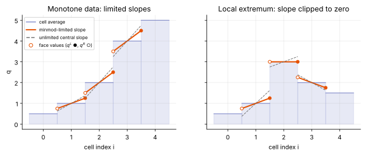
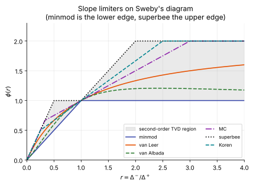
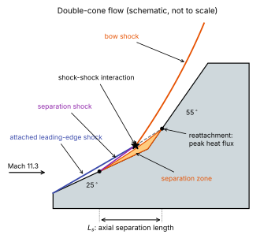
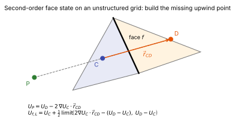

# Reconstruction and limiters

**Chapter:** 6 Spatial discretization · **Depth:** [deep]

## What it is

A finite-volume cell stores only an average. To evaluate a flux at a face you need the solution *at* the face, on each side. **Reconstruction** builds a polynomial inside each cell from the cell and its neighbours and evaluates it at the faces, producing the left and right states $\mathbf W_L$, $\mathbf W_R$ fed to the [flux function](riemann-solvers.md). "MUSCL extrapolation" and "reconstruction" are the same operation in different vocabularies. A **limiter** modifies the reconstruction near discontinuities so it doesn't create new maxima or minima.

## The problem it solves

Using cell averages directly as face states (first order) is robust but very dissipative: boundary layers and shear layers smear, and heat flux is poor. Higher-order polynomials are accurate in smooth regions but oscillate at shocks. Limiters give high order where the flow is smooth and fall back towards first order at discontinuities.

## How it works

### Godunov's theorem

No *linear* scheme (one whose coefficients don't depend on the solution) can be both monotonicity-preserving and better than first-order accurate. To get second order without oscillations, the scheme must be nonlinear: its stencil weights must depend on the data. Limiters and WENO weights are exactly that nonlinearity.

### MUSCL: piecewise-linear reconstruction

In 1D, give cell $i$ a slope $\sigma_i$ and evaluate it at the faces:

$$
q^L_{i+1/2} = q_i + \tfrac12\sigma_i,\qquad q^R_{i-1/2} = q_i - \tfrac12\sigma_i .
$$

The unlimited central slope $\sigma_i = \tfrac12(q_{i+1} - q_{i-1})$ is second order but oscillates at jumps. A limiter computes $\sigma_i$ from the one-sided differences $\Delta^- = q_i - q_{i-1}$ and $\Delta^+ = q_{i+1} - q_i$ instead.

<figure markdown>

<figcaption>Left: on monotone data minmod picks the smaller one-sided slope, keeping face values within the range of the neighbours. Right: at a local extremum the one-sided slopes have opposite signs, minmod returns zero, and the cell is flat (first order there).</figcaption>
</figure>

### Limiters

All limiters return zero slope when $\Delta^-$ and $\Delta^+$ have opposite signs (a local extremum). It is convenient to write them as a function of the ratio of successive differences,

$$
r_i = \frac{\Delta^-}{\Delta^+} = \frac{q_i - q_{i-1}}{q_{i+1} - q_i},\qquad \sigma_i = \phi(r_i)\,\Delta^+ ,
$$

so $r \approx 1$ in smooth monotone regions, $r \le 0$ at extrema, and $r$ far from 1 near jumps. A limiter is **TVD** if $\phi(r)$ lies in Sweby's region ($0 \le \phi \le \min(2r, 2)$, and between minmod and superbee for second-order accuracy); **symmetric** if $\phi(r)/r = \phi(1/r)$, so left and right are treated alike.

| Limiter | $\phi(r)$ (zero for $r \le 0$) | Character |
|---|---|---|
| minmod | $\min(1,\ r)$ | Lower edge of the second-order TVD region: most dissipative, very robust. Common in production reentry codes. |
| van Leer | $\dfrac{r + \lvert r\rvert }{1 + \lvert r\rvert }$ | Smooth (differentiable), a common default; the harmonic mean of the one-sided slopes. |
| van Albada | $\dfrac{r^2 + r}{r^2 + 1}$ | Smooth and mildly dissipative; differentiability helps implicit steady convergence (less limiter chatter). |
| MC (monotonized central; often called "the MUSCL limiter") | $\min\!\big(2r,\ \tfrac12(1 + r),\ 2\big)$ | Uses the central slope when allowed; sharper than van Leer. |
| superbee | $\max\!\big(\min(2r, 1),\ \min(r, 2)\big)$ | Upper edge of the TVD region: least dissipative, compressive; squares off smooth peaks and can steepen smooth gradients into steps. |
| Koren | $\min\!\big(2r,\ \tfrac13(1 + 2r),\ 2\big)$ | Built on the third-order upwind-biased ($\kappa = 1/3$) slope; not symmetric. Sharp, with good accuracy on smooth data. |
| OSPRE | $\dfrac{1.5\,(r^2 + r)}{r^2 + r + 1}$ | Smooth, symmetric, between van Albada and van Leer. |
| HCUS | $\dfrac{1.5\,(r + \lvert r\rvert )}{r + 2}$ | Smooth, based on a third-order-like upwind scheme; not symmetric. |
| SMART | $\min\!\big(2r,\ 0.25 + 0.75r,\ 4\big)$ | Bounded rather than strictly TVD (exceeds $\phi = 2$); very sharp, less robust at strong shocks. |

<figure markdown>

<figcaption>Limiter functions in Sweby's TVD region. The closer a curve hugs the upper edge, the less dissipative and more compressive it is. Smooth curves (van Leer, van Albada) avoid the kinks that cause limiter chatter in steady implicit runs.</figcaption>
</figure>

### When limiters are used

**Second-order finite-volume codes.** MUSCL with a slope limiter is the standard reconstruction in production aeroheating codes. Minmod and van Leer/van Albada dominate because robustness at strong shocks and steady convergence matter more than sharpness.

**TVD flux-limiter schemes.** The limiter can act on the flux (or on characteristic wave strengths) rather than on the slope, as in Harten–Yee and Yee's symmetric TVD schemes. LAURA's Roe + Yee TVD formulation is of this type.

**Unstructured grids.** Slopes come from least-squares or Green–Gauss gradients, and limiters such as Barth–Jespersen and Venkatakrishnan scale the gradient so face values stay within the range of the neighbours. Venkatakrishnan's is smooth and preferred for steady convergence.

**High-order codes, as a fallback.** WENO and TENO codes don't use slope limiters in normal operation (the nonlinear weights do that job), but fall back to a limited low-order reconstruction near troublesome regions: material interfaces, cells that would lose positivity, or boundaries. MUSCL-type limiters also remain the default in some high-order frameworks for robustness tests.

**Not to be confused with positivity limiters.** Those (Zhang–Shu scaling, positivity-preserving flux limiters) enforce $\rho, p > 0$ rather than monotonicity, and are applied on top of any reconstruction. See [positivity safeguards](riemann-solvers.md#positivity-safeguards).

### How much the limiter matters: the double-cone test {#double-cone-ranking}

The laminar double-cone flow (Holden's 25°–55° model, Run 35: $T_\infty = 138.9$ K, $\rho_\infty = 5.515\times10^{-4}$ kg/m³, $u_\infty = 2713$ m/s, Mach 11.3, unit Reynolds number 133,300 m⁻¹, each conical face 10.16 cm long) is the standard test for numerical dissipation in shock-dominated flows. The attached leading-edge shock, the separation shock and the bow shock off the second cone interact, and the size of the separation bubble at the corner depends sharply on how much dissipation the scheme adds.

Candler, Subbareddy & Nompelis (2015) ran five fluxes (modified Steger–Warming, Lax–Friedrichs, HLL, HLLC, Roe) with four limiters (minmod, van Albada, van Leer, superbee) on a sequence of grids, and used the separation length $L_s$ (axial distance from separation on the first cone to reattachment on the second) as a single-number gauge. Their conclusions:

- **All methods converge to the same $L_s$ under refinement**, but some would need an impractically large grid to get there. On a fixed grid, a larger bubble means less dissipation and a more accurate answer.
- **The limiter matters at least as much as the flux.** A dissipative limiter such as minmod can spoil a good flux function.
- **Best on coarse grids:** Roe + superbee, Roe + van Leer, and modified Steger–Warming. Every other combination gave a small bubble, a sign of excessive dissipation.
- **Van Leer is the best choice for this flow.** Superbee is the least dissipative but can introduce spatial oscillations; minmod is a poor choice.
- **On the finest grid ($1536\times768$)** the three best methods agree within 0.2%; the two Roe-based solutions differ by 0.04%. Modified Steger–Warming settles at a slightly smaller $L_s$, but the difference is the size of the local axial cell spacing (0.01 cm), so it may not be resolved.
- **Time convergence matters too:** the bubble takes a long time to settle, and at least 150 flow times (free-stream speed and cone-face length) must be simulated.
- **Heat flux is less grid-sensitive than $L_s$**, because refining wall-normally (which controls heat flux) is cheaper than refining axially (which controls the separation and reattachment points).

The lesson for aeroheating runs: report the limiter alongside the flux function, and treat a separation length or bubble size that changes with limiter choice as a sign the result is dissipation-limited.

### Extremum clipping and the stagnation point

Because every TVD limiter returns zero slope at a local extremum, it clips genuine smooth peaks too. In a reentry flow, stagnation-point quantities (pressure, temperature behind the shock) sit at smooth extrema, so the limiter locally drops to first order exactly where heating is evaluated. This is one reason heat-flux accuracy is so sensitive to limiter choice and grid alignment.

### Which variables to reconstruct

Reconstruction may act on conservative, primitive or characteristic variables. The update stays conservative in every case, so this choice affects oscillations and positivity, not the shock jump conditions.

**Conservative variables** ($\rho$, $\rho\mathbf u$, $\rho E$) are the simplest, but have a serious positivity problem at high Mach number. Internal energy is $\rho E - \tfrac12\rho|\mathbf u|^2$; at Mach 25 kinetic energy is about 99% of the total, so pressure is a small difference of two large numbers. Limiting each conserved variable independently can easily produce a face state with negative pressure or temperature.

**Primitive variables** ($\rho_s$, $\mathbf u$, $p$, $T$) make positivity much easier to enforce (limit $p$ and $T$ directly) and keep pressure and velocity exactly constant across an isolated contact discontinuity, avoiding spurious pressure oscillations there. This is the common choice in second-order reentry codes: US3D, for example, extrapolates and limits species densities, velocity, pressure and specific internal energy, then rebuilds $\mathbf U$, which reduces spurious pressure variations in boundary layers (Candler et al. 2015). It is also the choice in multiphase codes like MFC, where material interfaces are contacts. One caveat for fast chemistry: limiting each species density separately can break elemental conservation and create species overshoots, an open problem noted in the US3D paper.

**Characteristic variables** project the jump onto the eigenvectors of the flux Jacobian, $\mathbf w = \mathbf L\,\Delta\mathbf U$, giving one amplitude per wave family. Their advantage shows up where waves overlap: across a shock all primitives jump at once, and limiting each primitive separately treats a mixture of acoustic and entropy content with one slope, which seeds post-shock oscillations, especially at high order. Characteristic limiting limits each family by its own smoothness. The cost is an eigendecomposition per face, and the decoupling is only approximate because the eigenvectors are frozen at the face. High-order WENO codes often use it; second-order production codes usually don't.

**Characteristic–primitive** variants project primitive (rather than conservative) jumps onto characteristic fields, combining the positivity advantages of primitives with the wave separation of characteristic variables.

**Thermodynamically consistent primitive reconstruction.** If $\rho$, $p$ and $T$ are all reconstructed independently, the face states generally violate the equation of state. Consistent schemes reconstruct only two thermodynamic variables (for a mixture, the species densities plus either $p$ or $T$) and compute the third from the EOS at the face. Which one is *dependent* matters: reconstructing $T$ and deriving $p$ keeps temperature well behaved (useful for reaction rates and the [temperature inversion](../foundations/closing-the-system.md#2-caloric-relations-and-the-temperature-inversion)), while reconstructing $p$ keeps pressure equilibrium across contacts. ALPACA exposes this as "consistent primitive reconstruction" with a choice of dependent state.

## Variants

### First order

Face states equal cell averages. Robust, very dissipative. Standard as a **startup** strategy: run first order until the shock is established, then switch to second order.

### MUSCL with limiters

Described above. Second order in smooth regions; the workhorse of production reentry codes.

### WENO

Higher order by blending several candidate stencils with smoothness-dependent weights. See [WENO](weno.md).

### Multidimensional and unstructured reconstruction

On unstructured grids there is no "cell $i-1$" to form the upwind difference. Two approaches are common.

**Gradient-limited reconstruction.** Compute a cell gradient by least squares or Green–Gauss, extrapolate $U_f = U_C + \nabla U_C\cdot\vec r_{Cf}$, and scale the gradient with a Barth–Jespersen or Venkatakrishnan limiter so face values stay within the range of the neighbours. Venkatakrishnan's is smooth and preferred for steady convergence.

**Virtual upwind point (Darwish & Moukalled).** Used in US3D (Candler et al. 2015 chapter). For the flux from cell C to its downwind neighbour D across face $f$, build a virtual upwind point P on the line through C and D, at the same distance from C as D but on the other side. Its value comes from the gradient at C:

$$
U_P = U_C - \nabla U_C\cdot\vec r_{CD} \approx U_D - 2\,\nabla U_C\cdot\vec r_{CD},
$$

and the second form is preferred because the gradient is centred at C. The ordinary 1-D MUSCL formula then applies along P–C–D:

$$
U_{f,L} = U_C + \tfrac12\,\mathrm{limit}\big(U_C - U_P,\; U_D - U_C\big)
= U_C + \tfrac12\,\mathrm{limit}\big(2\nabla U_C\cdot\vec r_{CD} - (U_D - U_C),\; U_D - U_C\big),
$$

with any of the limiters above and a mirror-image formula for $U_{f,R}$.

This keeps the familiar slope-ratio limiters (minmod, van Leer, ...) on arbitrary elements. It still assumes the cell pair is well aligned with the face; on skewed or stretched tetrahedra the gradients degrade. Nompelis et al. (2004) found Green–Gauss gradients error-prone on such cells and switched the stencil to first order at shocks; US3D's viscous gradients use weighted least squares with a deferred correction ([viscous fluxes](viscous-fluxes.md)).

## Trade-offs

- **Minmod vs van Leer vs superbee.** Minmod: most robust, most dissipative; shrinks separation bubbles and smears shear layers. Van Leer and van Albada: the usual production compromise; van Leer was the best performer on the double cone. Superbee: least dissipative, but steepens smooth gradients and can produce oscillations.
- **Limiter vs flux function.** In shock-dominated flows they are equally important; upgrading the flux while keeping minmod buys little.
- **Primitive vs conservative variables.** Primitive: positivity and clean contacts; conservative: simpler and exactly what the update needs, but negative pressure at high Mach number is easy to produce.
- **Gradient-limited vs virtual-point reconstruction on unstructured grids.** Barth–Jespersen/Venkatakrishnan: general, but gradient-scaling limiters can stall convergence. Virtual upwind point: reuses 1-D limiters, but quality depends on the cell pair's alignment.

## Effects on stability and robustness

- Limiters keep the second-order scheme from creating new extrema at shocks; without them, high-Mach shocks produce overshoots that turn into negative pressure.
- Limiters that switch on and off near a shock stall steady convergence; freezing the limiter late in the run is a common remedy.
- A dissipative limiter is not a stability fix for a misaligned or tetrahedral shock region; the error there is created by the grid ([discretization families](discretization-families.md#element-types-at-strong-shocks)).

## Implications

| Lens | Effect |
|---|---|
| Time step and cost | Cheap for MUSCL; WENO and characteristic projection cost more per face. Limiters that switch on and off can stall steady convergence (limiter "chatter"). |
| Steady vs unsteady | Limiter chatter matters most for steady convergence; some codes freeze the limiter late in a run. |
| Accuracy | Order in smooth regions, clipping at extrema (stagnation point), dissipation in boundary layers; directly affects heat flux. |
| Robustness | Variable choice and limiter strength decide positivity at strong shocks. |
| Physics captured or lost | Dissipative limiters smear shear layers, contacts and instability waves. |
| Hardware / parallel fit | Local, stencil-based; maps well to GPUs. Wider stencils (WENO) mean more halo exchange. |

## In a run

Knobs: spatial order, limiter type, the variable set limited, and sometimes a limiter-freezing iteration. Symptoms: residual stalling at a plateau with a limiter flickering near the shock; post-shock wiggles (too little limiting, or limiting in the wrong variables); smeared heating peaks (too much limiting).

## Which codes

US3D: MUSCL with TVD limiting of species densities, velocity, pressure and specific internal energy; on unstructured grids the Darwish–Moukalled virtual-point stencil; QUICK-type third order and unbiased higher-order KEC fluxes as options (Candler et al. 2015; Candler, Subbareddy & Nompelis 2015). MFC reconstructs primitive (optionally characteristic) variables with WENO.

!!! warning "Calibration"
    Limiter defaults for DPLR, LAURA and US3D, and DPLR's variable set, are still to be filled in from their user manuals. The US3D details above are from the 2015 papers and may have changed since.

## See also

[The finite-volume pipeline](finite-volume-pipeline.md#2-reconstruct) · [WENO](weno.md) · [Riemann solvers](riemann-solvers.md) · [Conservation form](../foundations/conservation-and-weak-solutions.md)

## References

van Leer (1979); Sweby (1984); Yee (1987); Waterson & Deconinck (2007) on bounded limiters (Koren, OSPRE, HCUS, SMART); Venkatakrishnan (1995); Darwish & Moukalled (2003); Candler, Subbareddy & Nompelis (2015, chapter: double-cone comparison); Toro, *Riemann Solvers and Numerical Methods for Fluid Dynamics*; LeVeque, *Finite Volume Methods for Hyperbolic Problems*; Blazek, *Computational Fluid Dynamics*. See the [bibliography](../../references.md).
