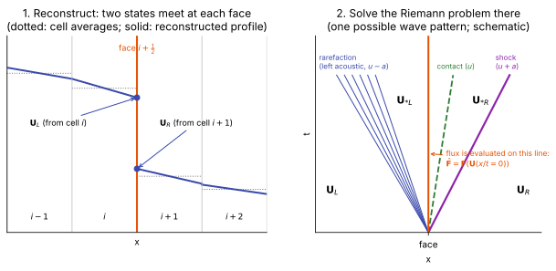
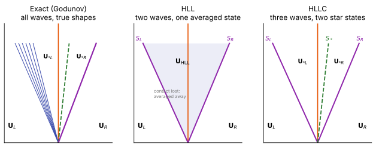
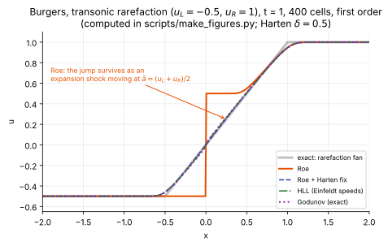

# Riemann solvers

**Slot:** Track 0.4 flux functions · **Depth:** [deep]

## What it is

A **numerical flux function** turns the two reconstructed face states $\mathbf U_L$, $\mathbf U_R$ into one flux $\hat{\mathbf F}(\mathbf U_L, \mathbf U_R)$ for the [conservative update](../foundations/conservation-and-weak-solutions.md#the-lax-wendroff-theorem). **Riemann solvers** are the family that does this by solving, exactly or approximately, the **Riemann problem**: the evolution of an initial discontinuity between two constant states. Other families split the flux by eigenvalue sign ([flux-vector splitting](flux-vector-splitting.md)) or use central differences plus dissipation ([central schemes](central-schemes.md)).

## The problem it solves

At a face, the two sides disagree. Physics resolves the disagreement by waves: for the Euler equations, a left acoustic wave, a contact (entropy and shear) wave, and a right acoustic wave, separating four constant states. Using that wave structure to decide the face flux gives upwinding that respects the [hyperbolic character](../foundations/mathematical-character.md#hyperbolic) of the equations, which is what makes shock capturing stable.

## How it works

### The Riemann problem at a face {#the-riemann-problem-at-a-face}

A finite-volume code stores one average per cell. [Reconstruction](reconstruction.md) turns those averages into a profile inside each cell, and at every face two values meet: $\mathbf U_L$, the left cell's profile evaluated at the face, and $\mathbf U_R$, the right cell's. They generally differ. The **Riemann problem** asks what happens if you start from exactly that: $\mathbf U = \mathbf U_L$ for $x < 0$ and $\mathbf U_R$ for $x > 0$, with the face at $x = 0$.

<figure markdown>

<figcaption markdown="span">Left: cell averages (dotted), reconstructed profiles (solid), and the two face states. Right: the same face in the $x$–$t$ plane. The initial jump breaks into three waves separating four constant states; the face flux is read off the vertical line $x = 0$. Schematic.</figcaption>
</figure>

Two facts make this useful:

- **The solution is self-similar.** With no length scale in the initial data, the solution depends only on $x/t$: it is constant along every ray from the origin. The face is the ray $x/t = 0$, so the state there, and hence the flux $\mathbf F(\mathbf U(0))$, is constant in time.
- **The wave structure is known.** For the Euler equations the jump splits into a left acoustic wave ($u - a$ family), a contact ($u$), and a right acoustic wave ($u + a$). Each acoustic wave is either a **shock** (a jump, if the gas is compressed) or a **rarefaction** (a smooth fan, if it expands). The contact is always a jump.

**The "star" states.** Following Toro's notation, the region between the two acoustic waves is the **star region**, and quantities there carry a $*$. Across a contact, pressure and normal velocity can't jump (otherwise it would be a pressure wave, not a contact), so the star region has a single $p_*$ and $u_*$. Everything else that the fluid carries (density, temperature, tangential velocity, species, $e_v$) *can* jump at the contact, so the star region holds two states: $\mathbf U_{*L}$ between the left wave and the contact, and $\mathbf U_{*R}$ between the contact and the right wave. Reading left to right: $\mathbf U_L \mid \mathbf U_{*L} \mid \mathbf U_{*R} \mid \mathbf U_R$.

### Godunov's method {#godunovs-method}

Godunov (1959) used this directly: treat the cell averages as piecewise-constant data, solve the Riemann problem exactly at every face, and use the resulting face state in the conservative update

$$
\mathbf U_i^{n+1} = \mathbf U_i^n - \frac{\Delta t}{\Delta x}\Big(\hat{\mathbf F}_{i+1/2} - \hat{\mathbf F}_{i-1/2}\Big),\qquad
\hat{\mathbf F}_{i+1/2} = \mathbf F\Big(\mathbf U^{\text{RP}}\big(x/t = 0;\ \mathbf U_L, \mathbf U_R\big)\Big),
$$

where $\mathbf U^{\text{RP}}(x/t;\,\mathbf U_L,\mathbf U_R)$ is the exact solution of the Riemann problem. For piecewise-constant data and a time step small enough that waves from neighbouring faces don't reach each other's faces (CFL $\le 1$), this update is the *exact* cell average of the exact evolution; the only approximation is averaging the result back to one value per cell. With higher-order reconstruction the same flux function is applied to the reconstructed face states, and the scheme is called "Godunov-type".

### The exact solver {#the-exact-solver}

For a $\gamma$-law gas the whole star region follows from one scalar equation for $p_*$. Across each acoustic wave, the velocity change is a known function of the pressure ratio: the Hugoniot if the wave is a shock, the isentrope if it is a rarefaction. Requiring both waves to land on the same $(p_*, u_*)$ gives

$$
f_L(p_*) + f_R(p_*) + (u_R - u_L) = 0,\qquad u_* = \tfrac12(u_L + u_R) + \tfrac12\big(f_R(p_*) - f_L(p_*)\big),
$$

with, for $K = L, R$,

$$
f_K(p) =
\begin{cases}
(p - p_K)\sqrt{\dfrac{A_K}{p + B_K}}, \quad A_K = \dfrac{2}{(\gamma+1)\rho_K},\ B_K = \dfrac{\gamma-1}{\gamma+1}p_K & p > p_K \text{ (shock)}\\[2ex]
\dfrac{2a_K}{\gamma - 1}\left[\left(\dfrac{p}{p_K}\right)^{(\gamma-1)/2\gamma} - 1\right] & p \le p_K \text{ (rarefaction)}.
\end{cases}
$$

The function is monotone in $p$, so Newton's method converges in a few iterations (typically 2–5 from a good initial guess). Then:

1. **Star densities** come from the Hugoniot (shock side) or the isentrope $\rho_{*K} = \rho_K (p_*/p_K)^{1/\gamma}$ (rarefaction side).
2. **Sampling** locates the face, $x/t = 0$, in the wave pattern. If $u_* > 0$ the face lies left of the contact, so the answer is $\mathbf U_L$, $\mathbf U_{*L}$, or a state inside a left rarefaction fan, depending on the signs of the left wave's speeds; symmetrically if $u_* < 0$. Inside a fan the state has a closed form.
3. The flux is $\mathbf F$ evaluated at that state.

The cost is the iteration and the branching. For reacting mixtures the shock and rarefaction branches need the real-gas Hugoniot and isentrope, each an inner iteration on the equation of state, which is why exact solvers are rare in production reentry codes. They remain the reference that approximate solvers are judged against.

### Approximate solvers: central flux minus dissipation {#central-minus-dissipation}

All the approximate solvers below can be read as "central flux minus dissipation":

$$
\hat{\mathbf F} = \tfrac12\big(\mathbf F_L + \mathbf F_R\big) - \tfrac12\,\mathbf D\,(\mathbf U_R - \mathbf U_L),
$$

and they differ in the dissipation matrix $\mathbf D$: how much each wave family is damped. For Rusanov $\mathbf D = S\,\mathbf I$, one large number for every wave; for Roe $\mathbf D = |\tilde{\mathbf A}| = \tilde{\mathbf R}\,|\tilde{\mathbf\Lambda}|\,\tilde{\mathbf R}^{-1}$, each wave damped by its own speed. That single difference explains most of their behaviour: contact resolution, boundary-layer smearing, positivity, entropy behaviour and carbuncle susceptibility.

The HLL family is easier to understand from its derivation, which uses only the integral form of the conservation law.

### Deriving HLL: averaging the fan {#deriving-hll}

<figure markdown>

<figcaption markdown="span">The exact solution, HLL's two-wave model with one averaged state, and HLLC's three-wave model with two star states, in the $x$–$t$ plane. The vertical line is the face. Schematic.</figcaption>
</figure>

Suppose all waves lie between a slowest speed $S_L$ and a fastest $S_R$. Take the box $[x_l, x_r] \times [0, T]$ with $x_l \le S_L T$ and $x_r \ge S_R T$. Its left and right edges see only $\mathbf U_L$ and $\mathbf U_R$, so the integral form gives, exactly,

$$
\int_{x_l}^{x_r}\mathbf U(x, T)\,dx = x_r\mathbf U_R - x_l\mathbf U_L + T(\mathbf F_L - \mathbf F_R).
$$

Outside $[S_L T, S_R T]$ the solution is still $\mathbf U_L$ or $\mathbf U_R$. Subtracting those parts leaves the **exact average of the true solution over the wave fan**:

$$
\mathbf U_{\text{HLL}} = \frac{S_R\mathbf U_R - S_L\mathbf U_L - (\mathbf F_R - \mathbf F_L)}{S_R - S_L}.
$$

HLL's one approximation is to replace the whole fan by this single constant state. The face flux then follows from the Rankine–Hugoniot condition across the left wave, $\hat{\mathbf F} = \mathbf F_L + S_L(\mathbf U_{\text{HLL}} - \mathbf U_L)$, which gives

$$
\hat{\mathbf F}_{\text{HLL}} =
\begin{cases}
\mathbf F_L & 0 \le S_L\\[0.5ex]
\dfrac{S_R\,\mathbf F_L - S_L\,\mathbf F_R + S_L S_R\,(\mathbf U_R - \mathbf U_L)}{S_R - S_L} & S_L < 0 < S_R\\[1.5ex]
\mathbf F_R & S_R \le 0.
\end{cases}
$$

Two consequences follow from the derivation:

- **Positivity comes from the averaging, and only if the speeds really bound the waves.** If $S_L$ and $S_R$ enclose every wave of the true solution, $\mathbf U_{\text{HLL}}$ is an average of physical states, and an average of states with positive density and internal energy has positive density and internal energy. If the estimates are too tight, the box misses part of the fan, the "average" is not one, and positivity is lost. So positivity is not a property of HLL as such but of HLL *with bounding speeds*.
- **The contact is lost.** One state inside the fan cannot hold a jump in density, temperature, species or tangential velocity. Those jumps get smeared, which is why HLL smears contacts and boundary layers.

### Deriving HLLC: restoring the contact {#deriving-hllc}

HLLC (Toro, Spruce & Speares 1994) splits the averaged state into two, $\mathbf U_{*L}$ and $\mathbf U_{*R}$, separated by a contact moving at $S_*$. The ingredients are the Rankine–Hugoniot condition across each outer wave,

$$
\mathbf F_{*K} = \mathbf F_K + S_K\big(\mathbf U_{*K} - \mathbf U_K\big),\qquad K = L, R,
$$

and the contact conditions $u_{*L} = u_{*R} = S_*$ and $p_{*L} = p_{*R} = p_*$. Working through the components:

- **Mass:** $\rho_{*K}(S_K - S_*) = \rho_K(S_K - u_K)$, so $\rho_{*K} = \rho_K\,\dfrac{S_K - u_K}{S_K - S_*}$. The factor $\chi_K = (S_K - u_K)/(S_K - S_*)$ is the compression across wave $K$.
- **Normal momentum:** $p_* = p_K + \rho_K(S_K - u_K)(S_* - u_K)$. Writing this for $K = L$ and $K = R$ and equating the two $p_*$ gives the contact speed

$$
S_* = \frac{p_R - p_L + \rho_L u_L(S_L - u_L) - \rho_R u_R(S_R - u_R)}{\rho_L(S_L - u_L) - \rho_R(S_R - u_R)}.
$$

- **Tangential momentum:** $v_{*K} = v_K$, $w_{*K} = w_K$; tangential velocity jumps only at the contact, which is how shear layers survive.
- **Energy:** the energy component of the Rankine–Hugoniot condition gives the last row below.

The star states are therefore

$$
\mathbf U_{*K} = \rho_K\,\chi_K
\begin{bmatrix} 1 \\ S_* \\ v_K \\ w_K \\ \dfrac{E_K}{\rho_K} + (S_* - u_K)\left(S_* + \dfrac{p_K}{\rho_K(S_K - u_K)}\right)\end{bmatrix},\qquad K = L, R,
$$

and the face flux is $\mathbf F_L$, $\mathbf F_{*L}$, $\mathbf F_{*R}$ or $\mathbf F_R$ according to which of the four regions contains $x/t = 0$ (the signs of $S_L$, $S_*$, $S_R$).

### HLLC with species and vibrational energy {#hllc-with-species-and-vibrational-energy}

For a reacting two-temperature mixture the conserved vector is $\mathbf U = (\rho_1, \dots, \rho_{n_s}, \rho u, \rho v, \rho w, E, \rho e_v)^T$. Species and $e_v$ are carried by the contact ([why](../foundations/mathematical-character.md#adding-species-and-vibrational-energy)), so across each outer wave they are compressed like the density and nothing else happens to them:

$$
\mathbf U_{*K} = \chi_K
\begin{bmatrix} \rho_{1,K} \\ \vdots \\ \rho_{n_s,K} \\ \rho_K S_* \\ \rho_K v_K \\ \rho_K w_K \\ E_K + \rho_K(S_* - u_K)\left(S_* + \dfrac{p_K}{\rho_K(S_K - u_K)}\right) \\ \rho_K e_{v,K} \end{bmatrix},\qquad \chi_K = \frac{S_K - u_K}{S_K - S_*}.
$$

Three things to check, each of which is a property you want:

- **Consistency:** $\sum_s \rho_{s,*K} = \chi_K\rho_K = \rho_{*K}$, so the species densities add up to the mixture density in each star state. Mass fractions and $e_v$ per unit mass are unchanged across the outer waves: $Y_{s,*K} = Y_{s,K}$, $e_{v,*K} = e_{v,K}$.
- **Upwinded species fluxes:** from the Rankine–Hugoniot condition, the species flux in star region $K$ is $\rho_{s,K}u_K + S_K(\chi_K - 1)\rho_{s,K} = Y_{s,K}\,\big[\rho_K u_K + S_K(\rho_{*K} - \rho_K)\big] = Y_{s,K}\,\hat F_{\rho}$. Each species flux is the upwind mass fraction times the total mass flux, with "upwind" decided by the sign of $S_*$. This is the condition (Larrouturou 1991) that keeps every $Y_s$ between 0 and 1 in a first-order update.
- **$E$ and $p$ are the mixture's.** $E$ includes the vibrational and chemical (formation) energy, and $p$ comes from the two-temperature equation of state. The sound speeds inside $S_L$, $S_R$ are [frozen](../foundations/mathematical-character.md#frozen-and-equilibrium-sound-speed).

**Example: a stationary composition contact.** Put pure N₂ on the left and partly dissociated N₂/N on the right, at the same pressure and with $u_L = u_R = 0$. Physically nothing should happen apart from (slow) diffusion. In HLLC, $S_* = 0$ exactly and $\chi_K = 1$, so the star states equal the side states and every flux is zero except pressure: the interface stays sharp indefinitely. In HLL with symmetric speeds $S_R = -S_L = a$, the species-$s$ flux is

$$
\hat F_{\rho_s} = \frac{S_L S_R\,(\rho_{s,R} - \rho_{s,L})}{S_R - S_L} = -\frac{a}{2}\,(\rho_{s,R} - \rho_{s,L}),
$$

a numerical diffusion flux with an effective diffusivity of order $a\,\Delta x/2$. For $a \approx 1$ km/s and $\Delta x = 1$ mm that is about $0.5$ m²/s, far above physical mass diffusivities at shock-layer densities, and it never switches off. The same mechanism, acting on temperature and tangential velocity, is what smears boundary layers in HLL and degrades heat flux.

## Variants

### Exact (Godunov)

The [exact solver](#the-exact-solver) above, used in [Godunov's method](#godunovs-method). The reference standard; expensive and awkward for real-gas mixtures, so rarely used in production reentry codes.

### Roe

Linearize around a special average state so the linear problem is exact for isolated discontinuities:

$$
\hat{\mathbf F}_{\text{Roe}} = \tfrac12(\mathbf F_L + \mathbf F_R) - \tfrac12\sum_k |\tilde\lambda_k|\,\tilde\alpha_k\,\tilde{\mathbf r}_k ,
$$

with eigenvalues $\tilde\lambda_k$, eigenvectors $\tilde{\mathbf r}_k$ and wave strengths $\tilde\alpha_k$ evaluated at Roe averages, for a perfect gas

$$
\tilde u = \frac{\sqrt{\rho_L}u_L + \sqrt{\rho_R}u_R}{\sqrt{\rho_L} + \sqrt{\rho_R}},\qquad \tilde H = \frac{\sqrt{\rho_L}H_L + \sqrt{\rho_R}H_R}{\sqrt{\rho_L} + \sqrt{\rho_R}},\qquad \tilde a^2 = (\gamma - 1)\big(\tilde H - \tfrac12\tilde u^2\big).
$$

In words: Roe's solver replaces the true wave pattern by three (or more, with species) **jumps**, one per eigenvalue, each moving at its Roe-averaged speed and damped in proportion to that speed. Reacting mixtures need a generalized Roe average (the pressure derivatives depend on composition).

**Strengths:** resolves stationary contacts and shear layers exactly, so boundary layers suffer little numerical dissipation. **Weaknesses:** admits expansion shocks at sonic points and needs an **entropy fix** ([why](#entropy-fixes-why-roe-needs-one)); not positivity-preserving in strong expansions; prone to the [carbuncle](shock-instabilities.md). The entropy-fix parameter $\delta$ is a real knob in hypersonic runs, and it affects heating.

### HLL

The [two-wave average](#deriving-hll): two waves with speeds $S_L < S_R$ and one averaged state between them. HLL is a *framework*: it does not say how to choose $S_L$ and $S_R$, and its properties depend on that choice; see [wave-speed estimates](#wave-speed-estimates).

**Strengths:** positivity-preserving when the speeds bound the true waves; carbuncle-resistant; no entropy fix; simple and robust. **Weaknesses:** the contact and shear waves are lost inside the averaged state, so contacts and **boundary layers are smeared**, which degrades heat flux on practical grids.

### HLLE

HLL with one particular choice of speeds, Einfeldt's (see [wave-speed estimates](#wave-speed-estimates)): the minimum and maximum of the one-sided acoustic speeds and the Roe-averaged ones. Einfeldt (1988) and Einfeldt et al. (1991) showed these speeds bound the physical waves for the Euler equations, which makes the scheme provably positivity-preserving. So "HLL vs HLLE" is not two different solvers: HLLE is HLL with the speeds that guarantee positivity, and an "HLL" with cruder speeds (Davis's, say) usually works but lacks that proof. Most codes that say "HLL" mean HLLE.

### HLLC

The [three-wave model](#deriving-hllc): restore the missing **C**ontact, with the contact speed $S_*$ and star states derived above. Species and extra scalars [ride the contact](#hllc-with-species-and-vibrational-energy).

**Strengths:** resolves contacts and shear layers like Roe, but positivity-preserving with suitable wave speeds (Batten et al. 1997) and needs no entropy fix. **Weaknesses:** like Roe, prone to the carbuncle at strong shocks aligned with the grid.

### HLLC-LM

A shock-stable, *lower*-dissipation HLLC (Fleischmann, Adami & Adams, 2020). HLLC is rewritten in an equivalent central form whose dissipation splits into acoustic and contact parts; the acoustic wave speeds are then scaled down smoothly where the face-normal Mach number is below 0.1. Because the transverse faces at a grid-aligned shock are exactly such faces, this removes the carbuncle without adding dissipation. Full formulas on [low-Mach corrections](low-mach-corrections.md#hllc-lm).

### Rusanov (local Lax–Friedrichs)

One wave speed $S = \max(|u_L| + a_L,\ |u_R| + a_R)$ for everything:

$$
\hat{\mathbf F} = \tfrac12(\mathbf F_L + \mathbf F_R) - \tfrac12 S\,(\mathbf U_R - \mathbf U_L).
$$

This is HLL with $S_L = -S$, $S_R = S$. Most dissipative, very robust, cheapest. Often used as a fallback in difficult cells.

### Summary

| Solver | Waves modelled | Contacts and shear | Positivity | Entropy fix needed | Carbuncle | Cost |
|---|---|---|---|---|---|---|
| Exact | all, true shapes | exact | yes | no | prone | high |
| Roe | all, as jumps | exact | no | yes | prone | medium |
| HLL | 2, one average state | smeared | only with bounding speeds | no | resistant | low |
| HLLE | as HLL | smeared | yes (Einfeldt speeds) | no | resistant | low |
| HLLC | 3, two star states | resolved | yes with suitable speeds | no | prone (worse in 3D) | low–medium |
| HLLC-LM | as HLLC | resolved | as HLLC | no | resistant | low–medium |
| Rusanov | 1 speed for all | heavily smeared | yes | no | resistant | lowest |

The pattern is the classical trade-off of hypersonic flux design: **the dissipation that smears contacts and boundary layers is the same dissipation that suppresses the carbuncle.** Hybrid and rotated solvers, and dissipation applied only at shocks, try to get both. A newer line of work argues the trade-off is partly false: the carbuncle is driven by *mis-scaled* acoustic dissipation at low face-normal Mach numbers, so it can be cured by reducing dissipation there ([HLLC-LM](#hllc-lm), [low-Mach corrections](low-mach-corrections.md)). See [shock instabilities](shock-instabilities.md) and Track 2.2–2.3.

### Dissipation in practice: the double cone {#double-cone-comparison}

On the Mach 11.3 double-cone flow, where the separation-bubble length is a sensitive gauge of dissipation, Candler, Subbareddy & Nompelis (2015) ranked flux and limiter combinations on coarse grids:

- **Least dissipative (largest bubble):** Roe + superbee, Roe + van Leer, and [modified Steger–Warming](flux-vector-splitting.md#modified-steger-warming).
- **Too dissipative:** Lax–Friedrichs (as expected), HLL (it ignores the contact wave), and every combination using minmod, including HLLC + minmod.
- **Fine-grid limit:** the best three agree within 0.2%; all methods converge to the same answer, but the dissipative ones need far more cells to get there.

The limiter mattered at least as much as the solver. Details on the [reconstruction page](reconstruction.md#double-cone-ranking).

## Wave-speed estimates

HLL-family solvers (HLL, HLLE, HLLC, HLLC-LM) need estimates $S_L$, $S_R$ of the fastest left- and right-running signals. Too small and the scheme loses positivity or stability, because a real wave falls outside the fan; too large and it adds dissipation. The common choices, with $c$ the sound speed:

| Estimate | $S_L$, $S_R$ | Notes |
|---|---|---|
| Rusanov | $\mp\max(\lvert u_L\rvert  + c_L,\ \lvert u_R\rvert  + c_R)$ | Symmetric and largest; most dissipative. |
| Davis (1988) | $S_L = \min(u_L - c_L,\ u_R - c_R)$, $S_R = \max(u_L + c_L,\ u_R + c_R)$ | Simple and cheap, but not guaranteed to bound the waves (a strong shock can be faster). A cruder variant uses $u_L - c_L$ and $u_R + c_R$ only. |
| Einfeldt (1988) | $S_L = \min(u_L - c_L,\ \hat u - \hat c)$, $S_R = \max(u_R + c_R,\ \hat u + \hat c)$, with Roe-averaged $\hat u$ and $\hat c^2 = \dfrac{\sqrt{\rho_L}c_L^2 + \sqrt{\rho_R}c_R^2}{\sqrt{\rho_L} + \sqrt{\rho_R}} + \dfrac12\dfrac{\sqrt{\rho_L\rho_R}}{(\sqrt{\rho_L} + \sqrt{\rho_R})^2}(u_R - u_L)^2$ | The HLLE choice; makes HLL positivity-preserving for the Euler equations. The usual default. |
| Arithmetic (Coralic & Colonius 2014) | as Einfeldt, with arithmetic averages $\bar u$, $\bar c$ instead of Roe averages | Used in multiphase codes, where Roe averages are awkward. |
| Toro, pressure-based (Toro et al. 1994) | $S_L = u_L - c_L q_L$, $S_R = u_R + c_R q_R$, with $q_K = \sqrt{1 + \tfrac{\gamma + 1}{2\gamma}(p_*/p_K - 1)}$ if $p_* > p_K$ (a shock on that side), else 1 | Estimates the star pressure $p_*$ first (e.g. two-rarefaction or linearized solvers). Tighter bounds and less dissipation, but tied to a $\gamma$-law EOS; needs an effective $\gamma$ for reacting mixtures. |

For HLLC, the contact speed $S_*$ then follows from the Batten et al. (1997) formula in the [HLLC section](#hllc). For reacting multi-temperature air, the sound speed in all of these is the [frozen sound speed](../foundations/mathematical-character.md#frozen-and-equilibrium-sound-speed).

## Entropy fixes: why Roe needs one {#entropy-fixes-why-roe-needs-one}

The [entropy condition](../foundations/conservation-and-weak-solutions.md#nonuniqueness-and-the-entropy-condition) rules out expansion shocks. The danger point is a **transonic rarefaction**: an expansion in which one acoustic eigenvalue changes sign, $\lambda(\mathbf U_L) < 0 < \lambda(\mathbf U_R)$, as at a sonic line in an expanding flow (around a capsule shoulder, or anywhere the flow accelerates through Mach 1). The correct solution is a fan that straddles the face. Whether a scheme produces it depends on one thing: **is there any dissipation left for that wave when its speed is near zero?**

<figure markdown>

<figcaption markdown="span">A transonic rarefaction in Burgers' equation, computed with four first-order fluxes. Roe keeps the initial jump as an expansion shock; Harten's entropy fix, HLL and the exact Godunov flux all open the correct fan.</figcaption>
</figure>

- **Roe: no.** Roe models every wave as a jump moving at $\tilde\lambda$ and damps it by $|\tilde\lambda|$. For Burgers, $\tilde\lambda = (u_L + u_R)/2$. If that average is zero (or small), the dissipation vanishes and the flux reduces to the central $\tfrac12(f_L + f_R)$, which, for a jump with $f_L = f_R$, is a perfectly balanced steady state. The scheme has no mechanism to open a fan, so the expansion shock persists, as in the figure. It is the linearization that causes this: a rarefaction is a *spreading* wave whose speed varies across it, and replacing it by one jump with one speed throws that spreading away.
- **Harten's entropy fix** restores a floor of dissipation: replace $|\tilde\lambda|$ by $(\tilde\lambda^2 + \delta^2)/2\delta$ when $|\tilde\lambda| < \delta$, so the coefficient never drops below $\delta/2$. Eigenvalue limiting, $|\lambda| \to \sqrt{\lambda^2 + \varepsilon^2}$, is the same idea ([figure on flux-vector splitting](flux-vector-splitting.md#modified-steger-warming)).
- **HLL, HLLE, Rusanov: built in.** Their dissipation is set by $S_L$ and $S_R$, which bound the *whole* fan: $S_L \le \lambda(\mathbf U_L) < 0 < \lambda(\mathbf U_R) \le S_R$. Written as central minus dissipation, the coefficient at a sonic point is $-2S_LS_R/(S_R - S_L) > 0$, which cannot vanish while the speeds straddle zero. They are monotone at first order and converge to the entropy solution.
- **Exact Godunov: by construction.** The exact solver knows that an expanding acoustic wave is a fan and samples inside it.
- **HLLC: no fix needed.** Its acoustic waves use the same bounding $S_L$, $S_R$ as HLL. The one wave whose speed can vanish is the contact, $S_*$, and its dissipation does go to zero there, but that is harmless: the contact field is *linearly degenerate* (its speed $u$ is the same on both sides, characteristics are parallel), so there is no compression-versus-expansion choice and no entropy condition to violate. Expansion shocks are only possible in genuinely nonlinear fields, the acoustic ones, whose speed changes across the wave.

**Why the fix matters beyond sonic points in hypersonics.** The same vanishing-eigenvalue problem appears wherever an eigenvalue goes to zero: the contact eigenvalue $u$ near a stagnation point and the face-normal velocity at a grid-aligned bow shock. That is part of why Roe is [carbuncle-prone](shock-instabilities.md), and production Roe codes typically apply the fix to all waves, with $\delta$ scaled by the local spectral radius. The price is extra dissipation everywhere the fix is active, including boundary layers, where the wall-normal velocity is small and the fix can dominate: it then smears the boundary layer and changes the heat flux. Codes therefore reduce or switch off the fix near walls.

!!! warning "Calibration"
    The general practice (entropy fix on all fields for robustness at strong shocks, reduced in boundary layers for accurate heat flux) is widely described for Roe-based hypersonic codes. The exact form, coefficient and switching used by a specific code (for example LAURA's eigenvalue limiter) should be taken from that code's documentation, not from this page.

## Reconstruction blends are not flux functions {#reconstruction-blends-are-not-flux-functions}

Commercial codes often advertise schemes that "blend central differencing and upwinding", and it is easy to read these as a different way of capturing shocks. They act at a different stage of the [finite-volume pipeline](finite-volume-pipeline.md):

1. **Reconstruction** decides the face states $\mathbf U_L$, $\mathbf U_R$. A central reconstruction uses a symmetric stencil (low dissipation, oscillates at jumps); an upwind-biased one (MUSCL, second-order upwind) is more dissipative and better behaved. A **blend** weights the two by a smoothness indicator, central where the solution is smooth and upwind near steep gradients.
2. **The flux function** (this page) turns $\mathbf U_L$, $\mathbf U_R$ into $\hat{\mathbf F}$. This is where the shock's jump conditions, entropy behaviour and carbuncle susceptibility are decided.

STAR-CCM+ is an example of the split. Its coupled (density-based) solver offers two inviscid flux functions, a preconditioned Roe scheme (Weiss & Smith) and AUSM+ / AUSM+-up, and separately a choice of spatial discretization: first order, second-order upwind, or a hybrid "MUSCL 3rd-order / central-differencing" reconstruction with a user-set upwind blending factor. The vendor documentation recommends AUSM+ rather than Roe for Mach numbers above about 3, and the MUSCL/CD blend mainly for lower-dissipation scale-resolving (LES/DES) work. The blend lowers dissipation in smooth regions; the shock is still captured by the Roe or AUSM+ flux. The same idea in the central-scheme world is a central flux with dissipation switched on only near shocks by a [shock sensor](central-schemes.md#shock-sensors).

!!! warning "Calibration"
    STAR-CCM+ options are from the Simcenter STAR-CCM+ user documentation (sections on evaluation of inviscid fluxes and coupled-flow discretization). Option names and defaults change between releases.

## Positivity safeguards

Strong expansions (capsule shoulders and wakes, near-vacuum regions) and strong shocks can drive density, pressure or temperature negative at a face or in an update even when the flux function itself is positivity-preserving, because high-order reconstruction can produce non-physical face states. Codes guard against this at three levels:

- **At the face states.** Check reconstructed $\rho$, $p$ (and species densities, $T$, $T_v$) and fall back to lower-order reconstruction where they are non-physical, or scale the reconstruction towards the cell average (Zhang–Shu-type limiting).
- **At the flux.** A *positivity-preserving flux limiter* blends the high-order flux with a first-order positive flux (HLL/HLLC with Einfeldt speeds, or Rusanov) just enough to keep the updated cell positive (Hu, Adams & Shu, 2013). ALPACA's "Riemann solver for positivity under flux splitting" is this fallback flux.
- **After the update (a posteriori).** If a cell ends up non-physical, recompute it with a lower-order, more robust scheme (MOOD-type detection).

Density and pressure floors (for example $10^{-7}$ in ALPACA) are the last line of defence, not a fix. Frequent triggering usually signals a resolution or startup problem.

## Implications

| Lens | Effect |
|---|---|
| Time step and cost | All are explicit-CFL-compatible; implicit codes also need the flux Jacobian, which is simpler for some solvers (and often approximated). |
| Steady vs unsteady | All usable for both; entropy fixes and wave-speed switches can cause limit cycles in steady convergence. |
| Accuracy | Contact-resolving solvers (Roe, HLLC) give much better boundary layers and heat flux on a given grid than HLL/Rusanov. |
| Robustness | HLL-family is positivity-preserving and carbuncle-resistant; Roe needs fixes. |
| Physics captured or lost | HLL loses the contact and shear waves; Roe and HLLC keep them. |
| Hardware / parallel fit | Face-local, branch-light; all map well to GPUs. |

## In a run

Knobs: flux scheme, entropy-fix coefficient (and where it is switched off), wave-speed estimate. Symptoms: carbuncle (a spurious protrusion of the bow shock at the stagnation line), expansion shocks at sonic points, negative pressure in strong expansions (wake), and heat flux that changes noticeably with the flux choice on the same grid.

## Which codes

LAURA uses Roe's scheme with Yee-type TVD limiting and an entropy fix; MFC defaults to HLLC (HLL and an exact solver are available); [ALPACA](../../codes/index.md#alpaca) offers HLLC, HLLC-LM, HLL and Rusanov with a choice of wave-speed estimates; STAR-CCM+ offers preconditioned Roe and AUSM+-up in its coupled solver, with AUSM+ recommended for hypersonic cases ([details](#reconstruction-blends-are-not-flux-functions)). DPLR and US3D use [modified Steger–Warming](flux-vector-splitting.md#modified-steger-warming) rather than a Riemann solver.

!!! warning "Calibration"
    These assignments follow the codes' published descriptions; defaults and options change between versions. Verify against current user manuals before relying on them.

## See also

[Flux-vector splitting](flux-vector-splitting.md) · [Central schemes](central-schemes.md) · [Shock instabilities](shock-instabilities.md) · [Reconstruction](reconstruction.md) · [The finite-volume pipeline](finite-volume-pipeline.md#3-inviscid-flux)

## References

Toro, *Riemann Solvers and Numerical Methods for Fluid Dynamics* (the standard reference for all of the above, including the exact solver and the HLL/HLLC derivations); LeVeque, *Finite Volume Methods for Hyperbolic Problems* (entropy fixes and transonic rarefactions); Godunov (1959); Roe (1981); Harten & Hyman (1983); Harten, Lax & van Leer (1983); Davis (1988); Einfeldt (1988); Einfeldt et al. (1991); Larrouturou (1991); Weiss & Smith (1995); Liou (1996); Toro, Spruce & Speares (1994); Batten et al. (1997); Quirk (1994); Coralic & Colonius (2014); Hu, Adams & Shu (2013); Fleischmann, Adami & Adams (2020). See the [bibliography](../../references.md).
