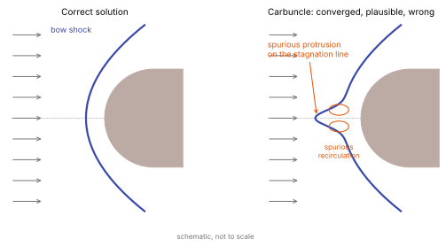

# Shock instabilities: the carbuncle

**Chapter:** 7 Inviscid flux functions · **Depth:** [deep]

## What it is

A family of purely numerical failures of shock-capturing schemes at strong shocks aligned with the grid: the **carbuncle** (a spurious protrusion of a blunt-body bow shock along the stagnation line, first reported by Peery and Imlay in 1988), **odd–even decoupling** along a planar shock (Quirk's test), and kinked Mach stems. The solution looks plausible, converges, and is wrong.

<figure markdown>

<figcaption markdown="span">Left: the correct bow shock ahead of a blunt body. Right: a carbuncle. The shock grows a protrusion along the stagnation line, with a pair of spurious recirculation cells behind it. The residual can converge to this state. Schematic, not to scale.</figcaption>
</figure>

## The problem it solves

This page is about a problem rather than a method: which flux functions are prone, the competing explanations of why, and the fixes. It matters directly for entry vehicles because the bow shock in front of a capsule nose is strong, nearly normal, and (on a shock-fitted or aligned grid) aligned with grid lines, and because a carbuncle at the stagnation line corrupts stagnation heating.

## How it works

### Who is prone

Contact-resolving solvers, [Roe](riemann-solvers.md#roe) and [HLLC](riemann-solvers.md#hllc), are prone; dissipative ones, [HLL](riemann-solvers.md#hll), [Rusanov](riemann-solvers.md#rusanov-local-laxfriedrichs) and [Steger–Warming](flux-vector-splitting.md#steger-warming), are not. HLLC was long regarded as relatively safe because its 2D disturbances usually stay bounded; Fleischmann et al. (2020) showed that with high-order reconstruction, high resolution and especially in **3D**, HLLC develops severe carbuncles much like Roe. The risk grows with resolution and order, exactly the direction modern codes are moving.

### Two explanations

**Too little dissipation on the shear and entropy waves.** Along a grid-aligned shock, contact-resolving solvers put almost no dissipation on the transverse waves, so perturbations can grow; the cure is to add dissipation there. This view motivated most fixes (hybrids, entropy fixes, HLLCM).

**Mis-scaled dissipation at low transverse Mach number.** In the fluxes computed *across* the shock's transverse direction, the face-normal velocity nearly vanishes, so these faces are in the low-Mach limit. There, acoustic dissipation (scaling with $c$) dwarfs advective dissipation (scaling with $|u|$), the same imbalance that ruins low-Mach accuracy (Guillard–Viozat). Hu and Adams, Fleischmann et al. and Chen et al. (2018) attribute the instability to this mismatch; reducing the acoustic dissipation at those faces cures it. Note that a perfectly aligned 1D situation is stable; a small deflection is needed to trigger the instability.

!!! note "Settled vs active"
    That certain fluxes are prone and that the problem worsens in 3D and at high order is well established. Which mechanism is primary is still debated; the low-Mach explanation is supported by stability analysis and by the success of dissipation-*reducing* cures, but the field has not converged on one theory.

## Variants

### Fixes that add dissipation

- **Hybrid fluxes** (Quirk): HLL near strong shocks, HLLC or Roe elsewhere; Kim et al. apply the HLL part only to transverse fluxes; Huang et al. only to some flux components. Stable, but a switch is needed and dissipation still rises locally.
- **Entropy fixes and artificial viscosity** in Roe-type schemes (Rodionov reviews the options).
- **Rotated Riemann solvers** (Ren): evaluate the flux in a frame aligned with the local flow or shock direction. Effective but expensive.
- **Shock-stable HLLC variants**: HLLCM (Shen et al., smearing shear velocities across the contact; too dissipative for boundary layers alone), pressure-dissipation HLLC (Xie et al.), HLLC-ADC and HLLC-SWM (Simon & Mandal, controlling the anti-diffusive part near shocks).
- **Eigenvalue limiting** in upwind fluxes: keep the convective eigenvalue $u'$ in the dissipation from reaching zero at the stagnation point, $\sqrt{\lambda^2 + \varepsilon^2}$ with $\varepsilon = \varepsilon_0 a$, $0.1\le\varepsilon_0\le0.3$. This is the production fix in Candler's group's codes, paired with grid alignment, and is applied when the shock-normal Mach number exceeds about 6. It must be switched off in boundary layers. See [modified Steger–Warming](flux-vector-splitting.md#eigenvalue-limiting).
- **Pressure-weighted Jacobians** for modified Steger–Warming: revert smoothly to the original, dissipative Steger–Warming flux across strong pressure jumps ([pressure weighting](flux-vector-splitting.md#pressure-weighting)).
- **Shock-aligned or shock-fitted grids** reduce the trigger: DPLR, LAURA and US3D all have shock-tailoring utilities ([shock alignment](discretization-families.md#shock-alignment)).

!!! note "A related but different error: tetrahedra at the shock"
    A strong shock crossing tetrahedra generates spurious vorticity from an imbalance of momentum flux on the element faces, even with a first-order flux. It is not a carbuncle (no instability needs to grow), and added dissipation does not remove it once created. The cure is hexahedral, shock-aligned cells at the bow shock. See [element types at strong shocks](discretization-families.md#element-types-at-strong-shocks).

### Fixes that reduce dissipation

- **Roe-M and LLF-M** (Hu & Adams; Fleischmann et al.): limit the acoustic eigenvalues to $\phi |u|$ at low face-normal Mach number.
- **HLLC-LM** (Fleischmann, Adami & Adams 2020): central reformulation of HLLC with Mach-scaled acoustic wave speeds; shock-stable in 2D and 3D while less dissipative than HLLC.

Both are on the [low-Mach corrections](low-mach-corrections.md) page.

## Typical values

- Eigenvalue limiter: $\varepsilon_0$ of 0.1–0.3, applied when the shock-normal Mach number exceeds about 6 (Candler, Subbareddy & Nompelis 2015).
- Quirk's odd–even test: a Mach 6 planar shock travelling along a duct whose centreline grid points are perturbed alternately up and down by a very small amount; prone schemes amplify the perturbation until the shock breaks up (Quirk 1994).
- HLLC-LM activation: face-normal Mach number below 0.1 (Fleischmann, Adami & Adams 2020).
- Sensitivity: worse with finer grids, higher-order reconstruction, cells of high aspect ratio along the shock, and in 3-D.

## Trade-offs

- **Dissipation-adding fixes.** Simple and proven in production, but the added dissipation must be confined to the shock, or boundary-layer and heat-flux accuracy suffer.
- **Dissipation-reducing fixes.** No penalty in boundary layers, and less dissipative than the baseline; less field experience for entry heating.
- **Grid alignment.** Removes much of the trigger and improves accuracy generally, at the cost of an adaptation step and a grid tied to one flow condition.
- **Dissipative baseline flux (HLL, Steger–Warming) everywhere.** Never carbuncles, but smears contacts and boundary layers; this is the trade the [modified Steger–Warming](flux-vector-splitting.md#modified-steger-warming) flux was designed to escape.

## Effects on stability and robustness

- A carbuncle is a stable, converged state of the discrete equations, so residual convergence doesn't detect it.
- It needs a trigger: a slightly misaligned shock, a grid perturbation, round-off. A perfectly aligned one-dimensional shock is stable.
- It can appear when a previously clean case is refined, moved to higher order or extended from axisymmetric to 3-D.
- Fixes with switches (hybrid fluxes, sensors) can themselves stall steady convergence ([convergence diagnostics](../time/convergence-diagnostics.md#stalls-and-limit-cycles)).

## Implications

| Lens | Effect |
|---|---|
| Time step and cost | Most fixes are cheap; rotated solvers cost several flux evaluations per face. |
| Steady vs unsteady | Steady blunt-body runs can converge to a carbuncle; unsteady high-order runs grow it over time. |
| Accuracy | A carbuncle corrupts standoff and stagnation heating; dissipation-adding fixes can degrade boundary layers if they act away from shocks. |
| Robustness | The central issue of this page. |
| Physics captured or lost | The cure must not smear the physics it sits next to (boundary layer, shear layers). |
| Hardware / parallel fit | Face-local fixes are GPU-friendly; shock sensors may need neighbour data. |

## In a run

A capsule or cylinder solution whose bow shock develops a nose or a bulge on the stagnation line, odd–even striping behind a planar shock, or stagnation heating that depends strongly on the flux scheme. Check by switching to HLL near the shock or by perturbing the grid: a physical feature survives, a carbuncle doesn't.

## Which codes

DPLR and US3D rely on [modified Steger–Warming](flux-vector-splitting.md#modified-steger-warming), which inherits FVS robustness at shocks; LAURA uses Roe with an entropy fix and shock-aligned grids; ALPACA offers HLLC-LM.

!!! warning "Calibration"
    The DPLR and US3D statements are from Candler, Subbareddy & Nompelis (2015); the LAURA statement is from its methods literature (Gnoffo 1990) at a general level. Parameter defaults are not given in those sources.

## See also

[Riemann solvers](riemann-solvers.md) · [Low-Mach corrections](low-mach-corrections.md) · [Flux-vector splitting](flux-vector-splitting.md)

## References

Peery & Imlay (1988); Quirk (1994); Kim et al. (2009); Ren (2003); Shen et al. (2016); Rodionov (2017); Chen et al. (2018); Fleischmann, Adami, Hu & Adams (2020); Fleischmann, Adami & Adams (2020); Hu & Adams (arXiv:1204.5092). See the [bibliography](../../references.md).
