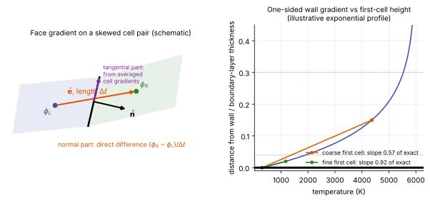

# Viscous fluxes and gradients

**Chapter:** 6 Spatial discretization · **Depth:** [deep]

## What it is

The discretization of $\mathbf F_{\text{visc}}$: viscous stresses (momentum diffusion), heat conduction for each temperature, and species mass diffusion. Each is a transport coefficient times a gradient, so the work is computing **face gradients** and **face-averaged coefficients**.

## The problem it solves

Diffusion is what sets boundary layers, skin friction and, above all, the wall heat flux $q_w = \kappa\,\partial T/\partial n + \dots$ ([closures](../foundations/closing-the-system.md#3-transport-properties)). An inviscid flux function knows nothing about it.

## How it works

Diffusion is [parabolic](../foundations/mathematical-character.md#parabolic): it has no preferred direction, so there is nothing to upwind. Central-type approximations are both natural and stable. In 1D on a uniform grid,

$$
q_{i+1/2} = -\kappa_{i+1/2}\,\frac{T_{i+1} - T_i}{\Delta x},\qquad \kappa_{i+1/2} = \tfrac12(\kappa_i + \kappa_{i+1}).
$$

In multiple dimensions on general grids, face gradients are built from cell gradients averaged to the face, plus a **face-normal correction** that uses the direct difference across the face. Without that correction, averaged gradients decouple neighbouring cells and allow odd–even oscillations.

### Cell gradients

**Green–Gauss.** From $\int_V\nabla\phi\,dV = \oint_S \phi\,\hat{\mathbf n}\,dS$, with face values taken as the average of the two adjacent cells:

$$
(\nabla\phi)_i \approx \frac{1}{V_i}\sum_{\text{faces}} \frac{\phi_L + \phi_R}{2}\,\hat{\mathbf n}\,S .
$$

Explicit and cheap, but error-prone on skewed and high-aspect-ratio cells (Nompelis, Drayna & Candler 2004).

**Weighted least squares.** Fit a hyperplane through the cloud of neighbouring cell values, weighting each neighbour (often by inverse distance). More robust on irregular grids, and the default in US3D. On very stretched cells even least squares can give poor wall-normal gradients, which is what the correction below is for.

### Deferred (face-normal) correction {#deferred-correction}

Split the face gradient into its component along the face normal $\hat{\mathbf n}$ and the rest, and replace the normal part with the direct difference between the two cell centroids, a distance $\Delta\ell$ apart along the unit vector $\hat{\mathbf e}$:

$$
(\nabla\phi)_f = \frac{\phi_R - \phi_L}{\Delta\ell}\,(\hat{\mathbf e}\cdot\hat{\mathbf n})\,\hat{\mathbf n}
+ \big[\mathbf I - \hat{\mathbf n}\otimes\hat{\mathbf n}\big]\,\tfrac12\big((\nabla\phi)_L + (\nabla\phi)_R\big).
$$

Reading the formula: the first term is the direct difference along the line joining the centroids, projected onto the face normal. The second term takes the average of the two cell gradients and removes its normal component with the projector $\mathbf I - \hat{\mathbf n}\otimes\hat{\mathbf n}$, leaving only the part tangent to the face. So the normal derivative comes from the two cells that share the face and the tangential derivative from the wider stencil.

<figure markdown>

<figcaption markdown="span">Left: the two pieces of the face gradient on a skewed pair of cells (schematic). Right: why the first cell height matters for heat flux. The wall gradient is estimated from the first cell centre and the wall value; for an illustrative exponential temperature profile, a first cell 30% of the boundary-layer thickness recovers 57% of the true wall gradient and a cell of 4% recovers 92%.</figcaption>
</figure>

This is the form of Nompelis et al. (2004), following Kim, Makarov & Caraeni (2003). The direct difference is compact (it couples the two cells sharing the face, which removes odd–even decoupling) and is accurate in exactly the direction that matters for heat flux on a stretched wall grid. On an ideal orthogonal grid it reduces to the plain difference.

**Typical effect.** US3D and DPLR, run on the same grid for Orion at 9.5 km/s, 18° angle of attack, with matched thermochemistry, agreed within 1% on stagnation-line data and surface pressure but differed by up to 5% in heat flux. Candler et al. (2015) attribute the difference most likely to gradient evaluation: DPLR uses standard finite differences, US3D weighted least squares with deferred correction, which is expected to be more accurate on non-ideal grids. The source was not confirmed.

The inviscid and viscous fluxes are computed separately but summed into **one residual** at each face ([the pipeline](finite-volume-pipeline.md#6-update)): one equation, assembled from pieces that each get the discretization suited to their mathematical character.

### Near the wall

Heat flux is a gradient at the wall, so its accuracy depends on resolving the thermal boundary layer. The usual guideline is a wall **cell Reynolds number** of order one or below,

$$
Re_\Delta = \frac{\rho\,a\,\Delta n}{\mu} \lesssim 1\ \text{(order of magnitude)},
$$

an accepted practice supported by grid studies in the aeroheating literature rather than a theorem. Those thin cells are also why the [viscous time-step limit](../time/time-step-limits.md) binds for explicit schemes.

## Variants

### Thin-layer approximation

Keep only viscous derivatives normal to the wall. Cheaper; appropriate for attached boundary layers on well-aligned grids. See [space marching](../special/space-marching.md#thin-layer-navier-stokes).

### Discontinuous Galerkin viscous treatments

DG needs special viscous discretizations (BR2, interior penalty, LDG), but these are still symmetric, not upwinded.

## Typical values

- Wall cell Reynolds number for grid-converged heating: of order one or below (accepted practice in the aeroheating literature).
- US3D against DPLR on the same Orion grid at 9.5 km/s: 1% in pressure, up to 5% in heat flux, attributed most likely to gradient evaluation (Candler et al. 2015).
- Wall gradient recovered by a one-sided difference on an exponential profile of thickness scale $\delta_T$: 92% with a first cell of $0.33\,\delta_T$, 57% with $2.5\,\delta_T$ (computed; the figure uses a boundary-layer thickness of about $8\,\delta_T$).
- Cost: a gradient reconstruction costs about as much as an inviscid flux evaluation.

## Trade-offs

- **Green–Gauss vs least squares.** Green–Gauss is cheaper and exact on regular grids; least squares is more accurate on irregular cell clouds but can still be poor in the thin direction of very stretched cells.
- **With vs without the face-normal correction.** The correction couples adjacent cells and fixes the wall-normal derivative, at the cost of a slightly more complicated Jacobian in an implicit code.
- **Thin-layer vs full viscous terms.** Thin-layer is cheaper and gives a simpler implicit operator; it drops streamwise diffusion, which is wrong in separated flow.
- **Arithmetic vs other face averages of transport coefficients.** Arithmetic averaging is standard; across a very large jump in conductivity a harmonic average represents the flux better.

## Effects on stability and robustness

- Averaged cell gradients without the direct-difference term allow odd–even (checkerboard) modes: a sawtooth in temperature produces no restoring diffusion.
- Central viscous fluxes are unconditionally dissipative, so they never destabilize a scheme by themselves; their stability cost is the explicit $\Delta x^2/(2\nu)$ step limit.
- On skewed or tetrahedral near-wall cells the tangential part of the gradient contaminates the normal one, which shows up as noisy wall heat flux, not as a crash.

## Implications

| Lens | Effect |
|---|---|
| Time step and cost | Adds the $\Delta x^2/(2\nu)$ explicit limit; gradient reconstruction costs about as much as an inviscid flux evaluation. |
| Steady vs unsteady | Neutral. |
| Accuracy | Gradient quality on stretched, skewed near-wall cells directly controls heat flux and skin friction. |
| Robustness | Poor face-normal correction on skewed grids gives odd–even noise in wall quantities. |
| Physics captured or lost | Sets boundary-layer structure; thin-layer variants drop streamwise diffusion (fine for attached layers, wrong in separation). |
| Hardware / parallel fit | Local stencil; GPU-friendly. |

## In a run

Knobs: gradient method (Green–Gauss, least squares, with or without face-normal correction), thin-layer vs full viscous terms, transport model.

Symptoms:

- Noisy wall heat flux on skewed or tetrahedral near-wall cells: gradient quality.
- Heat flux that changes with wall spacing: wall $Re_\Delta$ too large.
- A few-percent heat-flux difference between two codes with matching pressure: suspect the viscous gradients and transport properties before the inviscid flux.

## Which codes

All Navier–Stokes codes use central-type viscous discretizations; differences lie in gradient reconstruction. US3D: weighted least squares plus deferred correction (Candler et al. 2015). DPLR: standard finite differences on the structured grid (same source). FUN3D and SU2: Green–Gauss or least-squares variants on unstructured grids. LAURA: structured differences.

## See also

[Time-step limits](../time/time-step-limits.md) · [Transport and diffusion](../thermo/transport-and-diffusion.md) · [Wall boundary conditions](../walls/wall-boundary-conditions.md)

## References

Blazek, *Computational Fluid Dynamics: Principles and Applications*; Hirsch, *Numerical Computation of Internal and External Flows*; Nompelis, Drayna & Candler (2004); Kim, Makarov & Caraeni (2003); Candler et al. (2015, US3D). See the [bibliography](../../references.md).
