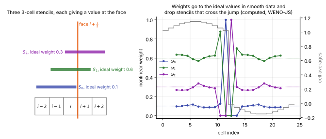

# ENO, WENO and TENO reconstruction

**Chapter:** 6 Spatial discretization · **Depth:** [deep]

## What it is

A family of high-order, nonlinear reconstructions that build the face value from several candidate polynomials, each on a different sub-stencil, and choose or weight them by how smooth the data is on each. They are the high-order answer to the same problem [MUSCL limiters](reconstruction.md#limiters) solve at second order: Godunov's theorem says high order without oscillations requires a nonlinear, data-dependent stencil. The three members differ in *how* they use the candidates:

- **ENO** picks the single smoothest candidate.
- **WENO** takes a convex combination, with weights that fall smoothly as a candidate gets rougher.
- **TENO** keeps each candidate fully or drops it entirely (a sharp cutoff), and uses the optimal linear weights among those kept.

## The problem it solves

MUSCL limiters are at most second order and clip smooth extrema. ENO-type schemes reach third, fifth or higher order in smooth flow and degrade gracefully at shocks. That matters for problems where small-amplitude waves must survive many cells: transition (instability waves), acoustics, turbulence, shock-turbulence and shock-interface interaction.

## How it works

### Candidate stencils

For the left state at face $i+\tfrac12$ with fifth-order schemes, take three 3-cell sub-stencils $\{i-2,i-1,i\}$, $\{i-1,i,i+1\}$, $\{i,i+1,i+2\}$, each giving a third-order candidate:

$$
\begin{aligned}
q^{(0)} &= \tfrac16\left(2q_{i-2} - 7q_{i-1} + 11q_i\right),\\
q^{(1)} &= \tfrac16\left(-q_{i-1} + 5q_i + 2q_{i+1}\right),\\
q^{(2)} &= \tfrac16\left(2q_i + 5q_{i+1} - q_{i+2}\right).
\end{aligned}
$$

The **linear (optimal) weights** $d_0 = \tfrac1{10}$, $d_1 = \tfrac6{10}$, $d_2 = \tfrac3{10}$ combine them into the fifth-order upwind-biased value on the full 5-cell stencil. The right state at the same face is the mirror image.

Each candidate is the value at the face of the unique parabola whose cell averages match the three cells of its stencil. $q^{(0)}$ extrapolates from cells entirely on the upwind side, $q^{(1)}$ is centred, and $q^{(2)}$ reaches one cell downwind.

<figure markdown>

<figcaption markdown="span">Left: the three candidate stencils for the left state at face $i+\tfrac12$, with their ideal weights. Right: the nonlinear weights $\omega_k$ computed with the Jiang–Shu formula for a smooth wave with a jump in the middle (grey steps, right axis). Away from the jump the weights sit near their ideal values (dotted lines). In the cells next to the jump, any stencil that crosses it gets a weight of essentially zero and the scheme falls back to the stencils on the smooth side.</figcaption>
</figure>

### Smoothness indicators

$$
\begin{aligned}
\beta_0 &= \tfrac{13}{12}(q_{i-2} - 2q_{i-1} + q_i)^2 + \tfrac14(q_{i-2} - 4q_{i-1} + 3q_i)^2,\\
\beta_1 &= \tfrac{13}{12}(q_{i-1} - 2q_i + q_{i+1})^2 + \tfrac14(q_{i-1} - q_{i+1})^2,\\
\beta_2 &= \tfrac{13}{12}(q_i - 2q_{i+1} + q_{i+2})^2 + \tfrac14(3q_i - 4q_{i+1} + q_{i+2})^2.
\end{aligned}
$$

A smoothness indicator measures how much the candidate parabola varies across the cell: it is the sum of the squared, scaled first and second derivatives of that parabola, integrated over cell $i$. The first term in each $\beta_k$ is the squared second difference (curvature) and the second is a squared first difference (slope). On smooth data all three are small and nearly equal. If a stencil contains a jump of size $\Delta$, its $\beta_k$ is of order $\Delta^2$, while a stencil on the smooth side has $\beta_k$ of order $\Delta x^2$.

A worked example. Take the cell values 1, 1, 1, 0, 0 in cells $i-2$ to $i+2$: a unit jump between cells $i$ and $i+1$. Then $\beta_0 = 0$ (all three cells equal), $\beta_1 = \tfrac{13}{12} + \tfrac14 = 1.33$ and $\beta_2 = \tfrac{13}{12} + \tfrac94 = 3.33$. With $\varepsilon = 10^{-6}$ the Jiang–Shu weights below give $\omega_0 \approx 1$ and $\omega_1, \omega_2$ of order $10^{-12}$ or smaller. The face value is $q^{(0)} = \tfrac16(2 - 7 + 11) = 1$: the scheme has used only the smooth upwind stencil and produced no overshoot.

### ENO

Harten, Engquist, Osher and Chakravarthy (1987): choose the one candidate whose divided differences are smallest (built up recursively, cell by cell). With $r$-point candidates it is $r$-th order. Drawbacks: it throws away the accuracy available from combining stencils (WENO gets order $2r-1$ from the same cells), and the stencil choice can flip back and forth on smooth data, which hurts steady convergence and can trigger spurious noise.

### WENO (Jiang–Shu) {#weno-jiang-shu}

$$
\alpha_k = \frac{d_k}{(\varepsilon + \beta_k)^2},\qquad \omega_k = \frac{\alpha_k}{\sum_j\alpha_j},\qquad q^L_{i+1/2} = \sum_k \omega_k\, q^{(k)},
$$

with a small $\varepsilon$ (often $10^{-6}$ or smaller, or scaled with the data). In smooth regions all $\beta_k$ are similar, $\omega_k \to d_k$ and the result is fifth order; a candidate crossing a shock gets a large $\beta_k$ and a vanishing weight.

The third-order version (WENO3) uses two 2-cell candidates, $q^{(0)} = \tfrac12(-q_{i-1} + 3q_i)$ and $q^{(1)} = \tfrac12(q_i + q_{i+1})$, with $\beta_0 = (q_i - q_{i-1})^2$, $\beta_1 = (q_{i+1} - q_i)^2$ and $d_0 = \tfrac13$, $d_1 = \tfrac23$. It is cheap and has a narrow halo, but is quite dissipative at practical resolutions.

### TENO (Fu, Hu and Adams) {#teno}

Targeted ENO separates the two jobs WENO weights do at once (rejecting discontinuous stencils and staying close to the optimal scheme). Each candidate gets a scale-separated smoothness measure, for example

$$
\gamma_k = \left(C + \frac{\tau}{\beta_k + \varepsilon}\right)^q,\qquad \chi_k = \frac{\gamma_k}{\sum_j\gamma_j},
$$

with $\tau$ a global smoothness reference (such as $|\beta_0 - \beta_2|$ in the fifth-order case). A **sharp cutoff** then keeps or drops each stencil,

$$
\delta_k = \begin{cases}0 & \chi_k < C_T\\ 1 & \text{otherwise}\end{cases},\qquad \omega_k = \frac{d_k\,\delta_k}{\sum_j d_j\,\delta_j},
$$

with a threshold $C_T$ typically $10^{-5}$–$10^{-7}$. In smooth regions every stencil is kept and the scheme is *exactly* the optimal linear scheme, so it is much less dissipative than WENO; at a discontinuity the offending stencils are removed outright. Higher-order TENO schemes add candidates of increasing width, so the scheme can fall back to smaller stencils gracefully.

!!! warning "Calibration"
    The TENO formulas above follow the structure of Fu, Hu & Adams (2016); constants ($C$, $q$, $C_T$) and the choice of $\tau$ differ between published variants and codes. Check the specific paper before implementing.

## Variants

### WENO-M (mapped, Henrick et al.)

Maps the nonlinear weights back towards the linear weights to restore design order at smooth critical points, where WENO-JS degrades (a stagnation region is full of such points).

### WENO-Z (Borges et al.)

Uses the global measure $\tau_5 = |\beta_0 - \beta_2|$: $\alpha_k = d_k\big(1 + (\tau_5/(\beta_k + \varepsilon))^p\big)$, typically $p = 1$ or $2$. Less dissipative than WENO-JS at the same cost; a common modern default.

### WENO-CU6 (Hu, Wang and Adams)

A sixth-order central-upwind scheme: adds a downwind candidate so that in smooth regions the scheme approaches a sixth-order *central* (non-dissipative) reconstruction, while shocks are still handled by WENO weighting. Designed for implicit LES.

### WENO-AO (adaptive order, Balsara, Garain and Shu)

Combines a high-order stencil with lower-order ones (e.g. WENO-AO(5,3)) and falls back to the lower order near discontinuities, improving robustness at strong shocks.

### Characteristic-wise reconstruction

Apply any of the above to characteristic variables (projected with left eigenvectors at the face), then project back. Much cleaner near strong shocks. See [which variables to reconstruct](reconstruction.md#which-variables-to-reconstruct).

### Machine-learned weights

Research schemes replace the smoothness-indicator formula with a neural network that outputs the weights. Rational-WENO (Shahane et al., 2024) uses a small network with trainable rational activation functions to set WENO3 weights; trained offline on analytical functions, it was reported to reach close to WENO5 accuracy on several tests with WENO3's narrow stencil, running about twice as fast as WENO5 on TPUs (WENO5's wider halo tripled the runtime relative to WENO3 there). Its tests were advection, Euler/Navier–Stokes benchmarks and atmospheric flows, not strong hypersonic shocks, so it should be read as a research direction, not a production option for entry flows.

### Other named variants

Codes expose many more (ALPACA lists, among others, WENOF3+, WENO5-AER, WENO5-IS, WENO5-NU6+, WENO7, WENO9). They are refinements of the same weight-design problem; they are not described individually here.

## Typical values

- Order: $2r - 1$ from $r$ candidates of $r$ cells each; 5 for the standard scheme, on a 5-cell stencil per side (6 cells per face, 3 ghost layers).
- Ideal weights (fifth order): 0.1, 0.6, 0.3.
- $\varepsilon$ in the Jiang–Shu weights: $10^{-6}$ in the original paper; smaller values (down to $10^{-40}$) or values scaled with $\Delta x^2$ are used to keep the scheme scale-independent.
- TENO cutoff $C_T$: $10^{-5}$–$10^{-7}$ (Fu, Hu & Adams 2016); smaller means less dissipation and less robustness.
- Cost: roughly two to three times a MUSCL reconstruction per face in component form, more with characteristic projection.

## Trade-offs

- **WENO-JS vs WENO-Z vs TENO.** Each step is less dissipative in smooth flow and less forgiving at strong shocks.
- **Component-wise vs characteristic-wise.** Characteristic projection removes most post-shock oscillations but needs an eigenvector multiply per stencil cell per face.
- **Higher order.** Better resolution per cell of smooth waves; wider halos, more cost, and no gain at a captured shock, where every scheme is first order.
- **Against second-order MUSCL for heating.** At the wall and at the shock the benefit is small; in between it matters only if there are waves or eddies to preserve.

## Effects on stability and robustness

- Not positivity-preserving: a fifth-order face value near a strong shock can have negative density or pressure. Codes add a positivity limiter or fall back to low order in the offending cell.
- The weights are non-smooth functions of the data (TENO's cutoff especially), so implicit steady solvers stall with them ([convergence diagnostics](../time/convergence-diagnostics.md#stalls-and-limit-cycles)).
- Lower dissipation makes the [carbuncle](shock-instabilities.md) more likely with contact-resolving fluxes.
- Component-wise reconstruction of conserved variables at Mach 20 and above is the least robust combination; primitive or characteristic variables are the usual choice.

## Implications

| Lens | Effect |
|---|---|
| Time step and cost | More arithmetic per face than MUSCL (more for characteristic projection); wider stencils mean wider halos and more communication, which can dominate on accelerators. Usually paired with explicit SSP-RK. |
| Steady vs unsteady | Built for unsteady, wave-resolving work. Nonlinear weights (and ENO stencil flips) can stall implicit steady convergence; TENO's hard switch is also non-smooth. |
| Accuracy | High order and low dissipation in smooth flow (TENO and CU6 least dissipative, WENO-JS most). Near-wall heat flux on stretched grids is not automatically better than a well-resolved second-order result. |
| Robustness | Not positivity-preserving on its own; strong hypersonic shocks need characteristic projection, positivity limiters or order fallback. Less dissipative variants need more care at shocks. |
| Physics captured or lost | Preserves small-amplitude waves (instability modes, acoustics) that MUSCL limiters damp; essential for transition and SWBLI unsteadiness studies. |
| Hardware / parallel fit | Regular, wide stencils; excellent on GPUs with structured data, but halo width grows with order. |

## In a run

Knobs: scheme and order, weight variant, $\varepsilon$ or $C_T$, reconstructed variables, and a fallback stencil near walls, interfaces or problem cells. Symptoms: oscillations behind strong shocks (try characteristic projection or a more dissipative flux); excessive dissipation of small waves (try WENO-Z, TENO or CU6); stalled steady residuals (expected; these schemes target unsteady problems).

## Which codes

MFC uses WENO (several orders, with JS/M/Z-type variants) on primitive variables, with HLLC fluxes and explicit SSP-RK time stepping. [ALPACA](../../codes/index.md#alpaca) and JAX-Fluids (TU Munich) offer WENO, WENO-Z, WENO-CU6, WENO-AO and TENO variants. US3D and other research codes use high-order or low-dissipation options for DNS of transition; production aeroheating codes (DPLR, LAURA) stay second order. Why they stay there is summarized under [implications](#implications).

!!! warning "Calibration"
    Option lists change between code versions; check current documentation.

## See also

[Reconstruction and limiters](reconstruction.md) · [Riemann solvers](riemann-solvers.md) · [Central schemes](central-schemes.md) · [MFC](../../codes/index.md#mfc)

## References

Harten, Engquist, Osher & Chakravarthy (1987); Shu & Osher (1988); Jiang & Shu (1996); Henrick, Aslam & Powers (2005); Borges, Carmona, Costa & Don (2008); Hu, Wang & Adams (2010); Fu, Hu & Adams (2016); Balsara, Garain & Shu (2016); Shu (1998) lecture notes; Shahane et al. (2024); Pirozzoli (2011). See the [bibliography](../../references.md).
