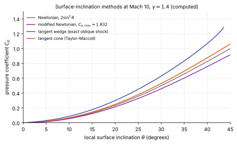

# Approximate and engineering methods

**Chapter:** 10 Reduced equations and engineering methods · **Depth:** [feel]

## What it is

The pre-CFD toolbox for hypersonic inviscid flow, still used for conceptual design and aerodynamic databases: local surface-inclination methods (Newtonian, tangent wedge, tangent cone, shock-expansion), thin-shock-layer theory, and the "exact" inviscid methods that preceded general CFD (method of characteristics, time-marching blunt-body solvers). Anderson, chapters 3–5.

## The problem it solves

A trajectory or aerodynamic database needs forces and heating at thousands of conditions; CFD can afford tens to hundreds of points. Engineering methods fill the space between CFD points, and CFD anchors them. They also explain why the numerical methods in this manual look the way they do: the blunt-body problem was solved by time marching for the same reason modern steady solvers march in pseudo-time.

## How it works

### Local surface-inclination methods

Each surface panel's pressure depends only on its own inclination $\theta$ to the free stream (and the free-stream state), not on its neighbours. That makes them as cheap as a loop over panels.

- **Newtonian / modified Newtonian:** $C_p = C_{p,\max}\sin^2\theta$ on surfaces facing the flow, $C_p = 0$ on shadowed ones ([details](../physics/hypersonic-shock-relations.md#modified-newtonian-theory)). Best on blunt bodies.
- **Tangent wedge:** treat each panel as a wedge of the same angle and use the oblique-shock pressure. Good for 2D slender bodies and compression surfaces.
- **Tangent cone:** use the conical-flow (Taylor–Maccoll) surface pressure for the local angle. Good for slender bodies of revolution.
- **Shock-expansion:** an oblique shock at the leading edge, then Prandtl–Meyer expansion along the surface, ignoring reflected waves (valid when they are weak, i.e. at high Mach number). Good for slender bodies and airfoils.
- **Prandtl–Meyer expansion** on leeward panels, often with a base-pressure correlation behind blunt bases.

<figure markdown>

<figcaption markdown="span">Pressure coefficient against local surface inclination at Mach 10 for a perfect gas with $\gamma = 1.4$: Newtonian, modified Newtonian (with $C_{p,\max}$ from the normal-shock stagnation pressure), tangent wedge from the exact oblique-shock relations, and tangent cone from a numerical solution of the Taylor–Maccoll equation. All computed. A cone sees a lower pressure than a wedge of the same angle because the flow can relieve sideways.</figcaption>
</figure>

A worked comparison at 10° and Mach 10: tangent wedge gives $C_p = 0.087$, tangent cone 0.067, Newtonian $2\sin^2 10° = 0.060$ and modified Newtonian 0.055. On a slender body the choice of method changes the pressure by tens of percent, so matching the method to the local body shape (two-dimensional or axisymmetric, blunt or slender) matters more than any refinement within one method.

Practical tools pick a method per panel (compression vs expansion, blunt vs slender) and add viscous corrections from reference-temperature skin friction and heating ([stagnation-point heating](../physics/stagnation-point-heating.md#away-from-the-stagnation-point-reference-temperature)).

### Thin-shock-layer theory

For strong shocks the shock layer is thin and dense, so the flow can be expanded in the density ratio $\varepsilon = \rho_1/\rho_2$. The leading term is Newtonian; the next includes the centrifugal (Busemann) correction and gives shock standoff and shape estimates for blunt bodies. Its main use today is insight: why Newtonian works, and why the standoff distance scales with $\varepsilon R_n$.

### Method of characteristics

In steady supersonic flow the equations are hyperbolic in space, so information travels along characteristic lines (Mach lines in 2D). The method of characteristics marches the solution along these lines, exactly for isentropic regions and with rotational corrections behind curved shocks. It is used for nozzle contours and, historically, for the supersonic part of blunt-body flows. It cannot enter subsonic regions, where the equations are [elliptic](../foundations/mathematical-character.md), which is the same limitation [space marching](space-marching.md) has.

### The blunt-body problem and time marching

The subsonic stagnation region made the blunt-body problem notoriously hard in the 1950s–60s: inverse methods and integral relations worked only for simple shapes. The breakthrough was to solve the **unsteady** equations and march in time to a steady state (Moretti & Abbett 1966), because the unsteady equations are hyperbolic everywhere, in subsonic regions too. Every steady CFD solver in this manual still does this in [pseudo-time](../time/local-time-stepping.md).

### Engineering aerothermal tools

Conceptual-design codes combine panel methods (modified Newtonian, tangent cone/wedge, shock-expansion) with heating correlations and streamline tracing on a surface mesh, producing aerodynamic and aerothermal databases over a whole trajectory in minutes. CBAERO (NASA Ames) is an example used for entry vehicles, anchored to CFD at selected points.

!!! warning "Calibration"
    The internal method choices of specific engineering tools (CBAERO and similar) should be taken from their documentation; this page describes the method family, not any tool's implementation.

## Variants

Newtonian · modified Newtonian · Newtonian–Busemann · tangent wedge · tangent cone · shock-expansion · thin-shock-layer theory · method of characteristics · integral-relations and inverse blunt-body methods (historical) · time-marching blunt-body solvers.

## Typical values

- Modified Newtonian forebody pressure on blunt capsules: within a few percent of CFD over the heat shield; poor at the shoulder and on the backshell.
- $C_{p,\max}$ at Mach 10, $\gamma = 1.4$: 1.832; limit as $M\to\infty$: 1.839 (computed).
- At 10° inclination and Mach 10: wedge 0.087, cone 0.067, Newtonian 0.060, modified Newtonian 0.055 (computed, figure above).
- Cost: a loop over surface panels; thousands of flight conditions per minute on a laptop.
- Shock-expansion and tangent-cone methods: best for slender bodies at high Mach number, where reflected waves are weak.

## Trade-offs

- Gain: speed (whole trajectories in minutes); transparency; good for trends and databases between CFD points.
- Pay: no interactions between panels (except streamline-traced heating), no separated or wake flow, no nonequilibrium, accuracy only within each method's range.

## Effects on stability and robustness

Not iterative in the CFD sense; robust by construction. The risk is using a method outside its validity range without noticing.

## Implications

| Lens | Effect |
|---|---|
| Time step and cost | Orders of magnitude cheaper than CFD. |
| Steady vs unsteady | Steady (quasi-steady along trajectories). |
| Accuracy (heat flux, pressure) | Good pressure on blunt forebodies; heating only through correlations. |
| Robustness | High, within the validity range. |
| Physics captured or lost | Local momentum balance only; no wakes, interactions, chemistry. |
| Hardware / parallel fit | Trivially parallel over conditions. |

## In a run

Use engineering methods to choose which trajectory points get CFD, to check CFD forebody pressures, and to interpolate between CFD points in a database.

## Which codes

Engineering tools rather than the CFD codes in the appendix. Time marching to steady state is universal in CFD; the method of characteristics survives in nozzle design and some shock-fitting codes.

## See also

[Hypersonic shock relations and Newtonian theory](../physics/hypersonic-shock-relations.md) · [Stagnation-point heating](../physics/stagnation-point-heating.md) · [Space marching](space-marching.md) · [Engineering checks](../verification/engineering-checks.md)

## References

Anderson, *Hypersonic and High-Temperature Gas Dynamics* (chapters 3–5); Moretti & Abbett (1966).
