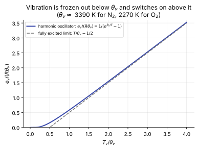
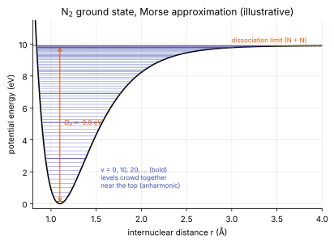

# Energy modes and thermodynamics

**Slot:** Track 4.1 · **Depth:** [deep]

## What it is

A molecule stores energy in several **modes**: translation (motion of the molecule as a whole), rotation (tumbling), vibration (the atoms oscillating along their bond) and electronic excitation (electrons in higher-energy states). Free electrons carry their own translational energy. Statistical mechanics gives each mode's energy as a function of a temperature; the [caloric closure](../foundations/closing-the-system.md#2-caloric-relations-and-the-temperature-inversion) sums them.

## The problem it solves

Where the energy goes decides the temperature. In a shock layer, a large fraction of the kinetic energy of the oncoming gas ends up in vibration, dissociation and electronic excitation rather than in random thermal motion, which changes temperature, density, standoff and heating ([entry flow anatomy](../physics/entry-flow-anatomy.md#post-shock-density-and-standoff)).

## How it works

### Equilibration rates

The modes reach equilibrium with each other at very different rates. Translation equilibrates in a few collisions, rotation in about ten, vibration in roughly $10^3$–$10^5$ (strongly temperature-dependent), and dissociation on comparable or slower scales at high temperature. That gap is why vibration gets its own temperature in [multi-temperature models](thermal-nonequilibrium.md).

### Translation and rotation

Fully excited at any temperature of interest, so their energy is linear in $T$: $\tfrac32 RT$ per unit mass (in terms of the species gas constant) for translation, plus $RT$ for rotation of a linear molecule. This is why the [two-temperature inversion](../foundations/closing-the-system.md#2-caloric-relations-and-the-temperature-inversion) gets $T$ directly once $T_v$ is known.

### Vibration

Vibration is quantized. In the harmonic-oscillator approximation, per unit mass,

$$
e_v = \frac{R\,\theta_v}{e^{\theta_v/T_v} - 1},
$$

with characteristic temperatures $\theta_v \approx 3390$ K for N₂ and $\approx 2270$ K for O₂. Well below $\theta_v$, vibration is frozen out; well above, it approaches the fully excited value $R(T_v - \theta_v/2)$.

<figure markdown>

<figcaption>Harmonic-oscillator vibrational energy. Vibration contributes almost nothing below about 0.2 θv and is essentially fully excited above about 2 θv; shock-layer temperatures of 6,000–15,000 K are well into the excited regime for air molecules.</figcaption>
</figure>

### The potential-energy well

The harmonic oscillator is an approximation to the true interatomic potential. Plot the energy of a diatomic molecule against the separation of its two nuclei: the curve has a minimum at the bond length, and its depth is the dissociation energy. Vibrational levels sit inside that well, getting closer together near the top because the real oscillator is anharmonic. **Dissociation means climbing out of the well.** Each electronic state has its own potential curve and its own well.

<figure markdown>

<figcaption>The N2 ground electronic state in the Morse approximation, with its vibrational levels (illustrative; the Morse fit is approximate near the top of the well). A molecule high in the well needs only a small push to dissociate: the picture behind vibration–dissociation coupling.</figcaption>
</figure>

This picture is the basis of **vibration–dissociation coupling**: a vibrationally excited molecule dissociates more easily, and dissociation preferentially removes high-lying (energetic) vibrational states. Park's [controlling temperature](finite-rate-chemistry.md#parks-controlling-temperature) is a crude model of the first effect; state-to-state models resolve both ([thermal nonequilibrium](thermal-nonequilibrium.md#state-to-state)).

### Electronic excitation

Electrons in an atom or molecule occupy quantized states; excited electronic states are higher-energy configurations. Each species has a table of levels from spectroscopy (for example the NIST Atomic Spectra Database), with characteristic temperatures $\theta_i$ and degeneracies $g_i$. The electronic energy is a Boltzmann average over that table:

$$
e_{el} = \frac{R\sum_i g_i\,\theta_i\,e^{-\theta_i/T_{el}}}{\sum_i g_i\,e^{-\theta_i/T_{el}}}.
$$

"Tabulated levels" means this sum runs over real levels rather than a fitted polynomial. CFD models usually truncate it to a few levels, up to a few dozen. In a two-temperature model $T_{el} = T_v$.

### Formation enthalpy

Each species carries a heat of formation $h_s^0$ (zero for N₂ and O₂ by convention; large and positive for N, O and NO). Including it in the total energy ([governing equations](../foundations/governing-equations.md#reacting-two-temperature-mixture)) is what makes chemical energy part of the conserved $E$, so the energy equation needs no chemistry source.

### Partition functions and polynomial fits

*(Outline.)* All of the above follow from the partition function of each mode. Production codes often use NASA polynomial fits for $c_p(T)$, $h(T)$ and $s(T)$ instead of explicit mode sums, which is simpler in a one-temperature model but needs care in multi-temperature models where modes have different temperatures.

## Implications

| Lens | Effect |
|---|---|
| Time step and cost | Mode sums and electronic-level tables cost per cell per evaluation inside the temperature inversion. |
| Steady vs unsteady | Neutral. |
| Accuracy | Sets temperature for a given energy, hence chemistry rates, standoff and heating. |
| Robustness | Nonlinear $e(T)$ requires a Newton inversion that can fail with bad energies. |
| Physics captured or lost | Harmonic vs anharmonic, truncated electronic levels: small effects on temperature, larger on radiation and dissociation coupling. |
| Hardware / parallel fit | Pointwise; branchy iterations reduce GPU efficiency. |

## In a run

Knobs: thermodynamic database (mode sums vs polynomial fits), number of electronic levels. Symptoms: temperature-inversion failures; small differences in standoff between codes using different databases.

## Which codes

All reacting codes. Mutation++ provides mode-resolved thermodynamics to codes that use it.

## See also

[Gas models](gas-models.md) · [Thermal nonequilibrium](thermal-nonequilibrium.md) · [Finite-rate chemistry](finite-rate-chemistry.md) · [Closing the system](../foundations/closing-the-system.md)

## References

Anderson, *Hypersonic and High-Temperature Gas Dynamics* (statistical thermodynamics chapters); Vincenti & Kruger, *Introduction to Physical Gas Dynamics*; Park, *Nonequilibrium Hypersonic Aerodynamics*. See the [bibliography](../../references.md).
