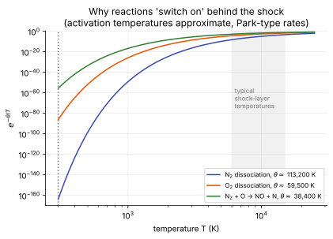

# Finite-rate chemistry

**Slot:** Track 0.1 closures; Track 4.3 · **Depth:** [deep]

## What it is

The model for the chemical production rates $\dot\omega_s$ in the species equations: a list of elementary reactions, each with a forward rate from a modified Arrhenius law and a backward rate from equilibrium.

## The problem it solves

When chemistry is neither frozen nor in equilibrium (Damköhler number of order one), composition depends on the flow's history, not just its local state. Finite-rate chemistry tracks that.

## How it works

### The species equation, term by term

$$
\partial_t\rho_s + \nabla\cdot(\rho_s\mathbf u) + \nabla\cdot\mathbf J_s = \dot\omega_s .
$$

$\partial_t\rho_s$ is the local change of the mass of species $s$ per unit volume. $\nabla\cdot(\rho_s\mathbf u)$ is that species carried along with the flow. $\nabla\cdot\mathbf J_s$ is diffusion relative to the mass-average velocity, driven mostly by concentration gradients ([transport and diffusion](transport-and-diffusion.md)). $\dot\omega_s$ is the net production by reactions, in kg/m³/s. Since $\sum_s\mathbf J_s = 0$ and $\sum_s\dot\omega_s = 0$ (mass is conserved), summing over species recovers ordinary continuity.

### The reactions

For air, the main classes are:

- dissociation: $\mathrm{N_2 + M \rightleftharpoons 2N + M}$, where M is any collision partner (a **third body**, with species-dependent efficiencies);
- Zeldovich exchange: $\mathrm{N_2 + O \rightleftharpoons NO + N}$ and $\mathrm{NO + O \rightleftharpoons O_2 + N}$;
- associative ionization: $\mathrm{N + O \rightleftharpoons NO^+ + e^-}$, which supplies the first electrons;
- electron-impact ionization: $\mathrm{N + e^- \rightleftharpoons N^+ + 2e^-}$, which dominates once there are enough electrons.

### Law of mass action

Each reaction $r$, $\sum_s \nu'_{s,r}X_s \rightleftharpoons \sum_s \nu''_{s,r}X_s$, has a net rate

$$
\mathcal R_r = k_{f,r}\prod_s [X_s]^{\nu'_{s,r}} - k_{b,r}\prod_s [X_s]^{\nu''_{s,r}},\qquad [X_s] = \frac{\rho_s}{M_s},
$$

and the production rate of each species sums over reactions:

$$
\dot\omega_s = M_s\sum_r\big(\nu''_{s,r} - \nu'_{s,r}\big)\,\mathcal R_r .
$$

### Arrhenius rates and equilibrium constants

Forward rates use the modified Arrhenius form

$$
k_f = A\,T_c^{\,n}\,e^{-\theta_a/T_c},
$$

and backward rates come from equilibrium, $k_b = k_f/K_{eq}(T)$, with $K_{eq}$ from Gibbs free energies (or curve fits, as in Park's mechanisms). Each reaction needs $A$, $n$, $\theta_a$, its third-body efficiencies, and thermodynamic data consistent with the [energy modes](energy-modes.md) used elsewhere in the code.

### Park's controlling temperature {#parks-controlling-temperature}

For dissociation in a two-temperature model, the rate is evaluated at $T_c = T^{a}\,T_v^{1-a}$ with $a$ typically 0.5–0.7. A vibrationally cold gas ($T_v < T$) then dissociates more slowly, a simple model of [vibration–dissociation coupling](energy-modes.md#the-potential-energy-well). It is empirical and one of the known weak points of the 2T model.

### How it knows when to react

It doesn't decide. Every reaction runs forward and backward all the time, at rates set by the local temperature and concentrations. The exponential does the switching:

<figure markdown>

<figcaption markdown="span">The Arrhenius factor for three air reactions. For N2 dissociation, $e^{-\theta/T}$ is about $10^{-164}$ at 300 K and about $10^{-5}$ at 10,000 K: behind the shock the rate rises by well over 100 orders of magnitude.</figcaption>
</figure>

Equilibrium is simply forward rate equal to backward rate. Whether a region is frozen, in nonequilibrium or in equilibrium depends on the Damköhler number $Da = \tau_{\text{flow}}/\tau_{\text{chem}}$. The enormous range of rates across one domain is also exactly what makes these sources [stiff](../sources/stiff-sources.md).

### Energy bookkeeping

Because formation enthalpies are part of the total energy, chemistry needs no source in the total-energy equation; dissociation converts thermal energy into chemical energy inside the conserved $E$. In a two-temperature model it does appear in the vibrational energy equation, as the vibrational energy carried away by dissociating molecules.

### Electrons and ions

Electrons are a species with a tiny molar mass. Many codes don't solve an equation for them; they enforce **charge neutrality** ($n_e = \sum$ ions) and treat ion–electron diffusion as **ambipolar** (electrons would run ahead, but the electric field holds them to the ions; see [transport](transport-and-diffusion.md#ambipolar-diffusion)). In a 2T model electron energy rides in $T_v$. The full picture (the two stages of ionization, which temperature drives which reaction, the electron energy pool, 3T models, avalanche ionization and blackout) is on [ionization, electrons and plasma](ionization-and-electrons.md).

## Variants

### Mechanisms

Park's air mechanisms (5- and 11-species), Dunn–Kang, and newer QCT-informed rates; CO₂–N₂ mechanisms for Mars; N₂–CH₄ for Titan.

## Implications

| Lens | Effect |
|---|---|
| Time step and cost | $O(n_r)$ rate evaluations with `exp` and powers per cell; source Jacobians for implicit treatment; stiffness. |
| Steady vs unsteady | Stiff in both; needs [implicit or split treatment](../sources/stiff-sources.md). |
| Accuracy | Rate uncertainty is one of the main aeroheating uncertainty sources; composition at the wall controls catalytic heating. |
| Robustness | Negative species densities, explosive overshoot with explicit treatment, startup failures. |
| Physics captured or lost | Chemical lag, recombination freezing in expansions and wakes, ionization (11-species). |
| Hardware / parallel fit | Pointwise and parallel; transcendental functions and branching cost GPU efficiency. |

## In a run

Knobs: mechanism, species set, controlling-temperature exponent, third-body efficiencies, startup strategy (frozen chemistry first). Symptoms: blow-up when chemistry switches on, standoff and heating sensitivity to the mechanism.

## Which codes

All reacting codes. Mutation++ supplies mechanisms and rates to SU2-NEMO and others.

## See also

[Stiff sources](../sources/stiff-sources.md) · [Thermal nonequilibrium](thermal-nonequilibrium.md) · [Energy modes](energy-modes.md) · [Gas models](gas-models.md)

## References

Park (1990, 1993); Park, *Nonequilibrium Hypersonic Aerodynamics*; Gnoffo, Gupta & Shinn (1989); Dunn & Kang (1973). See the [bibliography](../../references.md).
