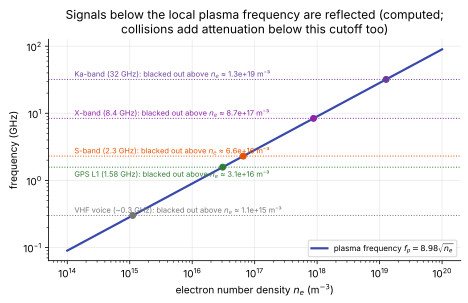

# Ionization, electrons and plasma

**Slot:** Track 4.5 (ionization and electrons) · **Depth:** [deep] for the energy bookkeeping and numerics, [feel] for blackout

## What it is

Above roughly 7–8 km/s the shock layer becomes a weakly ionized plasma: a small fraction of the gas is ions and free electrons. This page covers how air ionizes, what the free electrons do to the energy balance, how codes model them (charge neutrality, ambipolar diffusion, two- and three-temperature models), the numerical trouble electrons cause, and communications blackout, the most visible consequence.

## The problem it solves

Electrons matter far beyond their tiny mass. They control ionization (and, through electronic excitation, radiation), they carry a separate pool of energy that may not be in equilibrium with anything else, they set the plasma frequency that decides whether radio signals get through, and the electron-impact reactions are the stiffest and most explosive part of a reacting-flow calculation.

## How it works

### How air ionizes

In the 11-species air model the species are N₂, O₂, NO, N, O, the ions N₂⁺, O₂⁺, NO⁺, N⁺, O⁺, and free electrons e⁻ (Gupta et al. 1990). A **7-species** model keeps only NO⁺ and e⁻ as charged species, which is enough at lower speeds; the extra ions matter at higher speeds.

Ionization happens in two stages (Park 1993; Park 1990, ch. 4):

1. **Associative ionization** makes the first electrons: N + O → NO⁺ + e⁻ (and, less importantly, N + N → N₂⁺ + e⁻, O + O → O₂⁺ + e⁻). It needs atoms, so it starts once dissociation is under way, and it costs only about 2.8 eV per electron because the new molecular bond pays most of the ionization energy. This is why NO⁺ is the dominant ion at moderate speeds. Park found the computed ionization profiles behind shocks are controlled mostly by these rates.
2. **Electron-impact ionization**, N + e⁻ → N⁺ + 2e⁻ and O + e⁻ → O⁺ + 2e⁻, takes over once enough electrons exist. Electrons move so fast (their thermal speed is larger than an atom's by roughly the square root of the mass ratio, about 160 times for N) that their rate coefficients are intrinsically large, and each event turns one electron into two: an **avalanche**. The avalanche is self-limiting in practice, because each ionization drains the electron gas of its thermal energy (14.5 eV for N), cooling the electrons and slowing the process.

The full reaction set has six classes (Park 1990, §4.5): heavy-particle dissociation; electron-impact dissociation (fast only for N₂, because of N₂'s strong electron–vibration coupling); the Zeldovich NO exchange reactions; associative ionization and its reverse, dissociative recombination; electron-impact ionization of N and O; and charge exchange (for example NO⁺ + O → N⁺ + O₂).

### Which temperature drives which reaction

In a multi-temperature model each reaction's rate is evaluated at a **controlling temperature** suited to the energy mode that drives it. In Park's model (Park 1989, 1993):

| Reaction class | Controlling temperature | Why |
|---|---|---|
| Dissociation by heavy particles | $T_a = T^s T_v^{1-s}$, $s \approx 0.5$–0.7 | Molecules dissociate from high vibrational levels, so both the collision energy ($T$) and vibrational excitation ($T_v$) matter ([Park's $T_c$](finite-rate-chemistry.md#parks-controlling-temperature)) |
| Electron-impact dissociation of N₂ | $T_e$ | Driven by electron collisions |
| Zeldovich exchange, associative ionization, charge exchange | $T$ | Driven by heavy-particle collision energy |
| Electron-impact ionization, radiative recombination | $T_e$ | Driven by electron collisions |

In a two-temperature model $T_e = T_v$, so the last rows use $T_v$.

### The energy pools and what moves energy between them

Park's formulation (1990, §4.2) tracks three pools of internal energy:

- **Translational–rotational**, temperature $T$ (heavy particles).
- **Vibrational**, temperature $T_v$ (molecules).
- **Electron–electronic**, temperature $T_e$: the translational energy of free electrons *plus* the electronic excitation of atoms and molecules. Lumping these together is justified because electronic states are excited and quenched mostly by electron collisions.

The electron–electronic pool gains or loses energy through:

- **Ionization and recombination**: each ionization by electron impact removes the ionization energy from the pool; recombination returns it.
- **Electron-impact dissociation of N₂**: the dissociation energy is taken from the electrons.
- **Elastic collisions with heavy particles**, which pull $T_e$ towards $T$. For electron–ion collisions the Coulomb interaction has infinite range, so the cross-section is only finite because charges are screened beyond the **Debye length** (below); it is orders of magnitude larger than for electron–neutral collisions, especially at low electron density.
- **Electron–vibration coupling**: fast for N₂ (a resonance in the electron–N₂ cross-section near 2 eV) and orders of magnitude slower for O₂ and NO. This strong N₂ coupling is the physical justification for the two-temperature model's lumping of $T_e$ with $T_v$.
- **Chemistry**: species born in reactions arrive already electronically excited, and electrons born in associative ionization carry some energy.
- **Radiation**, which mostly comes from electronic transitions and drains the pool.
- **Pressure work by the ambipolar field** (below), which is not in conservation form.

### Charge neutrality and the Debye length

A plasma screens any charge imbalance over the **Debye length**,

$$
\lambda_D = \sqrt{\frac{\varepsilon_0 k T_e}{n_e e^2}} \approx 69\,\sqrt{\frac{T_e}{n_e}}\ \text{m}\qquad (T_e \text{ in K},\ n_e \text{ in m}^{-3}).
$$

For a shock layer with $T_e = 10{,}000$ K and $n_e = 10^{20}$ m⁻³, $\lambda_D \approx 0.7$ μm, far below any practical cell size. Resolving charge separation is therefore neither possible nor necessary, and codes impose **quasi-neutrality**: the electron density equals the sum of the ion densities, $n_e = \sum n_{\text{ions}}$, and electrons need no species equation of their own.

### Ambipolar diffusion and the electron work term

Electrons diffuse far faster than ions, but if they ran ahead, the charge separation would create an electric field pulling them back. The result is **ambipolar diffusion**: electrons and ions diffuse together, at roughly twice the ion rate ([transport](transport-and-diffusion.md#ambipolar-diffusion)). The field that holds them together is set by the electron pressure gradient, $\mathbf E \approx -\nabla p_e/(e\,n_e)$. Electrons do work against it, which appears in the electron energy equation as a term like $-p_e\,\nabla\cdot\mathbf u$. That term is **not in conservation form**. Park (1990, §5.5) notes it breaks the conservative, hyperbolic character of the system and becomes troublesome when ionization grows fast. Farbar, Boyd & Martin (2013) found it of comparable size to the other electron-energy sources in the RAM-C shock layer, even though it is often left out.

### Two or three temperatures?

- **Two-temperature (Park $T$–$T_v$):** $T_e = T_v$. The standard for entry CFD (DPLR, LAURA), justified by the N₂ electron–vibration coupling.
- **Three-temperature:** a separate electron energy equation. Two flavours exist: "free-electron" (electron translation alone in the third pool) and "electron–electronic" (electron translation plus electronic excitation, Park's pool).

What the recent comparisons found:

- Over most of a forebody shock layer, $T_e$ stays close to $T_v$. Farbar, Boyd & Martin (2013, LeMANS; RAM-C II and Stardust) saw large differences only upstream of the shock, where densities are too low for the coupling to keep up.
- In zero-dimensional relaxation at Mach 20–30, the electron temperature lags $T_v$ for less than about a microsecond and then follows it (Clarey & Greendyke 2019a). The free-electron 3T model added little over 2T. The electron–electronic 3T model behaved more physically and cost about 1.8 times the 2T model.
- In **wakes**, the electron–electronic energy stays out of equilibrium with the other modes while $T$ and $T_v$ agree with 2T (Clarey & Greendyke 2019b, FUN3D, RAM-C II). The wake is where a third temperature matters.
- Kim, Gülhan & Boyd (2012) found significant translational–electron nonequilibrium near the shock and in a plasma wind tunnel, and recommend a separate electron energy equation whenever the flow is strongly out of equilibrium.
- Park (1990, §5.5) reported an earlier five-temperature calculation (separate $T_v$ for N₂, O₂, NO plus $T_e$) in which the four internal temperatures came out nearly equal. Because the energy-exchange rates were themselves uncertain, the extra temperatures added cost and stiffness without adding trustworthy information.

### Communications blackout

A plasma reflects electromagnetic waves below its **plasma frequency**,

$$
f_p = \frac{1}{2\pi}\sqrt{\frac{n_e e^2}{\varepsilon_0 m_e}} \approx 8.98\,\sqrt{n_e}\ \text{Hz}\qquad (n_e \text{ in m}^{-3}),
$$

so a signal at frequency $f$ is cut off wherever $n_e$ exceeds $(f/8.98)^2$. Collisions between electrons and heavy particles also attenuate signals somewhat below this cutoff.

<figure markdown>

<figcaption markdown="span">Plasma frequency against electron density, and the critical density for common communication bands. Computed from $f_p = 8.98\sqrt{n_e}$.</figcaption>
</figure>

Blackout typically lasts several minutes of an Earth entry. The antenna sees the plasma around it, so what matters is the electron density in the boundary layer and the expanding flow at the antenna's location, often on the afterbody, rather than the peak value at the nose. Mitigation approaches studied over the years include aerodynamic shaping (slender, sharp bodies make less plasma near the antenna), injection of quenchants (water, electrophilic materials that capture electrons), magnetic windows, and higher transmission frequencies (Hartunian et al. 2007). Relaying through a satellite above the vehicle (TDRSS) is how the Shuttle largely avoided blackout: its antenna looked up through the thinner leeward plasma.

**RAM-C** (Radio Attenuation Measurement), flown in the late 1960s, is the classic validation data. The vehicles were three identical sphere-cones with a 15 cm nose radius and a 10° cone, entering at about 7.6 km/s (25,000 ft/s). Microwave reflectometers along the cone measured peak electron density and its location, and Langmuir probes at the rear measured electron density and temperature. RAM-C-1 injected water at the nose, RAM-C-2 did not inject, and RAM-C-3 injected water and electrophilic materials (Park 1990, §8.4). RAM-C II is still the standard test case for ionizing-flow CFD: Candler & MacCormack (1991), Farbar et al. (2013), Kim et al. (2012) and Clarey & Greendyke (2019b) all compare against it.

## Variants

- **Species sets:** 5-species air (no ions), 7-species (NO⁺, e⁻), 11-species (all five ions). The 7-species model is adequate to about 8 km/s and underpredicts ionization effects above that (DSMC comparison of 5-, 7- and 11-species sets, *AIAA J.* 58(3), 2020).
- **Electron energy treatment:** $T_e = T_v$ (2T); separate free-electron equation; separate electron–electronic equation (3T).
- **Diffusion:** ambipolar with mixture-averaged or Stefan–Maxwell diffusion; multitemperature, multicomponent models with explicit electric field. Clarey & Greendyke (2019b) found Stefan–Maxwell improved agreement with RAM-C II, while the explicit electric-field model made little difference for their cases.
- **Rates:** Park's two-temperature rates; quantum-kinetic (QK) rates from Bird's DSMC model, implemented in a three-temperature DPLR by Wagnild & Gallis (2018). QK avoids the very low dissociation rates that the $T$–$T_v$ model gives when $T_v$ is low.

## Typical values

Energies (standard spectroscopic values, as tabulated in Park 1990 and Anderson):

| Species | Dissociation energy (eV) | Ionization energy (eV) | $\theta_v$ (K) |
|---|---|---|---|
| N₂ | 9.76 | 15.58 | 3393 |
| O₂ | 5.12 | 12.07 | 2273 |
| NO | 6.50 | 9.26 | 2739 |
| N | — | 14.53 | — |
| O | — | 13.62 | — |

- At about 1 atm, O₂ dissociates between roughly 2500 and 4000 K, N₂ between roughly 4000 and 9000 K, and ionization becomes significant above about 9000 K (Anderson, chapter 9). These ranges shift to lower temperatures at lower pressure.
- RAM-C II was computed at 71 km, Mach 25.9, by Candler & MacCormack (1991): 7 species, one translational, four vibrational and one electron temperature, and electron densities in good agreement with flight. Their implicit Gauss–Seidel line relaxation converged in about 600 time steps.
- Lunar-return shock layers reach 10,000–11,000 K, fully dissociated, with ionization fractions of about 1–7% (NASA Ames EAST/NEQAIR studies for Orion).
- Critical electron densities for blackout (computed from $f_p$): about $3\times10^{16}$ m⁻³ for GPS L1, $7\times10^{16}$ m⁻³ for S-band, $9\times10^{17}$ m⁻³ for X-band.

## Trade-offs

- **More charged species:** captures ionization above ~8 km/s and electron densities for blackout; costs more species equations and stiffer chemistry.
- **3T instead of 2T:** captures electron nonequilibrium in wakes and very low-density regions; costs about 1.8× (electron–electronic model, Clarey & Greendyke 2019a), adds a non-conservative term and uncertain exchange rates.
- **Ambipolar diffusion with quasi-neutrality:** avoids resolving the Debye length; loses sheath physics near walls and probes.

## Effects on stability and robustness

Park (1990, §5.4–5.5) collects most of the practical lessons:

- **Avalanche ionization can blow up a run.** Once electron-impact ionization starts, electron density grows exponentially over a short distance. Heavy particles cool sharply there, density jumps, and the result looks like a local shock (observed experimentally as an "ionization shock"). Its pressure waves travel through the domain. In a time-accurate run this can be physical. In a steady run it is usually an artifact of an unrealistically high local electron energy, and it can make the run diverge.
- **Model the electron energy completely.** The terms that should hold $T_e$ in check are electron conduction, the large specific heat of electronic excitation, and the strong N₂ vibration coupling. Leaving them out lets $T_e$ swing wildly.
- **Ramp the chemistry.** Multiply all chemical sources by a factor that rises linearly from 0 to 1 over the early iterations. This is Park's simple, effective cure for start-up explosions.
- **Two temperatures are less stiff than one behind a shock.** With 1T, the first node behind the shock is extremely hot, rates and Jacobian entries are huge, and small errors in the post-shock state become large errors in dissociation. With 2T, $T_v$ starts low, so rates are small at the shock and grow over a few cells.
- **The starting solution sends waves.** A perfect-gas start at satellite speed gives post-shock temperatures of 30,000–40,000 K, and turning on chemistry then creates low-pressure regions. An equilibrium start (about 7000 K) creates high-pressure regions instead. Either way pressure waves cross the domain and can reflect off rigid boundaries; non-reflecting (characteristic) boundaries and a moving shock avoid that.
- **Implicit electron energy needs care.** With electron energy per unit mass as the variable, the Jacobian picks up zero derivatives with respect to the other species, which makes it singular. Kim, Gülhan & Boyd (2012) fix this by rescaling the electron energy variable.
- **Mass bookkeeping.** If one species equation is dropped and recovered from the total density, the dropped species must be the dominant one, so its accumulated errors stay small. N₂ is dominant behind the shock only below about 8 km/s. Otherwise, solve all species and make sure the diffusion fluxes sum to zero. In inviscid regions, chemistry cannot change the N/O elemental ratio, which is a useful check (Park 1990, §5.5).

## Implications

| Lens | Effect |
|---|---|
| Time step and cost | Ions and electrons add species; electron-impact reactions are the stiffest sources; a third temperature costs about 1.8× in 0-D tests. |
| Steady vs unsteady | Avalanche ionization can produce real transients in time-accurate runs and spurious ones in steady runs. |
| Accuracy (heat flux, pressure) | Ionization absorbs energy and lowers temperature; above ~8 km/s, a 7-species model misses part of the heat-flux reduction from ionization. Electron densities matter for blackout and radiation more than for pressure. |
| Robustness | Avalanche ionization, the non-conservative electron work term and singular Jacobians are the main hazards; chemistry ramping helps. |
| Physics captured or lost | 2T captures forebody ionization well (RAM-C); wakes and very low densities need 3T; quasi-neutrality loses sheaths. |
| Hardware / parallel fit | Neutral; more equations per cell and stiffer local chemistry. |

## In a run

- **Knobs:** species set (5, 7 or 11), electron energy treatment (2T or 3T), diffusion model, chemistry ramp.
- **Symptoms:** a sudden local drop in $T$ with a density jump and pressure waves (avalanche); $T_e$ oscillating wildly (missing coupling terms); slow convergence of electron density in the wake.
- **Check:** peak electron density along the RAM-C II body against flight data when validating a new setup; the N/O elemental ratio in inviscid regions.

## Which codes

- **DPLR:** two-temperature with Park rates in production use; a three-temperature version was used by Wagnild & Gallis (2018) to implement QK chemistry.
- **LAURA:** two-temperature Park model with 11-species air, coupled with HARA radiation (see the radiation chapter, still to be written).
- **FUN3D:** a three-temperature model was implemented and validated against RAM-C II by Clarey & Greendyke (2019b).
- **LeMANS** (University of Michigan research code): separate electron energy equation (Farbar, Boyd & Martin 2013).
- **Candler & MacCormack (1991)** is the ancestor of the Minnesota line (DPLR, US3D): seven species, a separate vibrational temperature for each molecule and an electron temperature, solved implicitly with line relaxation.

!!! warning "Calibration"
    Which electron-energy options are available in the current releases of DPLR, LAURA and US3D is not fully documented in open sources. The statements above come from the cited papers and user manuals and may not reflect current defaults.

## See also

[Choosing physical models](../model-selection.md) · [Finite-rate chemistry](finite-rate-chemistry.md) · [Thermal nonequilibrium](thermal-nonequilibrium.md) · [Energy modes](energy-modes.md) · [Transport and diffusion](transport-and-diffusion.md) · [Stiff source terms](../sources/stiff-sources.md) · [Frozen and equilibrium sound speed](../foundations/mathematical-character.md#frozen-and-equilibrium-sound-speed)

## References

Park, *Nonequilibrium Hypersonic Aerothermodynamics* (1990), §§4.2, 4.5, 5.4, 5.5, 8.4; Park (1988, 1989, 1993); Gupta, Yos, Thompson & Lee (1990); Candler & MacCormack (1991); Kim, Gülhan & Boyd (2012); Farbar, Boyd & Martin (2013); Clarey & Greendyke (2019a, 2019b); Wagnild & Gallis (2018); Hartunian et al. (2007); Anderson, *Hypersonic and High-Temperature Gas Dynamics*.
