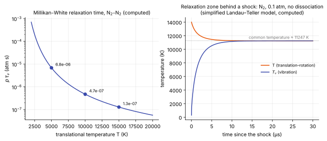

# Thermal nonequilibrium models

**Chapter:** 3 Gas models and thermochemistry · **Depth:** [deep]

## What it is

The family of models that let internal energy modes lag behind translation. Each extra temperature is an extra conserved energy equation plus a relaxation source. The hierarchy runs from one temperature (all modes equilibrated) through Park's two-temperature model to multi-temperature and state-to-state descriptions.

## The problem it solves

Right behind a strong shock, energy lands first in translation. Vibration needs $10^3$–$10^5$ collisions to catch up ([equilibration rates](energy-modes.md#equilibration-rates)), so the translational temperature overshoots, then relaxes as vibration absorbs energy and dissociation proceeds. That overshoot and lag affect standoff, the chemistry behind the shock, nonequilibrium radiation and heating. A one-temperature model can't represent any of it.

## How it works

Each lagging mode gets an energy equation (see the vibrational energy equation in [governing equations](../foundations/governing-equations.md#reacting-two-temperature-mixture)) with a relaxation source. The standard translational–vibrational exchange is the **Landau–Teller** form

$$
Q_{T\text{-}v} = \sum_s \rho_s\,\frac{e_{v,s}(T) - e_{v,s}(T_v)}{\tau_s},
$$

This says that the vibrational energy of species $s$ relaxes towards the value it would have at the translational temperature, $e_{v,s}(T)$, at a rate set by a relaxation time $\tau_s$. It has exactly the form of the [model relaxation equation](../sources/stiff-sources.md#why-explicit-integration-fails): the further $T_v$ is from $T$, the faster energy flows, and the flow stops when they are equal.

### The relaxation time

Vibration is hard to excite: a collision must be fast compared with the vibration period to transfer a quantum, so only the most energetic collisions do it, and the rate rises steeply with temperature. Millikan and White (1963) correlated measured relaxation times for many collision pairs with one formula,

$$
\begin{aligned}
p\,\tau_{sr} &= \exp\!\Big[A_{sr}\big(T^{-1/3} - B_{sr}\big) - 18.42\Big]\ \text{atm s},\\
A_{sr} &= 1.16\times10^{-3}\,\mu_{sr}^{1/2}\,\theta_{v,s}^{4/3},\qquad B_{sr} = 0.015\,\mu_{sr}^{1/4},
\end{aligned}
$$

for molecule $s$ colliding with partner $r$, where $\mu_{sr}$ is the reduced molar mass of the pair in g/mol and $\theta_{v,s}$ the characteristic vibrational temperature in kelvin. The left side is pressure times relaxation time because the time is inversely proportional to the collision rate, and so to pressure. For N₂–N₂, $\mu = 14$, $\theta_v = 3390$ K, giving $A = 221$ and $B = 0.029$. The mixture value $\tau_s$ is a mole-fraction-weighted average over collision partners.

The correlation was fitted below about 8000 K and extrapolates to unphysically short times at higher temperature: shorter than the time between collisions. **Park's correction** adds a collision-limited floor,

$$
\tau_s = \tau_{s,\text{MW}} + \frac{1}{n\,\sigma_v\,\bar c_s},
$$

with $n$ the number density, $\bar c_s = \sqrt{8k_BT/\pi m_s}$ the mean thermal speed and $\sigma_v$ an effective cross-section that falls as $(50{,}000\ \text{K}/T)^2$.

!!! warning "Calibration"
    The Millikan–White formula and constants are as published (1963). For Park's cross-section, different papers give $10^{-21}$ and $3\times10^{-21}$ m² at 50,000 K; check which one a code uses. The rate tables in Park (1993) were not readable from the available copy, so no further coefficients are quoted here.

<figure markdown>

<figcaption markdown="span">Left: the Millikan–White relaxation time for N₂–N₂ collisions (without Park's correction), computed from the formula above. Right: the relaxation zone behind a shock, from a simplified model: pure N₂ at a constant 0.1 atm, starting at the frozen post-shock state $T = 14{,}000$ K, $T_v = 300$ K, with Landau–Teller exchange and no dissociation. $T$ falls and $T_v$ rises until they meet near 11,250 K, in about 10 µs. A one-temperature model would start at the meeting point and miss the hot zone entirely.</figcaption>
</figure>

A worked reading of the figure. Energy is conserved between the two pools: translation and rotation hold $\tfrac72RT$ of enthalpy per mole, vibration holds $R\theta_v/(e^{\theta_v/T_v}-1)$. Starting with all the energy in the first pool at 14,000 K, the common temperature solves $\tfrac72T + \theta_v/(e^{\theta_v/T}-1) = \tfrac72(14{,}000)$, which gives 11,250 K: exciting vibration costs about 2750 K. At 0.1 atm and 12,000 K the relaxation time is about 3 µs, and at a post-shock speed of order 1 km/s the zone is a few millimetres long. That is thin compared with a capsule's shock layer at low altitude and comparable to it at high altitude, which is the whole reason the model matters only in some regimes.

### Coupling to chemistry

Vibration and dissociation are linked in both directions. A molecule that dissociates takes its vibrational energy with it, which is the term $\sum_s\dot\omega_s e_{v,s}$ in the vibrational energy equation. And a vibrationally cold molecule is harder to dissociate, which is modelled by evaluating the dissociation rate at a [controlling temperature](finite-rate-chemistry.md#parks-controlling-temperature) between $T$ and $T_v$. In real air the hot zone in the figure is therefore also where dissociation is delayed, and the temperatures go on falling after they meet as dissociation absorbs more energy.

## Variants

### One temperature (1T)

All internal modes in equilibrium at $T$; chemistry may still be finite-rate. Valid when vibrational relaxation is fast compared with the flow (dense flows, low speeds).

### Two temperature (Park 2T)

$T$ for translation and rotation (both fast); $T_v$ for vibration, electronic excitation and free-electron translation. The last two are lumped with vibration mainly because of strong electron–vibration coupling in N₂, and partly for convenience. Codes carry total energy plus vibrational energy (rather than separate translational and vibrational energies) because total energy is exactly conserved. The standard model for Earth and Mars entry design.

### Three temperature (3T)

A separate electron temperature $T_e$. Matters in strongly ionized flows and for radiation.

### Multi-vibrational

One vibrational temperature per molecule ($T_{v,\mathrm{N_2}}$, $T_{v,\mathrm{O_2}}$, $T_{v,\mathrm{NO}}$), or per vibrational mode of polyatomic molecules (CO₂ has three modes, relevant for Mars entry and backshell radiation).

### Rotational nonequilibrium

A separate rotational temperature. Rotation is fast, so this matters only in very rarefied flow (high altitude, small bodies) and inside the shock front itself.

### State-to-state {#state-to-state}

Every vibrational (and possibly electronic) level of every molecule is treated as its own pseudo-species with its own rate equations: hundreds to thousands of equations. Coarse-grained variants group levels into bins. These models show that the vibrational populations behind a shock are **not Boltzmann** at all, so "a temperature $T_v$" is itself a modeling assumption. That reaches directly into nonequilibrium radiation and into how dissociation rates should be modeled. Rate data come increasingly from ab initio potential surfaces and quasi-classical trajectory (QCT) calculations.

### Which model when

| Model | Extra equations | Captures | Needed when |
|---|---|---|---|
| 1T | 0 | chemistry lag only | relaxation zone much thinner than the shock layer: low altitude, large bodies, lower speeds |
| 2T | 1 | post-shock overshoot, vibration–dissociation coupling | standard for Earth and Mars entry |
| 3T | 2 | separate electron temperature | strongly ionized flow; wake electron density and radiation |
| Multi-vibrational | one per molecule or mode | species-specific lag | CO₂ (Mars), expanding flows, research |
| Rotational | 1 | rotational lag | rarefied flow, shock structure |
| State-to-state | $10^2$–$10^4$ | non-Boltzmann populations | 0-D and 1-D studies that inform reduced models |

Speed and altitude thresholds, and what goes wrong if a level is left out, are collected on [choosing physical models](../model-selection.md).

## Typical values

- Collisions needed to equilibrate: a few for translation, about ten for rotation, $10^3$–$10^5$ for vibration ([energy modes](energy-modes.md#equilibration-rates)).
- Millikan–White, N₂–N₂: $A = 221$, $B = 0.029$; $p\,\tau_v = 6.8\times10^{-6}$, $4.7\times10^{-7}$ and $1.3\times10^{-7}$ atm s at 5000, 10,000 and 15,000 K (computed from the correlation).
- Characteristic vibrational temperatures: about 3390 K (N₂), 2270 K (O₂), 2740 K (NO) ([energy modes](energy-modes.md#typical-values)).
- Temperature cost of exciting N₂ vibration behind a shock at 14,000 K: about 2750 K (computed above, no dissociation).

## Trade-offs

- **1T vs 2T.** One more equation and a temperature inversion buy the relaxation zone and a less stiff start behind strong shocks; the price is an empirical controlling temperature.
- **2T vs 3T and beyond.** Each further temperature needs its own exchange rates, which are less well known than the ones before; the gain is confined to ionized, radiating or rarefied regimes.
- **Temperatures vs state-to-state.** A temperature assumes a Boltzmann distribution within the mode. State-to-state removes the assumption and multiplies the unknowns by hundreds.

## Effects on stability and robustness

- The relaxation source is stiff where $\tau$ is short and is treated implicitly ([stiff source terms](../sources/stiff-sources.md)).
- The $T_v$ inversion fails if the vibrational energy goes negative; it is the two-temperature counterpart of the temperature-inversion abort.
- Behind a strong shock a 2T model is easier to start than a 1T model, because the low initial $T_v$ holds back dissociation and ionization (Park 1990, §5.5).
- Free-stream $T_v$ must be set consistently: equal to $T$ for flight, higher for a facility nozzle flow.

## Implications

| Lens | Effect |
|---|---|
| Time step and cost | Each extra temperature adds an equation (implicit block grows), a temperature inversion and relaxation pairs; state-to-state is unaffordable in 3D implicit codes. |
| Steady vs unsteady | Relaxation sources are stiff and need [implicit treatment](../sources/stiff-sources.md#point-implicit). |
| Accuracy | 2T captures the dominant effect for most Earth/Mars entries; weak spots are very high speeds (above about 10 km/s), nonequilibrium radiation, and the somewhat ad hoc controlling temperature. |
| Robustness | $T_v$ inversion failures and $T_v$ overshoot at startup. |
| Physics captured or lost | Overshoot and relaxation zone (2T); electron effects (3T); per-species lag (multi-vib); non-Boltzmann distributions (state-to-state only). |
| Hardware / parallel fit | Pointwise; more state per cell. |

!!! note "Settled vs active"
    Park's 2T model is settled practice for design. Whether its controlling temperature and relaxation correlations are adequate at high speeds, and how to build reduced models from state-to-state and QCT data, is an active research area.

## In a run

Knobs: number of temperatures, relaxation-time correlations, controlling-temperature exponent. Symptoms: post-shock $T$ overshoot (expected in 2T, absent in 1T); differences in standoff and radiation between 1T and 2T runs.

## Which codes

DPLR, LAURA, US3D, SU2-NEMO and Eilmer all run 2T as standard; multi-temperature and state-to-state are research options (often in 0D/1D tools).

## See also

[Energy modes](energy-modes.md) · [Finite-rate chemistry](finite-rate-chemistry.md) · [Gas models](gas-models.md) · [Stiff sources](../sources/stiff-sources.md)

## References

Park, *Nonequilibrium Hypersonic Aerothermodynamics*; Park (1993); Millikan & White (1963); Candler (2019). See the [bibliography](../../references.md).
