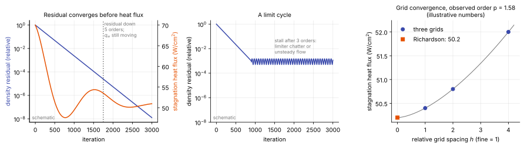

# Convergence diagnostics

**Chapter:** 12 Verification and diagnosis · **Depth:** [deep]

## What it is

The checks that tell you whether a run has converged, and how much of the remaining error is the grid's. There are two separate questions, and they are easy to blur:

- **Iterative convergence:** has the solver finished solving the discrete equations on this grid?
- **Grid convergence:** would the answer change if the grid were finer?

Neither says whether the model is right. That is validation, and the first line of it is the set of [engineering checks](../verification/engineering-checks.md).

## The problem it solves

A residual can fall by many orders of magnitude while the wall heat flux is still drifting. It can also stall while the heat flux is perfectly steady. And a solution that is fully converged on one grid can be 20% from the grid-independent answer. Heat flux is a gradient at a wall, behind a captured shock, so it is the last quantity to settle and the most sensitive to the grid. The diagnostics here are how you know when to stop and how far to trust the number.

## How it works

### What a residual is

The residual of a cell is the net imbalance of its fluxes and sources, $\mathbf R_i(\mathbf U)$: the amount by which the discrete conservation law is not yet satisfied. Codes report a norm of it over the grid, usually for the density equation,

$$
\|\mathbf R\|_2 = \sqrt{\frac{1}{N}\sum_{i=1}^{N} R_i^2}\qquad\text{or}\qquad \|\mathbf R\|_\infty = \max_i |R_i| ,
$$

divided by its value at the first iteration. "Converged five orders" means this ratio has reached $10^{-5}$. The maximum norm, with the location of the maximum, is the more useful one for diagnosis because it says *where* the solution is not settling.

### Why a small residual isn't a small error

The error in the solution and the residual are linked by the Jacobian: to first order $\mathbf R \approx (\partial\mathbf R/\partial\mathbf U)\,\delta\mathbf U$, so $\delta\mathbf U \approx (\partial\mathbf R/\partial\mathbf U)^{-1}\mathbf R$. Error modes that the Jacobian barely responds to (its small eigenvalues) produce a tiny residual for a large error. Those are the slow modes of the flow, and they are what remains late in a run:

- the bow shock creeping to its final position, one cell at a time;
- the entropy layer and the downstream boundary layer adjusting to that shock position, over a flow-through time along the body;
- slow recirculation in the wake;
- thermal relaxation of thick, slow regions.

Stagnation heat flux depends on the shock standoff and on the boundary-layer edge state, so it follows these slow modes. A norm over all cells is dominated by the many cells that settled long ago.

<figure markdown>

<figcaption markdown="span">Left: a residual that has dropped five orders while the stagnation heat flux is still moving (schematic). Middle: a residual that stalls in a limit cycle (schematic). Right: Richardson extrapolation from three grids, using the illustrative numbers of the worked example below.</figcaption>
</figure>

### Monitor the quantities you want

Alongside the residual, record at every iteration (or every few) the outputs the run exists for: stagnation-point heat flux, heat flux at a few body points, the integrated heat load, surface pressure, forces and moments, and the shock standoff distance. Declare convergence when both hold:

1. the residual has fallen by an agreed amount and is still falling or flat at round-off, and
2. each monitored quantity has changed by less than a small tolerance (0.1–1%) over a window long enough to cover the slowest process, which is at least one flow-through time of the body in pseudo-time.

### Stalls and limit cycles {#stalls-and-limit-cycles}

A residual that drops two to four orders and then hangs, often with a regular oscillation, has usually hit one of four things:

- **Limiter chatter.** A limiter with a switch in it ([minmod](../spatial/reconstruction.md#limiters), or any limiter built from `min` and `max`) flips between branches in nearly uniform regions as round-off-sized differences change sign. Each flip changes the flux slightly and the solver can't settle. The cures are to freeze the limiter after an initial transient, or to use a smooth limiter (van Albada, or Venkatakrishnan's limiter with its threshold parameter).
- **A shock between two cells.** A captured shock that wants to sit on a cell face can hop between two positions.
- **Switches in the flux.** [Entropy fixes, eigenvalue limiters](../spatial/flux-vector-splitting.md#modified-steger-warming) and pressure-based sensors have the same on/off character as limiters.
- **Real unsteadiness.** A separated wake or a shock/boundary-layer interaction may have no steady solution. The steady solver then wanders. This is physics, and the remedy is a time-accurate run ([dual time stepping](dual-time-stepping.md)) and time-averaging.

To tell them apart, look at where the maximum residual sits. Chatter sits in smooth free stream or at the boundary-layer edge; a hopping shock sits on the shock; real unsteadiness sits in the wake or the separation, and the monitored surface quantities oscillate with it. If the forebody heat flux is steady to four digits while the residual is stalled by something in the wake, the forebody answer is usable.

### Grid convergence and Richardson extrapolation

Run the same case on three grids with a constant refinement ratio $r$ (spacing $h_1 < h_2 < h_3$, $r = h_2/h_1 = h_3/h_2$) and get $f_1, f_2, f_3$ for the quantity of interest. If the error behaves as $f_h = f_{exact} + C h^p$, three values determine the three unknowns:

$$
p = \frac{\ln\big[(f_3 - f_2)/(f_2 - f_1)\big]}{\ln r},\qquad
f_{exact} \approx f_1 + \frac{f_1 - f_2}{r^p - 1} .
$$

$p$ is the **observed order of accuracy**. The second formula is **Richardson extrapolation**: it uses the two finest grids to estimate the answer on an infinitely fine one. Roache's **grid convergence index** turns this into an error band on the fine-grid value,

$$
\text{GCI}_{fine} = F_s\,\frac{|(f_2 - f_1)/f_1|}{r^p - 1},
$$

with a safety factor $F_s = 1.25$ when three grids confirm the order, and 3 when only two grids are available and $p$ is assumed.

Worked example (illustrative numbers). Stagnation heat flux of 52.0, 50.8 and 50.4 W/cm² on coarse, medium and fine grids with $r = 2$. The differences are 1.2 and 0.4, so $p = \ln 3/\ln 2 = 1.58$. Then $r^p - 1 = 2$, the extrapolated value is $50.4 - 0.4/2 = 50.2$ W/cm², and the GCI is $1.25 \times (0.4/50.4)/2 = 0.5\%$.

Three conditions must hold for this to mean anything. The differences must have the same sign (monotone convergence). Each grid must be iteratively converged well below the differences between grids. And the observed order should be plausible: a second-order scheme with a captured shock typically shows an order between 1 and 2, because the error at the shock is first order. An order of 5, or a negative one, means the grids are not yet in the range where the formula applies.

### What to refine for heat flux

Uniform refinement in every direction is rarely affordable or necessary. Heat flux has three specific sensitivities, best studied one at a time:

- **Wall-normal spacing.** The first cell must be thin enough for a linear temperature profile across it. Refine it until the heat flux stops changing; the usual endpoint is a wall [cell Reynolds number](time-step-limits.md#which-one-binds-the-cell-reynolds-number) of order one.
- **Shock alignment.** A grid line that follows the bow shock keeps the captured shock thin and free of the staircase errors that convect into the boundary layer. [Tailor](../spatial/discretization-families.md#shock-alignment) the grid, then refine.
- **Dissipation of the scheme.** If the heat flux changes when the flux function, the limiter or the entropy-fix parameter changes, the grid isn't fine enough for any of them. A grid-converged heat flux doesn't depend on those choices.

### Conservation checks

Independent of residuals, a correct steady solution must satisfy global balances. Mass flow in through the inflow boundary equals mass flow out. In the inviscid region ahead of the boundary layer, total enthalpy on the stagnation streamline equals its free-stream value, shock or no shock. The mass fraction of each element (N and O in air), summed over species, is unchanged by chemistry in the absence of diffusion. A violation points to a boundary-condition error, a non-conservative fix or an unconverged solution.

## Variants

- **Steady runs:** residual plus monitored quantities, as above.
- **Unsteady runs:** convergence of the subiterations within each step, then statistical convergence of means and spectra over many periods.
- **Adjoint-based error estimates:** weight the residual by the sensitivity of a chosen output, which says how much the remaining residual matters for *that* output and where to refine for it.
- **Order-of-accuracy verification:** manufactured solutions with a known exact answer test whether a code achieves its formal order. That is a test of the code, done once; the checks on this page are tests of a solution.

## Typical values

- Residual drop targeted in steady aeroheating runs: 5–10 orders. Line relaxation has been shown reaching 10 orders in under 300 iterations on a Mach 15 cylinder-wedge (Wright, Candler & Bose 1998; see [relaxation methods](relaxation-methods.md)).
- Stall level from limiter chatter: typically 2–4 orders below the initial residual.
- Tolerance on monitored quantities: 0.1–1% change over the last flow-through time.
- GCI safety factor: 1.25 (three grids), 3 (two grids) (Roache).
- Observed order for heat flux with a second-order shock-capturing scheme: between 1 and 2.
- Wall cell Reynolds number at which heat flux stops changing: of order one.

## Trade-offs

- **Deep residual convergence vs monitored quantities.** Ten orders is unambiguous but can take several times longer than the point at which the outputs stopped changing; outputs alone can be fooled by a slow drift.
- **Three-grid study vs targeted refinement.** A full study gives an error band; refining only the wall-normal spacing and the shock region is far cheaper and addresses the sensitivities that matter for heating.
- **Smooth limiters vs sharp ones.** Smooth limiters converge to round-off; sharp ones resolve shocks in fewer cells but may stall.

## Effects on stability and robustness

- A stalled residual is not a failed run, but it removes the simplest evidence of convergence, so the monitored quantities have to carry it.
- Freezing limiters or raising a switch threshold to get convergence changes the discrete equations slightly; check that the outputs didn't move.
- Convergence that degrades when the CFL number is raised points to lagged boundary conditions or an approximate Jacobian, not to the grid.

## Implications

| Lens | Effect |
|---|---|
| Time step and cost | Deciding convergence on outputs can save a large share of iterations; a grid study multiplies the cost of a case several times. |
| Steady vs unsteady | A steady residual that won't converge may be reporting an unsteady flow. |
| Accuracy (heat flux, pressure) | Pressure converges early and is insensitive to the grid. Heat flux converges last and needs its own refinement study. |
| Robustness | Limiters, entropy fixes and sensors are the usual causes of stalls. |
| Physics captured or lost | A forced steady solution of an unsteady wake is an artefact of the method. |
| Hardware / parallel fit | Monitoring is cheap; it shouldn't be skipped on large runs. |

## In a run

- Plot residual and heat flux against iteration on the same axes before believing either.
- Find the cell holding the maximum residual and look at the flow there.
- Compare stagnation heat flux between the last two CFL levels or the last two thousand iterations, not just the last two outputs.
- Signs that a converged solution is wrong: a bulge in the bow shock near the stagnation line ([carbuncle](../spatial/shock-instabilities.md)); asymmetry in a symmetric case; a heat-flux spike or dip exactly on the axis; standoff distance outside the range of the [engineering estimate](../verification/engineering-checks.md); heating that depends on the flux function or limiter; species mass fractions pinned at zero by clipping over a region.

## Which codes

Independent of the code. Every production solver prints residual norms and can write surface quantities during a run; what to monitor and when to stop are the user's decisions.

## See also

[Engineering checks on a solution](../verification/engineering-checks.md) · [Implicit methods](implicit-methods.md) · [Relaxation methods](relaxation-methods.md) · [Reconstruction and limiters](../spatial/reconstruction.md) · [Shock instabilities](../spatial/shock-instabilities.md) · [Dual time stepping](dual-time-stepping.md)

## References

Roache (1994); Roache, *Verification and Validation in Computational Science and Engineering*; Oberkampf & Roy, *Verification and Validation in Scientific Computing*; Venkatakrishnan (1995). See the [bibliography](../../references.md).
