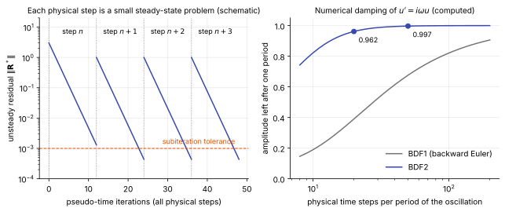

# Dual time stepping

**Chapter:** 9 Time integration and solvers · **Depth:** [deep]

## What it is

A way to make an implicit steady-state solver time-accurate. Physical time is discretized with an implicit backward difference, which turns each physical time step into a nonlinear algebraic problem. That problem is then solved by iterating in a second, fictitious time (**pseudo-time**) until it converges. There are two times, hence the name: the physical step $\Delta t$ sets the accuracy, and the pseudo-time step $\Delta\tau$ is only a convergence device.

## The problem it solves

An [explicit method](explicit-methods.md) must take the step its smallest cell allows, which on a wall-resolved grid is orders of magnitude smaller than any flow feature needs. Dual time stepping lets the physical step be chosen for the physics (so many steps per period of the unsteadiness of interest), while keeping all the machinery that makes steady solvers fast: local pseudo-time steps, [line relaxation](relaxation-methods.md), multigrid. Whether that pays off is the [cost model](explicit-vs-implicit.md): it does when the wanted step is far larger than the explicit limit.

## How it works

### One physical step is a steady problem

Discretize the time derivative with the second-order backward difference (BDF2):

$$
V\,\frac{3\mathbf U^{n+1} - 4\mathbf U^n + \mathbf U^{n-1}}{2\Delta t} + \mathbf R(\mathbf U^{n+1}) = 0 .
$$

$\mathbf U^n$ and $\mathbf U^{n-1}$ are known; $\mathbf U^{n+1}$ is the unknown, and it appears inside the residual $\mathbf R$, so the equation is nonlinear. Collect everything into an **unsteady residual**

$$
\mathbf R^*(\mathbf U) = V\,\frac{3\mathbf U - 4\mathbf U^n + \mathbf U^{n-1}}{2\Delta t} + \mathbf R(\mathbf U),
$$

so that the new time level is the solution of $\mathbf R^*(\mathbf U^{n+1}) = 0$. This has the same form as a steady-state problem with a modified residual. So solve it the way steady problems are solved: add a pseudo-time derivative and march it away,

$$
V\,\frac{\partial\mathbf U}{\partial\tau} + \mathbf R^*(\mathbf U) = 0 .
$$

When the pseudo-time iteration converges, $\partial\mathbf U/\partial\tau = 0$ and the BDF2 equation holds. The path through pseudo-time has no physical meaning, so each cell can use its own $\Delta\tau$ and any convergence acceleration is allowed.

### The subiteration

With an implicit pseudo-time step, subiteration $k$ solves

$$
\left[\left(\frac{V}{\Delta\tau} + \frac{3V}{2\Delta t}\right)\mathbf I + \frac{\partial\mathbf R}{\partial\mathbf U}\right]\delta\mathbf U = -\mathbf R^*(\mathbf U^{k}),\qquad \mathbf U^{k+1} = \mathbf U^k + \delta\mathbf U,
$$

starting from $\mathbf U^0 = \mathbf U^n$ (or an extrapolation from previous levels). Compared with the [steady implicit system](implicit-methods.md#backward-euler-and-its-linearization) there is one new term, $3V/(2\Delta t)$ on the diagonal. It comes from differentiating the physical time derivative with respect to $\mathbf U$.

That term makes the unsteady problem *easier* than the steady one. It adds to the diagonal, so the matrix is better conditioned, and the starting guess $\mathbf U^n$ is already close to the answer. The smaller the physical step, the stronger both effects and the fewer subiterations are needed.

As $\Delta\tau \to \infty$ the subiteration becomes Newton's method on the BDF2 equation. Codes that describe "implicit time stepping with Newton subiterations" are doing the same thing with an approximate Jacobian and an approximate linear solve; the subiterations remove the errors those approximations would otherwise leave in each step.

<figure markdown>

<figcaption markdown="span">Left: the unsteady residual over four physical steps. Within each step the subiterations drive it down to a tolerance, then the next step starts (schematic). Right: the fraction of an oscillation's amplitude that survives one period, against the number of physical steps per period, computed for the model equation $u' = i\omega u$. BDF2 keeps 96% at 20 steps per period and 99.7% at 50; first-order backward Euler keeps 39% and 68%.</figcaption>
</figure>

### How many subiterations

There are two errors in each physical step: the truncation error of BDF2, of order $\Delta t^2$, and the iteration error left by stopping the subiterations early. Converging the subiterations far below the truncation error is wasted work. Stopping too early is worse: the scheme loses its formal order, and unconverged steps add spurious damping or phase error that looks like physics. The practical rule is to drop the unsteady residual by two to three orders of magnitude within each step, and to confirm on a short segment that tightening the tolerance doesn't change the quantity of interest.

### How large a physical step

Choose $\Delta t$ from the fastest unsteadiness you need to resolve, using the right-hand panel of the figure: for BDF2, 50 steps per period loses 0.3% of the amplitude per period and 20 steps loses 4%. Anything faster than about 10 steps per period is strongly damped, which is useful, because it means unresolved high frequencies decay instead of aliasing.

The catch is what the chosen step implies for the acoustic CFL number in the region of interest. If resolving the physics needs a CFL number near one there (wall-bounded turbulence, acoustic receptivity), the implicit step buys nothing and costs several subiterations, and an explicit scheme is cheaper. Dual time stepping wins when the physics is slow compared with the grid's fastest time scale.

A worked example. Low-frequency unsteadiness of a shock-induced separation has a Strouhal number based on the separation length of roughly $St_L = fL/U_e \approx 0.03$ (Dussauge, Dupont & Debiève 2006). With $L = 5$ cm and $U_e = 2000$ m/s (illustrative), $f \approx 1.2$ kHz and the period is 0.83 ms. Fifty steps per period gives $\Delta t \approx 1.7\times10^{-5}$ s, against an explicit limit near $10^{-10}$ s at a heating-resolved wall cell: a ratio of about $10^5$, far above the cost of the subiterations.

## Variants

- **BDF1 (backward Euler in physical time).** First order and very dissipative (figure). Used only for robustness during start-up transients.
- **BDF2.** Second order and stable for any step size. The standard choice.
- **Crank–Nicolson (trapezoidal).** Second order with no amplitude damping, but it doesn't damp unresolved high frequencies either, so stiff modes ring.
- **Implicit Runge–Kutta (ESDIRK).** Several implicit stages per step, each solved by pseudo-time iteration; higher order and adaptive step control at a higher cost per step.
- **Explicit pseudo-time marching.** Jameson's original form: explicit multistage steps with local time stepping and multigrid in pseudo-time. No Jacobian, so it suits codes that are explicit at heart; the pseudo-time step must be limited by $\Delta t$ as well as by CFL.
- **Preconditioned pseudo-time.** Low-Mach preconditioning applied to the pseudo-time derivative only, which rescales the iteration without touching physical-time accuracy.

## Typical values

- Subiterations per physical step: commonly 3–10 with a good implicit solver and a small step, 20–50 with large steps or explicit pseudo-time marching.
- Subiteration tolerance: two to three orders of magnitude reduction of the unsteady residual per step.
- Steps per period for BDF2: 50–100 for quantities that depend on amplitude and phase (computed damping: 0.3% and 0.04% per period); 20 is a coarse lower bound.
- Separation-length Strouhal number of low-frequency shock/boundary-layer unsteadiness: about 0.02–0.05 (Dussauge, Dupont & Debiève 2006).
- Physical-step CFL at wall cells: $10^3$–$10^5$ in the example above; this is acceptable because those cells' fast scales are not part of the physics being resolved.

!!! warning "Calibration"
    Subiteration counts are typical of what unsteady RANS and detached-eddy practice reports, not values from one cited study; they depend strongly on the linear solver and the step size.

## Trade-offs

- **Gain:** a physical step chosen for accuracy; reuse of the steady solver; stability for any step size with BDF2.
- **Pay:** several residual and linear-solve passes per step; storage of two earlier time levels; sensitivity of accuracy to subiteration convergence.
- **Larger $\Delta t$:** fewer steps but more subiterations each and more temporal damping. Past a point the total work rises again.
- **Against explicit:** worthwhile when wanted step over allowed step exceeds the implicit overhead, typically a ratio above $10^2$.

## Effects on stability and robustness

- BDF2 with converged subiterations is stable at any step size for linear problems; stability is not what limits $\Delta t$.
- Under-converged subiterations are the usual failure, and a quiet one: the run stays stable but amplitudes and frequencies drift with the tolerance.
- The first step has no $\mathbf U^{n-1}$; codes take a BDF1 step, which can leave a start-up transient.
- A pseudo-time step much larger than the physical step in an explicit pseudo-time scheme is unstable; the pseudo-time step must be capped by a multiple of $\Delta t$.

## Implications

| Lens | Effect |
|---|---|
| Time step and cost | Step set by physics, not stability; cost per step is several steady-solver iterations. |
| Steady vs unsteady | Turns a steady solver into a time-accurate one. With $\Delta t \to \infty$ it reduces to the steady solver. |
| Accuracy (heat flux, pressure) | Second order in time with BDF2; unsteady loads and heating depend on steps per period and on subiteration convergence. |
| Robustness | Unconditionally stable in the linear sense; errors appear as wrong amplitudes, not blow-ups. |
| Physics captured or lost | Resolves unsteadiness slower than about 20 steps per period; damps everything faster, including acoustics and fine-scale turbulence at large steps. |
| Hardware / parallel fit | Inherits the steady solver's fit: line solves and Gauss–Seidel sweeps are harder on GPUs than explicit updates. |

## In a run

- Knobs: physical $\Delta t$, time-difference order, number of subiterations or their tolerance, pseudo-time CFL.
- Print the unsteady residual at the first and last subiteration of each step. If the drop is less than about two orders, add subiterations or reduce $\Delta t$.
- Halve $\Delta t$ over a short segment and compare the spectrum of a monitored signal (wall pressure in the separation, base pressure). Peaks that move are not resolved.
- Start from a converged steady or first-order solution, and discard the start-up transient before collecting statistics.
- A steady residual that refuses to converge and oscillates regularly is often the sign that the flow is unsteady and should be run this way ([convergence diagnostics](convergence-diagnostics.md#stalls-and-limit-cycles)).

## Which codes

The method is due to Jameson (1991). Second-order implicit time stepping with subiterations is what the implicit entry and aerodynamics codes use for unsteady work: [FUN3D](../../codes/index.md#fun3d), [SU2](../../codes/index.md#su2-nemo), [US3D](../../codes/index.md#us3d), [LAURA](../../codes/index.md#laura) and the [STAR-CCM+](../../codes/index.md#star-ccm) coupled solver all offer a form of it. Explicit codes such as [MFC](../../codes/index.md#mfc) don't need it.

!!! warning "Calibration"
    That these codes provide second-order implicit unsteady options is from their documentation at a general level. The exact formulation (dual time with pseudo-time marching, or Newton-type subiterations), the default order and the subiteration controls differ between codes and versions.

## See also

[Implicit methods](implicit-methods.md) · [Explicit methods](explicit-methods.md) · [Explicit vs implicit](explicit-vs-implicit.md) · [Local time stepping](local-time-stepping.md) · [Convergence diagnostics](convergence-diagnostics.md)

## References

Jameson (1991); Dussauge, Dupont & Debiève (2006). See the [bibliography](../../references.md).
