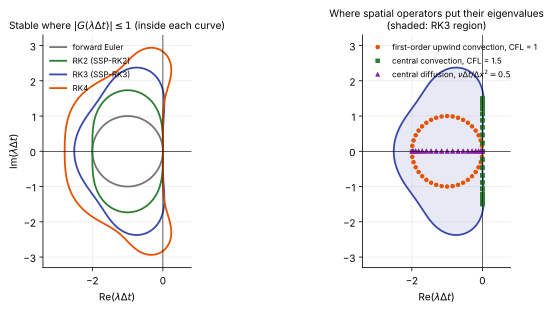

# Explicit methods

**Chapter:** 9 Time integration and solvers · **Depth:** [deep]

## What it is

A time-integration method is **explicit** when the new state is computed directly from states that are already known. The simplest is forward Euler,

$$
\mathbf U^{n+1} = \mathbf U^n - \frac{\Delta t}{V}\,\mathbf R(\mathbf U^n),
$$

where $\mathbf U$ is a cell's conserved state, $V$ its volume and $\mathbf R$ its residual (the net flux out of the cell minus sources). Runge–Kutta schemes chain several such stages. No linear system is solved and no Jacobian is formed.

## The problem it solves

It advances the solution in time at the lowest possible cost per step, with only local operations, and it is time-accurate by construction. That makes it the natural choice when the physics itself needs small steps (acoustics, moving shocks, resolved turbulence) and on GPUs. Its weakness is that the step size is capped by stability rather than chosen for accuracy, which is what makes it impractical for steady aeroheating ([explicit vs implicit](explicit-vs-implicit.md)).

## How it works

### Method of lines

Discretize space first. The [finite-volume pipeline](../spatial/finite-volume-pipeline.md) turns the PDE into one ordinary differential equation per cell,

$$
\frac{d\mathbf U}{dt} = \mathbf L(\mathbf U) \equiv -\frac{1}{V}\,\mathbf R(\mathbf U),
$$

and any ODE integrator can then advance it. Each evaluation of $\mathbf L$ is one full pass of the pipeline over the grid: decode, reconstruct, fluxes, sources.

### Why there is a step limit at all

Apply an integrator to the model equation $u' = \lambda u$. One step multiplies $u$ by an **amplification factor** $G$ that depends only on $z = \lambda\Delta t$. For forward Euler $G = 1 + z$; for an $s$-stage, order-$s$ Runge–Kutta scheme ($s \le 4$) it is the Taylor polynomial $G = 1 + z + \dots + z^s/s!$. The scheme is stable when $|G| \le 1$, which holds only inside a bounded **stability region** of the complex $z$-plane.

The spatial discretization supplies the $\lambda$'s: they are the eigenvalues of the linearized $\mathbf L$. Where they fall depends on the operator:

- **Upwind convection:** on a circle in the left half-plane, reaching out to $-2(|u|+a)/\Delta x$ on the real axis for first-order upwind.
- **Central convection** (no dissipation): on the imaginary axis, up to $\pm i(|u|+a)/\Delta x$.
- **Diffusion:** on the negative real axis, out to $-4\nu/\Delta x^2$.

The time step must be small enough that every $\lambda\Delta t$ sits inside the stability region. That requirement is the [CFL and viscous limits](time-step-limits.md), and the size and shape of the region decides the largest usable CFL number.

<figure markdown>

<figcaption markdown="span">Left: linear stability regions of forward Euler and of Runge–Kutta schemes of order 2, 3 and 4 with as many stages as their order (computed from $|G(z)| = 1$). Right: where the eigenvalues of three spatial operators land for the stated step sizes, over the RK3 region. Forward Euler and RK2 don't cover any of the imaginary axis, so they can't run a dissipation-free central scheme at any time step.</figcaption>
</figure>

| Scheme | Real-axis limit | Imaginary-axis limit | Residual evaluations per step |
|---|---|---|---|
| Forward Euler | 2 | 0 | 1 |
| RK2 | 2 | 0 | 2 |
| RK3 | 2.51 | 1.73 | 3 |
| RK4 | 2.79 | 2.83 | 4 |

(Computed from the stability polynomials.) More stages buy a larger region, but not for free: per residual evaluation, RK3 gets about 0.84 units of real-axis limit and RK4 about 0.70, against 2 for forward Euler. Multi-stage schemes are chosen for accuracy and for the imaginary-axis coverage that low-dissipation schemes need, not for raw stability per unit work.

This also settles a common confusion. CFL numbers of hundreds or thousands belong to [implicit methods](implicit-methods.md), whose stability region is unbounded. An explicit scheme is limited to a CFL number of order one whatever the spatial scheme, and shock capturing doesn't change that.

### Strong stability preservation

Linear stability isn't enough near shocks. A limiter or WENO reconstruction is designed so that a forward Euler step with $\Delta t \le \Delta t_{FE}$ doesn't create new oscillations (it is total-variation diminishing, or keeps density and pressure positive). A high-order time integrator can destroy that property even while linearly stable.

A **strong-stability-preserving** (SSP) Runge–Kutta scheme is one whose stages can be written as weighted averages of forward Euler steps with non-negative weights. An average of non-oscillatory states is non-oscillatory, so whatever forward Euler preserves, the SSP scheme preserves, for $\Delta t \le c\,\Delta t_{FE}$ with $c$ the scheme's SSP coefficient. The standard third-order scheme (Shu & Osher 1988) is

$$
\begin{aligned}
\mathbf U^{(1)} &= \mathbf U^n + \Delta t\,\mathbf L(\mathbf U^n),\\
\mathbf U^{(2)} &= \tfrac34\,\mathbf U^n + \tfrac14\big(\mathbf U^{(1)} + \Delta t\,\mathbf L(\mathbf U^{(1)})\big),\\
\mathbf U^{n+1} &= \tfrac13\,\mathbf U^n + \tfrac23\big(\mathbf U^{(2)} + \Delta t\,\mathbf L(\mathbf U^{(2)})\big).
\end{aligned}
$$

Read each line as "take a forward Euler step from the latest stage, then average with an earlier state". The weights $(\tfrac34,\tfrac14)$ and $(\tfrac13,\tfrac23)$ are positive and sum to one, and $c = 1$. The classical four-stage RK4 can't be written this way with positive weights, which is why shock-capturing codes default to SSP-RK3 rather than RK4 even though RK4 has the larger linear region.

### A worked step size

In the shock layer away from the wall, take $\Delta x = 1$ mm and $|u| + a = 5000$ m/s (illustrative). At CFL = 1 the step is $2\times10^{-7}$ s, about 5000 steps per millisecond of flow time, which is affordable. At a heating-resolved wall cell of $10^{-6}$ m the viscous limit gives about $2\times10^{-10}$ s ([time-step limits](time-step-limits.md#a-rough-number)), a thousand times smaller. In a time-accurate run that one number applies to every cell in the domain.

## Variants

### Forward Euler

First order, one evaluation per step. Used as a building block and as the smoother inside some steady-state iterations; not used alone for time-accurate work.

### SSP Runge–Kutta (TVD-RK)

SSP-RK2 (two stages, $c = 1$) and SSP-RK3 (above) are the standard pair for shock-capturing codes. Schemes with more stages than their order, such as the four-stage third-order and five-stage fourth-order SSP methods, have $c$ of 2 and about 1.5, so they allow larger steps per stage as well as per step (Gottlieb, Shu & Tadmor 2001).

### Low-storage Runge–Kutta

Formulations that keep only two copies of the solution regardless of the number of stages. They matter when memory is the constraint, as in large DNS and on GPUs.

### Explicit steady-state solvers

Multi-stage schemes with coefficients tuned for damping instead of accuracy, combined with [local time stepping](local-time-stepping.md), residual smoothing and multigrid (Jameson, Schmidt & Turkel 1981). This was the standard for transonic aerodynamics. It struggles on the stretched, reacting grids of aeroheating, which is the reason those codes went implicit.

### Explicit flow with implicit or sub-stepped sources

The fluxes are advanced explicitly and only the stiff chemistry is treated implicitly or by a sub-stepped ODE solver ([stiff source terms](../sources/stiff-sources.md)). This removes the chemical step limit but not the convective and viscous ones.

## Typical values

- Usable CFL: 0.3–0.9 for SSP-RK3 with WENO or MUSCL in practice, below the linear limit because of nonlinearity, multiple dimensions and positivity.
- Stability limits: table above (computed).
- SSP coefficients: 1 for SSP-RK2 and SSP-RK3; 2 for the four-stage third-order scheme; about 1.5 for the five-stage fourth-order scheme (Gottlieb, Shu & Tadmor 2001).
- Memory: two to three solution copies for SSP-RK3; two for low-storage schemes.
- Steps per flow-through time on a wall-resolved heating grid: of order $10^6$–$10^7$ (illustrative, from the worked step size).

## Trade-offs

- **Gain:** lowest cost per step; no Jacobians, so adding equations costs only linearly; time-accurate; every cell updates independently within a stage.
- **Pay:** the step is set by the smallest cell and the fastest wave or diffusion rate anywhere, whether or not the physics of interest needs it.
- **More stages:** higher order and a larger region, but more residual evaluations; efficiency per evaluation generally falls.
- **SSP vs classical RK:** SSP keeps the non-oscillatory and positivity properties of the spatial scheme; classical RK4 gives more linear stability and accuracy for smooth flow but no such guarantee.

## Effects on stability and robustness

- Exceeding the limit by a small margin doesn't degrade the answer gradually: the highest-wavenumber mode grows exponentially and the run fails within tens of steps.
- Positivity-preserving limiters are proved for forward Euler under a CFL condition; they carry over to SSP schemes with the same condition scaled by $c$.
- Stiff sources tighten the limit to the fastest chemical time scale unless they are treated implicitly.
- Forward Euler or RK2 with a central, low-dissipation flux is unstable at any step size.

## Implications

| Lens | Effect |
|---|---|
| Time step and cost | Cheapest step; CFL of order one; the step count is the cost. |
| Steady vs unsteady | Naturally time-accurate. Steady state needs local time stepping and multigrid, and is still slow on stretched grids. |
| Accuracy (heat flux, pressure) | Temporal error is usually negligible because stability forces a step far smaller than accuracy needs. Heat-flux accuracy is set by the spatial scheme and grid. |
| Robustness | Hard stability limit; SSP schemes preserve limiter and positivity properties. |
| Physics captured or lost | Resolves everything the grid resolves in time: acoustics, shock motion, turbulence. |
| Hardware / parallel fit | Ideal for GPUs: stencil operations, no global coupling, low memory. |

## In a run

- The knobs are the scheme and the CFL number. If a run fails immediately, halve the CFL before changing anything else.
- Check which limit binds by looking at where the minimum time step occurs: a wall cell means the viscous limit, a cell behind the shock usually means chemistry.
- A time step that collapses during a run points to a cell going bad (negative pressure, a runaway source), not to a wrong CFL setting.
- Cost scales as the inverse of the smallest cell size for convection and its square for diffusion, so refining the wall spacing by two can quadruple the step count.

## Which codes

[MFC](../../codes/index.md#mfc) uses SSP Runge–Kutta of order one to three. [Eilmer](../../codes/index.md#eilmer) offers explicit updates for transient facility flows alongside a Newton–Krylov steady solver. [US3D](../../codes/index.md#us3d) has explicit Runge–Kutta options for scale-resolving work alongside its implicit solvers. The steady aeroheating codes ([DPLR](../../codes/index.md#dplr), [LAURA](../../codes/index.md#laura)) are implicit.

!!! warning "Calibration"
    Scheme lists are from the codes' methods papers and documentation at a general level; defaults and available orders change between versions.

## See also

[Time-step limits](time-step-limits.md) · [Explicit vs implicit](explicit-vs-implicit.md) · [Local time stepping](local-time-stepping.md) · [Dual time stepping](dual-time-stepping.md) · [Stiff source terms](../sources/stiff-sources.md)

## References

Shu & Osher (1988); Gottlieb, Shu & Tadmor (2001); Jameson, Schmidt & Turkel (1981). See the [bibliography](../../references.md).
