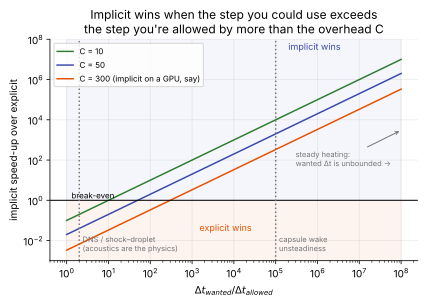

# Explicit vs implicit: the cost model

**Slot:** Track 0.5; Track 3 · **Depth:** [deep] · **Taught in:** [Lesson 0.1](../../course/track-0/0-1-governing-equations.md) (follow-up questions), [Track 3](../../course/track-3.md)

## What it is

A simple way to predict which time integrator wins for a given problem. Explicit is faster *per step*; implicit can take bigger steps. Which wins depends on how much bigger a step the problem would allow if stability weren't the constraint.

## The problem it solves

"Explicit codes are faster" and "implicit codes are faster" are both true, for different problems. This model says which, and why.

## How it works

Total cost is the number of steps times the cost per step. Let

- $\Delta t_{\text{allowed}}$: the explicit stability limit ([time-step limits](time-step-limits.md));
- $\Delta t_{\text{wanted}}$: the step the physics needs for accuracy (for a steady problem, unbounded);
- $C$: the cost of one implicit step relative to one explicit step, including Jacobian assembly and linear-solve iterations or subiterations.

Then the speed-up of implicit over explicit is

$$
\frac{\text{cost}_{\text{explicit}}}{\text{cost}_{\text{implicit}}} = \frac{\Delta t_{\text{wanted}}/\Delta t_{\text{allowed}}}{C},\qquad \text{implicit wins} \iff \frac{\Delta t_{\text{wanted}}}{\Delta t_{\text{allowed}}} > C .
$$

Implicit methods pay a fixed overhead per step to buy a bigger step. It is only worth it when you can use the bigger step.

<figure markdown>

<figcaption>Implicit speed-up against the ratio of wanted to allowed time step, for three values of the implicit overhead C. The three canonical cases sit in very different places.</figcaption>
</figure>

### Three cases

**Steady aeroheating.** Time doesn't matter; $\Delta t_{\text{wanted}}$ is effectively unbounded. Even with [local time stepping](local-time-stepping.md), explicit schemes need enormous iteration counts on stiff, high-aspect-ratio reacting grids, while implicit relaxation typically converges in thousands of iterations. Implicit wins by large factors. This is why every production aeroheating code is implicit.

**Capsule wake unsteadiness.** Suppose the physics is shedding at kHz frequencies and you want 100 steps per period: $\Delta t_{\text{wanted}} \sim 10^{-5}$ s. The wall cells allow $\Delta t_{\text{allowed}} \sim 10^{-10}$ s, and in a time-accurate run that limit applies globally. The ratio is $\sim10^5 \gg C$: implicit wins, using [dual time stepping](dual-time-stepping.md).

**DNS of transition, or shock–droplet interaction.** The physics you need is acoustics and small eddies, so $\Delta t_{\text{wanted}} \approx \Delta t_{\text{allowed}}$ and the ratio is near 1, below $C$. Explicit wins, especially on GPUs, where $C$ is effectively larger because explicit updates map better to the hardware. This is MFC's regime.

!!! note "Order-of-magnitude reasoning"
    The numbers above are illustrative. Real values of $C$ depend on the code, the linear solver and the hardware, and real iteration counts depend on the case.

### Why time-accurate explicit is expensive on wall-resolved grids

For time accuracy every cell must advance the same physical $\Delta t$, so local time stepping is not available (in its naive form; see [time-accurate LTS](local-time-stepping.md#time-accurate-lts-and-subcycling)). The global step is the minimum over all cells, and the thinnest wall cell sets it for the entire domain. The expense is not the cell count; it is that the smallest cell sets everyone's step.

### Scaling with the number of equations

Explicit cost per step grows roughly linearly with the number of equations $n$ (plus closure costs). Implicit cost per iteration grows with $n^2$ (memory) and $n^3$ (block operations), so reacting multi-temperature models raise $C$, and the crossover moves. See [implicit methods](implicit-methods.md#cost-scaling-with-the-number-of-equations).

### Shock regularization is not a time-step loophole

MFC's [IGR](../../codes/mfc.md#information-geometric-regularization-igr) replaces the shock-capturing machinery (reconstruction plus Riemann solver) with a regularization that allows simple central fluxes and very low memory. It is still explicit and still CFL-limited; it changes the flux slot, not the time-step constraint.

## Implications

| Lens | Effect |
|---|---|
| Time step and cost | The whole point: implicit removes stability limits at an overhead $C$ per step. |
| Steady vs unsteady | Steady problems favour implicit; wave-resolving unsteady problems favour explicit; slow unsteadiness on stiff grids favours implicit dual time stepping. |
| Accuracy | Explicit steps near the CFL limit resolve fast transients by default; implicit steps filter them. |
| Robustness | Implicit large steps can pass through unphysical states early; explicit runs blow up cleanly when the limit is exceeded. |
| Physics captured or lost | Large implicit steps cannot represent waves faster than the step. |
| Hardware / parallel fit | Explicit maps naturally to GPUs; implicit relaxation and line solves are harder, raising the effective $C$ on GPUs. |

## In a run

The choice is usually made by the code, not the input deck. Within implicit codes, the equivalent knob is the CFL number and the number of subiterations; within explicit codes, the CFL number and whether local time stepping is on (steady runs only).

## Which codes

!!! warning "Calibration"
    DPLR: implicit line relaxation, steady and time-accurate (subiterations). LAURA: point-implicit relaxation (line-implicit options in newer versions, to be checked). US3D: implicit relaxation on unstructured grids, implicit second-order time stepping for LES/DNS, explicit options too. FUN3D: implicit point/line relaxation, BDF2 with subiterations. MFC: explicit SSP-RK. To be verified against primary sources in Track 3.

## See also

[Time-step limits](time-step-limits.md) · [Local time stepping](local-time-stepping.md) · [Implicit methods](implicit-methods.md) · [Relaxation](relaxation-methods.md) · [Dual time stepping](dual-time-stepping.md)

## References

Blazek; Hirsch; Wright, Candler & Bose (1998). See the [bibliography](../../references.md).
