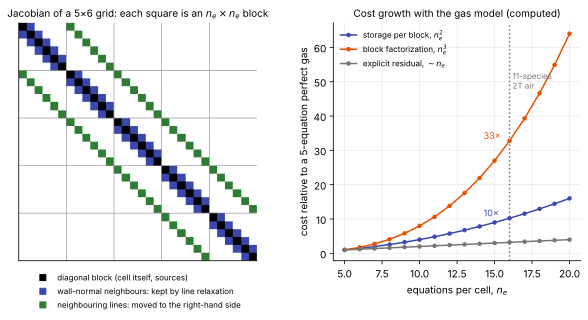

# Implicit methods and Jacobians

**Chapter:** 9 Time integration and solvers · **Depth:** [deep]

## What it is

An implicit method evaluates the residual at the *new* state, so each step requires solving a (linearized) system of equations coupling all cells. In exchange, it can take time steps far beyond the explicit [stability limits](time-step-limits.md).

## The problem it solves

Steady aeroheating problems are stiff: tiny wall-normal cells, high aspect ratios, fast chemistry and vibrational relaxation all impose small explicit steps that have nothing to do with the physics of interest. Implicit methods remove those stability limits so the step can be chosen for convergence speed (steady) or for the physical time scale of interest (unsteady).

## How it works

### Two different Jacobians

Two matrices both get called "the Jacobian," and they do different jobs.

The **flux Jacobian** $\mathbf A = \partial\mathbf F/\partial\mathbf U$ is for analysis. It lets you write $\partial_t\mathbf U + \mathbf A\,\partial_x\mathbf U = 0$; its eigenvalues are the wave speeds and its eigenvectors what each wave carries ([mathematical character](../foundations/mathematical-character.md#hyperbolic)). It doesn't produce a solution. Flux functions exploit it: [Roe](../spatial/riemann-solvers.md#roe) linearizes around a Roe-averaged $\mathbf A$, [HLL](../spatial/riemann-solvers.md#hll) uses its extreme eigenvalues as wave-speed bounds, characteristic boundary conditions use its eigenvectors, and the CFL condition uses its largest eigenvalue.

The **residual Jacobian** $\partial\mathbf R/\partial\mathbf U$ is for the implicit update. It is a huge sparse matrix with one $n\times n$ block per cell-neighbour pair (built from neighbours' flux Jacobians and the viscous terms) plus a diagonal block that includes the source Jacobian $\partial\mathbf S/\partial\mathbf U$.

### Backward Euler and its linearization

Backward Euler for the semi-discrete system $V\,d\mathbf U/dt = -\mathbf R(\mathbf U)$ is

$$
V\,\frac{\mathbf U^{n+1} - \mathbf U^n}{\Delta t} = -\mathbf R(\mathbf U^{n+1}).
$$

Linearize $\mathbf R(\mathbf U^{n+1}) \approx \mathbf R(\mathbf U^n) + \frac{\partial\mathbf R}{\partial\mathbf U}\Delta\mathbf U$:

$$
\left(\frac{V}{\Delta t}\,\mathbf I + \frac{\partial\mathbf R}{\partial\mathbf U}\right)\Delta\mathbf U = -\mathbf R(\mathbf U^n).
$$

As $\Delta t\to\infty$ the left-hand matrix becomes $\partial\mathbf R/\partial\mathbf U$ and the update becomes **Newton's method** for $\mathbf R(\mathbf U) = 0$, which converges quadratically near the solution. That is why steady implicit solvers ramp the CFL number up as the solution settles. The $V/\Delta t$ term keeps early iterations stable while the solution is far from converged.

<figure markdown>

<figcaption markdown="span">Left: the structure of the residual Jacobian for a small 2-D structured grid, with cells numbered along wall-normal lines. Each coloured square is one $n_e\times n_e$ block. The black and blue blocks form a block-tridiagonal system for each line, which [line relaxation](relaxation-methods.md#line-relaxation) solves exactly; the green blocks couple neighbouring lines. Right: how the cost of one block grows with the number of equations, relative to a five-equation perfect gas.</figcaption>
</figure>

### Solving it approximately

Nobody solves this system exactly. The left-hand side is usually an approximation (often a first-order, more dissipative Jacobian even when the residual is second order: a **defect-correction** strategy), and the linear system is solved approximately by [point or line relaxation](relaxation-methods.md), LU-SGS, or a Krylov method (GMRES) with preconditioning. Because the right-hand side is the true residual, the converged steady solution is unaffected by these approximations; only the convergence rate is.

### Cost scaling with the number of equations

Each block is $n\times n$, with $n$ the number of conserved variables per cell. Memory goes as $n^2$ and block factorizations or inversions as $n^3$. Going from a perfect gas ($n = 5$) to 11-species two-temperature air ($n = 16$) multiplies block-operation cost by roughly $(16/5)^3 \approx 33$, before counting the extra source-Jacobian work. An explicit code pays roughly linearly in $n$. See [explicit vs implicit](explicit-vs-implicit.md).

!!! note "Quadratic or cubic?"
    The $n^3$ figure is for factorizing or inverting the blocks. Codes that factor once and reuse the factors across relaxation sweeps pay mostly the $n^2$ block–vector products per sweep, and memory goes as $n^2$ in any case. That is why the US3D paper describes the fully coupled DPLR cost as varying with the *square* of the number of equations (Candler et al. 2015). Both statements are true; which one dominates depends on how many sweeps reuse each factorization and on whether memory, not arithmetic, is the limit.

### Decoupled implicit method {#decoupled-implicit-method}

With many species the coupled implicit operator becomes the bottleneck. In 3-D, fully coupled line relaxation stores seven $n_e\times n_e$ blocks per cell; with 20 species plus vibrational energy $n_e \approx 26$, so roughly $7\times 26^2 \approx 4700$ numbers per cell for the operator alone, against 26 for the solution itself.

Candler, Subbareddy & Nompelis (2013) split the implicit problem in two sequential parts, each a modified [DPLR](relaxation-methods.md#dplr) solve:

1. **Mixture equations.** Total mass, momentum and total energy: a $5\times5$ (3-D) block-tridiagonal line solve, independent of the number of species.
2. **Species and internal-energy equations** (and turbulence equations in US3D). Their implicit operator is approximated so that it becomes a **scalar** tridiagonal system along each line, using the mixture update from step 1.

The right-hand side is still the full coupled residual, so the converged steady solution is unchanged; only the path to it differs.

Typical values and trade-offs, from the primary sources:

- **Cost scaling:** the implicit solve becomes essentially linear in the number of species; the chemical source term and its Jacobian, inherently quadratic in $n_s$, then dominate the cost.
- **Speed:** about 3× faster than the fully coupled method for a 20-species kinetics model, with a similar reduction in memory (Candler et al. 2015).
- **Memory:** a single large Jacobian block per cell instead of seven.
- **Where it works:** steady problems with moderate to low Damköhler number, i.e. chemistry not much faster than the flow. When chemical time scales are very small relative to flow time scales, convergence suffers and the fully coupled DPLR may be needed.
- **Status in US3D (2015):** steady-state only, as an optional solution mode; an unsteady formulation was in development.

## Variants

### Steady state via pseudo-time

March $\Delta t\to$ large with local time stepping; time accuracy is irrelevant. See [local time stepping](local-time-stepping.md).

### Time-accurate implicit and dual time stepping

Second-order backward differences in physical time, with inner pseudo-time iterations at each physical step. See [dual time stepping](dual-time-stepping.md).

### Point-implicit sources only

Treat only the sources implicitly and the fluxes explicitly. See [stiff source terms](../sources/stiff-sources.md#point-implicit).

### Newton–Krylov and JFNK

Krylov solvers that need only Jacobian–vector products, which can be approximated by finite differences of the residual (Jacobian-free).

## Typical values

- CFL numbers: ramped from order 1–10 at start-up to $10^2$–$10^6$ as the solution settles.
- Blocks stored per cell for fully coupled line relaxation in 3-D: seven, each $n_e\times n_e$; about 4700 numbers per cell at $n_e = 26$, against 26 for the solution.
- Cost growth from a perfect gas ($n_e = 5$) to 11-species 2T air ($n_e = 16$): about 10× in block storage, about 33× in block factorization.
- Decoupled implicit method: about 3× faster than fully coupled for a 20-species model, with a similar memory saving (Candler et al. 2015).
- Iterations to converge a steady blunt-body case with line relaxation: hundreds to a few thousand ([relaxation methods](relaxation-methods.md)).

## Trade-offs

- **Exact vs approximate Jacobian.** An exact linearization of a second-order scheme gives Newton-like convergence but is large and ill-conditioned; a first-order approximate Jacobian is cheaper and better conditioned, and costs convergence rate but not accuracy.
- **Stored Jacobian vs Jacobian-free.** Storing blocks costs memory that grows as $n_e^2$; Jacobian-free Krylov methods avoid it but need a good preconditioner, which is usually a stored approximate Jacobian anyway.
- **Coupled vs decoupled species.** Coupled handles fast chemistry; decoupled makes cost linear in the number of species when chemistry is not much faster than the flow.
- **Implicit vs explicit.** A large fixed cost per step in exchange for a step size free of stability limits ([explicit vs implicit](explicit-vs-implicit.md)).

## Effects on stability and robustness

- Linear stability is unconditional, but the linearization is only valid near the current state. Too large a step early in a run sends the Newton update outside the physical range, which is why the CFL number is ramped.
- An approximate linear solve limits the usable CFL number: the stiffer the modes left to the iteration, the lower the limit.
- Boundary conditions and source terms left out of the Jacobian (lagged) behave explicitly and cap the CFL number.
- Non-smooth pieces of the residual (limiters, switches) aren't represented in the Jacobian and can stall convergence.

## Implications

| Lens | Effect |
|---|---|
| Time step and cost | Removes the stability limit; each iteration costs much more than an explicit step (Jacobian assembly, linear solve), with $n^2$ memory and $n^3$ block cost. Decoupling the species equations makes the solve roughly linear in $n_s$ (about 3× faster at 20 species). |
| Steady vs unsteady | Natural steady-state accelerator; time-accurate with dual time stepping. |
| Accuracy | Converged steady solutions don't depend on the left-hand-side approximation; time-accurate runs need subiteration convergence. |
| Robustness | Large steps can drive the solution through unphysical states early on; CFL ramping and startup strategies matter. |
| Physics captured or lost | Large time steps filter out fast transients by design; fine for steady flow, wrong for wave-resolving physics. |
| Hardware / parallel fit | Global coupling and recursive solves (Gauss–Seidel, line solves) are harder on GPUs than explicit updates. |

## In a run

Knobs: CFL start value and ramp, Jacobian order, number of relaxation sweeps or Krylov iterations, source treatment. Symptoms: divergence when CFL ramps too fast; stall at a plateau; quadratic convergence at the end when the Jacobian is accurate.

## Which codes

DPLR ([line relaxation](relaxation-methods.md#line-relaxation)), LAURA (point-implicit relaxation), US3D, FUN3D, SU2 and Eilmer (Newton–Krylov option) are all implicit for steady problems. MFC is explicit.

## See also

[Point and line relaxation](relaxation-methods.md) · [Explicit vs implicit](explicit-vs-implicit.md) · [Time-step limits](time-step-limits.md) · [Dual time stepping](dual-time-stepping.md)

## References

Blazek; Hirsch; Wright, Candler & Bose (1998); Candler, Subbareddy & Nompelis (2013, decoupled method); Candler et al. (2015, US3D); Knoll & Keyes (2004). See the [bibliography](../../references.md).
