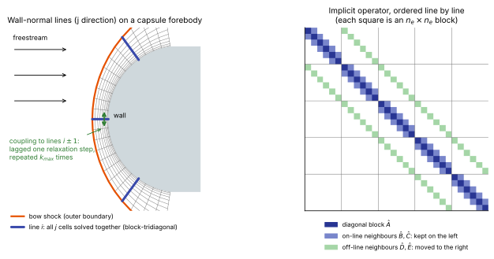
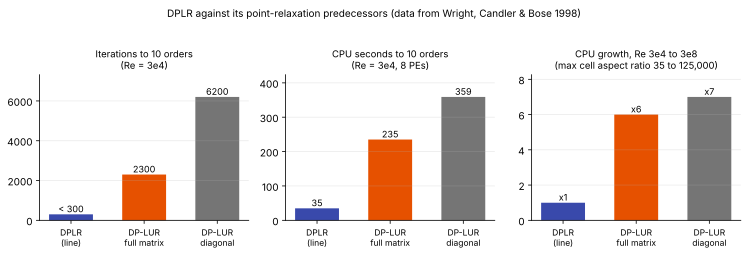

# Point and line relaxation

**Slot:** Track 0.5 time advancement; Track 3.3–3.4 · **Depth:** [deep]

## What it is

Iterative ways of approximately solving the implicit system $\big(\tfrac{V}{\Delta t}\mathbf I + \tfrac{\partial\mathbf R}{\partial\mathbf U}\big)\delta\mathbf U = -\mathbf R$ ([implicit methods](implicit-methods.md)) by solving small pieces of it exactly and iterating over the rest. Point relaxation solves one cell at a time. Line relaxation solves a whole line of cells at once, and the data-parallel line-relaxation method (DPLR) is the version that made it the standard steady-state solver for capsule and blunt-body aeroheating.

## The problem it solves

The full implicit system has one $n_e\times n_e$ block per cell–neighbour pair, where $n_e$ is the number of equations per cell (5 for a 3-D perfect gas, 16 or more for 11-species two-temperature air). It is far too large to factor directly. A relaxation method keeps the couplings that matter most on the left-hand side, where they are solved exactly, and moves the rest to the right-hand side, where they are updated by repeated sweeps.

The choice of what to keep decides whether the method converges. A heat-flux grid for an entry capsule puts the first cell at roughly $y^+\approx 1$, often $10^{-6}$ m or less, while the cells along the wall are millimetres to centimetres long. The cell aspect ratio reaches $10^3$–$10^5$. Coupling in the wall-normal direction (diffusion across thin cells, acoustic waves bouncing between wall and shock) is far stronger than coupling along the wall. A method that treats the two directions alike converges at the pace of the stiffest one.

## How it works

### The implicit system on a structured grid

Take a 2-D structured grid with $i$ along the wall and $j$ normal to it. Backward Euler with the [modified Steger–Warming](../spatial/flux-vector-splitting.md#modified-steger-warming) flux, whose split Jacobians $\mathbf A^\pm$ are exact linearizations of the face flux, gives for cell $(i,j)$:

$$
\hat{\mathbf A}_{ij}\,\delta\mathbf U_{ij}
+ \hat{\mathbf B}_{ij}\,\delta\mathbf U_{i,j+1} + \hat{\mathbf C}_{ij}\,\delta\mathbf U_{i,j-1}
+ \hat{\mathbf D}_{ij}\,\delta\mathbf U_{i+1,j} + \hat{\mathbf E}_{ij}\,\delta\mathbf U_{i-1,j}
= \Delta t\,\mathbf R^n_{ij}.
$$

With face areas $S$ and cell volume $V$, the blocks are

$$
\begin{aligned}
\hat{\mathbf A}_{ij} &= \mathbf I + \frac{\Delta t}{V}\Big(S_{i+\frac12}\mathbf A^+_{i+\frac12} - S_{i-\frac12}\mathbf A^-_{i-\frac12} + S_{j+\frac12}\mathbf B^+_{j+\frac12} - S_{j-\frac12}\mathbf B^-_{j-\frac12}\Big) - \Delta t\,\frac{\partial\mathbf W}{\partial\mathbf U}\bigg|_{ij},\\
\hat{\mathbf D}_{ij} &= \frac{\Delta t}{V}\,S_{i+\frac12}\mathbf A^-_{i+\frac12}, \qquad
\hat{\mathbf E}_{ij} = -\frac{\Delta t}{V}\,S_{i-\frac12}\mathbf A^+_{i-\frac12},
\end{aligned}
$$

and $\hat{\mathbf B}$, $\hat{\mathbf C}$ are the same in $j$. $\mathbf W$ is the chemical and vibrational source term, so its Jacobian sits on the diagonal block. In 3-D each cell has seven blocks (diagonal plus six neighbours).

The two directions play different roles. $\hat{\mathbf B}$ and $\hat{\mathbf C}$ link a cell to its neighbours on the same wall-normal line. $\hat{\mathbf D}$ and $\hat{\mathbf E}$ link it to the neighbouring lines.

### Point relaxation {#point-relaxation}

Move every neighbour term to the right-hand side and solve each cell's $n_e\times n_e$ diagonal block exactly:

$$
\hat{\mathbf A}_{ij}\,\delta\mathbf U^{(k)}_{ij} = \Delta t\,\mathbf R^n_{ij} - \sum_{\text{nb}}\hat{\mathbf N}_{ij}\,\delta\mathbf U^{(k-1)}_{\text{nb}}.
$$

Using the neighbours' latest values (sweeping through the grid in order) is **Gauss–Seidel**; using last sweep's values for all of them is **Jacobi**. Gauss–Seidel converges faster and, in a supersonic region, a sweep aligned with the flow carries information downstream in one pass, because that is the only direction it travels physically ([mathematical character](../foundations/mathematical-character.md#mixed-character-around-a-blunt-body)). Jacobi parallelizes trivially but converges more slowly. Storing the full off-diagonal Jacobians and relaxing them this way is **full-matrix point relaxation** (FMPR); the **diagonal** variant approximates the neighbour blocks by their spectral radii, which avoids storing them.

### Line relaxation {#line-relaxation}

Keep the on-line blocks $\hat{\mathbf B}$, $\hat{\mathbf C}$ on the left. For each $i$, the cells $j = 1,\dots,N_j$ along the line now form a **block-tridiagonal** system, solved directly by the block Thomas algorithm (LU factorization by forward elimination, then back substitution):

- factorization: about $N_j$ block inversions and block–block products, $O(N_j\,n_e^3)$;
- each back substitution: block–vector products only, $O(N_j\,n_e^2)$.

That cost split is the key to everything below: factor once, back-substitute cheaply many times.

### The DPLR algorithm {#dplr}

*Left: lines run from the wall to the bow shock; each is solved exactly. Right: ordering the unknowns line by line makes the on-line couplings a block-tridiagonal band (blue) and the couplings to neighbouring lines two distant bands (green), which DPLR moves to the right-hand side.*

Wright, Candler & Bose (1998) solve the system in $k_{\max}+1$ steps per iteration:

1. **Step 0.** Drop the off-line terms and solve each line:

    $$
    \hat{\mathbf B}_{ij}\,\delta\mathbf U^{(0)}_{i,j+1} + \hat{\mathbf A}_{ij}\,\delta\mathbf U^{(0)}_{ij} + \hat{\mathbf C}_{ij}\,\delta\mathbf U^{(0)}_{i,j-1} = \Delta t\,\mathbf R^n_{ij}.
    $$

2. **Steps $k = 1,\dots,k_{\max}$.** Put the off-line terms back on the right, using the previous step's values on the neighbouring lines:

    $$
    \hat{\mathbf B}_{ij}\,\delta\mathbf U^{(k)}_{i,j+1} + \hat{\mathbf A}_{ij}\,\delta\mathbf U^{(k)}_{ij} + \hat{\mathbf C}_{ij}\,\delta\mathbf U^{(k)}_{i,j-1} = \Delta t\,\mathbf R^n_{ij} - \hat{\mathbf D}_{ij}\,\delta\mathbf U^{(k-1)}_{i+1,j} - \hat{\mathbf E}_{ij}\,\delta\mathbf U^{(k-1)}_{i-1,j}.
    $$

3. **Update.** $\delta\mathbf U^n_{ij} = \delta\mathbf U^{(k_{\max})}_{ij}$.

The left-hand side is the same in every step, so each line is factored **once** per iteration and back-substituted $k_{\max}+1$ times.

Two properties follow from lagging every off-line term by exactly one step (a Jacobi coupling between lines rather than a Gauss–Seidel sweep):

- **No data dependencies.** Everything a relaxation step needs was computed in the previous step. If each processor owns whole lines, every line is solved simultaneously with no communication inside the solve. This is the "data-parallel" in the name.
- **No sweep-direction bias.** The predecessor, MacCormack & Candler's Gauss–Seidel line relaxation (GSLR, 1989), swept forward and backward in $i$ with the latest data. In 3-D, sweeping in two along-wall directions biases the converged solution and can create a spurious crossflow velocity. DPLR treats all neighbouring lines symmetrically, so the bias disappears and the 3-D extension is direct.

The price is information speed along the wall: GSLR moves information across the whole domain in one sweep, DPLR only $k_{\max}$ cells per iteration in $i$. Early in a run, while the bow shock is still moving into place, this shows up as slower convergence; once the shock settles, DPLR's terminal convergence rate is as good as or better than GSLR's.

### Why wall-normal lines

Line relaxation works because the numerics match the physics: the wall-normal direction has the smallest cells and the strongest coupling, and that is exactly the direction solved exactly. The remaining along-wall coupling is weak, and four lagged relaxation steps capture enough of it.

The test in Wright et al. (1998) is the cleanest demonstration. A Mach 15 cylinder-wedge on a $128\times128$ grid was run at Reynolds numbers from $3\times10^4$ to $3\times10^8$, with the grid adjusted each time to keep $y^+ = 1$. The maximum cell aspect ratio grew from 35 to about 125,000. DPLR converged in essentially the same number of iterations at every Reynolds number; the point-relaxation DP-LUR methods slowed down by factors of 6 and 7.

### Viscous terms in the implicit operator

The viscous flux at the new level is linearized with a thin-layer approximation, keeping only the derivative across the face (direction $\eta$):

$$
\mathbf F_v^{n+1} \approx \mathbf F_v^n + \mathbf M\,\frac{\partial}{\partial\eta}\big(\mathbf N\,\delta\mathbf U\big),
\qquad \mathbf N = \frac{\partial\mathbf V}{\partial\mathbf U},
$$

where $\mathbf V$ are primitive variables and $\mathbf M$ is the viscous coefficient matrix (rotated into the face frame on unstructured grids). The result adds to the same tridiagonal blocks, so the structure of the solve doesn't change. Because the wall-normal viscous coupling is on the left-hand side, DPLR converges viscous and inviscid problems at almost the same rate; DP-LUR always needed more iterations for the viscous case.

### Lines on unstructured grids {#unstructured-lines}

An unstructured solver has no $(i,j,k)$ index to follow, so lines are **grown** from the connectivity. In the approach of Nompelis, Drayna & Candler (2004), carried into US3D (Candler et al. 2015):

1. Start at each face of a chosen boundary, usually the wall.
2. Step to the adjoining element across the opposite face, and repeat.
3. Stop when the next element is a pyramid or tetrahedron, already belongs to another line, or the maximum line length is reached.
4. Cells not on any line are treated as lines of length one, which is point relaxation (FMPR).

The intended grid is a paved surface (quads and triangles) extruded into hexahedral or prismatic layers through the boundary layer, with tetrahedra filling the rest. For parallel runs, each line is collapsed to a single node of the partitioning graph, weighted by its length, before ParMETIS splits the grid. A line is therefore never cut across processors, and the factorization and back substitution need no communication.

### Unsteady flows

Line relaxation in pseudo-time is a steady-state accelerator. Run as a time integrator it is only first-order accurate and the lagged off-line terms bias the transient. US3D therefore uses other integrators for unsteady work; for hybrid RANS/LES its preferred option is a second-order implicit point relaxation at CFL of order 100, which is approximately time-accurate in the small near-wall cells and accurate in the larger cells where the resolved unsteadiness lives (Candler et al. 2015). See [dual time stepping](dual-time-stepping.md).

## Variants

### GSLR

Gauss–Seidel line relaxation (MacCormack & Candler 1989): exact wall-normal line solves, with alternating forward and backward Gauss–Seidel sweeps along the wall. Fast information transport, but sequential and biased in 3-D.

### DP-LUR

Data-parallel lower–upper relaxation (Wright, Candler & Prampolini 1996): the LU-SGS idea with the Gauss–Seidel sweeps replaced by Jacobi-like relaxation steps so that it parallelizes. Two forms: **diagonal** (neighbour Jacobians replaced by spectral radii, no off-diagonal storage) and **full matrix** (neighbour Jacobians stored). Both degrade on high-aspect-ratio grids because the wall-normal coupling sits on the right-hand side.

### DPLR

Line solves along wall-normal lines with $k_{\max}$ Jacobi-style relaxation steps for the off-line terms ([above](#dplr)).

### Hybrid line and point relaxation

Line solves in the extruded wall layers, FMPR elsewhere ([above](#unstructured-lines)). Used in US3D and in other unstructured codes with prism-layer lines.

### LU-SGS

Lower–upper symmetric Gauss–Seidel (Yoon & Jameson): approximate factorization with forward and backward sweeps and a scalar diagonal, so no block inversions are needed. Cheap per iteration, but it converges more and more slowly as the grid is stretched.

### Decoupled DPLR

Solve the mixture mass, momentum and energy equations with block line relaxation, then the species and internal-energy equations with scalar tridiagonal line solves. See [implicit methods](implicit-methods.md#decoupled-implicit-method).

## Typical values

From the primary sources; the hardware numbers are 1990s Cray T3E figures, useful for ratios rather than absolute speed.

- **Relaxation steps:** $k_{\max} = 4$. Iteration count keeps improving up to about $k_{\max} = 6$, but beyond 4 the extra back substitutions cost more than they save in CPU time (Wright et al. 1998). The Candler et al. (2015) chapter still recommends 4.
- **Convergence, Mach 15 cylinder-wedge, $Re = 3\times10^4$, $128\times128$, $y^+ = 1$:** 10 orders of magnitude in density residual in under 300 iterations (DPLR) versus 2300 (full-matrix DP-LUR) and 6200 (diagonal DP-LUR).
- **CPU time for the same case (8 processors):** 35 s (DPLR), 235 s (full-matrix DP-LUR), 359 s (diagonal DP-LUR). DPLR reaches steady state in about 15% of the time.
- **Aspect-ratio sensitivity:** DPLR CPU time unchanged from $Re = 3\times10^4$ to $3\times10^8$ (maximum aspect ratio 35 to 125,000); DP-LUR full matrix ×6, diagonal ×7.
- **Memory:** DPLR stores 5 Jacobian blocks per cell in 2-D and 7 in 3-D, each $n_e\times n_e$. For a perfect gas that is about 2× the memory of full-matrix DP-LUR in 2-D and 4× in 3-D; the same as GSLR.
- **Parallel efficiency:** 98% on 32 processors in 1998. US3D (2015) scaled well to 8192 cores on grids of several hundred million hexahedra, and to 20,000 cores in later tests.
- **Hybrid unstructured grids (Nompelis et al. 2004, perfect-gas cylinder at 5 km/s and $T_\infty = 200$ K, about Mach 18):** pure line relaxation on a hexahedral grid reached machine zero in about 800 iterations; pure point relaxation on the same grid had not reached machine zero after 5000; hybrid line/point converged about 2× slower than pure line relaxation.

## Trade-offs

- **Line vs point relaxation.** Both pay one $O(n_e^3)$ block inversion per cell per iteration (line factorization or diagonal-block inversion), so their per-iteration costs are similar in order. The iteration count is not: line relaxation is roughly independent of wall-normal stretching, point relaxation is not. On viscous aeroheating grids line relaxation wins by a large margin.
- **More relaxation steps vs cost per iteration.** Each extra step is one back substitution ($n_e^2$), cheap next to the factorization ($n_e^3$). Past $k_{\max}\approx 4$ the convergence gain no longer pays for it.
- **DPLR vs GSLR.** DPLR gives up fast along-wall information transport for perfect parallelism and freedom from sweep bias. The along-wall penalty matters mostly during the start-up transient.
- **Memory vs convergence.** DPLR stores 5–7 blocks per cell; diagonal DP-LUR stores none. With many species $n_e$ grows and the $n_e^2$ storage per block becomes the binding limit, which is what the decoupled method attacks.
- **Grid design vs flexibility.** Lines require extruded hexahedral or prismatic layers. Fully tetrahedral regions fall back to point relaxation and converge more slowly; tetrahedra at the bow shock also hurt accuracy ([discretization families](../spatial/discretization-families.md#element-types-at-strong-shocks)).
- **DPLR vs Krylov (GMRES).** In Candler's group's comparisons DPLR was cheaper than preconditioned GMRES except on grids where wall-normal lines can't be built.

## Effects on stability and robustness

- The exact linearization of the modified Steger–Warming flux gives an implicit operator consistent with the residual, which is part of why DPLR tolerates large CFL numbers. With approximate operators convergence is worse; Nompelis et al. note that their point-relaxation results used full Jacobians and that more approximate operators converge even more slowly.
- Large time steps can carry the solution through unphysical states early on; runs start at CFL of order 1 and ramp up quickly (Wright et al. started at 1 and increased it within the first iterations).
- Folding the boundary conditions into the line operator (the wall cell's block absorbs the ghost-cell Jacobian) keeps the wall implicit, which matters for isothermal and catalytic walls with strong gradients.
- A bow shock that keeps moving through a tetrahedral region prevents convergence to machine zero: the residual oscillates around the steady state. Shock-aligned hexahedra fix it.

## Implications

| Lens | Effect |
|---|---|
| Time step and cost | Removes the explicit limit. Cost per iteration: one $O(n_e^3)$ factorization plus $k_{\max}+1$ $O(n_e^2)$ back substitutions per cell. Iterations to steady state of order a few hundred for laminar blunt bodies, independent of wall stretching. |
| Steady vs unsteady | A steady-state accelerator. As a time integrator it is first order and biased; unsteady runs use dual time stepping or point relaxation at moderate CFL. |
| Accuracy (heat flux, pressure) | None directly: the converged answer is set by the residual. Indirectly it lets you afford $y^+\approx1$ wall grids, which heat flux needs. |
| Robustness | Line solves cure the stiffness of high-aspect-ratio wall cells. Implicit boundary conditions and exact flux Jacobians help large-CFL stability. |
| Physics captured or lost | None directly. Large pseudo-time steps erase transients by design. |
| Hardware / parallel fit | Lines are independent within a relaxation step, so it parallelizes over lines with no communication inside the solve. The Thomas algorithm is sequential along a line, which limits fine-grained (GPU) parallelism unless many lines are batched. |

## In a run

Knobs:

- $k_{\max}$ (number of relaxation steps): 4 is the usual default.
- Line direction or line-growing boundary and maximum line length (unstructured).
- CFL start value and ramp schedule.
- Jacobian fidelity: exact modified Steger–Warming Jacobians, or a simplified operator.

Symptoms and checks:

- Fast initial drop, then a long plateau while the bow shock moves, then a steep terminal slope: normal for DPLR on blunt bodies.
- Convergence much worse than expected near the wall: check that lines actually exist there (unstructured: did they stop at a pyramid layer?).
- Residual oscillates around a level and never reaches machine zero: look for a shock sitting in tetrahedra or misaligned cells.
- Convergence degrades as species count grows: memory and $n_e^2$ storage; consider the decoupled mode.

## Which codes

- **DPLR** (NASA Ames): the method is its namesake. Structured multi-block grids, wall-normal lines, $k_{\max}$ relaxation steps; documented in Wright, Candler & Bose (1998) and the DPLR user manual (NASA/TM-2009-215388).
- **US3D** (University of Minnesota and NASA Ames): the same line-relaxation method on unstructured grids, lines grown from boundary faces, FMPR elsewhere, line-aware partitioning; decoupled implicit mode as an option for steady problems (Candler et al. 2015; Nompelis et al. 2004).
- **LAURA** and **FUN3D** (NASA Langley): see the calibration note.

!!! warning "Calibration"
    LAURA's original solver is point-implicit relaxation (Gnoffo 1990); whether and how later LAURA versions add line-implicit options should be checked in the LAURA 5.6 user manual (NASA/TM-2020-220566). FUN3D is described in the literature as using point and line-implicit relaxation on unstructured grids with lines in boundary-layer prism stacks; the details here have not yet been checked against a FUN3D primary source.

## See also

[Implicit methods](implicit-methods.md) · [Local time stepping](local-time-stepping.md) · [Explicit vs implicit](explicit-vs-implicit.md) · [Flux-vector splitting](../spatial/flux-vector-splitting.md) · [DPLR](../../codes/index.md#dplr) · [US3D](../../codes/index.md#us3d)

## References

Wright, Candler & Bose (1998); Wright, Candler & Prampolini (1996); MacCormack & Candler (1989); Nompelis, Drayna & Candler (2004); Candler, Subbareddy & Nompelis (2015, chapter); Candler et al. (2015, US3D); Yoon & Jameson (1988); Gnoffo (1990). See the [bibliography](../../references.md).
