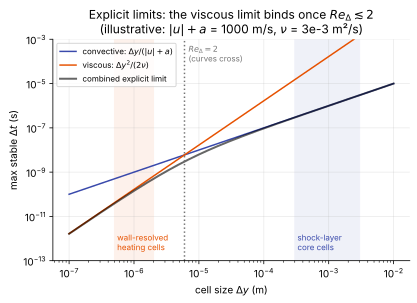

# Time-step limits

**Chapter:** 9 Time integration and solvers · **Depth:** [deep]

## What it is

An explicit scheme is stable only if its time step is small enough. The Navier–Stokes equations impose (at least) two such limits, one from the [hyperbolic](../foundations/mathematical-character.md#hyperbolic) convective part and one from the [parabolic](../foundations/mathematical-character.md#parabolic) viscous part, and reacting flows add a third from stiff sources. Which one binds, and where, decides whether explicit time stepping is practical.

## The problem it solves

It explains why production aeroheating codes are implicit, why explicit codes thrive on unsteady wave-resolving problems, and why the thin wall cells needed for heat flux are so expensive.

## How it works

### The convective (CFL) limit

A wave must not cross more than about one cell per step: the numerical domain of dependence has to contain the physical one. For an explicit scheme,

$$
\Delta t_{\text{conv}} \lesssim \frac{\Delta x}{|u| + a},\qquad \text{CFL} = \frac{(|u| + a)\,\Delta t}{\Delta x} \le \text{CFL}_{\max} = O(1),
$$

with $\text{CFL}_{\max}$ depending on the scheme (Runge–Kutta stages, reconstruction). CFL numbers far above 1 belong to **implicit** schemes, not to shock-capturing schemes as such; backward Euler is unconditionally stable in linear analysis and production codes ramp CFL to $10^2$–$10^6$ ([implicit methods](implicit-methods.md)).

### The viscous limit, from von Neumann analysis

For $u_t = \nu u_{xx}$ with forward Euler in time and central differences in space,

$$
u_i^{n+1} = u_i^n + r\,(u_{i+1}^n - 2u_i^n + u_{i-1}^n),\qquad r = \frac{\nu\,\Delta t}{\Delta x^2}.
$$

Insert a Fourier mode $u_j^n = G^n e^{\mathrm i k j\Delta x}$: the amplification factor is $G = 1 - 4r\sin^2(k\Delta x/2)$. Stability needs $|G|\le 1$ for every $k$, so $r \le \tfrac12$:

$$
\Delta t_{\text{visc}} \lesssim \frac{\Delta x^2}{2\nu}.
$$

It scales with $\Delta x^2$, which is brutal on fine grids.

### Which one binds: the cell Reynolds number

An explicit scheme must satisfy both; a common combined estimate is

$$
\frac{1}{\Delta t} \approx \frac{|u| + a}{\Delta x} + \frac{2\nu}{\Delta x^2}.
$$

The ratio of the two limits is

$$
\frac{\Delta t_{\text{conv}}}{\Delta t_{\text{visc}}} = \frac{2\nu}{(|u| + a)\,\Delta x} = \frac{2}{Re_\Delta},\qquad Re_\Delta = \frac{(|u| + a)\,\Delta x}{\nu},
$$

so the **viscous limit binds when $Re_\Delta \lesssim 2$**. Wall-resolved aeroheating grids are deliberately built with wall $Re_\Delta$ of order one or below for heat-flux accuracy ([viscous fluxes](../spatial/viscous-fluxes.md#near-the-wall)), so there the viscous limit governs.

<figure markdown>

<figcaption markdown="span">Convective and viscous explicit limits against cell size, for illustrative shock-layer values. Large cells are convection-limited; below the crossover the viscous limit takes over and falls as $\Delta y^2$.</figcaption>
</figure>

### A rough number

Illustrative values, not to be quoted: wall spacing $\Delta y \sim 10^{-6}$ m, $|u| + a \sim 10^3$ m/s, $\nu \sim 3\times10^{-3}$ m²/s. Then $\Delta t_{\text{visc}} \approx 2\times10^{-10}$ s, against a flow-through time over a meter-scale capsule of about $10^{-3}$ s. A *time-accurate* explicit run, where every cell must take the same step, would need millions of steps per flow-through, set by a handful of wall cells.

For *steady* problems, [local time stepping](local-time-stepping.md) removes the "smallest cell sets the global step" problem, but not the underlying stiffness: convergence still degrades with cell aspect ratio. See that page and [explicit vs implicit](explicit-vs-implicit.md).

### Source-term limit

Explicit treatment of chemistry or vibrational relaxation also requires $\Delta t$ below the fastest chemical or relaxation time scale, which behind a strong shock can be far smaller than either flow limit. This is why sources are treated implicitly. See [stiff source terms](../sources/stiff-sources.md).

### Multiple dimensions

In 2D and 3D the convective limit uses the sum of the directional wave-speed-to-spacing ratios, and the viscous limit the sum of $\nu/\Delta x_k^2$ terms. On high-aspect-ratio wall cells the wall-normal direction dominates both.

## Variants

The same analysis applies to each kind of term, giving one limit per physical process:

| Limit | Form | Scales with | Binds where |
|---|---|---|---|
| Convective (CFL) | $\Delta x/(\lvert u\rvert + a)$ | $\Delta x$ | coarse cells, inviscid regions |
| Viscous (Fourier) | $\Delta x^2/(2\nu)$ | $\Delta x^2$ | thin wall cells, $Re_\Delta \lesssim 2$ |
| Source | of order the fastest chemical or relaxation time | independent of the grid | behind the shock |

## Typical values

- Crossover between the two flow limits: cell Reynolds number $Re_\Delta = 2$.
- Wall cell on a heating grid (illustrative): $\Delta y \sim 10^{-6}$ m gives $\Delta t_{\text{visc}} \approx 2\times10^{-10}$ s.
- Shock-layer cell (illustrative): $\Delta x = 1$ mm and $\lvert u\rvert + a = 5000$ m/s give $\Delta t_{\text{conv}} = 2\times10^{-7}$ s.
- Maximum CFL of explicit Runge–Kutta schemes: of order one ([explicit methods](explicit-methods.md#why-there-is-a-step-limit-at-all)).

## Trade-offs

- A finer wall grid improves heat flux and costs explicit time step quadratically. Halving the wall spacing quarters the viscous limit.
- Implicit methods remove the limits at a fixed cost per step; whether that pays depends on how large a step the physics allows ([explicit vs implicit](explicit-vs-implicit.md)).

## Effects on stability and robustness

- The limits are sharp. Just inside, the scheme is stable; just outside, the shortest-wavelength mode grows exponentially.
- The binding cell can change during a run: the shock moves, chemistry switches on, the boundary layer thins.
- In several dimensions the limits combine (the inverse steps add), so a cell that is thin in one direction and coarse in the others is still bound by its thin direction.

## Implications

| Lens | Effect |
|---|---|
| Time step and cost | Sets the explicit step everywhere; on wall-resolved grids the viscous limit makes explicit time-accurate runs very expensive. |
| Steady vs unsteady | For steady runs, local time stepping helps; for unsteady runs, the smallest cell sets the global step. |
| Accuracy | The limits are about stability, not accuracy; accuracy may demand a smaller step anyway (acoustics, DNS). |
| Robustness | Exceeding the limit gives exponential blow-up, usually first in the thinnest wall cells or behind the shock. |
| Physics captured or lost | None directly; but cost pressure pushes users to coarser wall grids, which loses heat-flux accuracy. |
| Hardware / parallel fit | Explicit steps are cheap and GPU-friendly; the problem is how many are needed. |

## In a run

Knob: CFL number (and for explicit codes, a viscous Fourier number). Symptoms: blow-up at the first steps in the wall cells; an explicit run that is stable but advances physical time absurdly slowly.

## Which codes

All explicit codes (MFC, Eilmer in explicit mode) are bound by these limits; implicit codes (DPLR, LAURA, US3D, FUN3D) sidestep them with CFL numbers far above 1.

## See also

[Explicit vs implicit](explicit-vs-implicit.md) · [Local time stepping](local-time-stepping.md) · [Implicit methods](implicit-methods.md) · [Stiff sources](../sources/stiff-sources.md)

## References

Hirsch, *Numerical Computation of Internal and External Flows* (von Neumann analysis); Blazek. See the [bibliography](../../references.md).
