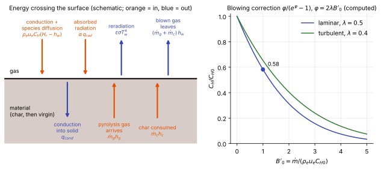

# Surface energy balance

**Chapter:** 5 Boundary conditions and walls · **Depth:** [deep]

## What it is

The statement that energy doesn't accumulate at the heated surface: everything arriving from the gas and from inside the material must equal everything leaving. Written out, it is one equation linking convective heating, radiation, blowing and conduction into the material. It is the boundary condition that joins a flow solver to a [material-response code](../../codes/index.md#material-response-tools).

## The problem it solves

The flow solver needs a wall temperature and a blowing rate. The material-response code needs a heat load. Each one's output is the other's input, and the surface energy balance is where they meet. It also explains a practice that looks odd at first: CFD hands the TPS designer a heat-transfer coefficient and a recovery enthalpy, not the heat flux it computed.

## How it works

### The balance

The surface is a control volume of zero thickness, so it stores nothing. Per unit area and time:

$$
\underbrace{\rho_e u_e C_H\,(H_r - h_w)}_{\text{convection}}
+ \underbrace{\alpha\,q_{rad}}_{\text{absorbed radiation}}
+ \underbrace{\dot m_g h_g + \dot m_c h_c}_{\text{arriving from the material}}
= \underbrace{\varepsilon\sigma T_w^4}_{\text{reradiation}}
+ \underbrace{(\dot m_g + \dot m_c)\,h_w}_{\text{blown gas leaving}}
+ \underbrace{q_{cond}}_{\text{into the solid}} .
$$

<figure markdown>

<figcaption markdown="span">Left: the energy fluxes crossing an ablating surface (schematic). Orange arrows bring energy to the surface, blue arrows take it away. Right: the blowing correction to the heat-transfer coefficient, computed from the formula in the [blowing](#blowing) section.</figcaption>
</figure>

Term by term:

- **Convection.** The heat delivered by the boundary layer, conduction plus species diffusion ([wall boundary conditions](wall-boundary-conditions.md#what-the-wall-heat-flux-is-made-of)), written in film-coefficient form (next section).
- **Absorbed radiation.** $q_{rad}$ is the radiative flux from the shock layer reaching the surface and $\alpha$ the surface absorptivity.
- **Arriving from the material.** A charring ablator decomposes in depth and the pyrolysis gas flows out through the char, arriving at the surface at a rate $\dot m_g$ with enthalpy $h_g$. The char itself is consumed at the surface at a rate $\dot m_c$ (oxidation, sublimation), bringing its enthalpy $h_c$.
- **Reradiation.** The surface radiates as a grey body with emissivity $\varepsilon$.
- **Blown gas leaving.** All the mass injected, $\dot m_g + \dot m_c$, leaves the surface as gas at the wall enthalpy $h_w$.
- **Conduction into the solid.** What is left over heats the material. This is the term the TPS thickness is sized against.

For a non-ablating surface the $\dot m$ terms vanish. If conduction is also negligible the balance reduces to the [radiative-equilibrium wall](wall-boundary-conditions.md#thermal-conditions), $q_{conv} + \alpha q_{rad} = \varepsilon\sigma T_w^4$.

This form assumes equal diffusion coefficients for all species (unit Lewis number), so that heat and mass transfer share one coefficient. Without that assumption the diffusion term is written with a separate mass-transfer coefficient and a sum over species.

### The film coefficient, and why CFD hands it over

The convective term is written as a coefficient times a driving potential:

$$
q_{conv} = \rho_e u_e C_H\,(H_r - h_w).
$$

$\rho_e u_e C_H$ is the **heat-transfer (film) coefficient**, in kg/(m² s): $\rho_e u_e$ is the mass flux at the boundary-layer edge and $C_H$ the dimensionless Stanton number. $H_r$ is the **recovery enthalpy**, the enthalpy the wall gas would have if the wall were adiabatic; at a stagnation point it is the total enthalpy. $h_w$ is the enthalpy of the gas at the wall, at the wall temperature and wall composition.

The point of the split is that the two factors depend on different things. The coefficient is set by the outer flow and the boundary-layer state, and hardly changes with wall temperature. The driving potential carries the dependence on the wall.

That matters because the CFD run and the material-response run don't share a wall temperature. CFD is run at a few trajectory points with an assumed wall (cold, or radiative equilibrium). The material code then marches through the whole trajectory with a surface temperature that it computes itself and that changes with time. So CFD reports

$$
\rho_e u_e C_H = \frac{q_{w,\text{CFD}}}{H_r - h_{w,\text{CFD}}}
$$

together with $H_r$ and pressure, and the material code rebuilds the heat flux at its own wall state as $\rho_e u_e C_H\,(H_r - h_w(T_w))$. A worked example of this **hot-wall correction**: with $H_r = 28$ MJ/kg, a CFD cold wall at 300 K ($h_w \approx 0.3$ MJ/kg) and an actual surface at 2000 K ($h_w \approx 2.25$ MJ/kg), the actual convective flux is $(28 - 2.25)/(28 - 0.3) = 0.93$ of the cold-wall value.

### Catalysis changes the heat flux, not the coefficient

$h_w$ includes enthalpies of formation. At a non-catalytic wall in a frozen boundary layer the gas touching the wall is still dissociated, so $h_w$ is large: it contains the dissociation energy that was never released. The driving potential $H_r - h_w$ is correspondingly small, and so is the heat flux. At a fully catalytic wall the gas at the wall is recombined, $h_w$ is small and the potential is large.

So a factor-of-two change in heat flux between catalytic conditions ([wall boundary conditions](wall-boundary-conditions.md#catalytic-conditions)) appears in the film-coefficient form as a change in $h_w$, with $C_H$ nearly the same. The causal chain is: catalysis sets the wall composition; the composition sets $h_w$; $h_w$ sets the potential. The transport across the boundary layer, which is what $C_H$ measures, is not what changed.

### Blowing {#blowing}

Gas injected at the wall thickens the boundary layer and carries heat away from the surface, so it lowers the heat-transfer coefficient. This is **blockage**. The widely used correction, from boundary-layer film theory, is

$$
\frac{C_H}{C_{H0}} = \frac{\varphi}{e^{\varphi} - 1},\qquad \varphi = 2\lambda\,B'_0,\qquad B'_0 = \frac{\dot m_g + \dot m_c}{\rho_e u_e C_{H0}},
$$

with $C_{H0}$ the coefficient without blowing, $B'_0$ the blowing rate made dimensionless with it, and $\lambda$ an empirical factor: 0.5 for laminar flow and about 0.4 for turbulent flow. At $B'_0 = 1$ in laminar flow, $\varphi = 1$ and the coefficient falls to $1/(e - 1) = 0.58$ of its unblown value. At $B'_0 = 5$ it is 3%: the boundary layer is close to being blown off the surface.

The dimensionless ablation rates $B'_c = \dot m_c/(\rho_e u_e C_M)$ and $B'_g = \dot m_g/(\rho_e u_e C_M)$ are also how the surface chemistry enters. A **B′ table** is a precomputed solution of surface chemical equilibrium that returns $B'_c$ and $h_w$ as functions of pressure, surface temperature and $B'_g$. The material code looks them up instead of solving surface chemistry at every step.

## Variants

### Levels of coupling

- **Uncoupled (standard design practice).** Non-ablating CFD at selected trajectory points gives $\rho_e u_e C_H$, $H_r$ and $p$. The material code applies the surface energy balance with the blowing correction and B′ tables.
- **Loosely coupled.** The material code's wall temperature and blowing rates are returned to the flow solver as a blowing wall condition, and the two are iterated at each trajectory point.
- **Fully coupled.** The flow solver solves the surface mass and energy balances as its wall boundary condition, with ablation products as species in the flow. Needed when the products matter to the flow itself, for example when they absorb shock-layer radiation.

### Steady-state ablation

If the surface recedes at a constant rate and the temperature profile moves with it, $q_{cond}$ can be written in closed form and no in-depth solution is needed. It is a useful limit for long, steady heating pulses and for checking a material code.

## Typical values

- Blowing correction at $B'_0 = 0.5,\ 1,\ 2$ (computed from the formula above): 0.77, 0.58, 0.31 laminar ($\lambda = 0.5$); 0.81, 0.65, 0.41 turbulent ($\lambda = 0.4$).
- Hot-wall correction at entry enthalpies: a few percent to about 10% for surfaces at 1500–2500 K (example above: 7% at 2000 K and 28 MJ/kg).
- Emissivity of charred ablators and coated tiles: roughly 0.8–0.9.
- Radiative-equilibrium temperature: 2134 K at 100 W/cm² and $\varepsilon = 0.85$ ([wall boundary conditions](wall-boundary-conditions.md#typical-values)).

## Trade-offs

- **Film-coefficient hand-off vs passing heat flux.** The coefficient transfers across wall temperatures and is nearly independent of blowing-free wall chemistry; a raw heat flux is valid only at the wall state it was computed for.
- **Uncoupled vs coupled.** Uncoupled is cheap enough to run thousands of Monte Carlo sizing cases; coupled captures blowing, shape change and ablation products in the flow but costs a flow solution per iteration.
- **B′ tables vs finite-rate surface chemistry.** Tables are fast and need only thermodynamic data; they assume the surface is in chemical equilibrium with the gas, which over-predicts recession when surface reactions are rate-limited.
- **Unit Lewis number.** One transfer coefficient and a simple balance, at the price of ignoring unequal species diffusion.

## Effects on stability and robustness

- The balance is strongly nonlinear in $T_w$ (the $T_w^4$ term and the B′ table). Material codes solve it by Newton iteration at each time step; a poor initial guess or a coarse table can prevent convergence.
- In coupled runs, heat flux falls as blowing rises and blowing rises with heat flux. Iterating the two codes without under-relaxation can oscillate.
- At very large $B'_0$ the film-theory correction drives $C_H$ towards zero. Boundary-layer blow-off is then outside what the correction was built for.

## Implications

| Lens | Effect |
|---|---|
| Time step and cost | The balance itself is trivial; coupling level decides cost (one CFD solution per trajectory point uncoupled, several when iterated). |
| Steady vs unsteady | The flow is treated as quasi-steady at each trajectory point; the material response is transient through the whole trajectory. |
| Accuracy (heat flux, pressure) | Hot-wall and blowing corrections change the net heat flux by percent to tens of percent; errors in $h_w$ (wall chemistry) go straight into the driving potential. |
| Robustness | Nonlinear solve at the surface; coupled iterations may need under-relaxation. |
| Physics captured or lost | Uncoupled practice loses the effect of ablation products on the flow and on radiation; B′ loses rate-limited surface chemistry. |
| Hardware / parallel fit | Material response is cheap and embarrassingly parallel across body points and Monte Carlo samples. |

## In a run

- From a CFD solution extract $q_w$, $p_w$, $H_r$ and $h_w$ at the CFD wall state, and form $\rho_e u_e C_H$. Record which wall temperature and catalytic condition were used.
- Check that $C_H$ from a cold-wall run and from a radiative-equilibrium run of the same case agree; if they do, the hand-off is sound.
- When heat flux from a catalytic and a non-catalytic run differ, compare $h_w$ between them before concluding that the transport changed.
- In a coupled run, monitor $B'$ along the surface: values above about 1 mean blowing is reshaping the boundary layer and the uncoupled correction is being stretched.

## Which codes

The film-coefficient balance with B′ tables is the formulation of the classic one-dimensional ablation codes, CMA and its successor FIAT, and is shared by the multidimensional codes in the [material-response family](../../codes/index.md#material-response-tools). On the flow side, [DPLR](../../codes/index.md#dplr) supplies film coefficients for uncoupled sizing and has a blowing wall for loose coupling; [LAURA](../../codes/index.md#laura) solves ablating-wall surface balances in the flow solver; [US3D](../../codes/index.md#us3d) couples to a solid solver with shape change.

!!! warning "Calibration"
    The balance and the blowing correction are as given in the open literature on CMA and FIAT (Moyer & Rindal 1968; Chen & Milos 1999). Which coupling options each flow code currently supports is from their methods papers and manuals at a general level; check the version in use.

## See also

[Wall boundary conditions](wall-boundary-conditions.md) · [Stagnation-point heating](../physics/stagnation-point-heating.md) · [Transport and diffusion](../thermo/transport-and-diffusion.md) · [Codes at a glance: material response](../../codes/index.md#material-response-tools)

## References

Moyer & Rindal (1968); Chen & Milos (1999); Milos & Rasky (1994); Lachaud & Mansour (2014). See the [bibliography](../../references.md).
