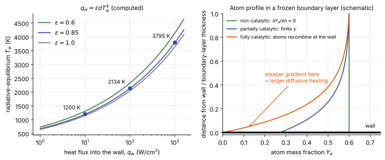

# Wall boundary conditions

**Chapter:** 5 Boundary conditions and walls · **Depth:** [deep]

## What it is

The conditions imposed on velocity, temperature (or temperatures) and composition at a solid surface. There are three independent choices: what the gas velocity does at the wall (no-slip or slip), what fixes the wall temperature (thermal condition), and what the wall does to atoms that reach it (catalytic condition).

## The problem it solves

The wall is where the heat flux is read off, and the heat flux depends on the wall conditions as much as on the flow. The same shock layer can deliver very different heating to a cold copper calorimeter, a glass-coated tile and a charring ablator. Choosing the wall conditions is therefore part of defining the problem, not a numerical detail.

## How it works

### What the wall heat flux is made of

The heat flux into the wall has a conduction part for each temperature and a diffusion part:

$$
q_w = \underbrace{k\,\frac{\partial T}{\partial n} + k_v\,\frac{\partial T_v}{\partial n}}_{\text{conduction}} \;+\; \underbrace{\sum_s h_s\,\rho D_s\,\frac{\partial Y_s}{\partial n}}_{\text{diffusion}} ,
$$

with $n$ the distance from the wall into the gas, $k$ and $k_v$ the translational–rotational and vibrational–electronic conductivities, $Y_s$ the mass fraction of species $s$, $D_s$ its diffusion coefficient (written here in [Fick form](../thermo/transport-and-diffusion.md)) and $h_s$ its enthalpy **including the enthalpy of formation**.

The two parts respond to different wall conditions.

- The **conduction** part is driven by the temperature difference across the boundary layer. The thermal condition sets $T_w$ and so controls it.
- The **diffusion** part exists only if the composition changes towards the wall. Atoms diffusing to a wall where they recombine carry their dissociation energy with them: $h_s$ of an N or O atom is large and positive, and each atom that recombines at the wall deposits it there. The catalytic condition controls this part.

### The no-slip wall and the pressure

At a continuum wall the gas velocity equals the wall velocity (no-slip), which supplies three conditions. The energy and species equations get theirs from the thermal and catalytic conditions below. Pressure is the one quantity taken from the interior, consistent with one acoustic wave leaving the domain ([boundary conditions](../spatial/boundary-conditions.md#counting-what-enters)). The usual statement is $\partial p/\partial n = 0$, which is the wall-normal momentum equation for a thin boundary layer.

### Thermal conditions

**Isothermal.** $T = T_w$, a given value, and normally $T_v = T_w$ as well. This is the standard choice for ground tests (the model stays near room temperature during a short run) and for "cold-wall" flight heating.

Heat flux is not very sensitive to the wall temperature as long as the wall is cold compared with the flow. The driving potential is the difference between the recovery enthalpy and the wall enthalpy, and at entry speeds the first dwarfs the second. A worked example: at 7.5 km/s the total enthalpy is about $V^2/2 = 28$ MJ/kg. Air at 300 K has $h \approx 0.3$ MJ/kg and at 2000 K about 2.25 MJ/kg. Raising the wall from 300 K to 2000 K changes the driving potential from 27.8 to 25.9 MJ/kg, so the heat flux falls by about 7%.

**Adiabatic.** $\partial T/\partial n = 0$, zero heat flux. The wall takes up the recovery temperature. This is used when only forces and moments are wanted. At entry speeds the adiabatic wall temperature is many thousands of kelvin, which no material reaches, so it is not a heating condition.

**Radiative equilibrium.** The wall re-radiates everything it receives and conducts nothing inward:

$$
q_w(T_w) = \varepsilon\,\sigma\,T_w^4 ,
$$

with $\varepsilon$ the surface emissivity and $\sigma$ the Stefan–Boltzmann constant. $q_w$ itself depends on $T_w$, so this is a nonlinear equation at every wall face, solved by a few Newton iterations each step. It is a good model for low-conductivity reusable surfaces in steady heating and gives an upper bound on the surface temperature of any passive material, because any conduction into the material lowers $T_w$.

<figure markdown>

<figcaption markdown="span">Left: radiative-equilibrium wall temperature against heat flux for three emissivities, computed from $q_w = \varepsilon\sigma T_w^4$. At $\varepsilon = 0.85$, 10 W/cm² gives 1200 K and 100 W/cm² gives 2134 K. Right: atom mass fraction through a chemically frozen boundary layer for three wall catalytic conditions (schematic). The slope at the wall sets the diffusive heat flux.</figcaption>
</figure>

**Coupled to the material.** For an ablator, or whenever conduction into the structure matters, the wall temperature comes from a [surface energy balance](surface-energy-balance.md) solved together with a material-response code.

### Catalytic conditions

Behind a strong shock much of the flow's energy is stored as dissociation. A rough count for air: dissociating all the O₂ takes about 3.6 MJ per kg of air and all the N₂ about 26 MJ per kg of air. At 7.5 km/s, with the oxygen fully dissociated and roughly half the nitrogen, on the order of half of the 28 MJ/kg total enthalpy sits in dissociation (an estimate from the dissociation energies, not a computed equilibrium state). Whether that energy reaches the wall depends on where the atoms recombine.

- If gas-phase recombination is fast (high density, thick boundary layer), atoms recombine in the cool gas near the wall, the energy is released there and conducted in. The wall's surface chemistry is irrelevant.
- If gas-phase recombination is slow (a chemically **frozen** boundary layer, typical of high altitude), atoms reach the wall intact. Then the wall decides. A **catalytic** surface promotes recombination and collects the energy. A non-catalytic surface lets the atoms leave again and collects none of it.

The wall condition is a balance at the surface: the diffusive mass flux of atoms to the wall equals the rate at which the surface consumes them,

$$
\rho D_a\,\frac{\partial Y_a}{\partial n}\bigg|_w = \gamma\,\rho_{a,w}\sqrt{\frac{R_a T_w}{2\pi}} \;\equiv\; k_w\,\rho_{a,w} .
$$

The square root is the kinetic-theory mass flux of atoms striking a surface per unit atom density ($R_a$ is the gas constant of the atomic species). $\gamma$ is the **recombination efficiency**: the fraction of atoms striking the wall that recombine. The product $k_w$ has units of velocity and is called the catalytic speed (Goulard 1958).

| Condition | What is imposed | Meaning |
|---|---|---|
| Non-catalytic | $\gamma = 0$, so $\partial Y_s/\partial n = 0$ | No surface reaction. Lowest heating. |
| Partially catalytic | finite $\gamma(T_w)$ for the material | A real surface. Needs measured $\gamma$. |
| Fully catalytic | $\gamma = 1$ | Every atom that strikes the wall recombines. The rate is then limited by diffusion to the wall. |
| Equilibrium catalytic | composition at the wall = chemical equilibrium at $(p_w, T_w)$ | For a cold wall in air this is essentially fully recombined gas. |
| Super-catalytic | wall composition = free-stream composition | Forces complete recombination to the ambient molecules, whether or not surface kinetics could deliver it. A conservative upper bound used in design. |

These five are easy to mix up. Fully catalytic is a statement about the surface (it never limits the rate). Equilibrium and super-catalytic are statements about the gas composition at the wall, imposed directly. For cold walls in air all three give similar heating; they differ for hot walls and for CO₂ atmospheres, where the surface chemistry has more than one possible product.

How much it matters: when the boundary layer is frozen and about half the enthalpy is in dissociation, a non-catalytic wall receives roughly half the heating of a fully catalytic one. [Fay and Riddell's](../physics/stagnation-point-heating.md#fayriddell) stagnation-point formula contains this bracket explicitly. When the boundary layer is in equilibrium, the two walls receive nearly the same heating.

### Slip and temperature-jump walls (rarefied flow) {#slip-and-temperature-jump-walls-rarefied-flow}

In the slip regime ($10^{-3} \lesssim Kn \lesssim 10^{-1}$, [continuum breakdown](../rarefied/continuum-breakdown.md)) the gas next to the wall has had too few collisions with it to take on its velocity and temperature. The Navier–Stokes equations still hold in the interior, so the fix is a boundary condition: the wall values are replaced by a slip velocity and a jumped temperature proportional to the mean free path $\lambda$ times the local gradient.

**Maxwell velocity slip** (neglecting thermal creep):

$$
u_s = \frac{2 - \sigma}{\sigma}\,\lambda\,\left.\frac{\partial u}{\partial n}\right|_w ,
$$

**Smoluchowski temperature jump:**

$$
T_s - T_w = \frac{2 - \alpha}{\alpha}\,\frac{2\gamma}{\gamma + 1}\,\frac{\lambda}{Pr}\,\left.\frac{\partial T}{\partial n}\right|_w ,
$$

with $\sigma$ the tangential-momentum accommodation coefficient, $\alpha$ the thermal accommodation coefficient (both 1 for a fully diffuse, fully accommodating wall), $\gamma$ here the ratio of specific heats, and $Pr$ the Prandtl number. Both reduce to no-slip and $T_s = T_w$ as $\lambda \to 0$. The effect is to lower skin friction and heat flux relative to no-slip, by an amount that grows with $Kn$. Multi-species, multi-temperature extensions exist (for example Gökçen & MacCormack 1989). Beyond $Kn \sim 0.1$ slip conditions are no longer enough and [DSMC](../rarefied/dsmc.md) is needed.

### Numerical implementation {#numerical-implementation}

With ghost cells, no-slip is imposed by reversing the velocity ($\mathbf u_g = -\mathbf u_1$, so the face average is zero) and an isothermal wall by $T_g = 2T_w - T_1$, where subscript 1 is the first interior cell. The second formula has a trap: whenever $T_1 > 2T_w$ the ghost temperature is negative. Behind a strong shock on a coarse or unconverged grid, with a 300 K wall, that happens easily. The robust alternative is to skip the ghost state for the viscous flux and difference directly between the cell centre and the wall face:

$$
q_w \approx k_w\,\frac{T_1 - T_w}{\Delta n/2},
$$

with $\Delta n$ the height of the first cell. This is a first-order one-sided gradient, which is why the first cell must be thin enough for the temperature profile across it to be nearly linear. The usual criterion is a wall [cell Reynolds number](../time/time-step-limits.md#which-one-binds-the-cell-reynolds-number) of order one ([viscous fluxes](../spatial/viscous-fluxes.md#near-the-wall)).

## Variants

Each wall condition makes three independent choices: what the wall does to the temperature(s), to the composition, and to the velocity. Blowing adds a fourth when the wall is ablating. The tables below give, for each option, the condition imposed at the wall, what it means physically, and what it does to the solution. The sections above have the derivations.

### Thermal

| Condition | Imposed at the wall | Physical meaning | Consequence |
|---|---|---|---|
| Isothermal | $T = T_w$ (given) | The wall is a heat sink that holds its temperature, like a short tunnel test or a thick metal model | Highest heat flux of the thermal options; the conservative choice for design |
| Adiabatic | $q_w = 0$ (for a non-reacting gas, $\partial T/\partial n = 0$) | The wall takes no heat at all | $T_w$ rises to the recovery temperature, many thousands of kelvin at entry; useful for forces only, never for heating |
| Radiative equilibrium | $q_w(T_w) = \varepsilon\sigma T_w^4$ | Everything the wall receives it radiates away; nothing conducts inward | Realistic surface temperature for a reusable surface; heat flux a few percent below the cold-wall value; upper bound on $T_w$ for a passive material |
| Coupled surface energy balance | $q_w + \alpha q_{rad} = \varepsilon\sigma T_w^4 + q_{cond} + \text{blowing terms}$, with $T_w$ from a material code | Part of the heat soaks into the material, part is reradiated, part leaves with ablation gases | Correct $T_w$ for an ablator; costs a coupled calculation ([surface energy balance](surface-energy-balance.md)) |

### Catalytic

These only matter when atoms reach the wall, which means a chemically frozen or nonequilibrium boundary layer. In an equilibrium boundary layer the atoms have already recombined in the gas and all five give nearly the same heat flux.

| Condition | Imposed at the wall | Physical meaning | Consequence |
|---|---|---|---|
| Non-catalytic | $\partial Y_s/\partial n = 0$ ($\gamma = 0$) | Atoms hit the wall and leave as atoms; their dissociation energy is never released there | Lowest heat flux, up to about half the fully catalytic value; **unsafe** as a design assumption |
| Partially catalytic | $\rho D_a\,\partial Y_a/\partial n = \gamma\,\rho_{a,w}\sqrt{R_aT_w/2\pi}$ | A fraction $\gamma$ of atoms striking the wall recombine; $\gamma$ is a measured property of the material and depends on $T_w$ | Heat flux between the bounds; as good as the measured $\gamma$ |
| Fully catalytic | $\gamma = 1$ | Every atom striking the wall recombines; the only limit is how fast atoms diffuse to it | Upper bound set by diffusion through the boundary layer |
| Equilibrium catalytic | $Y_{s,w} = Y_s^{eq}(p_w, T_w)$ | The gas at the wall is in chemical equilibrium at the wall temperature; for a cold wall in air that means fully recombined N₂ and O₂ | Close to fully catalytic for cold walls in air; differs for hot walls |
| Super-catalytic | $Y_{s,w} = Y_{s,\infty}$ | The wall returns the gas to free-stream composition, whether or not surface kinetics could do it | Conservative upper bound used in design, notably for Mars, where it also forces CO₂ to reform |
| Finite-rate surface chemistry | wall species flux $= \sum_r \dot w_{s,r}$ over several surface reactions | Recombination plus reactions that consume the wall itself, e.g. oxidation $\mathrm{C(s) + O \to CO}$ and nitridation $\mathrm{C(s) + N \to CN}$ | Adds surface recession and carbon species in the boundary layer; needs rate data for each reaction |

### Velocity and temperature jump

| Condition | Imposed at the wall | Physical meaning | Consequence |
|---|---|---|---|
| No-slip | $\mathbf u = 0$, $T = T_w$ | Collisions with the wall are frequent enough that the adjacent gas takes on the wall's velocity and temperature | Standard continuum condition, valid for $Kn \lesssim 10^{-3}$ |
| Maxwell slip with Smoluchowski jump | $u_s \propto \lambda\,\partial u/\partial n$, $T_s - T_w \propto \lambda\,\partial T/\partial n$ | The gas next to the wall has had too few wall collisions to equilibrate, so it slides and stays hotter than the wall | Lower skin friction and heat flux, by an amount growing with $Kn$; needed for $10^{-3} \lesssim Kn \lesssim 10^{-1}$ ([slip section](#slip-and-temperature-jump-walls-rarefied-flow)) |

### Vibrational temperature

In a two-temperature model the vibrational energy needs its own wall condition, and it sets the vibrational conduction term $k_v\,\partial T_v/\partial n$ in the [wall heat flux](#what-the-wall-heat-flux-is-made-of).

| Condition | Imposed at the wall | Physical meaning | Consequence |
|---|---|---|---|
| Full accommodation | $T_v = T_w$ | Molecules leave the wall with their vibration equilibrated to the wall temperature | Vibrational energy conducts into a cold wall; the usual choice |
| Non-accommodating | $\partial T_v/\partial n = 0$ | The wall exchanges no vibrational energy with the gas | Drops the $k_v$ term from $q_w$, so heat flux is somewhat lower; the vibrational counterpart of a non-catalytic wall |

### Blowing and ablating walls

| Imposed at the wall | Physical meaning | Consequence |
|---|---|---|
| A wall-normal mass flux $\dot m = \rho_w v_w$ of pyrolysis and ablation gases; tangential velocity still zero; each species' convective plus diffusive flux equals what the surface injects, $\rho_w v_w Y_{s,w} - \rho D_s\,\partial Y_s/\partial n = \dot m_s$; energy from the [surface energy balance](surface-energy-balance.md) | The heat shield is decomposing and the gases it releases push out into the boundary layer | Thickens the boundary layer and lowers the convective heat flux (blockage: 0.58 of the unblown value at $B'_0 = 1$, laminar); fills the boundary layer with carbon and hydrogen species, which can absorb shock-layer radiation ([blowing](surface-energy-balance.md#blowing)) |

## Typical values

- Radiative-equilibrium temperatures at $\varepsilon = 0.85$ (computed): 1200 K at 10 W/cm², 1795 K at 50 W/cm², 2134 K at 100 W/cm², 2809 K at 300 W/cm².
- Emissivity of high-temperature TPS surfaces (reaction-cured glass tile coatings, oxidized carbon–carbon, charred ablators): roughly 0.8–0.9.
- Recombination efficiency $\gamma$: of order $10^{-3}$–$10^{-2}$ for glassy silica-based coatings, of order 0.1 and above for many metals and metal oxides, with strong dependence on temperature and surface history.
- Share of total enthalpy in dissociation at about 7.5 km/s in air: of order one half (estimate above), which is the size of the non-catalytic to fully catalytic bracket in a frozen boundary layer.
- Accommodation coefficients $\sigma$, $\alpha$ for engineering surfaces: close to 1.

!!! warning "Calibration"
    The emissivity and $\gamma$ ranges are orders of magnitude for orientation, not design data. Measured catalytic efficiencies for the same material differ between facilities by factors of several, and catalysis is one of the main uncertainties in aeroheating prediction. Use the material-specific curves in the code's documentation or the arc-jet literature for real work.

## Trade-offs

- **Cold isothermal wall vs radiative equilibrium.** Isothermal is simplest and gives the highest heat flux (conservative); radiative equilibrium gives a realistic surface temperature and a slightly lower flux, at the cost of a nonlinear solve per face.
- **Super- or fully catalytic vs material-specific $\gamma$.** The bounding conditions need no data and can't under-predict; a finite-rate model can remove a large conservatism but inherits the uncertainty of the measured $\gamma$.
- **Non-catalytic.** Useful as the lower bound of the bracket, never as a design assumption: it is one of the few simplifications that under-predicts heating ([choosing physical models](../model-selection.md#what-goes-wrong-if-you-leave-it-out)).

## Effects on stability and robustness

- Ghost-cell isothermal walls can produce negative ghost temperatures (above); use the direct wall-face gradient.
- Radiative-equilibrium and catalytic conditions are nonlinear in the wall state. Lagging them by an iteration works but slows convergence; an under-relaxed update of $T_w$ avoids oscillation early in a run.
- Starting impulsively with a cold wall in hot post-shock gas gives enormous first-step gradients. Codes ramp the CFL number or start from a lower-order solution.
- Fully and super-catalytic walls steepen the species gradients at the wall, so they need the same wall-normal resolution for species as for temperature.

## Implications

| Lens | Effect |
|---|---|
| Time step and cost | Negligible per iteration; nonlinear wall conditions add a small Newton solve per wall face. |
| Steady vs unsteady | Radiative equilibrium is a steady idealization; transient heating needs the material's thermal response. |
| Accuracy (heat flux, pressure) | Catalytic condition: up to a factor of about two on heat flux when the boundary layer is frozen. Wall temperature: several percent for cold walls. Pressure: unaffected. |
| Robustness | Negative ghost temperatures, impulsive starts, lagged nonlinear conditions. |
| Physics captured or lost | Bounding conditions lose the material dependence; a single $\gamma$ loses surface reactions other than recombination. No-slip loses rarefaction effects above $Kn \sim 10^{-3}$. |
| Hardware / parallel fit | Local to wall faces; no parallel issues. |

## In a run

- State the wall conditions with every heat flux you quote: thermal condition and $T_w$ or $\varepsilon$, catalytic condition.
- Run the non-catalytic and fully (or super-) catalytic cases as a bracket. If they agree, the boundary layer is near equilibrium and catalysis doesn't matter for this case. If they differ by tens of percent, it is the leading uncertainty.
- Compare stagnation heating with [Fay–Riddell or Sutton–Graves](../verification/engineering-checks.md) only for a fully catalytic cold wall, which is what those correlations assume.
- For tunnel comparisons use the model's wall temperature and material; for flight, the condition the TPS designer asks for.
- Check the species profiles at the wall as well as the temperature profile when refining the grid.

## Which codes

[DPLR](../../codes/index.md#dplr) and [LAURA](../../codes/index.md#laura) both offer isothermal and radiative-equilibrium walls and a ladder of catalytic options from non-catalytic through material-specific models to super-catalytic, and both have blowing walls for coupling to material response. [US3D](../../codes/index.md#us3d) adds finite-rate gas–surface chemistry and coupling to a solid solver. Super-catalytic walls have been the common conservative choice for Mars entry design.

!!! warning "Calibration"
    Which catalytic models each code ships, what they are called, and which is the default vary by version. The design-practice statement is from NASA entry-vehicle aerothermal papers on NTRS in general, not from one cited analysis; check the specific mission's aerothermal database paper.

## See also

[Surface energy balance](surface-energy-balance.md) · [Transport and diffusion](../thermo/transport-and-diffusion.md) · [Boundary conditions](../spatial/boundary-conditions.md) · [Stagnation-point heating](../physics/stagnation-point-heating.md) · [Continuum breakdown](../rarefied/continuum-breakdown.md) · [Choosing physical models](../model-selection.md)

## References

Goulard (1958); Fay & Riddell (1958); Maxwell (1879); Smoluchowski (1898); Gökçen & MacCormack (1989); Park, *Nonequilibrium Hypersonic Aerothermodynamics*, ch. 4 and 9; Bird, *Molecular Gas Dynamics and the Direct Simulation of Gas Flows*. See the [bibliography](../../references.md).
